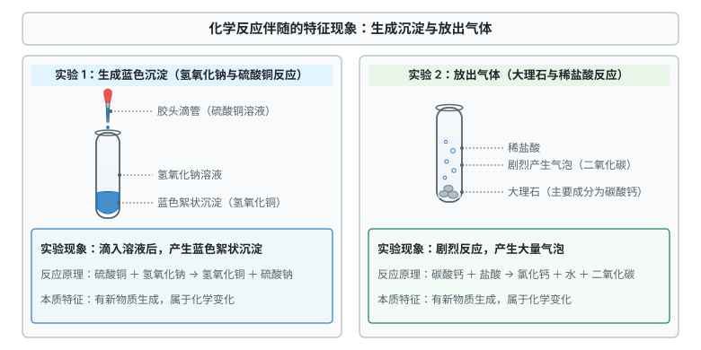
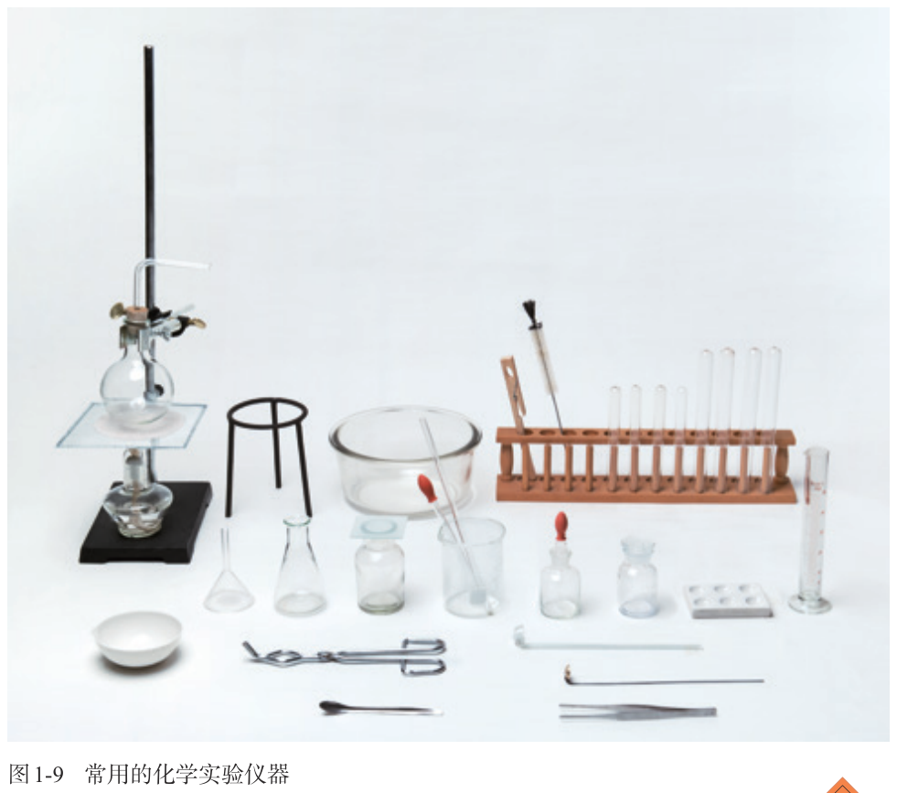
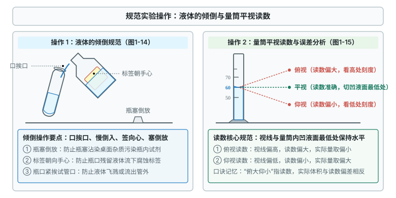

# 第一单元 走进化学世界

这一章先分清物理变化和化学变化，再认识实验仪器、学规范的实验操作，最后了解科学探究的方法。

标着**重点**的三个知识点，中考常考、基础性强，要花最多时间；标着**一般**的，理解控制变量法就行；标着**了解**的，能辨析即可。

## 本章前置自查

本章是起始单元，不需要化学前置知识。用小学科学和生活经验自查：

1. 能辨析常见的形态变化（水结冰、水蒸发只是形态改变，没有变成新物质）。
2. 知道火柴燃烧、食物腐烂、铁器生锈都有新物质产生。
3. 有基本的安全常识（注意用电、明火防烫伤、不碰有毒腐蚀品）。

---

## 1.1a 物理变化与化学变化的判断

```yaml
id: CHEM-9A-01-1a
weight: 重点
weight_note: 7 套卷直接考查 4 次
textbook: 九上 1.1 物质的变化和性质，p.8–11
prerequisites: []
evidence:
  - 能根据“是否有新物质生成”准确判断具体的日常现象或实验过程属于物理变化还是化学变化
  - 能辨析发光、放热、颜色改变、放出气体、生成沉淀等伴随现象与化学变化本质特征的区别
figure: 已完成 figures/chemical-reaction-phenomena.svg（化学反应伴随的特征现象：生成沉淀与放出气体）
sources: [TB9A-1.1, GD2022-01, GZ2024-04]
walk_source: 课本 p.10 实验 1-1 方法
```

### 本次只学

学会根据是否有新物质生成，准确判断一种变化是物理变化还是化学变化。

### 先认住

- **物理变化**：没有新物质生成的变化（矿石粉碎、冰雪融化、海水晒盐）。
- **化学变化**：有新物质生成的变化，又叫**化学反应**（木炭燃烧、钢铁生锈、光合作用）。
- **本质区别**：变化时**是否有新物质生成**。
- **伴随现象**：化学变化常伴随变色、放出气体、生成沉淀，以及放热、吸热、发光；化学变化中往往同时有物理变化（蜡烛燃烧时，石蜡熔化是物理变化，燃烧生成水和二氧化碳是化学变化）。



### 走一遍

任务：分析并判断“水沸腾”和“大理石与稀盐酸反应”分别属于哪种变化。

第一步：看变化前后的物质。水沸腾后变成水蒸气，遇冷凝结仍是水；大理石与稀盐酸反应后生成了二氧化碳气体等新物质。

第二步：判断有没有新物质。水沸腾只是状态改变，没有新物质；大理石与稀盐酸反应生成了新物质二氧化碳等。

第三步：水沸腾是物理变化；大理石与稀盐酸反应是化学变化。

### 容易错

- 发光、放热、变色、产生气体**不一定是化学变化**（电灯通电发光放热、沸水冒气泡都是物理变化）。
- 爆炸不一定是化学变化（火药爆炸是化学变化，气球胀破、车胎爆炸是物理变化）。

### 练一练

- `Q-CHEM-GD2022-01`
- `Q-CHEM-GZ2024-04`

---

## 1.1b 物理性质与化学性质的判断

```yaml
id: CHEM-9A-01-1b
weight: 了解
weight_note: 7 套卷没有直接考查
textbook: 九上 1.1 物质的变化和性质，p.11–12
prerequisites:
  - id: CHEM-9A-01-1a
    strength: hard
    reason: 区分物质在化学变化中表现出来的性质（化学性质）与不需要化学变化表现出的性质（物理性质）。
evidence:
  - 能准确区分描述的是物质的“物理性质”还是“化学性质”
figure: 不需要
sources: [TB9A-1.1]
```

### 先认住

- **化学性质**：在**化学变化中表现出来的性质**（可燃性、助燃性、毒性、腐蚀性、能与酸反应等）。
- **物理性质**：**不需要化学变化就表现出来的性质**（颜色、状态、气味、熔点、沸点、硬度、密度、挥发性、溶解性、导电性等）。
- **性质与变化**：“性质”常用“能、易、会、可以”描述；“变化”是动态过程（“酒精挥发”是物理变化，“酒精易挥发”是物理性质）。

---

## 1.2a 常见化学仪器的识别与用途

```yaml
id: CHEM-9A-01-2a
weight: 重点
weight_note: 7 套卷直接考查 7 次
textbook: 九上 1.2 化学实验与科学探究，p.14–15, 24, 28
prerequisites: []
evidence:
  - 能认出试管、烧杯、量筒、集气瓶、锥形瓶、酒精灯、胶头滴管、漏斗、长颈漏斗、铁架台、托盘天平、蒸发皿等常见仪器并准确写出名称
  - 能准确说出常见仪器的用途、使用禁忌（如能否直接加热、能否作反应容器等）
figure: 已完成 figures/tb9a-1-fig1-9.png（课本图 1-9 原图，放在先认住之后）
sources: [TB9A-1.2, GZ2022-16-1, GD2023-08]
walk_source: 课本 p.28 复习与提高第 7 题的归类方法，仪器范围参照课本 p.15 图 1-9 与附录
```

### 本次只学

认识常用实验仪器的名称、材质、用途和使用注意事项。

### 先认住

- **反应容器**：试管和蒸发皿**能直接加热**（蒸发皿是陶瓷）；烧杯、烧瓶、锥形瓶**垫陶土网加热**；量筒和集气瓶**不能加热**（量筒不能作反应容器，不能溶解或稀释药品）。
- **取用与加液仪器**：胶头滴管吸取和滴加少量液体（垂直悬空在容器口上方，不伸入、不碰壁，不平放、不倒置）；普通漏斗用于过滤；长颈漏斗用于注入液体（装置需气密时，下端管口伸入液面以下形成液封）。
- **量度与称量仪器**：量筒量取液体体积（按分度值读数，视线与凹液面最低处相平）；托盘天平称固体质量（精确到 $0.1\ \mathrm{g}$，左物右码）。
- **加热与支撑仪器**：酒精灯加热（用外焰）；铁架台固定仪器；试管夹夹持试管（从试管底部往上套，夹在距管口约 $\dfrac{1}{3}\sim\dfrac{1}{4}$ 处）。



### 走一遍

任务：按加热特性和容器功能给常见仪器归类。

第一步：按能否加热分。直接加热：试管、蒸发皿；垫陶土网加热：烧杯、锥形瓶；不能加热：量筒、集气瓶。

第二步：按容器功能分。能作反应容器：试管（少量试剂）、烧杯与锥形瓶（较多试剂）；不能作反应容器：量筒。

第三步：看材质。蒸发皿是陶瓷，耐高温；试管、烧杯、量筒是玻璃；坩埚钳是金属。

### 容易错

- 仪器名写错别字（“长颈漏斗”写成“长领漏斗”、“集气瓶”写成“集气屏”、“试管”写成“试官”）。
- 在量筒里反应、配制溶液或稀释浓溶液。

### 练一练

- `Q-CHEM-GZ2022-16-1`
- `Q-CHEM-GD2023-08`

---

## 1.2b 化学实验基本操作与安全规范

```yaml
id: CHEM-9A-01-2b
weight: 重点
weight_note: 7 套卷直接考查 5 次
textbook: 九上 1.2 化学实验与科学探究，p.15–21
prerequisites:
  - id: CHEM-9A-01-2a
    strength: hard
    reason: 认识各种实验仪器的性能与用途是掌握正确实验操作和安全规程的基础。
evidence:
  - 能掌握药品的取用规范（固体块状与粉末、液体倾倒与滴加）、量筒的水平读数及视线偏折误差判断
  - 能掌握酒精灯的正确使用、液体加热的安全要点、仪器连接与装置气密性检查方法
  - 能准确识别实验室安全规范与应急处理方法（护目镜、酒精失火处理、触电防范等）
figure: 已完成 figures/liquid-pouring-and-reading.svg（液体倾倒与量筒平视读数规范示意图）
sources: [TB9A-1.2, GD2023-07, GD2025-10]
walk_source: 课本 p.17 液体的取用与量取、p.18 实验 1-4
```

### 本次只学

掌握药品取用、量筒和酒精灯的使用、仪器连接与气密性检查，以及实验室安全规范。

### 先认住

- **药品取用**：不用手接触药品；不把鼻孔凑到容器口闻气味（用手在瓶口轻轻扇动）；不尝任何药品。取块状固体：容器横放，慢慢竖立；取粉末：用药匙或纸槽送至管底再直立。
- **液体取用与量取**：倾倒时瓶塞倒放、标签朝向手心、瓶口紧挨试管口缓缓倒入；量取时量筒放平，视线与凹液面最低处相平（俯视读数偏大、实际偏小；仰视读数偏小、实际偏大）。
- **酒精灯与加热**：禁止向燃着的酒精灯添加酒精，禁止用燃着的酒精灯引燃另一只；用外焰加热；用灯帽盖灭，不能用嘴吹；酒精在台面燃烧，立即用湿抹布扑盖；加热试管内液体不超过容积的 $\dfrac{1}{3}$，管口不对着人。
- **连接、气密性与安全**：玻璃导管先用水润湿，再稍用力转动插入胶塞；塞橡胶塞要慢慢转动塞进，不能把容器放在桌上使劲塞（会压破）；检查气密性：导管一端浸入水中，手紧握试管外壁，导管口有气泡冒出说明不漏气；仪器洗净的标准：内壁的水既不聚成水滴，也不成股流下；穿实验服、戴护目镜；电器着火不能用水浇；废液倒入指定容器。



### 走一遍

任务：量取 $2\ \mathrm{mL}$ 稀盐酸倒入试管（课本实验 1-4）。

第一步：选量筒。选略大于待量体积且最接近的规格，用 $10\ \mathrm{mL}$ 量筒。

第二步：倒到接近刻度。瓶塞倒放，标签朝向手心，瓶口紧挨量筒口缓缓倾倒，接近 $2\ \mathrm{mL}$ 刻度时停止，立即盖紧瓶塞放回原处。

第三步：滴管定容。量筒平放，改用胶头滴管悬空垂直逐滴滴加，视线与凹液面最低处相平，直到凹液面最低处恰好与 $2\ \mathrm{mL}$ 刻度线相切。

第四步：把盐酸缓缓倒入试管，量筒放回原处。

### 容易错

- 俯仰视混淆：俯视读数**偏大**，实际体积**偏小**；仰视读数**偏小**，实际体积**偏大**。
- 用嘴吹灭酒精灯（火焰可能压入灯内，引起着火或爆炸）。
- 滴管伸入容器或碰壁（污染滴管和整瓶试剂）。

### 练一练

- `Q-CHEM-GD2023-07`
- `Q-CHEM-GD2025-10`

---

## 1.2c 科学探究的基本环节与方法

```yaml
id: CHEM-9A-01-2c
weight: 一般
weight_note: 7 套卷直接考查 2 次
textbook: 九上 1.2 化学实验与科学探究，p.21–23
prerequisites:
  - id: CHEM-9A-01-2b
    strength: soft
    reason: 具备规范的实验操作技能有助于科学探究实验的顺利实施。
evidence:
  - 能理解科学探究的基本环节（提出问题、猜想与假设、设计实验、进行实验、收集证据、解释与结论、反思与评价、表达与交流）
  - 能在对比实验中准确识别变量，运用控制变量法分析实验数据并得出合理结论
figure: 不需要
sources: [TB9A-1.2, GZ2022-20-2]
```

### 本次只学

理解科学探究的基本环节，会用控制变量法设计实验、分析数据。

### 先认住

- **探究环节**：**补充**（课本没讲，真题常用）：提出问题 $\rightarrow$ 猜想与假设 $\rightarrow$ 设计实验方案 $\rightarrow$ 进行实验 $\rightarrow$ 收集证据 $\rightarrow$ 解释与结论 $\rightarrow$ 反思与评价 $\rightarrow$ 表达与交流。课本强调：先用观察和实验获取证据，再分析推理得出结论。
- **控制变量法**：探究某个因素的影响时，**其他条件保持相同**，只改变这一个因素（单一变量）。
- **证据与结论**：现象和数据是客观证据；结论必须由数据归纳、推理得出，言之有据。

### 容易错

- 对比实验有两个以上变量不同，就得不出单一变量的结论（两组只能有一个变量不同）。
- 混淆现象与结论（现象是看到、听到、测到的事实；结论是分析后的推论）。

### 练一练

- `Q-CHEM-GZ2022-20-2`
