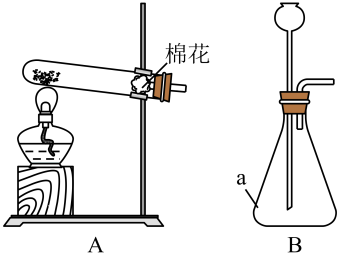

# 第一单元 走进化学世界 · 题目

讲义只用 `lesson.md` 里引用的题，按知识点顺序排在前面。

---

## 讲义用题（7 道）

### Q-CHEM-GD2022-01

```yaml
category: 真题
source: 2022 年广东省初中学业水平考试 化学 第 1 题
source_quality: 原卷
kp: CHEM-9A-01-1a
type: 选择
grading: 自动
answer_by: 原卷解析
review:
  概念: CHEM-9A-01-1a
```

**题干**

下列涉及化学变化的是（　　）

A. 光合作用
B. 冰雪融化
C. 海水蒸发
D. 溪水流淌

**答案**

A

**解析**

1. A 项：光合作用过程中，植物吸收二氧化碳和水，生成有机物和氧气，有新物质生成，属于化学变化，符合题意。
2. B 项：冰雪融化过程中，水由固态变为液态，只是状态发生改变，无新物质生成，属于物理变化，不符合题意。
3. C 项：海水蒸发过程中，水由液态变为气态，只是状态发生改变，无新物质生成，属于物理变化，不符合题意。
4. D 项：溪水流淌过程中，只是水的位置移动，无新物质生成，属于物理变化，不符合题意。
故选 A。

---

### Q-CHEM-GZ2024-04

```yaml
category: 真题
source: 2024 年广州市初中学业水平考试 化学 第 4 题
source_quality: 原卷
kp: CHEM-9A-01-1a
type: 选择
grading: 自动
answer_by: 原卷解析
review:
  概念: CHEM-9A-01-1a
```

**题干**

下列过程不属于化学变化的是（　　）

A. 用盐酸除去铁钉表面的铁锈
B. 用过氧化氢制得氧气
C. 用蒸馏法将海水淡化制得蒸馏水
D. 用液氢作燃料推进长征系列运载火箭

**答案**

C

**解析**

1. A 项：用盐酸除去铁钉表面的铁锈，铁锈与盐酸反应生成了不同于铁锈的新物质，有新物质生成，属于化学变化，不符合题意。
2. B 项：用过氧化氢制得氧气，过氧化氢在二氧化锰催化下分解生成水和氧气，有新物质生成，属于化学变化，不符合题意。
3. C 项：蒸馏法将海水淡化制得蒸馏水，是利用液体沸点不同通过加热汽化和冷凝使水与杂质分离，没有新物质生成，属于物理变化，符合题意。
4. D 项：用液氢作燃料推进长征系列运载火箭，氢气与氧气点燃反应生成水，有新物质生成，属于化学变化，不符合题意。
故选 C。

---

### Q-CHEM-GZ2022-16-1

```yaml
category: 真题
source: 2022 年广州市初中学业水平考试 化学 第 16 题第（1）问
source_quality: 原卷
kp: CHEM-9A-01-2a
do: 本章只做第（1）问
other_parts:
  第（2）问: CHEM-9A-04-2c 单质、化合物与氧化物的判断
  第（3）问: CHEM-9A-06-1b 碳单质的化学性质；CHEM-9A-06-2b 一氧化碳的性质与毒性
  第（4）问: CHEM-9A-06-2b 一氧化碳的性质与毒性
type: 选择
grading: 自动
answer_by: 原卷解析
review:
  概念: CHEM-9A-01-2a
```

**题干**

陶瓷是火与土的结晶，是中华民族文化的象征之一。

下列中学实验室常见用品中，材质为陶瓷的是（　　）（填标号）。

A. 烧杯
B. 集气瓶
C. 蒸发皿
D. 坩埚钳

**答案**

C

**解析**

1. A 项：烧杯由玻璃材质制成，不符合题意。
2. B 项：集气瓶由玻璃材质制成，不符合题意。
3. C 项：蒸发皿由陶瓷材质制成，符合题意。
4. D 项：坩埚钳由金属材料制成，不符合题意。
故选 C。

---

### Q-CHEM-GD2023-08

```yaml
category: 真题
source: 2023 年广东省初中学业水平考试 化学 第 8 题
source_quality: 原卷
kp: CHEM-9A-01-2a
type: 选择
grading: 自动
answer_by: 原卷解析
review:
  概念: CHEM-9A-01-2a
```

**题干**

项目学习小组在实验室将树叶放入溶质质量分数为 10% 的 $\ce{NaOH}$ 溶液中煮沸，叶肉变黄时取出，洗刷干净后制成叶脉书签。回答下列问题。

配制 $\ce{NaOH}$ 溶液不需用到的仪器是（　　）

A. 烧杯
B. 量筒
C. 漏斗
D. 玻璃棒

**答案**

C

**解析**

1. A 项：配制氢氧化钠溶液时，溶解固体药品需要使用烧杯作为容器，需要用到烧杯。
2. B 项：配制溶液量取水时需要使用量筒，需要用到量筒。
3. C 项：漏斗主要用于过滤分离固液混合物，配制溶液过程中不需要过滤，因此不需用到漏斗。
4. D 项：溶解固体时需要用玻璃棒搅拌加速溶解，需要用到玻璃棒。
故选 C。

---

### Q-CHEM-GD2023-07

```yaml
category: 真题
source: 2023 年广东省初中学业水平考试 化学 第 7 题
source_quality: 原卷
kp: CHEM-9A-01-2b
type: 选择
grading: 自动
answer_by: 原卷解析
review:
  概念: CHEM-9A-01-2b
```

**题干**

实验要有安全意识。下列行为正确的是（　　）

A. 在实验室吃零食
B. 在实验室追打闹
C. 穿实验服和护目镜
D. 将药品带出实验室

**答案**

C

**解析**

1. A 项：实验室中很多化学药品有毒或有腐蚀性，可能污染食物造成中毒，禁止在实验室吃零食，行为错误。
2. B 项：在实验室追逐打闹容易碰撞摔倒或打翻仪器药品引发安全事故，禁止打闹，行为错误。
3. C 项：进行实验时穿好实验服、戴好护目镜，能保护身体和眼睛免受试剂溅射伤害，符合安全规范，行为正确。
4. D 项：实验室药品大多具有危险性，严禁私自将药品带出实验室，行为错误。
故选 C。

---

### Q-CHEM-GD2025-10

```yaml
category: 真题
source: 2025 年广东省初中学业水平考试 化学 第 10 题
source_quality: 原卷
kp: CHEM-9A-01-2b
type: 选择
grading: 自动
answer_by: 原卷解析
review:
  概念: CHEM-9A-01-2b
```

**题干**

实验安全无小事。下列行为不符合安全规范的是（　　）

A. 实验过程中戴好护目镜
B. 用灯帽盖灭酒精灯
C. 将废液倒入指定容器内
D. 电器着火用水浇灭

**答案**

D

**解析**

1. A 项：实验过程中戴好护目镜，可防止液体飞溅、固体颗粒迸溅等对眼睛造成伤害，符合安全规范。
2. B 项：用灯帽盖灭酒精灯，能隔绝空气使火焰熄灭，切不可用嘴吹灭，符合安全规范。
3. C 项：将废液倒入指定容器内集中处理，可防止腐蚀管道和污染环境，符合安全规范。
4. D 项：电器着火不能用水浇灭，因为水能导电，容易引发触电事故，且可能损坏电器设备；应先切断电源，再用二氧化碳或干粉灭火器扑灭，不符合安全规范。
故选 D。

---

### Q-CHEM-GZ2022-20-2

```yaml
category: 真题
source: 2022 年广州市初中学业水平考试 化学 第 20 题第（2）问
source_quality: 原卷
kp: CHEM-9A-01-2c
do: 本章只做第（2）问
other_parts:
  第（1）问: CHEM-9A-01-2a 常见化学仪器的识别与用途
  第（3）问: CHEM-9A-01-2c 科学探究的基本环节与方法
type: 探究
grading: 自评
answer_by: 原卷解析
review:
  概念: CHEM-9A-01-2c
  审题: CHEM-9A-01-2c
```

**题干**

某化学兴趣小组研究影响化学反应快慢的因素。

该小组的实验设计和数据记录如下表。每个实验均在反应开始后，就立即用排水法连续收集多瓶 $\ce{CO2}$，表中“—”表示气泡太少，不再收集。

| 序号 | 盐酸浓度 | 盐酸体积 | 大理石形状 | 第 1 瓶 | 第 2 瓶 | 第 3 瓶 | 第 4 瓶 | 第 5 瓶 | 第 6 瓶 |
| :---: | :---: | :---: | :---: | :---: | :---: | :---: | :---: | :---: | :---: |
| 实验 1 | $10\%$ | $70\ \mathrm{mL}$ | 小颗粒 | 8 | 9 | 10 | 12 | 14 | 19 |
| 实验 2 | $10\%$ | $70\ \mathrm{mL}$ | 块状 | 11 | 12 | 15 | 17 | 21 | 23 |
| 实验 3 | $7.5\%$ | $70\ \mathrm{mL}$ | 小颗粒 | 10 | 12 | 13 | 15 | 17 | 26 |
| 实验 4 | $7.5\%$ | $70\ \mathrm{mL}$ | 块状 | $t$ | 14 | 16 | 19 | 22 | 24 |
| 实验 5 | $5\%$ | $70\ \mathrm{mL}$ | 小颗粒 | 14 | 18 | 19 | 32 | 63 | — |
| 实验 6 | $5\%$ | $70\ \mathrm{mL}$ | 块状 | 20 | 31 | 59 | — | — | — |

① 该小组研究了哪些因素对反应快慢的影响？_______
② 为了分析浓度对反应快慢的影响，可对比表中实验_______（填标号）。
A. 2 和 3    B. 2 和 4    C. 4 和 5    D. 1 和 6
③ 根据实验数据反映出的规律，表中数值 $t$ 的合理范围是：_______$<t<$_______。

**答案**

① 盐酸浓度和大理石的形状
② B
③ 11；14

**解析**

1. ① 小问：根据表格中的实验方案设计，各组实验中盐酸的浓度（$10\%$、$7.5\%$、$5\%$）以及大理石的形状（小颗粒、块状）不同，因此该小组研究的是盐酸浓度和大理石的形状对反应快慢的影响。
2. ② 小问：根据控制变量法的单一变量原则，要分析盐酸浓度对反应快慢的影响，必须保证大理石形状和加入盐酸体积完全相同。对比实验 2 和 4，大理石形状均为块状、盐酸体积均为 $70\ \mathrm{mL}$，唯一的变量是盐酸浓度（$10\%$ 与 $7.5\%$），符合控制变量要求，故选 B。
3. ③ 小问：对比实验 1 和 2 可知，盐酸浓度相同时，块状大理石反应收集第 1 瓶的时间大于小颗粒（$11\ \mathrm{s} > 8\ \mathrm{s}$），同理对比实验 3 和 4 可知，在 $7.5\%$ 盐酸下，块状大理石收集第 1 瓶时间 $t$ 必然大于小颗粒的收集时间（$t > 10\ \mathrm{s}$）；同时，大理石形状相同时，浓度越低反应越慢，收集所需时间越长，因此块状大理石在 $7.5\%$ 盐酸下的时间 $t$ 必然大于在 $10\%$ 盐酸下的时间 $11\ \mathrm{s}$（即 $t > 11$）；另外由于反应随盐酸逐渐消耗浓度降低，收集同一浓度下后续第 2 瓶气体的用时必定长于第 1 瓶（实验 4 收集第 2 瓶用时 $14\ \mathrm{s}$），所以第 1 瓶用时必定小于第 2 瓶，即 $t < 14$。综上分析，$t$ 的合理范围为 $11 < t < 14$。

---

## 备选（8 道）

### Q-CHEM-GD2023-17-2

```yaml
category: 真题
source: 2023 年广东省初中学业水平考试 化学 第 17 题第（2）问
source_quality: 原卷
kp: CHEM-9A-01-1a
do: 本章只做第（2）问
other_parts:
  第（1）问: CHEM-9A-04-1a 爱护水资源与节约用水
  第（3）问: CHEM-9A-04-1b 水的净化方法与自来水生产流程
  第（4）问: CHEM-9A-06-1a 碳单质的物理性质与微观结构
  第（5）问: CHEM-9A-04-1a 爱护水资源与节约用水
type: 填空
grading: 自评
answer_by: 原卷解析
review:
  概念: CHEM-9A-01-1a
  审题: CHEM-9A-01-1a
```

**题干**

地球是一个美丽的“水球”，表面约 71% 被水覆盖，淡水仅占总水量的 2.5%；其余是海水或咸水。海水淡化是解决人类淡水资源短缺的有效措施。

海水淡化技术主要有热分离法和膜分离法，热分离法利用蒸发和冷凝分离水与非挥发性物质，能耗大，成本高；膜分离法利用薄膜的选择透过性实现海水淡化。

依据上文，回答下列问题。

（2）热分离法中，水发生了________（填“物理变化”或“化学变化”）。限制热分离法大规模应用的原因是________________________________。

**答案**

物理变化；能耗大，成本高

**解析**

1. 第一空：热分离法利用蒸发使液态水汽化为水蒸气，再通过冷凝将水蒸气液化为淡水，整个过程中水仅发生形态和状态的变化，没有生成新物质，属于物理变化。
2. 第二空：由短文材料“热分离法利用蒸发和冷凝分离水与非挥发性物质，能耗大，成本高”可知，限制热分离法大规模应用的原因是能耗大，成本高。

---

### Q-CHEM-GD2025-03

```yaml
category: 真题
source: 2025 年广东省初中学业水平考试 化学 第 3 题
source_quality: 原卷
kp: CHEM-9A-01-1a
type: 选择
grading: 自动
answer_by: 原卷解析
review:
  概念: CHEM-9A-01-1a
```

**题干**

冬至时节，有“北方吃饺子，南方吃汤圆”的习俗。下列说法错误的是（　　）

A. 饺子皮所含淀粉属于糖类
B. 饺子馅所用肉类含蛋白质
C. 煮汤圆时只发生化学变化
D. 汤圆可以为人体提供能量

**答案**

C

**解析**

1. A 项：淀粉是多糖，属于糖类，是人体主要供能物质，说法正确。
2. B 项：瘦肉等肉类中富含蛋白质，是构成人体细胞的基础物质，说法正确。
3. C 项：煮汤圆时，汤圆受热吸水膨胀变软，主要是物理变化；同时馅料受热也发生复杂的化学转化，因此既发生物理变化也发生化学变化，“只发生化学变化”说法错误。
4. D 项：汤圆含有淀粉、油脂等营养物质，在人体内经氧化分解释放能量，可为人体提供能量，说法正确。
故选 C。

---

### Q-CHEM-GD2022-18-1

```yaml
category: 真题
source: 2022 年广东省初中学业水平考试 化学 第 18 题第（1）问
source_quality: 原卷
kp: CHEM-9A-01-2a
do: 本章只做第（1）问
other_parts:
  第（2）问: CHEM-9A-02-3b 实验室制取氧气的反应原理与工业制法
  第（3）问: 九下酸碱内容（地图未录入）
  第（4）问: 九下酸碱内容（地图未录入）
type: 填空
grading: 自评
answer_by: 原卷解析
review:
  概念: CHEM-9A-01-2a
```

**题干**

具备基本化学实验技能是学习化学的基础和保证。在化学实验操作考试中，小明和小英分别抽取了 I、II 两组试题。可供选择的实验药品有大理石、$\ce{KClO3}$、$\ce{MnO2}$、稀盐酸、$\ce{NaOH}$ 溶液、$\ce{H2O2}$ 溶液、酚酞溶液、石蕊溶液等，相关实验装置如图所示。


I 组：$\ce{O2}$ 和 $\ce{CO2}$ 的实验室制取

（1）仪器 a 的名称是______。

**答案**

试管

**解析**

仪器 a 是常用的反应容器，名称为试管。

---

### Q-CHEM-GD2023-18-1

```yaml
category: 真题
source: 2023 年广东省初中学业水平考试 化学 第 18 题第（1）问第 i 小问
source_quality: 原卷
kp: CHEM-9A-01-2a
do: 本章只做第（1）问第 i 小问
other_parts:
  第（1）问 ii: CHEM-9A-02-3b 实验室制取氧气的反应原理与工业制法
  第（1）问 iii: CHEM-9A-02-2a 氧气的化学性质与燃烧现象
  第（2）问: CHEM-9A-05-1a 质量守恒定律及其微观解释
type: 填空
grading: 自评
answer_by: 原卷解析
review:
  概念: CHEM-9A-01-2a
```

**题干**

回答下列问题。

（1）实验室制取 $\ce{O2}$ 及性质检验



i. 上图中仪器 a 的名称是__________。

**答案**

锥形瓶

**解析**

图中仪器 a 具有平底和锥形颈部，常用作反应容器，名称是锥形瓶。

---

### Q-CHEM-GD2024-07

```yaml
category: 真题
source: 2024 年广东省初中学业水平考试 化学 第 7 题
source_quality: 原卷
kp: CHEM-9A-01-2a
type: 选择
grading: 自动
answer_by: 原卷解析
review:
  概念: CHEM-9A-01-2a
```

**题干**

用质量分数为 37% 的盐酸配制 10% 的稀盐酸，不需要用到的仪器是（　　）

A. 玻璃棒
B. 烧杯
C. 量筒
D. 酒精灯

**答案**

D

**解析**

1. 配制稀盐酸是用浓溶液加水稀释，需要用量筒量取浓盐酸和水，倒入烧杯中，并用玻璃棒搅拌均匀。
2. 整个稀释配制过程不需要加热，因此不需要用到酒精灯。
故选 D。

---

### Q-CHEM-GZ2024-20-1

```yaml
category: 真题
source: 2024 年广州市初中学业水平考试 化学 第 20 题第（1）问
source_quality: 原卷
kp: CHEM-9A-01-2a
do: 本章只做第（1）问
other_parts:
  第（2）问: CHEM-9A-04-3c 基于化学式的定量计算
  第（3）问: CHEM-9A-01-2c 科学探究的基本环节与方法
  第（4）问: CHEM-9A-04-1b 水的净化方法与自来水生产流程
  第（5）问: 本轮不收（涉及酸性对净水效果的探究，属九下内容）
  第（6）问: CHEM-9A-04-1b 水的净化方法与自来水生产流程
  第（7）问: CHEM-9A-04-1c 过滤操作与硬水软化
type: 填空
grading: 自评
answer_by: 本项目编写，待复核
review:
  概念: CHEM-9A-01-2a
```

**题干**

学习小组进行水质调查时发现某池塘水较浑浊，为此开展水质研究。

【查阅资料】
① 明矾溶于水生成的 $\ce{Al(OH)3}$ 胶体，能吸附水中悬浮物，发生沉降，从而达到净水目的。
② $\ce{Al(OH)3}$ 胶体能溶于酸。
③ 净水效果可用浊度去除率 $A$ 表示，$A$ 值越大表示净水效果越好。

I. 探究影响明矾净水效果的因素
【提出猜想】猜想 a：一定范围内，明矾的用量越大，净水效果越好。
猜想 b：一定范围内，水样的酸性越强，净水效果越差。
【实验准备】配制絮凝剂溶液和稀硫酸
（1）用明矾配制 $100\ \mathrm{mL}$ 质量分数为 1% 的絮凝剂溶液（密度取 $1.0\ \mathrm{g/cm^3}$），需用到的玻璃仪器除了量筒、烧杯、胶头滴管外，还需要________。

**答案**

玻璃棒

**解析**

用固体明矾配制溶液时，固体溶解需要使用玻璃棒搅拌加速溶解，因此需用到的玻璃仪器除了量筒、烧杯、胶头滴管外，还需要玻璃棒。托盘天平和药匙是称固体用的，不属于玻璃仪器。

---

### Q-CHEM-GD2024-08

```yaml
category: 真题
source: 2024 年广东省初中学业水平考试 化学 第 8 题
source_quality: 原卷
kp: CHEM-9A-01-2b
type: 选择
grading: 自动
answer_by: 原卷解析
review:
  概念: CHEM-9A-01-2b
```

**题干**

“体验蛋雕艺术，传承非遗文化”。兴趣小组用化学方法制作蛋雕：将蛋壳在熔化的石蜡中裹上蜡衣，用金属丝划穿蜡衣雕“花”，吸取适量 10% 的稀盐酸滴在划痕处，一段时间后，放入热水中熔去多余的蜡，做成蛋雕作品。回答下列问题。

关于蛋雕制作说法正确的是（　　）

A. 石蜡熔化属于化学变化
B. 盐酸有腐蚀性，要做好防护
C. 石蜡能与盐酸发生化学反应
D. 盐酸滴到蛋壳上有氢气生成

**答案**

B

**解析**

1. A 项：石蜡熔化只是状态由固态变为液态，没有新物质生成，属于物理变化，说法错误。
2. B 项：盐酸有腐蚀性，操作使用时需做好防护，说法正确。
3. C 项：石蜡化学性质稳定，不与稀盐酸发生化学反应，正是利用其耐酸性质作为保护涂层，说法错误。
4. D 项：蛋壳的主要成分是碳酸钙，盐酸滴在蛋壳上反应生成氯化钙、水和二氧化碳气体，而不是氢气，说法错误。
故选 B。

---

### Q-CHEM-GZ2024-20-3

```yaml
category: 真题
source: 2024 年广州市初中学业水平考试 化学 第 20 题第（3）问
source_quality: 原卷
kp: CHEM-9A-01-2c
do: 本章只做第（3）问
other_parts:
  第（1）问: CHEM-9A-01-2a 常见化学仪器的识别与用途
  第（2）问: CHEM-9A-04-3c 基于化学式的定量计算
  第（4）问: CHEM-9A-04-1b 水的净化方法与自来水生产流程
  第（5）问: 本轮不收（涉及酸性对净水效果的探究，属九下内容）
  第（6）问: CHEM-9A-04-1b 水的净化方法与自来水生产流程
  第（7）问: CHEM-9A-04-1c 过滤操作与硬水软化
type: 探究
grading: 自评
answer_by: 原卷解析
review:
  概念: CHEM-9A-01-2c
  审题: CHEM-9A-01-2c
```

**题干**

学习小组进行水质调查时发现某池塘水较浑浊，为此开展水质研究。

【查阅资料】
① 明矾溶于水生成的 $\ce{Al(OH)3}$ 胶体，能吸附水中悬浮物，发生沉降，从而达到净水目的。
② $\ce{Al(OH)3}$ 胶体能溶于酸。
③ 净水效果可用浊度去除率 $A$ 表示，$A$ 值越大表示净水效果越好。

I. 探究影响明矾净水效果的因素
【提出猜想】猜想 a：一定范围内，明矾的用量越大，净水效果越好。
猜想 b：一定范围内，水样的酸性越强，净水效果越差。
【设计实验，验证猜想】取该水样，按下列实验方案加入试剂后，充分搅拌，静置 $t\ \mathrm{min}$，测定水样的浊度并计算得到浊度去除率，记录数据。

| 实验序号 | 水样体积 $/ \mathrm{mL}$ | $1\%$ 絮凝剂溶液体积 $/ \mathrm{mL}$ | $9.8\%$ 硫酸体积 $/ \mathrm{mL}$ | 蒸馏水体积 $/ \mathrm{mL}$ | $t\ \mathrm{min}$ 后浊度去除率 |
| :---: | :---: | :---: | :---: | :---: | :---: |
| i | 200 | 5.0 | 0 | 5.0 | $A_1$ |
| ii | 200 | $V_1$ | 0 | 7.5 | $A_2$ |
| iii | 200 | 0 | 0 | $V_2$ | $A_3$ |
| iv | 200 | 5.0 | 2.0 | 3.0 | $A_4$ |
| v | 200 | 5.0 | 5.0 | 0 | $A_5$ |

【数据分析，交流讨论】
（3）实验 i、ii、iii 用于探究猜想 a 是否成立，则 $V_1=$________，$V_2=$________。

**答案**

2.5；10.0

**解析**

1. 探究猜想 a（明矾用量对净水效果的影响），根据控制变量法的单一变量原则，除絮凝剂溶液体积这一变量外，其他各影响因素（水样体积、加入液体总体积、硫酸用量）必须保持严格相同。
2. 三组实验水样体积均为 $200\ \mathrm{mL}$，均未加入稀硫酸；实验 i 中加入絮凝剂溶液 $5.0\ \mathrm{mL}$、蒸馏水 $5.0\ \mathrm{mL}$，加入液体总体积为 $10.0\ \mathrm{mL}$。因此实验 ii 和 iii 中加入液体总体积也必须为 $10.0\ \mathrm{mL}$。
3. 实验 ii 中加入蒸馏水 $7.5\ \mathrm{mL}$，则絮凝剂溶液体积 $V_1 = 10.0 - 7.5 = 2.5\ \mathrm{mL}$；实验 iii 中未加絮凝剂溶液，则蒸馏水体积 $V_2 = 10.0\ \mathrm{mL}$。
