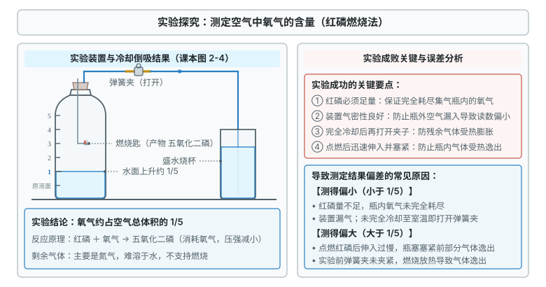
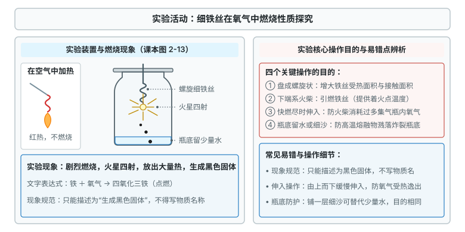
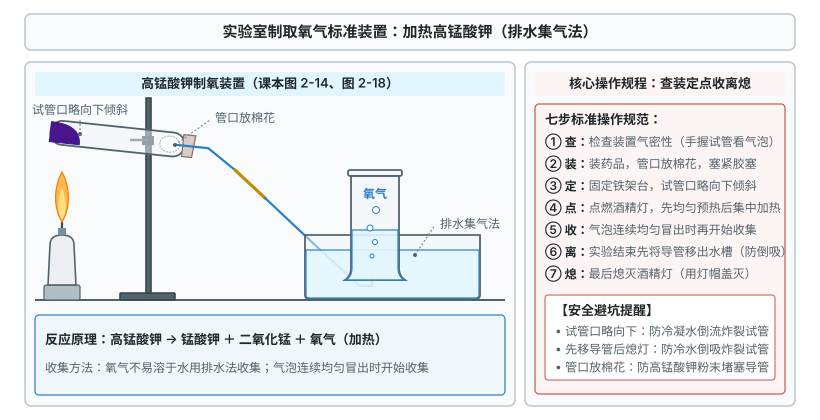

# 第二单元 空气和氧气

这一章先认识空气的组成，再学氧气的性质和反应类型，最后学实验室制取氧气。

标着**重点**的化合反应与氧化反应，中考几乎每年都考，要花最多时间；标着**一般**的，记牢现象、原理和操作步骤就行。

## 本章前置自查

开始本单元前，确保自己已掌握以下几件事：

1. 区分物理变化与化学变化：化学变化有新物质生成。（第一单元 课题1）
2. 区分物理性质与化学性质：颜色、状态、气味、密度、熔沸点、溶解性是物理性质。（第一单元 课题1）
3. 说出常见仪器的名称和用途（试管、集气瓶、酒精灯、铁架台、导管、水槽等）。（第一单元 课题2）
4. 会取用药品、加热固体和液体、检查装置气密性。（第一单元 课题2）

---

## 2.1a 空气的组成与测定空气中氧气含量

```yaml
id: CHEM-9A-02-1a
weight: 了解
weight_note: 7 套卷没有直接考查
textbook: 九上 2.1 我们周围的空气，p.30–33
prerequisites:
  - id: CHEM-9A-01-1a
    strength: hard
    reason: 运用红磷燃烧消耗密闭集气瓶中氧气生成五氧化二磷的化学变化。
  - id: CHEM-9A-01-2b
    strength: hard
    reason: 掌握红磷点燃、密闭集气瓶与打开止水夹等规范实验操作。
evidence:
  - 能准确说出空气的主要成分及其体积分数（氮气约 78%、氧气约 21%）
  - 能说出红磷燃烧测定空气中氧气含量的实验原理、现象及产生误差的原因
figure: 已完成 figures/air-oxygen-content.svg（测定空气中氧气含量的装置与水倒吸示意图）
sources: [TB9A-2.1]
```

### 先认住

- **空气的成分**（体积分数，不是质量分数）：氮气 $78\%$、氧气 $21\%$、稀有气体 $0.94\%$、二氧化碳 $0.04\%$、其他气体和杂质 $0.02\%$。
- **测定氧气含量的原理**：红磷在密闭集气瓶中燃烧，耗尽氧气，生成固体五氧化二磷（$\text{红磷} + \text{氧气} \xrightarrow{\text{点燃}} \text{五氧化二磷}$）。冷却后瓶内压强减小，水倒吸，进入水的体积约占原空气体积的 $\dfrac{1}{5}$，说明氧气约占空气总体积的 $\dfrac{1}{5}$。
- **成功的关键**：红磷足量（耗尽氧气）；气密性良好（防止外界气体漏入）；点燃后迅速伸入瓶内并塞紧胶塞（防止瓶内气体受热逸出，测得值偏大）；冷却至室温再打开弹簧夹（否则气体仍膨胀，进入的水偏少）。



### 练一练

- `Q-CHEM-GZ2020-04`

---

## 2.1b 纯净物与混合物的区分

```yaml
id: CHEM-9A-02-1b
weight: 一般
weight_note: 7 套卷直接考查 3 次
textbook: 九上 2.1 我们周围的空气，p.32–34
prerequisites:
  - id: CHEM-9A-02-1a
    strength: hard
    reason: 从空气由氮气、氧气等多种物质组成的宏观事实引出纯净物与混合物的分类概念。
evidence:
  - 能区分纯净物和混合物，并能举出常见生活实例
  - 能辨析具有迷惑性的物质类别（如洁净的空气是混合物、冰水混合物是纯净物）
figure: 不需要
sources: [TB9A-2.1, GD2022-03, GZ2024-03]
```

### 本次只学

学会根据物质的宏观组成区分纯净物与混合物。

### 先认住

- **纯净物**：只由一种物质组成，有固定的组成和性质，可以用专门的化学符号表示。例如：氧气（$\ce{O2}$）、氮气（$\ce{N2}$）、二氧化碳（$\ce{CO2}$）、水、红磷、五氧化二磷、冰水混合物（冰和水是同一种物质）。
- **混合物**：由两种或两种以上物质混合而成，没有固定的组成，各成分保持原有性质，不能用专门的化学符号表示。例如：空气、自来水、矿泉水、汽水、食醋、生铁、合金。
- **判断方法**：只含一种物质是纯净物，含两种或两种以上是混合物。

### 容易错

- “洁净的空气”“纯净的矿泉水”望文生义当纯净物（都含多种物质，是混合物）。
- “冰水混合物”当混合物（冰和水都是水，是纯净物）。

### 练一练

- `Q-CHEM-GD2022-03`

---

## 2.1c 空气成分的性质用途与保护

```yaml
id: CHEM-9A-02-1c
weight: 一般
weight_note: 7 套卷直接考查 3 次
textbook: 九上 2.1 我们周围的空气，p.34–37
prerequisites:
  - id: CHEM-9A-02-1a
    strength: hard
    reason: 认识空气中各组分气体的存在是理解其性质用途与防范大气污染的前提。
evidence:
  - 能列举氧气、氮气和稀有气体在生产生活中的主要用途
  - 能说出常见空气污染物，知道二氧化碳不属于空气污染物，树立保护大气环境的意识
figure: 不需要
sources: [TB9A-2.1, GZ2023-03, GZ2024-05]
```

### 本次只学

了解氧气、氮气、稀有气体的主要性质与用途，掌握空气污染物的范围及防治措施。

### 先认住

- **空气各成分的主要用途**：
  - 氧气：供给呼吸（医疗急救、潜水、登山）、支持燃烧（炼钢、气焊、航天助燃）。
  - 氮气：化学性质不活泼，用作保护气（食品包装充氮防腐、灯泡充氮）；制硝酸和化肥的原料；液氮用于超导材料冷冻和医疗冷冻麻醉。
  - 稀有气体（氦、氖、氩、氪、氙）：化学性质很不活泼，用作保护气；通电发出不同颜色的光，用于霓虹灯等电光源；氦气密度小且稳定，用于充填气球和飞艇。
- **空气污染物**：有害气体（二氧化硫 $\ce{SO2}$、一氧化碳 $\ce{CO}$、二氧化氮 $\ce{NO2}$、臭氧 $\ce{O3}$）和烟尘（$\text{PM}_{10}$、$\text{PM}_{2.5}$）。二氧化硫和二氧化氮是形成酸雨的主要原因。
- **二氧化碳**（$\ce{CO2}$）：空气的天然成分，是光合作用的原料；过多会加剧温室效应，但**不属于**空气质量监测的污染物。

### 容易错

- 把二氧化碳当空气污染物（它是温室气体，但不计入污染物项目）。
- 以为呼出的气体只有二氧化碳（含量最多的仍是氮气，只是比吸入的空气氧气少、二氧化碳和水蒸气多）。

### 练一练

- `Q-CHEM-GZ2023-03`

---

## 2.2a 氧气的化学性质与燃烧现象

```yaml
id: CHEM-9A-02-2a
weight: 一般
weight_note: 7 套卷直接考查 1 次
textbook: 九上 2.2 氧气，p.38–41、p.49、p.53
prerequisites:
  - id: CHEM-9A-01-1a
    strength: hard
    reason: 依据燃烧生成新物质判断木炭、硫、铁丝与氧气发生的化学变化。
  - id: CHEM-9A-01-2b
    strength: hard
    reason: 严格遵循用坩埚钳夹持、铁丝底部系火柴引燃、瓶底留水或细沙等安全操作规范。
evidence:
  - 能准确描述木炭、硫、细铁丝在空气和氧气中燃烧的实验现象
  - 能说明木炭、硫、铁丝燃烧实验中操作细节的目的（如瓶底留水或细沙的作用）
figure: 已完成 figures/iron-wire-combustion.svg（细铁丝在氧气中燃烧实验装置与现象示意图）
sources: [TB9A-2.2]
```

### 本次只学

掌握氧气的物理性质与化学性质，学会准确描述常见物质在氧气中燃烧的实验现象与操作细节。

### 先认住

- **氧气的物理性质与检验**：无色、无臭，密度比空气略大，不易溶于水（$1\ \mathrm{L}$ 水约溶 $30\ \mathrm{mL}$ 氧气）。能使带火星的木条复燃，用来检验氧气。
- **常见单质在氧气中燃烧**：
  - 木炭：剧烈燃烧，发出白光，放出热量，生成能使澄清石灰水变浑浊的无色气体（文字表达式：$\text{碳} + \text{氧气} \xrightarrow{\text{点燃}} \text{二氧化碳}$）。
  - 硫：剧烈燃烧，发出明亮的**蓝紫色火焰**（在空气中为微弱的淡蓝色火焰），放出热量，生成具有**刺激性气味的气体**（文字表达式：$\text{硫} + \text{氧气} \xrightarrow{\text{点燃}} \text{二氧化硫}$）。
  - 细铁丝：剧烈燃烧，**火星四射**，放出大量热，生成**黑色固体**（文字表达式：$\text{铁} + \text{氧气} \xrightarrow{\text{点燃}} \text{四氧化三铁}$）。
- **操作要点**：
  - 硫：瓶底预先放少量水或氢氧化钠溶液，吸收二氧化硫，防止污染空气。
  - 铁丝：盘成螺旋状（增大受热面积）；末端系火柴（引燃）；火柴快燃尽时伸入瓶内（防止火柴消耗过多氧气）；瓶底留少量水或铺细沙（防止高温熔融物溅落炸裂瓶底）。



### 容易错

- 把现象写成生成物名称（“生成黑色固体”写成“生成四氧化三铁”，“生成有刺激性气味的气体”写成“生成二氧化硫”）。
- 混淆“烟”与“雾”：烟是固体微粒（红磷燃烧产生白烟），雾是小液滴。

### 练一练

- `Q-CHEM-TB9A-2.2-3`
- `Q-CHEM-GD2019-19-1`

---

## 2.2b 化合反应与氧化反应

```yaml
id: CHEM-9A-02-2b
weight: 重点
weight_note: 7 套卷直接考查 4 次
textbook: 九上 2.2 氧气，p.41–42
prerequisites:
  - id: CHEM-9A-02-2a
    strength: hard
    reason: 从氧气与多种单质燃烧生成一种物质的反应特征中抽象归纳出“多变一”的化合反应。
evidence:
  - 能根据反应物和生成物的种数判断化合反应（多变一）
  - 能判断氧化反应，区分剧烈氧化与缓慢氧化
  - 能辨析化合反应与氧化反应的交叉关系
figure: 不需要
sources: [TB9A-2.2]
walk_source: 课本 p.40–41 思考与讨论（分析木炭、硫、细铁丝在氧气中燃烧）
```

### 本次只学

理解化合反应和氧化反应的概念，学会判断化学反应的基本类型及其交叉关系。

### 先认住

- **化合反应**：由两种或两种以上物质生成另一种物质，特征“多变一”，通式 $A + B + \dots \rightarrow AB$。属于基本反应类型。
- **氧化反应**：物质与氧气发生的反应。不属于基本反应类型。
- **剧烈氧化与缓慢氧化**：
  - 剧烈氧化：发光、放热剧烈的氧化反应，如燃烧。
  - 缓慢氧化：进行得缓慢、不易察觉，同样放热。如动植物呼吸、食物腐烂、铁制品生锈、酿酒酿醋、农家肥腐熟。
- **化合反应与氧化反应是交叉关系**：
  - 既是化合反应又是氧化反应：木炭燃烧（$\text{碳} + \text{氧气} \xrightarrow{\text{点燃}} \text{二氧化碳}$）、细铁丝燃烧（$\text{铁} + \text{氧气} \xrightarrow{\text{点燃}} \text{四氧化三铁}$）。
  - 是化合反应但不是氧化反应：两种物质生成一种物质，却没有氧气参加（后面的单元会遇到）。记住：氧化反应不一定是化合反应，化合反应也不一定是氧化反应。
  - 是氧化反应但不是化合反应：酒精燃烧（$\text{酒精} + \text{氧气} \xrightarrow{\text{点燃}} \text{水} + \text{二氧化碳}$，生成物有两种）、蜡烛燃烧。
  - 既不是化合反应也不是氧化反应：高锰酸钾受热分解为锰酸钾、二氧化锰和氧气（一变三，是分解反应）。

### 走一遍

任务：判断木炭、硫、细铁丝在氧气中燃烧三个反应的类型。

第一步：写出各反应的文字表达式。

反应①（木炭）：$\text{碳} + \text{氧气} \xrightarrow{\text{点燃}} \text{二氧化碳}$。

反应②（硫）：$\text{硫} + \text{氧气} \xrightarrow{\text{点燃}} \text{二氧化硫}$。

反应③（细铁丝）：$\text{铁} + \text{氧气} \xrightarrow{\text{点燃}} \text{四氧化三铁}$。

第二步：数生成物的种数，判断是否“多变一”。

三个反应的反应物都是 $\textcolor{#287fc4}{2}$ 种，生成物都只有 $\textcolor{#287fc4}{1}$ 种，$\boxed{\text{均属于化合反应}}$。

第三步：看有没有氧气参加。

三个反应的反应物中都有氧气，$\boxed{\text{均属于氧化反应}}$。

第四步：得出综合结论。

木炭、硫、细铁丝在氧气中燃烧，$\boxed{\text{既是化合反应，又是氧化反应}}$。

### 容易错

- 把氧化反应当基本反应类型（氧化反应按有没有氧气参加分，化合、分解反应按反应物和生成物的种数分，分法不同）。
- 以为氧化反应都是化合反应（生成物多于一种就不是，如蜡烛燃烧生成二氧化碳和水）。
- 以为缓慢氧化不放热（同样放热，只是慢，容易散失）。

### 练一练

- `Q-CHEM-TB9A-2.2-5`
- `Q-CHEM-TB9A-2.2-6`
- `Q-CHEM-GZ2019-06`

---

## 2.3a 催化剂与分解反应

```yaml
id: CHEM-9A-02-3a
weight: 一般
weight_note: 7 套卷直接考查 2 次
textbook: 九上 2.3 制取氧气，p.45–49
prerequisites:
  - id: CHEM-9A-02-2b
    strength: soft
    reason: 结合化合反应“多变一”的特点反向对比分解反应“一变多”的基本特征。
evidence:
  - 能准确表述催化剂的特征（一变两不变），理解催化剂在化学反应中的作用
  - 能根据反应物和生成物的种数判断分解反应（一变多）
figure: 不需要
sources: [TB9A-2.3, GD2022-17, GD2024-15]
```

### 本次只学

认识催化剂和催化作用的本质，理解分解反应的概念与基本特征。

### 先认住

- **催化剂（触媒）**：能**改变**其他物质的化学反应速率，而本身的**质量**和**化学性质**在反应前后都不变的物质。它的作用叫**催化作用**，特征“一变两不变”。
- **催化剂的要点**：
  - “改变”包括加快和减慢；
  - 不能增加生成物的总质量（由反应物的用量决定）；
  - 物理性质（颗粒形态、状态）可能变，化学性质和质量一定不变；
  - 同一个反应可用不同催化剂（过氧化氢分解可用二氧化锰、氧化铁或硫酸铜）；二氧化锰也不是只能当催化剂，在其他反应中可以是反应物或生成物。
- **分解反应**：由一种反应物生成两种或两种以上其他物质，特征“一变多”，通式 $AB \rightarrow A + B + \dots$。属于基本反应类型。

### 容易错

- 以为催化剂只能加快反应，或能增加产物质量（它只改变速率，不改变由反应物用量决定的产量）。
- 以为没有催化剂反应就不能发生（过氧化氢常温下也会缓慢分解，催化剂只是显著加快）。

### 练一练

- `Q-CHEM-GD2024-15`

---

## 2.3b 实验室制取氧气的反应原理与工业制法

```yaml
id: CHEM-9A-02-3b
weight: 一般
weight_note: 7 套卷直接考查 2 次
textbook: 九上 2.3 制取氧气，p.34、p.38、p.43–49
prerequisites:
  - id: CHEM-9A-02-3a
    strength: hard
    reason: 理解过氧化氢在二氧化锰催化作用下加速分解制氧的化学原理。
  - id: CHEM-9A-01-1a
    strength: soft
    reason: 工业利用液态空气各成分沸点不同分离得到氧气，属于物理变化。
evidence:
  - 能熟练书写实验室制取氧气的两种反应原理（文字表达式）
  - 能说明工业制取氧气的方法及其物理变化本质
figure: 已完成 figures/kmno4-oxygen-prep.svg（高锰酸钾加热制取氧气装置与操作规程示意图）
sources: [TB9A-2.3]
```

### 本次只学

掌握实验室制取氧气的化学反应原理与工业制取氧气的方法。

### 先认住

- **实验室制取氧气的两种反应原理**：
  ① 加热高锰酸钾制取氧气：
  $$\text{高锰酸钾} \xrightarrow{\text{加热}} \text{锰酸钾} + \text{二氧化锰} + \text{氧气}$$
  ② 过氧化氢溶液在二氧化锰催化下分解制取氧气：
  $$\text{过氧化氢} \xrightarrow{\text{二氧化锰}} \text{水} + \text{氧气}$$
- **工业制氧气（分离液态空气法）**：利用各成分的**沸点不同**（液氮 $-196\ ^\circ\mathrm{C}$，液氧 $-183\ ^\circ\mathrm{C}$）。低温加压使空气变为液态，再缓慢升温，沸点低的液氮先蒸发，余下主要是液氧。氧气加压储存在蓝色钢瓶中。
- **本质区别**：实验室制氧是**化学变化**（有新物质生成）；工业制氧是**物理变化**（按沸点分离混合物，原料廉价易得）。



### 容易错

- 把工业制氧当化学变化（分离液态空气没有新物质生成）。
- 把二氧化锰写成反应物（它是催化剂，写在箭头上方或下方）。

### 练一练

- `Q-CHEM-TB9A-2.3-4`
- `Q-CHEM-GD2020-13`

---

## 2.4a 氧气的实验室制取与性质实验

```yaml
id: CHEM-9A-02-4a
weight: 一般
weight_note: 7 套卷直接考查 2 次
textbook: 九上 2.4 实验活动1 氧气的实验室制取与性质，p.52–53
prerequisites:
  - id: CHEM-9A-01-2a
    strength: hard
    reason: 正确选用试管、铁架台、酒精灯、集气瓶、水槽等制取气体仪器。
  - id: CHEM-9A-01-2b
    strength: hard
    reason: 熟练掌握连接仪器、检查装置气密性、给固体加热等基本操作。
  - id: CHEM-9A-02-3b
    strength: hard
    reason: 依据高锰酸钾受热分解制取氧气的反应原理选择发生装置与收集方法。
evidence:
  - 能根据反应物状态和反应条件选择发生装置，根据气体性质选择收集装置
  - 掌握加热高锰酸钾制取氧气的规范操作步骤（查装定点收离熄）与注意事项
  - 能掌握氧气的检验与验满方法
figure: 已完成 figures/kmno4-oxygen-prep.svg（高锰酸钾分解制取氧气的完整装置与排水集气法示意图）
sources: [TB9A-2.4, GD2024-09, GD2025-11]
```

### 本次只学

掌握实验室制取氧气的装置选择、操作步骤、验满方法及实验安全规范。

### 先认住

- **气体制备装置的选择依据**：
  - 发生装置：由**反应物的状态**和**反应条件**（是否加热）决定。固体加热型（高锰酸钾分解）试管口略向下倾斜（防止冷凝水倒流炸裂试管）；固液常温型（过氧化氢分解）不需要加热。
  - 收集装置：由**气体的密度和水溶性**决定。不易溶于水、不与水反应用排水法；密度比空气大用向上排空气法（导管伸入瓶底）。
- **加热高锰酸钾制取氧气的操作步骤与规范（查装定点收离熄）**：
  ① 查：连接仪器，导管一端浸入水中，手紧握试管外壁，导管口有气泡冒出；松手后导管内形成一段稳定水柱，说明气密性良好；
  ② 装：试管中装入少量高锰酸钾粉末，管口放一团蓬松的棉花（防止粉末进入导管堵塞），塞紧单孔橡胶塞；
  ③ 定：固定在铁架台上，铁夹夹在试管中上部，**试管口略向下倾斜**（防止冷凝水倒流炸裂试管）；
  ④ 点：点燃酒精灯，先在试管下方来回移动，使试管**均匀受热**，再对准药品部位集中加热；
  ⑤ 收：用排水法。**刚有气泡时不要收集**（那是试管内的空气），待气泡**连续且均匀冒出**时，再把导管口伸入盛满水的集气瓶；瓶口有大气泡冒出表示集满；在水面下用磨砂玻璃片盖住瓶口，移出水槽，正放在桌面上；
  ⑥ 离：停止加热时，**先把导管移出水面**；
  ⑦ 熄：**再熄灭酒精灯**。口诀“先离后熄”：先熄灯会使试管内温度降低、压强减小，水倒吸入灼热的试管，引起炸裂。
- **检验与验满方法**：
  - 检验：带火星的木条**伸入瓶内**，复燃，是氧气。
  - 验满（向上排空气法）：带火星的木条**放在瓶口**，复燃，已集满。


### 容易错

- 混淆检验与验满的木条位置：检验伸入瓶内，验满放在瓶口。
- 结束时先熄灯再拔导管（水倒吸炸裂试管，必须先拔导管）。

### 练一练

- `Q-CHEM-GD2024-09`

---

> 跨学科实践活动1（微型空气质量“检测站”的组装与使用）：组装并使用一套简易的空气质量检测装置，说出测得数据代表什么。
