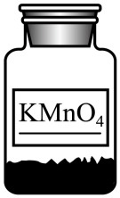
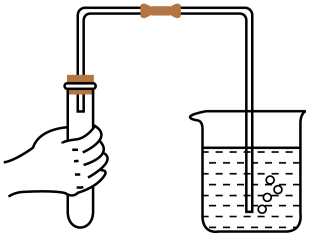
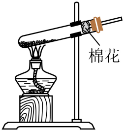
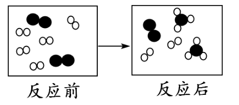
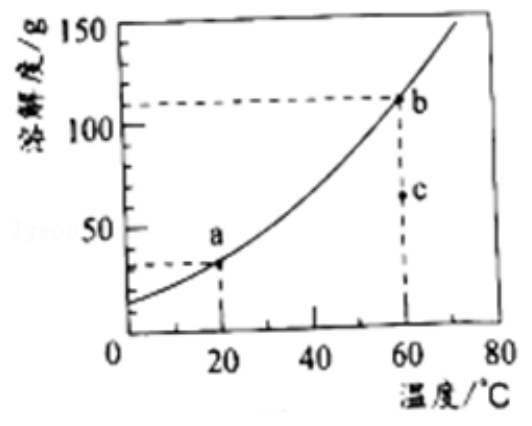
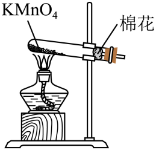
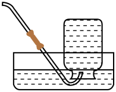
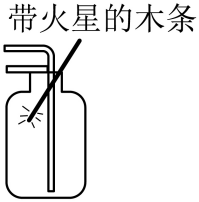
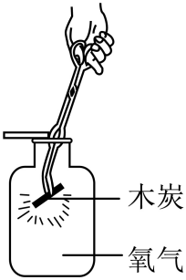

# 第二单元 空气和氧气 · 题目

讲义只用 `lesson.md` 里引用的题，按知识点顺序排在前面。

---

## 讲义用题（8 道）

### Q-CHEM-GD2022-03

```yaml
category: 真题
source: 2022 年广东省初中学业水平考试 化学 第 3 题
source_quality: 原卷
kp: CHEM-9A-02-1b
type: 选择
grading: 自动
answer_by: 原卷解析
review:
  概念: CHEM-9A-02-1b
```

**题干**

下列属于纯净物的是（　　）

A. 汽水
B. 氢气
C. 黄铜
D. 空气

**答案**

B

**解析**

1. A 项：汽水是由水、二氧化碳、糖等多种物质混合而成，属于混合物，不符合题意。
2. B 项：氢气由同种物质组成，属于纯净物，符合题意。
3. C 项：黄铜是铜和锌的合金，属于混合物，不符合题意。
4. D 项：空气由氮气、氧气、二氧化碳、稀有气体等多种气体混合而成，属于混合物，不符合题意。故选 B。

---

### Q-CHEM-GZ2023-03

```yaml
category: 真题
source: 2023 年广州市初中学业水平考试 化学 第 3 题
source_quality: 原卷
kp: CHEM-9A-02-1c
type: 选择
grading: 自动
answer_by: 原卷解析
review:
  概念: CHEM-9A-02-1c
```

**题干**

生机勃勃的地球离不开空气，下列关于空气的说法不正确的是（　　）

A. 稀有气体可用于霓虹灯的制作
B. $\ce{CO2}$ 是植物光合作用的重要原料
C. $\ce{SO2}$ 排放是导致酸雨的原因之一
D. $\text{PM}_{2.5}$ 的含量越高空气质量越好

**答案**

D

**解析**

1. A 项：稀有气体通电时可以发出不同颜色的光，可用于制作霓虹灯等电光源，说法正确。
2. B 项：光合作用可将二氧化碳和水转化为有机物和氧气，二氧化碳是植物光合作用的重要原料，说法正确。
3. C 项：二氧化硫和水、氧气反应可生成酸性物质，随降水落下形成酸雨，二氧化硫排放是导致酸雨的原因之一，说法正确。
4. D 项：$\text{PM}_{2.5}$ 是指环境空气中空气动力学当量直径小于等于 $2.5\ \mu\mathrm{m}$ 的细颗粒物，属于空气污染物，其含量越高空气质量越差，说法错误。故选 D。

---

### Q-CHEM-TB9A-2.2-3

```yaml
category: 课本习题
source: 人教版 化学 九年级上册 课题2 练习与应用 第 3 题（印刷页 p.42）
source_quality: 课本原文
kp: CHEM-9A-02-2a
type: 选择
grading: 自动
answer_by: 本项目编写，待复核
review:
  概念: CHEM-9A-02-2a
```

**题干**

下列关于物质燃烧的说法中，正确的是（　　）

A. 红磷在空气中不能燃烧
B. 木炭燃烧后生成黑色固体
C. 硫燃烧时生成有刺激性气味的气体
D. 铁丝插入盛有氧气的集气瓶中剧烈燃烧

**答案**

C

**解析**

1. A 项：红磷在空气中能够燃烧，产生大量白烟并放出热量，说法错误。
2. B 项：木炭在空气或氧气中充分燃烧生成的是无色气体二氧化碳，并不是黑色固体，说法错误。
3. C 项：硫在空气或氧气中燃烧都生成具有刺激性气味的气体二氧化硫，说法正确。
4. D 项：铁丝在常温下插入盛有氧气的集气瓶中不会自发燃烧，必须在铁丝末端系火柴引燃至红热后再伸入充满氧气的集气瓶中才能剧烈燃烧，说法错误。故选 C。

---

### Q-CHEM-TB9A-2.2-5

```yaml
category: 课本习题
source: 人教版 化学 九年级上册 课题2 练习与应用 第 5 题（印刷页 p.42）
source_quality: 课本原文
kp: CHEM-9A-02-2b
type: 选择
grading: 自动
answer_by: 本项目编写，待复核
review:
  概念: CHEM-9A-02-2b
```

**题干**

已知下列反应在一定条件下都能发生，其中属于化合反应的是（　　）

A. 氧化汞 $\xrightarrow{\text{加热}}$ 汞 $+$ 氧气
B. 大理石 $+$ 盐酸 $\rightarrow$ 氯化钙 $+$ 二氧化碳 $+$ 水
C. 酒精 $+$ 氧气 $\xrightarrow{\text{点燃}}$ 水 $+$ 二氧化碳
D. 碳 $+$ 氧气 $\xrightarrow{\text{点燃}}$ 二氧化碳

**答案**

D

**解析**

1. A 项：反应物为一种，生成物有两种，符合“一变多”，属于分解反应，不属于化合反应。
2. B 项：生成物有三种物质，不符合“多变一”，不属于化合反应。
3. C 项：生成物有两种物质，不符合“多变一”，不属于化合反应。
4. D 项：反应物有两种物质（碳与氧气），生成物只有一种物质（二氧化碳），符合“多变一”的特征，属于化合反应。故选 D。

---

### Q-CHEM-TB9A-2.2-6

```yaml
category: 课本习题
source: 人教版 化学 九年级上册 课题2 练习与应用 第 6 题（印刷页 p.42）
source_quality: 课本原文
kp: CHEM-9A-02-2b
type: 填空
grading: 自评
answer_by: 本项目编写，待复核
review:
  概念: CHEM-9A-02-2b
```

**题干**

请用文字表示硫、红磷和铁丝分别在氧气中燃烧时发生的反应。

**答案**

硫：$\text{硫} + \text{氧气} \xrightarrow{\text{点燃}} \text{二氧化硫}$；

红磷：$\text{红磷} + \text{氧气} \xrightarrow{\text{点燃}} \text{五氧化二磷}$（或 $\text{磷} + \text{氧气} \xrightarrow{\text{点燃}} \text{五氧化二磷}$）；

铁丝：$\text{铁} + \text{氧气} \xrightarrow{\text{点燃}} \text{四氧化三铁}$

**解析**

1. 硫在氧气中燃烧生成二氧化硫，文字表达式为 $\text{硫} + \text{氧气} \xrightarrow{\text{点燃}} \text{二氧化硫}$。
2. 红磷在氧气中燃烧生成五氧化二磷，文字表达式为 $\text{红磷} + \text{氧气} \xrightarrow{\text{点燃}} \text{五氧化二磷}$。
3. 细铁丝在氧气中剧烈燃烧生成四氧化三铁黑色固体，文字表达式为 $\text{铁} + \text{氧气} \xrightarrow{\text{点燃}} \text{四氧化三铁}$。

---

### Q-CHEM-GD2024-15

```yaml
category: 真题
source: 2024 年广东省初中学业水平考试 化学 第 15 题
source_quality: 原卷
kp: CHEM-9A-02-3a
type: 选择
grading: 自动
answer_by: 原卷解析
review:
  概念: CHEM-9A-02-3a
  审题: CHEM-9A-02-3a
```

**题干**

探究 $\ce{H2O2}$ 分解速率的影响因素，下列分析正确的是（　　）

| 实验编号 | $\ce{H2O2}$ 溶液体积 / $\mathrm{mL}$ | $\ce{H2O2}$ 溶液溶质质量分数 / $\%$ | 催化剂（$0.1\ \mathrm{g}$） | 温度 / $^\circ\mathrm{C}$ |
| :---: | :---: | :---: | :---: | :---: |
| ① | $5$ | $10$ | — | $20$ |
| ② | $5$ | $10$ | $\ce{MnO2}$ 粉末 | $20$ |
| ③ | $5$ | $5$ | $\ce{MnO2}$ 粉末 | $20$ |
| ④ | $5$ | $5$ | $\ce{MnO2}$ 粉末 | $40$ |
| ⑤ | $5$ | $5$ | $\ce{Fe2O3}$ 粉末 | $20$ |

A. ①④探究有无催化剂的影响
B. ②③探究 $\ce{H2O2}$ 溶液浓度的影响
C. ②④探究反应温度的影响
D. ④⑤探究催化剂种类的影响

**答案**

B

**解析**

1. A 项：根据对比实验单一变量原则，实验①中未加催化剂且温度为 $20\ ^\circ\mathrm{C}$、浓度为 $10\%$，实验④中加入了催化剂但温度为 $40\ ^\circ\mathrm{C}$、浓度为 $5\%$，变量不唯一，不能用于探究有无催化剂的影响，说法错误。
2. B 项：实验②和③中过氧化氢溶液体积均为 $5\ \mathrm{mL}$、均加入 $0.1\ \mathrm{g}\ \ce{MnO2}$、反应温度均为 $20\ ^\circ\mathrm{C}$，唯一的变量是过氧化氢溶液的溶质质量分数（浓度），因此能探究 $\ce{H2O2}$ 溶液浓度的影响，说法正确。
3. C 项：实验②和④中过氧化氢溶液的溶质质量分数和反应温度均不同，存在两个变量，不能用于探究反应温度的影响，说法错误。
4. D 项：实验④和⑤中催化剂种类不同且反应温度也不同，变量不唯一，不能用于探究催化剂种类的影响，说法错误。故选 B。

---

### Q-CHEM-TB9A-2.3-4

```yaml
category: 课本习题
source: 人教版 化学 九年级上册 课题3 练习与应用 第 4 题（印刷页 p.48）
source_quality: 课本原文
kp: CHEM-9A-02-3b
type: 选择
grading: 自动
answer_by: 本项目编写，待复核
review:
  概念: CHEM-9A-02-3b
```

**题干**

下列反应中，属于分解反应的是（　　）

A. 硫 $+$ 氧气 $\xrightarrow{\text{点燃}}$ 二氧化硫
B. 石蜡 $+$ 氧气 $\xrightarrow{\text{点燃}}$ 二氧化碳 $+$ 水
C. 铁 $+$ 氧气 $\xrightarrow{\text{点燃}}$ 四氧化三铁
D. 高锰酸钾 $\xrightarrow{\text{加热}}$ 锰酸钾 $+$ 二氧化锰 $+$ 氧气

**答案**

D

**解析**

1. A 项：硫与氧气反应生成二氧化硫，反应物有 $2$ 种，生成物只有 $1$ 种，属于化合反应，不属于分解反应。
2. B 项：石蜡与氧气反应生成二氧化碳和水，反应物有 $2$ 种，生成物有 $2$ 种，不属于分解反应。
3. C 项：铁与氧气反应生成四氧化三铁，反应物有 $2$ 种，生成物只有 $1$ 种，属于化合反应，不属于分解反应。
4. D 项：高锰酸钾受热分解生成锰酸钾、二氧化锰和氧气，由一种反应物生成三种其他物质，符合“一变多”的特征，属于分解反应。故选 D。

---

### Q-CHEM-GD2024-09

```yaml
category: 真题
source: 2024 年广东省初中学业水平考试 化学 第 9 题
source_quality: 原卷
kp: CHEM-9A-02-4a
type: 选择
grading: 自动
answer_by: 原卷解析
review:
  概念: CHEM-9A-02-4a
```

**题干**

实验室制取 $\ce{O2}$，下列操作、药品和装置选择不合理的是（　　）

A. 选择药品 
B. 检查气密性 
C. 发生装置 
D. 收集装置 

**答案**

C

**解析**

1. A 项：实验室可以通过加热高锰酸钾固体生成氧气，选用高锰酸钾药品合理，说法正确。
2. B 项：有气体生成或参与的反应在实验前需要进行气密性检查；用双手紧握试管外壁，导管口放入水中，若导管口有气泡冒出，松开手后导管内形成一段稳定水柱，说明装置气密性良好，操作合理，说法正确。
3. C 项：加热固体制取气体时，试管口应略向下倾斜，防止固体受热产生的冷凝水倒流至试管底部使灼热试管炸裂；图示试管口向上倾斜，操作不合理，符合题意。
4. D 项：氧气密度比空气略大，可用向上排空气法收集；使用多功能瓶向上排空气收集氧气时，氧气应从长管通入，空气由短管排出（长进短出），装置选择合理，说法正确。故选 C。

---

### Q-CHEM-GD2019-19-1

```yaml
category: 真题
source: 2019 年广东省初中学业水平考试 化学 第 19 题第（1）问
source_quality: 原卷（本地存档 Word 转 PDF 页，逐页核对）
kp: CHEM-9A-02-2a
type: 填空
grading: 自评
do: 本章只做第（1）问
answer_by: 原卷解析
review:
  概念: CHEM-9A-02-2a
```

**题干**

燃烧是人类最早利用的化学反应之一。

（1）按图进行铁丝在 $\ce{O2}$ 中燃烧的实验，反应的化学方程式为______。该实验装置存在明显不足，改进措施是______。


**答案**

$3\ce{Fe}+2\ce{O2}\xrightarrow{点燃}\ce{Fe3O4}$；在集气瓶底部加少量水（或铺一层细沙）

**解析**

铁丝在氧气中剧烈燃烧、火星四射，生成黑色固体四氧化三铁。反应放出大量的热，高温熔融物溅落会使集气瓶炸裂，所以瓶底要预先放少量水或铺一层细沙。

---

### Q-CHEM-GZ2019-06

```yaml
category: 真题
source: 2019 年广州市初中学业水平考试 化学 第 6 题
source_quality: 原卷（本地存档 Word 转 PDF 页，逐页核对）
kp: CHEM-9A-02-2b
type: 选择
grading: 自动
answer_by: 原卷解析
review:
  概念: CHEM-9A-02-2b
```

**题干**

下图为某反应的微观示意图，“○”“●”各表示一种原子，下列说法不正确的是（　　）



A．反应物是两种单质

B．反应物有剩余

C．该反应为化合反应

D．该反应生成了多种产物

**答案**

D

**解析**

对照反应前后的微粒：反应物是由两种原子分别构成的两种单质，有一种单质过量而有剩余；生成物只有一种分子，属于“多变一”的化合反应。所以 D“生成了多种产物”不正确。

---

### Q-CHEM-GD2020-13

```yaml
category: 真题
source: 2020 年广东省初中学业水平考试 化学 第 13 题
source_quality: 原卷（本地存档 Word 转 PDF 页，逐页核对）
kp: CHEM-9A-02-3b
type: 选择
grading: 自动
answer_by: 原卷解析
review:
  概念: CHEM-9A-02-3b
```

**题干**

实验室用氯酸钾固体（二氧化锰作催化剂）制取氧气，下列装置组合正确的是（　　）



A．①③　　B．①⑤　　C．②③　　D．②④

**答案**

A

**解析**

氯酸钾是固体，二氧化锰是固体催化剂，反应需要加热，属于“固体加热型”，选装置①作发生装置。氧气的密度比空气略大、不易溶于水，可用装置③（或④）收集。

---

### Q-CHEM-GZ2020-04

```yaml
category: 真题
source: 2020 年广州市初中学业水平考试 化学 第 4 题
source_quality: 原卷（本地存档 Word 转 PDF 页，逐页核对）
kp: CHEM-9A-02-1a
type: 选择
grading: 自动
answer_by: 原卷解析
review:
  概念: CHEM-9A-02-1a
```

**题干**

空气是人类生产活动的重要资源。下列生活生产中用到的气体不是来自空气的是（　　）

A．炼钢过程用到的氧气

B．磁悬浮列车用到的氮气

C．用于生产氮肥的氨气

D．制作电光源的稀有气体

**答案**

C

**解析**

空气中按体积计，氮气约占 78%、氧气约占 21%、稀有气体约占 0.94%、二氧化碳约占 0.03%，其余是其他气体和杂质。空气中没有氨气，所以 C 不是来自空气。

---

## 备选

### Q-CHEM-GZ2024-03

```yaml
category: 真题
source: 2024 年广州市初中学业水平考试 化学 第 3 题
source_quality: 原卷
kp: CHEM-9A-02-1b
type: 选择
grading: 自动
answer_by: 原卷解析
review:
  概念: CHEM-9A-02-1b
```

**题干**

下列属于纯净物的是（　　）

A. 水蒸气
B. 生铁
C. 碘酒
D. 食醋

**答案**

A

**解析**

1. A 项：水蒸气只含水一种物质，属于纯净物，符合题意。
2. B 项：生铁中含有铁、碳等多种物质，属于混合物，不符合题意。
3. C 项：碘酒中含有碘和酒精等多种物质，属于混合物，不符合题意。
4. D 项：食醋中含有水、醋酸等多种物质，属于混合物，不符合题意。故选 A。

---

### Q-CHEM-GZ2024-05

```yaml
category: 真题
source: 2024 年广州市初中学业水平考试 化学 第 5 题
source_quality: 原卷
kp: CHEM-9A-02-1c
type: 选择
grading: 自动
answer_by: 原卷解析
review:
  概念: CHEM-9A-02-1c
```

**题干**

空气是人类生产活动的重要资源。下列关于空气的说法不正确的是（　　）

A. 空气是工业制取氧气的廉价、易得的原料
B. 人呼吸空气时呼出的气体中只含有二氧化碳
C. 将氮气充入食品包装袋中可起到防腐作用
D. 倡导“低碳”生活有利于减少温室气体的排放

**答案**

B

**解析**

1. A 项：工业制取氧气是利用液氮和液氧的沸点不同，从液化空气中分离出氮气和氧气，空气是工业制取氧气的廉价、易得原料，说法正确。
2. B 项：人体呼出的气体中大部分仍是氮气，除二氧化碳外还含有水蒸气、氧气和稀有气体等，并不是只含有二氧化碳，说法错误。
3. C 项：常温下氮气的化学性质不活泼，可用作保护气，将氮气充入食品包装袋中可起到防腐保鲜作用，说法正确。
4. D 项：二氧化碳过量排放会导致温室效应加剧，倡导“低碳”生活有利于减少温室气体排放，说法正确。故选 B。

---

### Q-CHEM-GD2025-11

```yaml
category: 真题
source: 2025 年广东省初中学业水平考试 化学 第 11 题
source_quality: 原卷
kp: CHEM-9A-02-4a
type: 选择
grading: 自动
answer_by: 原卷解析
review:
  概念: CHEM-9A-02-4a
```

**题干**

下列关于 $\ce{O2}$ 的制取、验满及性质实验操作错误的是（　　）

A. 制备 
B. 收集 
C. 验满 
D. 助燃性 

**答案**

C

**解析**

1. A 项：加热高锰酸钾制取氧气，试管口略向下倾斜可防止冷凝水倒流炸裂试管，试管口放一团棉花可防止固体粉末进入导管，操作正确。
2. B 项：氧气不易溶于水且不与水反应，可以用排水法收集，操作正确。
3. C 项：氧气向上排空气法验满时，应将带火星的木条放在集气瓶口，若木条复燃，证明已集满；图示将带火星木条伸入瓶内属于检验气体性质，操作错误，符合题意。
4. D 项：木炭在氧气中燃烧生成二氧化碳气体，集气瓶底部不需要放水或细沙，操作正确。故选 C。

