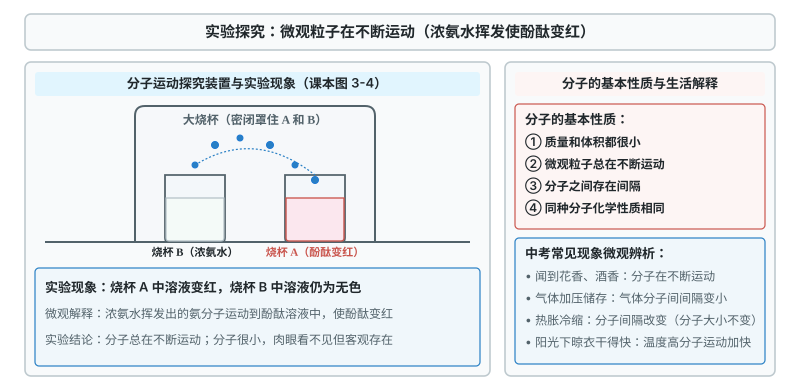
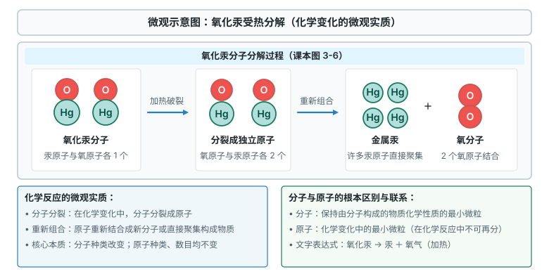
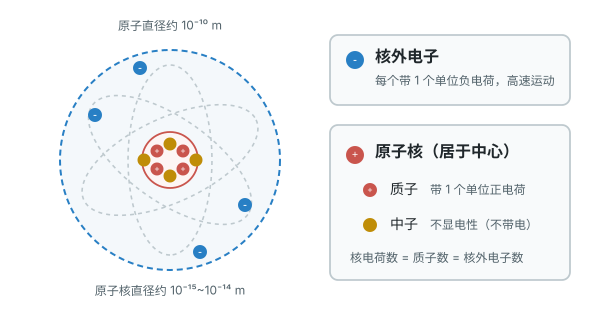
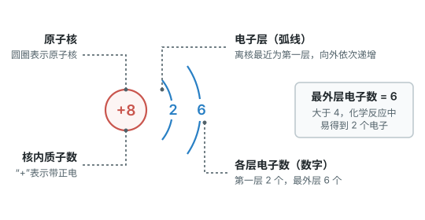
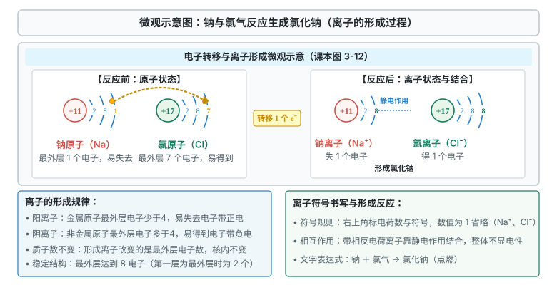
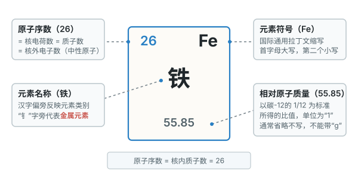
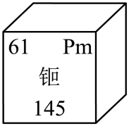

# 第三单元 物质构成的奥秘

这一单元从微观角度看物质：先认识分子、原子、离子，再看原子内部结构，最后学元素符号和周期表单元格。

标着**重点**的两个知识点，中考几乎每年都考，要花最多时间；标着**一般**的，掌握粒子数量关系、会读图表、会写符号；标着**了解**的，读懂微观变化就行。

## 本章前置自查

下面两件事，哪一件没把握，先回看前面单元：

1. 能区分物理变化和化学变化，判断依据是有没有新物质生成。（第一单元 课题1）
2. 熟悉水蒸发、蜡烛熔化这类状态变化和气压现象。（生活经验与物理知识）

---

## 3.1a 分子的基本性质及现象解释

```yaml
id: CHEM-9A-03-1a
weight: 重点
weight_note: 7 套卷直接考查 8 次
textbook: 九上 3.1 分子和原子，p.56–59
prerequisites:
  - id: CHEM-9A-01-1a
    strength: soft
    reason: 结合物质蒸发、扩散等物理现象建立物质微观粒子在运动的观念。
evidence:
  - 能用“分子在不断运动”解释扩散、挥发等现象
  - 能用“分子之间有间隔，间隔随温度或压强改变”解释气体的热胀冷缩和加压储存
  - 能准确判断“分子大小改变”“分子停止运动”等说法的正误
figure: 已完成 figures/molecular-motion-ammonia.svg（浓氨水分子运动使酚酞变红探究实验示意图）
sources: [TB9A-3.1, GZ2022-11, GZ2024-08]
walk_source: 2022 广州 11 真题情境
```

### 本次只学

从宏观现象找到微观原因：分子很小，在不断运动，分子之间有间隔。

### 先认住

- 物质由分子、原子等微观粒子构成，分子的质量和体积都很小。
- 微观粒子总在不断运动。温度升高，分子运动加快，所以在热水中扩散更快。
- 分子之间有间隔。气体受压，间隔减小；热胀冷缩是间隔随温度改变，分子本身大小不变。



### 走一遍

任务：用微观粒子的观点，解释检查装置气密性时导管口产生气泡的现象。

用手紧握试管外壁，导管口有气泡冒出。解释步骤：

第一步：手握试管，管内气体温度升高。

第二步：温度升高，气体分子运动加快，分子间隔变大。

第三步：装置内气体压强增大，一部分气体从导管口逸出，在水中形成气泡。

第四步：这个过程中分子数目没有增加，分子本身的大小和种类也没有改变。


### 容易错

- “酒香不怕巷子深”说明分子不断运动，不是分子之间有引力。
- 热胀冷缩改变的是分子间隔，不是分子本身的大小。
- 分子在任何温度下都在运动，固体里的分子也不例外。

### 练一练

- `Q-CHEM-GZ2024-08`

---

## 3.1b 微观粒子观点解释物理变化与化学变化

```yaml
id: CHEM-9A-03-1b
weight: 了解
weight_note: 7 套卷没有直接考查
textbook: 九上 3.1 分子和原子，p.59–61
prerequisites:
  - id: CHEM-9A-03-1a
    strength: hard
    reason: 运用分子间间隔变化解释物理变化，分子分解与原子重组解释化学变化。
  - id: CHEM-9A-01-1a
    strength: hard
    reason: 宏观上有无新物质生成的本质对应微观上分子本身是否发生改变。
evidence:
  - 能从分子是否变成其他分子，区分物理变化和化学变化
  - 能说出化学变化中分子可分、原子重新组合，原子种类不变
figure: 已完成 figures/mercury-oxide-decomposition.svg（氧化汞受热分解微观实质示意图）
sources: [TB9A-3.1]
```

### 先认住

- 物理变化中，分子没有变成其他分子，通常只是间隔或排列改变。
- 化学变化中，分子分成原子，原子重新组合成新分子；分子种类变，原子种类不变。
- 分子是保持由分子构成的物质化学性质的最小粒子；原子是化学变化中的最小粒子。



---

## 3.2a 原子的构成与微粒间数量关系

```yaml
id: CHEM-9A-03-2a
weight: 一般
weight_note: 7 套卷直接考查 1 次
textbook: 九上 3.2 原子结构，p.65, 68
prerequisites:
  - id: CHEM-9A-03-1b
    strength: hard
    reason: 先明确化学变化中分子可分而原子不可分，进而深入探究原子内部的结构。
evidence:
  - 能说出原子由原子核和核外电子构成，原子核一般由质子和中子构成
  - 能用“核电荷数=质子数=核外电子数”求中性原子中的粒子数
  - 能判断相对原子质量是一个比值，单位通常省略不写
figure: 已完成 figures/atom-structure.svg（原子的构成示意图：原子核居中与核外电子）
sources: [TB9A-3.2, GZ2024-16]
```

### 本次只学

认识原子内部的三种粒子，掌握中性原子里的数量关系。

### 先认住

- 原子由中心的**原子核**和**核外电子**构成；原子核一般由质子和中子构成。
- 质子带 1 个单位正电荷，电子带 1 个单位负电荷，中子不带电。中性原子中：**核电荷数 = 质子数 = 核外电子数**。
- 相对原子质量是原子质量与碳-12 质量的 $\dfrac{1}{12}$ 相比所得的比值，单位为“1”，通常省略；原子的质量主要集中在原子核上。



### 容易错

- 质子数不一定等于中子数。例如普通氢原子核内只有 1 个质子，没有中子。
- 相对原子质量不是原子的实际质量，不能带质量单位“g”或“kg”。

### 练一练

- `Q-CHEM-TB9A-3.2-1`
- `Q-CHEM-GZ2019-24-1`

---

## 3.2b 核外电子排布与原子结构示意图

```yaml
id: CHEM-9A-03-2b
weight: 一般
weight_note: 7 套卷直接考查 1 次
textbook: 九上 3.2 原子结构，p.66–67
prerequisites:
  - id: CHEM-9A-03-2a
    strength: hard
    reason: 依据原子核内质子数与核外电子数相等的电中性关系进行电子层排布。
evidence:
  - 能读出原子结构示意图中的核电荷数、电子层数和各层电子数
  - 能根据最外层电子数判断原子在化学反应中较易得电子、失电子或具有相对稳定结构
figure: 已完成 figures/oxygen-atom-structure.svg（氧原子结构示意图：核电荷数与电子层排布）
sources: [TB9A-3.2, GZ2022-04]
```

### 本次只学

看懂原子结构示意图，并由最外层电子数判断原子的得失电子倾向。

### 先认住

- 原子结构示意图中，圆圈和圆圈内的正数表示原子核和核内质子数；弧线表示电子层；弧线上的数字是该层电子数。
- 离核最近的是第一层，依次向外。第一层不超过 2 个电子；最外层一般不超过 8 个（只有 1 层的不超过 2 个）。
- 最外层有 8 个电子（氦为 2 个）是相对稳定结构。金属原子最外层电子一般少于 4 个，易失去电子；非金属原子一般多于 4 个，易得到电子。



### 容易错

- 圆圈内的正数是核内质子数，不是原子所带的净电荷。
- 电子层数看弧线层数，不能把各层的电子数相加当作层数。

### 练一练

- `Q-CHEM-GZ2022-04`

---

## 3.2c 离子的形成与离子符号

```yaml
id: CHEM-9A-03-2c
weight: 一般
weight_note: 7 套卷直接考查 2 次
textbook: 九上 3.2 原子结构，p.67
prerequisites:
  - id: CHEM-9A-03-2b
    strength: hard
    reason: 根据原子最外层电子数得失电子达到稳定结构推导离子电荷与离子符号。
evidence:
  - 能判断原子得失电子后形成阳离子还是阴离子
  - 能正确书写并解释简单离子符号，如 $\ce{Na+}$、$\ce{Cl-}$、$\ce{Cu^{2+}}$
  - 能由质子数和电荷数求简单离子的核外电子数
figure: 已完成 figures/sodium-chloride-formation.svg（钠与氯气反应生成氯化钠及离子形成微观示意图）
sources: [TB9A-3.2, GZ2024-16]
```

### 本次只学

由原子得失电子判断离子电性，并读写离子符号与核外电子数。

### 先认住

- 带电荷的原子叫离子。**失去电子**带正电荷，成阳离子；**得到电子**带负电荷，成阴离子。
- 离子符号在元素符号右上角标电荷数和电性，数值为 1 时省略。如 $\ce{Na+}$、$\ce{Cl-}$、$\ce{Cu^{2+}}$。
- 形成离子时质子数不变。阳离子的核外电子数 $=$ 质子数 $-$ 失去的电子数；阴离子的核外电子数 $=$ 质子数 $+$ 得到的电子数。



### 容易错

- $\ce{Cu^{2+}}$ 右上角的“2+”表示一个铜离子带 2 个单位正电荷；符号前面的数字（如 $\ce{2Cu^{2+}}$）才表示离子个数。
- 形成离子时变的是核外电子数，质子数不变。

### 练一练

- `Q-CHEM-GZ2024-16-1`

---

## 3.3a 元素的概念与元素符号

```yaml
id: CHEM-9A-03-3a
weight: 一般
weight_note: 7 套卷直接考查 2 次
textbook: 九上 3.3 元素，p.72–74
prerequisites:
  - id: CHEM-9A-03-2a
    strength: hard
    reason: 根据核电荷数（即质子数）相同的一类原子归纳定义元素概念。
evidence:
  - 能说出元素是质子数相同的一类原子的总称
  - 能区分“物质由元素组成”和“分子由原子构成”两种表述
  - 能说出元素符号的书写规则（一个字母大写，两个字母时第二个小写）和元素符号表示的意义
figure: 不需要
sources: [TB9A-3.3, GD2022-16]
```

### 本次只学

用元素描述物质的宏观组成，用原子描述分子的微观构成。

### 先认住

- **元素**是质子数（核电荷数）相同的一类原子的总称。不同元素的本质区别是质子数不同。
- 宏观上说“物质由元素组成”；微观上说“分子由原子构成”。例如氧化锌和碳酸锌都含锌元素，不能说含“锌分子”。
- 元素符号：第一个字母大写，第二个字母小写。它表示一种元素，也表示这种元素的一个原子。

### 容易错

- 元素只讲种类、不讲个数，不能说“一个氧元素”。
- 大小写不能混：$\ce{Co}$ 是钴元素，$\ce{CO}$ 是一氧化碳。

### 练一练

- `Q-CHEM-GD2022-16-3`

---

## 3.3b 元素周期表单元格信息

```yaml
id: CHEM-9A-03-3b
weight: 重点
weight_note: 7 套卷直接考查 6 次
textbook: 九上 3.3 元素，p.75–76
prerequisites:
  - id: CHEM-9A-03-3a
    strength: hard
    reason: 掌握元素符号的书写与中文名称偏旁部首分类（金属、非金属）。
  - id: CHEM-9A-03-2a
    strength: hard
    reason: 运用原子序数等于核内质子数的等量关系读取周期表单元格信息。
evidence:
  - 能从元素周期表单元格读出原子序数、元素符号、元素名称和相对原子质量
  - 能由原子序数推出中性原子的核电荷数、质子数和核外电子数
  - 能判断相对原子质量没有“g”单位，并从元素名称偏旁判断金属或非金属元素
figure: 已完成 figures/periodic-cell.svg（元素周期表单元格通用示意图：原子序数、符号、名称与相对原子质量）
sources: [TB9A-3.3, GD2024-10, GD2025-06]
walk_source: 2024 广东 10 真题方法
```

### 本次只学

读懂元素周期表的一个单元格，并把原子序数转换为原子中的粒子数。

### 先认住

- 单元格中：左上角是**原子序数**，右上角是**元素符号**，中间是**元素名称**，下方是**相对原子质量**。
- 中性原子：**原子序数 = 核电荷数 = 质子数 = 核外电子数**。
- 相对原子质量是比值，单位为“1”，通常省略，不能加“g”或“kg”。
- 由名称偏旁判断类别：带“钅”字旁的一般是金属元素（汞是常温液态金属，特例不带“钅”）；带“石”字旁（固态）、“气”字头（气态）、“氵”字旁（液态，如溴）的是非金属元素。



### 走一遍

任务：读取元素周期表单元格中钷元素的信息，推断微粒数目与元素分类。

单元格信息显示：左上角为 61，右上角为 $\ce{Pm}$，中间为“钷”，下方为 145。

第一步：读原子序数求粒子数。原子序数是 61，中性原子中原子序数 $=$ 核电荷数 $=$ 质子数 $=$ 核外电子数，所以钷原子的核电荷数、质子数和核外电子数都是 $\textcolor{#287fc4}{61}$。

第二步：读元素符号：$\ce{Pm}$。

第三步：“钷”带“钅”字旁，是金属元素。

第四步：读相对原子质量：$\boxed{145}$，不带单位“g”。



### 容易错

- 下方的数字是相对原子质量，不是原子的实际质量，不带“g”。
- 只有中性原子的核外电子数等于原子序数；形成离子后核外电子数改变，质子数不变。

### 练一练

- `Q-CHEM-GD2025-06`

---

> 跨学科实践活动2（制作模型并展示科学家探索物质组成与结构的历程）：用球棍、彩泥等材料制作原子或分子模型；结合道尔顿、汤姆孙、卢瑟福等人的实验与假说，展示“实验事实 → 建立模型 → 修正发展”的过程。
