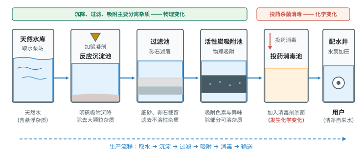
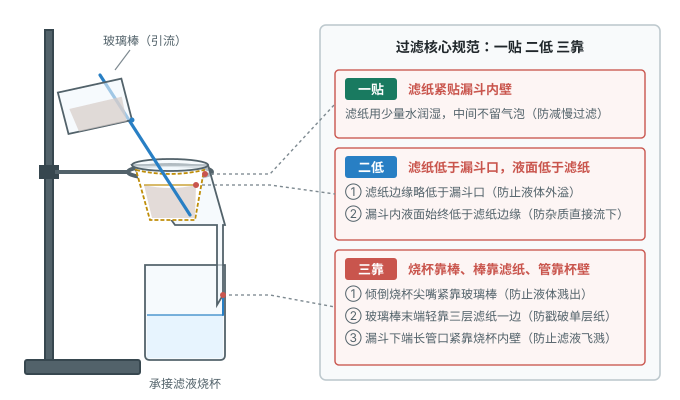
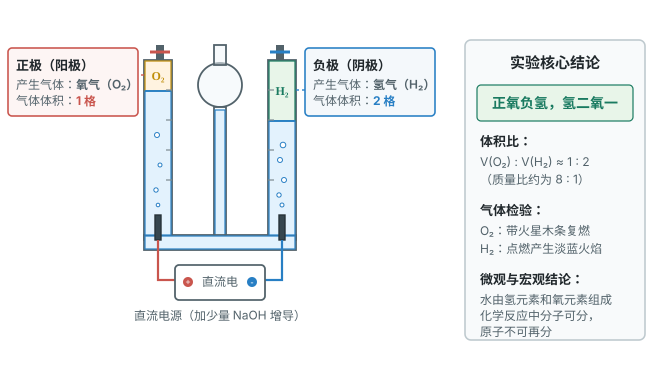
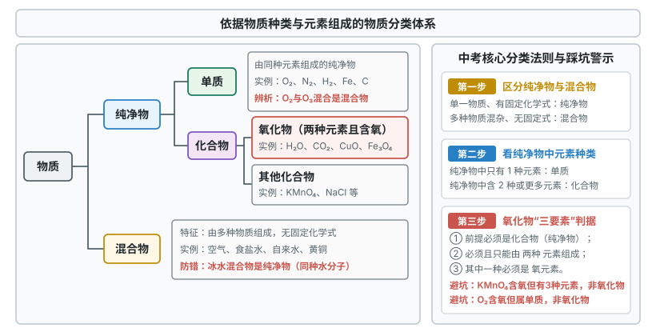

# 第四单元 自然界的水

这一章先学怎么净水，再通过电解水认识水的组成和物质分类，最后学化学式、化合价和相关计算。

标着**重点**的七个知识点，中考几乎每年都考，要花最多时间；标着**一般**的，联系生活记住节水和防污措施；标着**了解**的，记住实验安全和操作规范。

## 本章前置自查

下面四件事，哪一件没把握，先回看前面单元：

1. 区分物理变化与化学变化：化学变化有新物质生成。（第一单元 课题1）
2. 会药品的取用、物质的加热和托盘天平的使用。（第一单元 课题2）
3. 区分混合物与纯净物：空气是含氮气、氧气等的混合物。（第二单元 课题1）
4. 说出化学变化的实质：分子分成原子，原子重新组合成新分子。（第三单元 课题1、课题2）

---

## 4.1a 爱护水资源与节约用水

```yaml
id: CHEM-9A-04-1a
weight: 一般
weight_note: 7 套卷直接考查 1 次
textbook: 九上 4.1 水资源及其利用，p.82–85
prerequisites:
  - id: CHEM-9A-01-1a
    strength: soft
    reason: 认识工业废水排放与生活污水对水体环境造成的化学污染。
evidence:
  - 能准确说出地球水储量与淡水资源的现状（淡水占比小且分布不均）
  - 能举例说明节约用水与防治水体污染的具体措施（工业循环、农业节水灌溉、生活一水多用、污水处理达标排放）
figure: 不需要
sources: [TB9A-4.1, GD2023-17]
```

### 本次只学

认识水资源的现状，掌握节约用水与防治水体污染的途径。

### 先认住

- **地球水资源现状**：地球表面约 $71\%$ 被水覆盖，但海水约占水储量的 $96.53\%$，陆地淡水仅约 $2.53\%$，且大部分是冰雪，人类可直接利用的淡水很少。我国水资源总量居世界前列，但人均量只有世界平均水平的几分之一，时空分布极不均衡。
- **节约用水途径**：
  - 工业上：推行节水新技术，提高用水的重复利用率。
  - 农业上：改大水漫灌为喷灌、滴灌。
  - 生活上：使用节水器具，一水多用（淘米水浇花、洗衣水冲厕所）。
- **防治水体污染**：来源有工业污染（废水未经处理排放）、农业污染（农药、化肥使用不当）、生活污染（污水任意排放）。措施：用新技术减少污染物排放、工业废水达标后排放、合理使用农药化肥、生活污水集中处理。

### 容易错

- “水资源取之不尽、用之不竭”是错的：能直接利用的淡水极少。
- “全面禁止使用化肥和农药”是错的：它们对增产很重要，应“合理使用”。

### 练一练

- `Q-CHEM-GD2023-17-5`

---

## 4.1b 水的净化方法与自来水生产流程

```yaml
id: CHEM-9A-04-1b
weight: 重点
weight_note: 7 套卷直接考查 9 次
textbook: 九上 4.1 水资源及其利用，p.86–89
prerequisites:
  - id: CHEM-9A-01-2b
    strength: hard
    reason: 掌握沉降、吸附及消毒杀菌等基本净水原理与操作。
  - id: CHEM-9A-02-1b
    strength: soft
    reason: 明确天然水是混合物，通过净化逐步除去不溶性杂质。
evidence:
  - 能说出自来水厂净水的主要生产流程（沉淀、过滤、吸附、消毒杀菌）及各环节的作用
  - 能明确明矾絮凝沉降、活性炭物理吸附色素和异味、投药消毒属于化学变化的原理与区别
  - 能指出净化后的自来水仍然是混合物，单一操作净化程度最高的是蒸馏
figure: 已完成 figures/water-purification.svg（自来水厂净水流程：沉淀、过滤、吸附与消毒杀菌）
sources: [TB9A-4.1, GZ2022-05, GZ2023-08, GD2022-14, GD2025-12, GZ2024-07, GZ2024-20]
walk_source: 课本 p.86 自来水厂净水流程分析与 2025 广东 12 净水步骤辨析
```

### 本次只学

掌握自来水生产的工序及常用净水方法的原理与区别。

### 先认住

- **天然水与自来水**：河水、湖水、井水等天然水是混合物，含不溶性杂质、可溶性杂质和微生物。自来水经净化后仍含可溶性矿物质，还是混合物。
- **常用净水方法及作用**：
  - **沉降**：
    - 静置沉淀：让较大的不溶性固体自然沉降。
    - 吸附沉淀：加絮凝剂（如明矾），其生成的胶状物吸附悬浮杂质，加速沉降。
  - **过滤**：分离液体与不溶性固体。
  - **吸附**：活性炭疏松多孔，吸附色素、异味和部分可溶性杂质（物理变化）。
  - **消毒杀菌**：用氯气（$\ce{Cl2}$）、漂白粉或二氧化氯（$\ce{ClO2}$）杀灭病菌（化学变化）。
  - **蒸馏**：利用沸点不同，水汽化再冷凝，除去可溶性与不溶性杂质，单一操作净化程度最高，得到纯净物。
- **自来水厂流程**：取水 $\to$ 加明矾沉淀 $\to$ 过滤池 $\to$ 活性炭吸附池 $\to$ 投药消毒 $\to$ 配水泵送。沉降、过滤、吸附分离杂质，投药消毒是化学变化。
- **净水程度比较**：蒸馏 $>$ 吸附 $>$ 过滤 $>$ 沉淀。



### 走一遍

任务：分析自来水厂净水生产各工序的作用及物质变化类型，判断所得水样的纯净度。

第一步：分析取水与加絮凝剂反应沉淀池。

向天然水中加絮凝剂明矾，其生成的胶状物吸附悬浮杂质，加速沉降，除去较大的泥沙。

第二步：分析过滤池。

水流过石英砂等滤料层，拦截细小悬浮物和不溶性固体，固液分离，属于物理变化。

第三步：分析活性炭吸附池。

活性炭疏松多孔，吸附色素和异味，并除去部分溶解的有机杂质，属于物理变化。

第四步：分析投药消毒池。

加入消毒剂（如二氧化氯），破坏细菌的细胞结构，有新物质生成，属于化学变化。

第五步：归纳所得水样的物质属性。

泥沙、异味和细菌被除去，但水中仍溶有较多可溶性钙、镁化合物等矿物质，因此自来水属于 $\boxed{\text{混合物}}$。

### 容易错

- “自来水是纯水”是错的：它含较多可溶性无机盐，是混合物；只有蒸馏水是纯净物。
- 吸附与消毒不同：活性炭吸附是物理变化；氯气或投药消毒生成新物质，是化学变化。
- “过滤能除去所有杂质”是错的：只能除去不溶性固体，溶解的钙镁离子、色素滤不掉。

### 练一练

- `Q-CHEM-GZ2022-05`
- `Q-CHEM-GZ2023-08`

---

## 4.1c 过滤操作与硬水软化

```yaml
id: CHEM-9A-04-1c
weight: 重点
weight_note: 7 套卷直接考查 4 次
textbook: 九上 4.1 水资源及其利用，p.87–89
prerequisites:
  - id: CHEM-9A-04-1b
    strength: hard
    reason: 在掌握净水方法的基础上，规范掌握过滤基本操作“一贴二低三靠”。
  - id: CHEM-9A-01-2a
    strength: hard
    reason: 熟练使用漏斗、烧杯、玻璃棒、铁架台等过滤实验仪器。
evidence:
  - 能熟练运用“一贴二低三靠”规范描述过滤实验操作及玻璃棒引流等关键注意事项
  - 能分析过滤后滤液仍浑浊的常见原因及处理方法
  - 能用肥皂水区分硬水与软水，并说出生活中煮沸软化硬水的方法
figure: 已完成 figures/filtration.svg（过滤装置与操作核心规范：一贴二低三靠）
sources: [TB9A-4.1, GD2024-20, GZ2024-20, GD2023-16, GD2025-16]
walk_source: 课本 p.87 实验 4-2 过滤操作规范与滤液浑浊排查
```

### 本次只学

掌握过滤的“一贴二低三靠”，掌握硬水与软水的鉴别和软化。

### 先认住

- **过滤仪器与装置**：铁架台（带铁圈）、漏斗、烧杯、玻璃棒、滤纸。
- **过滤核心操作规范“一贴、二低、三靠”**：
  - **一贴**：滤纸紧贴漏斗内壁，不留气泡（有气泡会减慢过滤）。
  - **二低**：滤纸边缘低于漏斗口；液面低于滤纸边缘（防止液体从滤纸与漏斗的缝隙直接流下，过滤失败）。
  - **三靠**：烧杯尖嘴靠玻璃棒中下部；玻璃棒末端斜靠在三层滤纸一边（防止戳破单层滤纸）；漏斗下端管口靠烧杯内壁（防止滤液飞溅，沿杯壁流下加速过滤）。
- **玻璃棒的作用**：引流（液体平稳流入漏斗，防止飞溅或冲破滤纸）。


- **硬水与软水**：
  - 概念：含较多可溶性钙、镁化合物的水是硬水；不含或含较少的是软水。
  - 检验：**补充**（课本没讲，真题常用）：取样，加肥皂水振荡。泡沫丰富、浮渣少的是软水；泡沫少、浮渣多的是硬水。
  - 危害与软化：硬水洗衣浪费肥皂、衣物变硬；锅炉用硬水易结水垢，浪费燃料，甚至爆炸。**补充**（课本没讲，真题常用）：生活中用**煮沸**降低硬度（可溶性钙镁盐变成沉淀），实验室用**蒸馏**得到软水。

### 走一遍

任务：组装过滤装置，说明“一贴二低三靠”，并排查滤液仍浑浊的原因。

第一步：组装仪器并检查“一贴”。

将折好的滤纸放入漏斗，用少量蒸馏水润湿，使滤纸紧贴漏斗内壁，不留 $\boxed{\text{气泡}}$。若有气泡会减慢过滤速率。

第二步：检查操作中的“二低”规范。

滤纸边缘低于漏斗边缘；液面必须低于 $\boxed{\text{滤纸边缘}}$，防止液体沿滤纸和漏斗的缝隙直接流下。

第三步：检查操作中的“三靠”规范与玻璃棒的作用。

烧杯尖嘴紧靠 $\boxed{\text{玻璃棒中下部}}$（玻璃棒引流）；玻璃棒末端斜靠在 $\boxed{\text{三层滤纸}}$ 一边（防止戳破单层滤纸）；漏斗下端管口紧靠承接滤液的烧杯内壁（防止飞溅，加速流下）。

第四步：排查过滤后滤液依然浑浊的原因并给出补救措施。

滤液仍浑浊，可能的原因有：$\textcolor{#287fc4}{1}$ 滤纸破损；$\textcolor{#287fc4}{2}$ 液面高于滤纸边缘；$\textcolor{#287fc4}{3}$ 承接滤液的烧杯不干净。处理方法：清洗烧杯，更换新滤纸，$\boxed{\text{重新过滤}}$。

### 容易错

- 倾倒液体要用玻璃棒引流，直接倒入会溅出或冲破滤纸。
- “过滤后的水就是软水”是错的：过滤除不掉钙离子、镁离子，硬度不变。
- 生活中软化硬水写“煮沸”，实验室写“蒸馏”。

### 练一练

- `Q-CHEM-GD2024-20-2`
- `Q-CHEM-GZ2024-20-7`

---

## 4.2a 氢气的性质与验纯

```yaml
id: CHEM-9A-04-2a
weight: 了解
weight_note: 7 套卷没有直接考查
textbook: 九上 4.2 水的组成，p.91–92
prerequisites:
  - id: CHEM-9A-01-1b
    strength: hard
    reason: 掌握氢气的密度、难溶于水等物理性质与可燃性化学性质。
  - id: CHEM-9A-01-2b
    strength: hard
    reason: 严格执行点燃可燃性气体之前必须验纯的安全操作规程。
evidence:
  - 能说出氢气的物理性质（无色无臭、难溶于水、相同条件下密度最小）及点燃前必须验纯的操作规范
figure: 不需要
sources: [TB9A-4.2]
```

### 先认住

- **物理性质**：氢气（$\ce{H2}$）无色、无臭、难溶于水，是相同条件下密度最小的气体（约为空气的 $\dfrac{1}{14}$）。可用向下排空气法或排水法收集。
- **可燃性**：纯净的氢气在空气里安静燃烧，淡蓝色火焰，放出大量热；火焰上方罩干冷烧杯，内壁有水雾。文字表达式：$$\text{氢气} + \text{氧气} \xrightarrow{\text{点燃}} \text{水}$$微观上，氢分子、氧分子分裂为原子，原子重新组合成水分子。
- **验纯**：混有空气或氧气的氢气遇明火可能剧烈爆炸，点燃可燃性气体前必须验纯：用拇指堵住集满氢气的试管口，管口朝下靠近火焰，移开拇指点火；爆鸣声尖锐说明不纯，声音很小说明较纯。

### 练一练

- `Q-CHEM-SZ2019-06`

---

## 4.2b 水的电解实验与水分子的构成

```yaml
id: CHEM-9A-04-2b
weight: 重点
weight_note: 7 套卷直接考查 4 次
textbook: 九上 4.2 水的组成，p.92–94
prerequisites:
  - id: CHEM-9A-04-2a
    strength: hard
    reason: 依据氢气的可燃性检验电解水负极产生的氢气。
  - id: CHEM-9A-02-2a
    strength: hard
    reason: 依据氧气的助燃性检验电解水正极产生的氧气。
  - id: CHEM-9A-03-1b
    strength: hard
    reason: 从水分子分解为氢原子、氧原子，重新组合成氢分子和氧分子解释电解本质。
evidence:
  - 能准确描述电解水实验的现象、两极产物的检验方法及生成气体的体积比（正氧负氢、$V(\ce{O2}):V(\ce{H2}) = 1:2$）
  - 能写出水通电分解的文字表达式（$\text{水} \xrightarrow{\text{通电}} \text{氢气} + \text{氧气}$）
  - 能从微观原子重组和宏观元素守恒解释水是由氢元素和氧元素组成的
figure: 已完成 figures/water-electrolysis.svg（霍夫曼电解水器：正氧负氢与体积比1比2）
sources: [TB9A-4.2, GZ2023-10, GD2022-17, GD2023-20]
walk_source: 课本 p.92 探究水分解反应实验与生成物推断
```

### 本次只学

通过电解水实验掌握水的组成和化学反应的微观本质。

### 先认住

- **现象与体积比**：通直流电，两电极表面都产生气泡；正极管内气体少，负极管内气体多；体积比约为 $V(\ce{O2}) : V(\ce{H2}) = 1 : 2$（口诀：“正氧负氢，氢二氧一”）。
- **气体检验与表达式**：正极气体使带火星的木条复燃，是氧气（$\ce{O2}$）；负极气体点燃产生淡蓝色火焰，是氢气（$\ce{H2}$）。文字表达式：
  $$\text{水} \xrightarrow{\text{通电}} \text{氢气} + \text{氧气}$$


- **结论**：宏观上，水由**氢元素和氧元素**组成；微观上，水分子分解为氢原子和氧原子，原子重新组合成氢分子和氧分子，说明化学反应中**分子可以再分，原子不能再分**。
- **增强导电性**：纯水几乎不导电，加少量氢氧化钠（$\ce{NaOH}$）或硫酸钠（$\ce{Na2SO4}$），它们本身不参加反应。

### 破题钥匙

```think
宏观: 通电后两个电极上都冒气泡，一边气体体积约是另一边的 2 倍
微观: 水分子分成氢原子和氧原子，原子再重新组合成氢分子和氧分子
图: chem-electrolysis
符号: $\ce{2H2O ->[\text{通电}] 2H2 ^ + O2 ^}$
招: 守恒
结: 分子变了，原子没变
```

### 走一遍

任务：由电解水的现象推断两极的气体，写出表达式，推断水的元素组成。

第一步：观察玻璃管内的气体体积比例。

接通直流电源，管 a 内气体体积约为管 b 的 $\textcolor{#287fc4}{2}$ 倍。

第二步：根据电极极性判断气体种类。

按“正氧负氢、氢二氧一”，体积大（2 份）的管 a 连负极，是氢气（$\ce{H2}$）；体积小（1 份）的管 b 连正极，是氧气（$\ce{O2}$）。

第三步：写出反应的文字表达式并进行微观解释。

箭头上方注明条件“通电”：
$$\text{水} \xrightarrow{\text{通电}} \text{氢气} + \text{氧气}$$
微观上：水分子分裂为氢原子和氧原子，每 2 个氢原子结合成 1 个氢分子，每 2 个氧原子结合成 1 个氧分子。

第四步：由生成物推导反应物的元素组成。

氢气由氢元素组成，氧气由氧元素组成；反应前后元素种类不变，所以水由 $\boxed{\text{氢元素和氧元素}}$ 组成。

### 容易错

- 别记错正负极，也别混淆体积比与质量比：“正氧负氢”，氢气与氧气的体积比约为 $2:1$，质量比为 $1:8$。
- “水由氢气和氧气组成”“水分子中含氢分子和氧分子”都是错的：水是纯净物，水分子由氢原子和氧原子构成。
- 实测体积比常大于 $2:1$：有误差，原因之一是氧气在水中的溶解度比氢气稍大。

### 练一练

- `Q-CHEM-GZ2023-10`

---

## 4.2c 单质、化合物与氧化物的判断

```yaml
id: CHEM-9A-04-2c
weight: 重点
weight_note: 7 套卷直接考查 5 次
textbook: 九上 4.2 水的组成，p.94–95, 104
prerequisites:
  - id: CHEM-9A-04-2b
    strength: hard
    reason: 从水是化合物、氢气氧气是单质的电解结论引申出纯净物的分类。
  - id: CHEM-9A-03-3a
    strength: hard
    reason: 依据是否只含一种元素区分单质与化合物；氧化物是由两种元素组成且其中一种是氧元素的化合物。
evidence:
  - 能依据组成元素的种类将纯净物准确分类为单质与化合物
  - 能根据氧化物的概念（由两种元素组成且其中一种是氧元素的化合物）准确判断常见物质是否属于氧化物
  - 能从宏观物质组成与微观分子构成分类辨析混合物、单质、化合物和氧化物
figure: 已完成 figures/substance-classification.svg（物质分类概念树状图：物质、纯净物、混合物、单质、化合物与氧化物包含关系）
sources: [TB9A-4.2, GD2023-06, GD2022-17, GD2025-02, GZ2022-16]
walk_source: 课本 p.94 分类法与 2023 广东 6 辨析题
```

### 本次只学

按元素种类判断单质、化合物与氧化物。

### 先认住



- **单质与化合物**：同种元素组成的纯净物是单质（如 $\ce{O2}$、$\ce{N2}$、$\ce{H2}$、$\ce{Fe}$、$\ce{C}$、$\ce{Si}$）；不同种元素组成的纯净物是化合物（如 $\ce{H2O}$、$\ce{CO2}$、$\ce{KMnO4}$、$\ce{NaCl}$）。
- **氧化物**：由两种元素组成且其中一种是氧元素的化合物（如 $\ce{H2O}$、$\ce{CO2}$、$\ce{SO2}$、$\ce{Fe3O4}$、$\ce{CuO}$）。
- **包含关系**：纯净物分为单质和化合物；氧化物属于化合物，单质与化合物互不包含。
- **先看是不是纯净物**：同种元素组成的物质不一定是单质（$\ce{O2}$ 与 $\ce{O3}$ 混合是混合物）；含氧的化合物不一定是氧化物（$\ce{KMnO4}$ 含三种元素，不是氧化物）。

### 破题钥匙

```think
宏观: 一种纯净物，里面只含一种元素，或含不同种元素
微观: 一种分子里只有同一种原子，或有不同种原子
图: chem-substance
符号: 单质 $\ce{H2}$、$\ce{O2}$；化合物 $\ce{H2O}$、$\ce{CO2}$
结: 先看元素种类，再分单质和化合物
```

### 走一遍

任务：判断臭氧（$\ce{O3}$）、二氧化氯（$\ce{ClO2}$）、次氯酸钠（$\ce{NaClO}$）和乙醇（$\ce{C2H5OH}$）的类别，找出氧化物。

第一步：判断是否为纯净物。

四种物质都有固定的化学式，都是纯净物。

第二步：根据组成元素种类划分单质和化合物。

臭氧（$\ce{O3}$）只含氧元素，是 $\boxed{\text{单质}}$；其余三种含两种或三种元素，都是 $\boxed{\text{化合物}}$。

第三步：用“两种元素且含氧”筛选氧化物。

1. 二氧化氯（$\ce{ClO2}$）：由氯、氧共 $\textcolor{#287fc4}{2}$ 种元素组成，含氧，是 $\boxed{\text{氧化物}}$。
2. 次氯酸钠（$\ce{NaClO}$）：由钠、氯、氧共 $\textcolor{#287fc4}{3}$ 种元素组成，不是氧化物（是含氧化合物）。
3. 乙醇（$\ce{C2H5OH}$）：由碳、氢、氧共 $\textcolor{#287fc4}{3}$ 种元素组成，不是氧化物。

### 容易错

- “含氧的化合物就是氧化物”是错的：$\ce{KMnO4}$、$\ce{H2SO4}$ 含三种元素，不是氧化物。
- “同种元素组成的物质一定是单质”是错的：$\ce{O2}$ 与 $\ce{O3}$ 的混合气体是混合物，单质必须是纯净物。
- 冰水混合物是纯净物：冰是固态水，只含 $\ce{H2O}$ 一种分子，是氧化物。

### 练一练

- `Q-CHEM-GD2023-06`

---

## 4.3a 化学式的书写读法与符号数字含义

```yaml
id: CHEM-9A-04-3a
weight: 重点
weight_note: 7 套卷直接考查 9 次
textbook: 九上 4.3 物质组成的表示，p.96–98, 100
prerequisites:
  - id: CHEM-9A-04-2c
    strength: hard
    reason: 明确单质与化合物的分类是掌握化学式书写规则的前提。
  - id: CHEM-9A-03-3a
    strength: hard
    reason: 熟练运用元素符号正确拼写物质的化学式。
evidence:
  - 能说出化学式表示的宏观意义（物质、元素组成）和微观意义（一个分子、一个分子的原子构成）
  - 能准确辨析化学符号中不同位置数字的含义（前面的系数表示微粒数，右下角角标表示单个微粒内的原子数）
  - 能按规则规范书写常见单质与简单化合物的化学式并能正确命名（“某化某”“几氧化几某”）
figure: 不需要
sources: [TB9A-4.3, GD2022-05, GD2025-05, GZ2022-15, GD2022-11, GD2023-05, GD2024-04, GD2024-11]
walk_source: 课本 p.97 符号意义与 2022 广州 15(1) 命名规则
```

### 本次只学

理解化学式的宏观与微观意义，掌握符号中数字的含义和化学式的读写。

### 先认住

- **化学式的意义**（以水 $\ce{H2O}$ 为例）：
  - 宏观：表示水这种物质；表示水由氢元素和氧元素组成。
  - 微观：表示 1 个水分子；表示 1 个水分子由 2 个氢原子和 1 个氧原子构成。
- **符号中数字的含义**：
  - **符号前面的数字**：微粒（分子、原子或离子）的个数。如 $\ce{2O}$ 表示 2 个氧原子；$\ce{2H2O}$ 表示 2 个水分子；$\ce{2Na+}$ 表示 2 个钠离子。
  - **符号右下角的数字**：1 个分子（或原子团）中该元素的原子个数。如 $\ce{H2O}$ 中的“2”表示 1 个水分子含 2 个氢原子。
  - **元素右上角的数字**：1 个离子所带的电荷数。如 $\ce{Mg^{2+}}$ 中的“2+”表示 1 个镁离子带 2 个单位正电荷。
  - **元素正上方的数字**：该元素的化合价。如 $\ce{\overset{+2}{Mg}O}$ 中的“+2”表示氧化镁中镁元素显 +2 价。
- **单质化学式的书写**：
  - 由原子直接构成的单质（金属、稀有气体、固态非金属）：直接用元素符号，如 $\ce{Fe}$、$\ce{Cu}$、$\ce{He}$、$\ce{Ne}$、$\ce{C}$、$\ce{P}$。
  - 分子型气态非金属单质：元素符号右下角写分子中的原子数，如 $\ce{O2}$、$\ce{N2}$、$\ce{H2}$、$\ce{Cl2}$、$\ce{O3}$。
- **简单化合物的命名与读法**：
  - 氧化物与无氧二元化合物：从右向左读作“某化某”，如 $\ce{NaCl}$ 读作氯化钠，$\ce{MgO}$ 读作氧化镁。
  - 需读出原子个数的： $\ce{CO2}$ 读作二氧化碳，$\ce{Fe3O4}$ 读作四氧化三铁，$\ce{P2O5}$ 读作五氧化二磷。

### 破题钥匙

```think
宏观: 水这种物质，由氢、氧两种元素组成
微观: 1 个水分子由 2 个氢原子和 1 个氧原子构成
图: chem-formula
符号: $\ce{H2O}$，右下角的数字管 1 个分子里的原子个数
结: 化学式既指一种物质，也指一个分子
```

### 走一遍

任务：说出 $\ce{3SO2}$ 中各数字的含义，并读出该物质的名称。

第一步：分析最前面的化学计量数字。

“3”在最前面，表示分子的数目，即 $\boxed{3 \text{ 个二氧化硫分子}}$。

第二步：分析元素符号右下角的数字。

“2”在氧元素符号右下方，表示 1 个分子中该原子的数目，即 $\boxed{\text{每个二氧化硫分子中含有 } 2 \text{ 个氧原子}}$。

第三步：按“后写先读”的规则命名该化学式。

从右向左读，并读出氧原子个数，读作 $\boxed{\text{二氧化硫}}$。

### 容易错

- 系数与角标不同：“$\ce{2O}$”是两个氧原子，“$\ce{O2}$”是一个氧分子，“$\ce{2O2}$”是两个氧分子。
- 两个字母的元素符号，第一个大写、第二个小写（氯写成 $\text{CL}$、钠写成 $\text{NA}$ 都是错的）。
- 要从右向左读：$\ce{Fe3O4}$ 读“四氧化三铁”，不是“三铁化四氧”。

### 练一练

- `Q-CHEM-GD2022-05`

---

## 4.3b 化合价规则与根据化学式求化合价

```yaml
id: CHEM-9A-04-3b
weight: 重点
weight_note: 7 套卷直接考查 4 次
textbook: 九上 4.3 物质组成的表示，p.98–101
prerequisites:
  - id: CHEM-9A-03-2c
    strength: hard
    reason: 依据原子得失电子形成的离子电荷数理解元素化合价的数值与正负。
  - id: CHEM-9A-04-3a
    strength: hard
    reason: 正确辨识化学式中各元素的原子个数比以运用正负化合价代数和为零的原则。
evidence:
  - 能熟记常见元素和常见原子团（根）的化合价，并牢记在单质里元素的化合价为 0
  - 能熟练运用“在化合物里正负化合价代数和为 0”的原则，由已知元素的化合价计算未知元素的化合价
  - 能根据化合价书写化合物的化学式（最小公倍数法或交叉法）
figure: 不需要
sources: [TB9A-4.3, GD2022-20, GD2024-21, GD2025-21, GD2023-20]
walk_source: 课本 p.101 练习 6 方法与 2024 广东 21(1) 真题
```

### 本次只学

熟记常见元素和原子团的化合价，会用代数和为零求未知化合价。

### 先认住

- **化合价基本规律**：
  - **在化合物里，各元素正、负化合价的代数和为 0**。
  - **在单质里，元素的化合价为 0**（如 $\ce{O2}$、$\ce{Fe}$、$\ce{H2}$）。
  - 金属元素与非金属元素化合时，金属元素通常显正价，非金属元素通常显负价。
  - 氢元素通常显 +1 价；氧元素通常显 -2 价。
- **常见元素与原子团化合价**：
  - 一价钾钠银氢氨：钾、钠、银、氢、铵根（$\ce{NH4}$）通常显 +1 价；
  - 二价钙镁钡锌铜：钙、镁、钡、锌、铜（常见）通常显 +2 价；
  - 三价铝：铝显 +3 价；铁有 +2、+3 两种价态（+2 价读“亚铁”，+3 价读“铁”）；
  - 负一硝酸氢氧氯：硝酸根（$\ce{NO3}$）、氢氧根（$\ce{OH}$）显 -1 价，氯化物里的氯显 -1 价；
  - 负二硫酸碳酸氧：硫酸根（$\ce{SO4}$）、碳酸根（$\ce{CO3}$）显 -2 价，氧化物里的氧显 -2 价。
  - 注意：化合价标在正上方，“符号在前、数字在后”；离子电荷写在右上角，两者不同。
- **由化学式求化合价**：设未知元素的化合价为 $x$，按各元素“原子个数 $\times$ 化合价”的代数和为 0 列方程。
- **由化合价写化学式**：正价在前负价在后，用两价绝对值的最小公倍数求原子个数比，化为最简整数比标在右下角，再验算代数和是否为 0。

### 走一遍

任务：计算赤泥主要成分三氧化二铁（$\ce{Fe2O3}$）中铁元素的化合价。

第一步：标出已知元素的常见化合价。

氧化物中，氧元素通常显 $\textcolor{#287fc4}{-2}$ 价。

第二步：设未知元素的化合价。

设 $\ce{Fe2O3}$ 中铁元素的化合价为 $x$。

第三步：按正负化合价代数和为 0 列方程。

$$2 \times x + 3 \times (\textcolor{#287fc4}{-2}) = 0$$

第四步：求解未知数并写出答案。

$$2x - 6 = 0 \implies x = \boxed{+3}$$

答：三氧化二铁中铁元素的化合价为 $\boxed{+3}$。

### 容易错

- 正价必须带“+”：写“+3”，不能写“3”。
- 化合价标在正上方，正负号在前（如 $\ce{\overset{+2}{Mg}}$）；离子电荷标在右上角，数值在前（如 $\ce{Mg^{2+}}$）。
- 别忘了单质中元素化合价为 0（$\ce{Fe}$、$\ce{N2}$ 不能套化合物的价态）。

### 练一练

- `Q-CHEM-GD2022-20-2`

---

## 4.3c 基于化学式的定量计算

```yaml
id: CHEM-9A-04-3c
weight: 重点
weight_note: 7 套卷直接考查 7 次
textbook: 九上 4.3 物质组成的表示，p.101–103
prerequisites:
  - id: CHEM-9A-03-2a
    strength: hard
    reason: 准确查找各元素的相对原子质量作为计算基础。
  - id: CHEM-9A-04-3a
    strength: hard
    reason: 根据化学式明确分子中各元素的原子个数比。
evidence:
  - 能根据化学式准确计算相对分子质量
  - 能根据化学式计算组成物质的各元素质量比及某元素的质量分数
  - 能结合商品标签或物质质量，计算一定量物质中某一元素的质量
figure: 不需要
sources: [TB9A-4.3, GZ2024-06, GZ2022-08, GD2022-16, GD2023-21, GD2024-21, GD2025-07]
walk_source: 课本 p.102 规范例题方法
```

### 本次只学

掌握三项计算：相对分子质量、元素质量比、某元素的质量分数。

### 先认住

- **相对分子质量（$M_{\text{r}}$）**：各原子的相对原子质量（$A_{\text{r}}$）与原子个数乘积之和。单位为“1”，省略不写。
- **元素质量比**：各元素的相对原子质量与原子个数乘积之比。
  $$\text{元素质量比} = [A_{\text{r}}(\text{A}) \times m] : [A_{\text{r}}(\text{B}) \times n]$$
  结果必须化为最简整数比。
- **元素的质量分数（$\omega$）**：该元素的质量与物质总质量之比。
  $$\omega(\text{A}) = \frac{A_{\text{r}}(\text{A}) \times m}{M_{\text{r}}} \times 100\%$$
- **换算**：
  $$\text{某元素的质量} = \text{化合物的质量} \times \text{该元素的质量分数}$$
  $$\text{化合物的质量} = \frac{\text{某元素的质量}}{\text{该元素的质量分数}}$$

### 走一遍

任务：求碳酸氢铵（$\ce{NH4HCO3}$）的相对分子质量、元素质量比和氮元素的质量分数。
（相对原子质量：$\text{H}-1, \text{C}-12, \text{N}-14, \text{O}-16$）

第一步：计算相对分子质量。

各原子的相对原子质量乘以个数后求和：
$$M_{\text{r}}(\ce{NH4HCO3}) = 14 + 1 \times 4 + 1 + 12 + 16 \times 3 = \boxed{79}$$

第二步：计算 $\ce{N}$、$\ce{H}$、$\ce{C}$、$\ce{O}$ 四种元素的质量比。

原子个数：$\ce{N}$ 有 1 个，$\ce{H}$ 有 $4+1=5$ 个，$\ce{C}$ 有 1 个，$\ce{O}$ 有 3 个：
$$\text{质量比} = 14 : (1 \times \textcolor{#287fc4}{5}) : 12 : (16 \times \textcolor{#287fc4}{3}) = \boxed{14 : 5 : 12 : 48}$$

第三步：计算氮元素的质量分数（结果保留一位小数）。

$$\omega(\text{N}) = \frac{14}{\textcolor{#287fc4}{79}} \times 100\% \approx \boxed{17.7\%}$$

### 容易错

- 质量比别漏乘右下角个数：$\ce{CO2}$ 中碳氧质量比是 $12:32$，不是 $12:16$。
- 别漏乘括号外的数：$\ce{(NH4)2SO4}$ 中氮原子 $1 \times 2 = 2$ 个，氢原子 $4 \times 2 = 8$ 个。
- 相对分子质量不带“g”：它是比值，单位是“1”。

### 练一练

- `Q-CHEM-GZ2024-06`

---

## 4.4a 水的组成及变化探究实验

```yaml
id: CHEM-9A-04-4a
weight: 了解
weight_note: 7 套卷没有直接考查
textbook: 九上 4.4 实验活动2 水的组成及变化的探究，p.107
prerequisites:
  - id: CHEM-9A-04-2b
    strength: hard
    reason: 掌握水电解器的连接、通电分解现象与气体检验规范。
  - id: CHEM-9A-01-2b
    strength: hard
    reason: 遵循点燃氢气验纯与安全操作规范。
evidence:
  - 能规范描述水电解器实验装置连接、气体检验操作及注意事项（加入少量 $\ce{NaOH}$ 或 $\ce{Na2SO4}$ 增强导电性）
figure: 不需要
sources: [TB9A-4.4]
```

### 先认住

- **探究内容**：水的生成（氢气燃烧，火焰上方罩干冷烧杯出现水雾）和水的分解（电解水生成氢气和氧气），共同说明水由氢、氧两种元素组成。
- **电解器操作要点**：
  - 玻璃管中注满蒸馏水，加少量氢氧化钠或硫酸钠增强导电性。
  - 接直流电源，闭合开关，两极表面都冒气泡，负极气体体积约为正极的 2 倍。
  - 断电后，缓慢开启活塞放出气体，用燃着的木条在管口检验：正极气体使木条复燃，负极气体安静燃烧，淡蓝色火焰。

### 练一练

- `Q-CHEM-GD2019-10`

---

> 跨学科实践活动3（水质检测及自制净水器）：调查自来水厂流程，采集水样做水质检测，用纱布、小卵石、石英砂、活性炭和蓬松棉自制简易净水器。
