# 第四单元 自然界的水 · 题目

讲义只用 `lesson.md` 里引用的题，按知识点顺序排在前面。

---

## 讲义用题（10 道）

### Q-CHEM-GD2023-17-5

```yaml
category: 真题
source: 2023 年广东省初中学业水平考试 化学 第 17 题第（5）问
source_quality: 原卷
kp: CHEM-9A-04-1a
type: 简答
grading: 自评
answer_by: 原卷解析
do: 本章只做第（5）问
other_parts: CHEM-9A-01-1a 物理变化与化学变化的判断（第2问）、CHEM-9A-03-1a 分子的基本性质及现象解释（第3问）、CHEM-9A-06-1a 碳单质的物理性质与微观结构（第4问）
review:
  概念: CHEM-9A-04-1a
```

**题干**

地球是一个美丽的“水球”，表面约 71%被水覆盖，淡水仅占总水量的 2.5%；其余是海水或咸水海水淡化是解决人类淡水资源短缺的有效措施。全球海水淡化水用途如图1所示。
海水淡化技术主要有热分离法和膜分离法，热分离法利用热发和冷凝分离水与非挥发性物质，能耗大，成本高；膜分离法利用薄膜的选择透过性实现海水淡化，但现有薄膜的水通量低，应用受到限制，有科学家提出，给石墨烯“打上”许多特定大小的孔，制成单层纳米孔二维薄膜。可进行海水淡化。石墨烯海水淡化膜工作原理如图2所示。


依据上文，回答下列问题。

（5）提出爱护水资源的一条建议_______。

**答案**

淘米水浇花（或生活上一水多用、随手关闭水龙头、使用节水器具等，合理即可）

**解析**

保护水资源主要从“节约用水”和“防治水体污染”两方面采取措施。
1. 节约用水方面：在家庭生活中可以一水多用（如淘米水浇花、洗衣水冲厕所）、随手关闭水龙头、推广使用节水龙头和节水马桶；在农业上改大水漫灌为喷灌或滴灌；在工业上提高水的循环利用率。
2. 防治水体污染方面：工业废水经处理达标后排放、生活污水集中处理排放、农业上合理施用农药和化肥。

---

### Q-CHEM-GZ2022-05

```yaml
category: 真题
source: 2022 年广州市初中学业水平考试 化学 第 5 题
source_quality: 原卷
kp: CHEM-9A-04-1b
type: 选择
grading: 自动
answer_by: 原卷解析
review:
  概念: CHEM-9A-04-1b
```

**题干**

广州北部水厂采用了先进的超滤膜净水技术，超滤膜能有效去除水中的悬浮物、藻类、细菌等不溶性杂质。关于水的净化，下列说法不正确的是（　　）

A. 加入明矾能促进水中悬浮杂质沉降
B. 活性炭可除去水中异味
C. 超滤膜可降低水的硬度
D. 自来水属于混合物

**答案**

C

**解析**

1. A 项：明矾溶于水形成的胶状物具有吸附性，可以吸附水中悬浮的杂质，加速水中悬浮杂质沉降，不符合题意。
2. B 项：活性炭结构疏松多孔，具有吸附性，可以吸附水中的色素和异味，不符合题意。
3. C 项：超滤膜能有效去除水中的悬浮物、藻类、细菌等不溶性杂质，但不能除去可溶性杂质，不能降低水的硬度，符合题意。
4. D 项：自来水是由水、可溶性矿物质等混合而成，属于混合物，不符合题意。

故选 C。

---

### Q-CHEM-GZ2023-08

```yaml
category: 真题
source: 2023 年广州市初中学业水平考试 化学 第 8 题
source_quality: 原卷
kp: CHEM-9A-04-1b
type: 选择
grading: 自动
answer_by: 原卷解析
review:
  概念: CHEM-9A-04-1b
```

**题干**

某学习小组制作的净水器如图，关于该净水器的说法正确的是（　　）

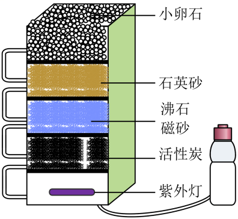

A. 能把自来水变成纯净物
B. 能除尽水中的可溶性杂质
C. 能除去水中的色素和异味
D. 净水时水最后流经小卵石

**答案**

C

**解析**

1. A 项：经该净水器净化后所得到的水中仍含有钙、镁离子等可溶性杂质，属于混合物，选项错误。
2. B 项：净水器主要除去不溶性固体杂质和异味，不能除尽水中的可溶性杂质，选项错误。
3. C 项：活性炭具有吸附性，可吸附水中的色素和异味，选项正确。
4. D 项：净水时水从上往下流动，最先流经小卵石，选项错误。

故选 C。

---

### Q-CHEM-GD2024-20-2

```yaml
category: 真题
source: 2024 年广东省初中学业水平考试 化学 第 20 题第（2）问
source_quality: 原卷
kp: CHEM-9A-04-1c
type: 填空
grading: 自评
answer_by: 原卷解析
do: 本章只做第（2）问
other_parts: CHEM-9A-02-2b 化合反应与氧化反应（第2问第一空）、CHEM-9A-05-1a 质量守恒定律及其微观解释（第3问）、九下（第1、4、5问）
review:
  概念: CHEM-9A-04-1c
  前置: CHEM-9A-02-2b
```

**题干**

铜箔在新能源汽车电池制造等领域有重要应用。一种制造铜箔工艺的主要工序如图1所示。

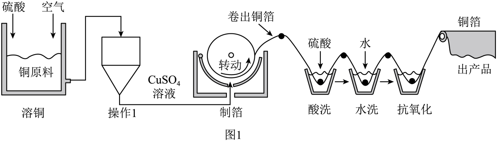

（2）“溶铜”中，存在 $\ce{Cu}$ 与 $\ce{O2}$ 生成 $\ce{CuO}$ 的反应，该反应属于______(填基本反应类型)。“操作1”的目的是除去难溶性固体杂质，该操作名称为______。

**答案**

化合反应；过滤

**解析**

1. 第一空：“溶铜”中存在 $\ce{Cu}$ 与 $\ce{O2}$ 生成 $\ce{CuO}$ 的反应，该反应符合“多变一”的特点，属于化合反应。
2. 第二空：“操作1”的目的是除去难溶性固体杂质，实现了固液分离，该基本实验操作名称为过滤。

---

### Q-CHEM-GZ2024-20-7

```yaml
category: 真题
source: 2024 年广州市初中学业水平考试 化学 第 20 题第（7）问
source_quality: 原卷
kp: CHEM-9A-04-1c
type: 填空
grading: 自评
answer_by: 原卷解析
do: 本章只做第（7）问
other_parts: CHEM-9A-01-2a 常见化学仪器的识别与用途（第1问）、九下（第2问）、CHEM-9A-01-2c 科学探究的基本环节与方法（第3、5问）、CHEM-9A-04-1b 水的净化方法与自来水生产流程（第4、6问）
review:
  概念: CHEM-9A-04-1c
```

**题干**

学习小组进行水质调查时发现某池塘水较浑浊，为此开展水质研究。

Ⅱ. 硬水的软化

（7）取少量水样，加入________，振荡后静置，产生较多浮渣，说明水样是硬水。用沉淀法除去水样中的 $\ce{Ca^{2+}}$ 和 $\ce{Mg^{2+}}$ 后，再加入盐酸调节溶液至中性，得到软水。

**答案**

肥皂水

**解析**

含有较多可溶性钙、镁化合物的水叫做硬水。将肥皂水滴加到含有较多 $\ce{Ca^{2+}}$、$\ce{Mg^{2+}}$ 的硬水中振荡，会形成较多浮渣、较少泡沫，所以实验中常用肥皂水来鉴别水样是否是硬水。

---

### Q-CHEM-GZ2023-10

```yaml
category: 真题
source: 2023 年广州市初中学业水平考试 化学 第 10 题
source_quality: 原卷
kp: CHEM-9A-04-2b
type: 选择
grading: 自动
answer_by: 原卷解析
review:
  概念: CHEM-9A-04-2b
  前置: CHEM-9A-03-1a
```

**题干**

用电解水实验探究水的元素组成，下列说法不正确的是（　　）

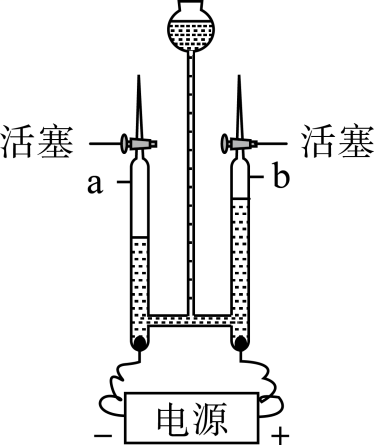

A. a管和b管中气体体积比约为2：1
B. b管中的气体能使燃着的木条烧得更旺
C. 该探究说明水中含有氢分子和氧分子
D. 该探究的依据是化学变化前后元素种类不变

**答案**

C

**解析**

1. A 项：电解水实验正极产生氧气，负极产生氢气，产生氢气和氧气的体积比约为 $2:1$。a 与负极相连，b 与正极相连，所以 a 管和 b 管中气体体积比约为 $2:1$，正确。
2. B 项：b 管收集到的是氧气，具有助燃性，能使燃着的木条烧得更旺，正确。
3. C 项：化学反应前后元素的种类不变，水通电分解生成氢气和氧气说明水由氢元素和氧元素组成，水中不含有氢分子和氧分子，错误。
4. D 项：该探究的依据是化学变化前后元素种类不变，从而从水分解的产物是氢气和氧气得出水由氢元素和氧元素组成，正确。

故选 C。

---

### Q-CHEM-GD2023-06

```yaml
category: 真题
source: 2023 年广东省初中学业水平考试 化学 第 6 题
source_quality: 原卷
kp: CHEM-9A-04-2c
type: 选择
grading: 自动
answer_by: 原卷解析
review:
  概念: CHEM-9A-04-2c
```

**题干**

下列物质均可用于杀菌消毒，其中属于氧化物的是（　　）

A. $\ce{O3}$
B. $\ce{ClO2}$
C. $\ce{NaClO}$
D. $\ce{C2H5OH}$

**答案**

B

**解析**

氧化物是只含有两种元素且其中一种元素是氧元素的化合物。
1. A 项：$\ce{O3}$ 是由一种元素组成的纯净物，属于单质，不符合题意。
2. B 项：$\ce{ClO2}$ 是由氯、氧两种元素组成的且其中一种是氧元素的化合物，属于氧化物，符合题意。
3. C 项：$\ce{NaClO}$ 是由钠、氯、氧三种元素组成的化合物，不属于氧化物，不符合题意。
4. D 项：$\ce{C2H5OH}$ 是由碳、氢、氧三种元素组成的化合物，不属于氧化物，不符合题意。

故选 B。

---

### Q-CHEM-GD2022-05

```yaml
category: 真题
source: 2022 年广东省初中学业水平考试 化学 第 5 题
source_quality: 原卷
kp: CHEM-9A-04-3a
type: 选择
grading: 自动
answer_by: 原卷解析
review:
  概念: CHEM-9A-04-3a
```

**题干**

下列化学用语表示两个分子的是（　　）

A. $\ce{O^{2-}}$
B. $\ce{2O3}$
C. $\ce{SO2}$
D. $\ce{2O}$

**答案**

B

**解析**

1. A 项：$\ce{O^{2-}}$ 表示一个氧离子，不符合题意。
2. B 项：化学式前加数字表示分子数目，$\ce{2O3}$ 表示 2 个臭氧分子，符合题意。
3. C 项：$\ce{SO2}$ 可以表示二氧化硫这种物质、一个二氧化硫分子等，不符合题意。
4. D 项：元素符号前加数字表示原子数目，$\ce{2O}$ 表示 2 个氧原子，不符合题意。

故选 B。

---

### Q-CHEM-GD2022-20-2

```yaml
category: 真题
source: 2022 年广东省初中学业水平考试 化学 第 20 题第（2）问
source_quality: 原卷
kp: CHEM-9A-04-3b
type: 填空
grading: 自评
answer_by: 原卷解析
do: 本章只做第（2）问
other_parts: CHEM-9A-06-1b 碳单质的化学性质（第1问）、CHEM-9A-06-2b 一氧化碳的性质与毒性（第3问）、CHEM-9A-02-2b 化合反应与氧化反应（第4问）、CHEM-9A-07-1c 化学反应中的能量变化（第4问）、CHEM-9A-05-2a 化学方程式的书写与含义（第5问）
review:
  概念: CHEM-9A-04-3b
  计算: CHEM-9A-04-3b
```

**题干**

《千里江山图》是我国传世名画之一，宋代画家王希孟创造性地将炭黑、赭石、孔雀石、蓝铜矿等矿物颜料用在不同的画层。

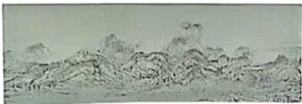

（2）画作的青色用到蓝铜矿，其主要成分为 $\ce{Cu3(OH)2(CO3)}_x$，$x=$______。

**答案**

2

**解析**

蓝铜矿的主要成分为 $\ce{Cu3(OH)2(CO3)}_x$。
在化合物中，铜元素显 $+2$ 价，氢氧根（$\ce{OH-}$）显 $-1$ 价，碳酸根（$\ce{CO3^{2-}}$）显 $-2$ 价。
依据化合物中各元素及原子团正负化合价代数和为 0 的原则：
$$(+2) \times 3 + (-1) \times 2 + (-2) \times x = 0$$
$$6 - 2 - 2x = 0$$
$$2x = 4 \implies x = \boxed{2}$$

---

### Q-CHEM-GZ2024-06

```yaml
category: 真题
source: 2024 年广州市初中学业水平考试 化学 第 6 题
source_quality: 原卷
kp: CHEM-9A-04-3c
type: 选择
grading: 自动
answer_by: 原卷解析
review:
  概念: CHEM-9A-04-3c
  计算: CHEM-9A-04-3c
```

**题干**

蔗糖是食品中常用的甜味剂，其化学式为 $\ce{C12H22O11}$。下列关于蔗糖的说法正确的是（　　）

A. 属于无机化合物
B. $\ce{C}$、$\ce{H}$、$\ce{O}$ 三种元素的质量比为 $12:22:11$
C. 1个蔗糖分子中含有11个水分子
D. 氧元素的质量分数为 $\dfrac{16 \times 11}{12 \times 12 + 1 \times 22 + 16 \times 11} \times 100\%$

**答案**

D

**解析**

1. A 项：由蔗糖的化学式 $\ce{C12H22O11}$ 可知，它是一种含碳元素的化合物，属于有机物，故选项说法错误。
2. B 项：蔗糖中碳、氢、氧的质量比为 $(12 \times 12) : (1 \times 22) : (16 \times 11) = 144 : 22 : 176 = 72 : 11 : 88 \ne 12 : 22 : 11$，故选项说法错误。
3. C 项：由蔗糖的化学式 $\ce{C12H22O11}$ 可知，蔗糖是由蔗糖分子构成的，一个蔗糖分子是由 12 个碳原子、22 个氢原子和 11 个氧原子构成的，蔗糖分子中不含水分子，故选项说法错误。
4. D 项：蔗糖中氧元素的质量分数为 $\dfrac{16 \times 11}{12 \times 12 + 1 \times 22 + 16 \times 11} \times 100\%$，故选项说法正确。

故选 D。

---

### Q-CHEM-GD2019-10

```yaml
category: 真题
source: 2019 年广东省初中学业水平考试 化学 第 10 题
source_quality: 原卷（本地存档 Word 转 PDF 页，逐页核对）
kp: CHEM-9A-04-4a
type: 选择
grading: 自动
answer_by: 原卷解析
review:
  概念: CHEM-9A-04-4a
```

**题干**

电解水实验装置如图所示。下列说法正确的是（　　）

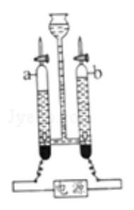

A．电解前后元素种类不变

B．实验说明水由 $\ce{H2}$ 和 $\ce{O2}$ 组成

C．反应的化学方程式为 $2\ce{H2O}=2\ce{H2}\uparrow+\ce{O2}\uparrow$

D．a 管收集的气体能使燃着的木条燃烧更旺

**答案**

A

**解析**

由质量守恒定律，反应前后元素种类不变，A 正确。电解水说明水由氢元素和氧元素组成，水中没有氢气和氧气，B 错。方程式缺少反应条件“通电”，C 错。a 管与电源负极相连，气体体积多，是氢气，不能使燃着的木条燃烧更旺，D 错。

---

### Q-CHEM-SZ2019-06

```yaml
category: 真题
source: 2019 年深圳市中考 化学 第 6 题
source_quality: 原卷（本地存档 Word 转 PDF 页，逐页核对）
kp: CHEM-9A-04-2a
type: 选择
grading: 自动
answer_by: 原卷解析
review:
  概念: CHEM-9A-04-2a
```

**题干**

$\ce{CuO}$ 粉末与 $\ce{H2}$ 在加热条件下会发生反应。下列说法错误的是（　　）

A．反应所需 $\ce{H2}$ 可由 $\ce{Cu}$ 与稀 $\ce{H2SO4}$ 反应制得

B．反应过程可观察到固体粉末由黑色变成红色

C．发生的反应为 $\ce{CuO}+\ce{H2}\xrightarrow{\triangle}\ce{Cu}+\ce{H2O}$

D．该反应说明 $\ce{H2}$ 具有还原性

**答案**

A

**解析**

铜排在金属活动性顺序氢的后面，不能与稀硫酸反应，不能制得氢气，A 错误。氢气还原氧化铜，黑色粉末变红，生成铜和水，说明氢气具有还原性，B、C、D 正确。

---

## 备选题

### Q-CHEM-GD2022-14

```yaml
category: 真题
source: 2022 年广东省初中学业水平考试 化学 第 14 题
source_quality: 原卷
kp: CHEM-9A-04-1b
type: 选择
grading: 自动
answer_by: 原卷解析
review:
  概念: CHEM-9A-04-1b
```

**题干**

劳动课程标准要求学生承担家庭劳动。下列项目与所涉及的化学知识不相符的是（　　）

| 选项 | 项目 | 化学知识 |
| :--- | :--- | :--- |
| A | 用燃气灶炒菜 | 燃气燃烧放热 |
| B | 用炉具清洁剂去除油污 | $\ce{NaOH}$ 可与油脂反应 |
| C | 用厨余垃圾自制花肥 | 物质发生缓慢氧化 |
| D | 往自制净水器内放入活性炭 | 活性炭具有催化作用 |

A. A
B. B
C. C
D. D

**答案**

D

**解析**

1. A 项：用燃气灶炒菜，是因为燃气具有可燃性，燃烧放出热量，不符合题意。
2. B 项：用炉具清洁剂去除油污，是因为炉具清洁剂中含有氢氧化钠，氢氧化钠能与油脂反应，不符合题意。
3. C 项：用厨余垃圾自制花肥，是因为厨余垃圾能与空气中的氧气发生缓慢氧化，不符合题意。
4. D 项：往自制净水器内放入活性炭，是因为活性炭具有吸附性，可以吸附水中的色素和异味，而不是具有催化作用，符合题意。

故选 D。

---

### Q-CHEM-GD2025-12

```yaml
category: 真题
source: 2025 年广东省初中学业水平考试 化学 第 12 题
source_quality: 原卷
kp: CHEM-9A-04-1b
type: 选择
grading: 自动
answer_by: 原卷解析
review:
  概念: CHEM-9A-04-1b
```

**题干**

下列关于自来水厂净水的说法错误的是（　　）

A. 自来水厂的水源需要保护
B. 明矾可使悬浮的杂质沉降
C. 消毒除去水中部分微生物
D. 自来水厂净水后得到纯水

**答案**

D

**解析**

1. A 项：自来水厂的水源是提供生活用水的源头，需要重点保护防止污染，该说法正确。
2. B 项：明矾溶于水形成的胶状物能吸附水中悬浮的杂质，使杂质沉降，该说法正确。
3. C 项：消毒过程中使用消毒剂，可除去水中部分微生物，保障饮用水安全，该说法正确。
4. D 项：自来水厂净水过程主要包括沉淀、过滤、吸附、消毒等，只能除去水中的不溶性杂质和部分可溶性杂质、微生物，得到的自来水中仍含有一些可溶性矿物质等，不是纯水，该说法错误。

故选 D。

---

### Q-CHEM-GZ2024-07

```yaml
category: 真题
source: 2024 年广州市初中学业水平考试 化学 第 7 题
source_quality: 原卷
kp: CHEM-9A-04-1b
type: 选择
grading: 自动
answer_by: 原卷解析
review:
  概念: CHEM-9A-04-1b
```

**题干**

劳动谱写时代华章，奋斗创造美好未来。下列劳动项目与所涉及的化学知识没有关联的是（　　）

| 选项 | 劳动项目 | 化学知识 |
| :--- | :--- | :--- |
| A | 用白醋除去水垢 | 醋酸具有酸性 |
| B | 洗净擦干炒菜后的铁锅 | 铁潮湿空气中易生锈 |
| C | 用活性炭制作简易净水器 | 活性炭具有导电性 |
| D | 利用秸秆发酵产生沼气 | 沼气中含有的甲烷可作燃料 |

A. A
B. B
C. C
D. D

**答案**

C

**解析**

1. A 项：水垢主要成分是碳酸钙、氢氧化镁，白醋中含有醋酸，醋酸具有酸性，能与碳酸钙、氢氧化镁反应，所以用白醋能除去水垢，说法正确，不符合题意。
2. B 项：铁在潮湿空气中易生锈，炒菜后的铁锅洗净擦干，是为了防止铁生锈，说法正确，不符合题意。
3. C 项：用活性炭制作简易净水器，是利用了活性炭具有吸附性，能吸附水中的色素及异味，与导电性无关，说法错误，符合题意。
4. D 项：利用秸秆发酵产生沼气，沼气中含有甲烷，甲烷具有可燃性，能用作燃料，说法正确，不符合题意。

故选 C。

---

### Q-CHEM-GZ2024-20-4

```yaml
category: 真题
source: 2024 年广州市初中学业水平考试 化学 第 20 题第（4）（6）问
source_quality: 原卷
kp: CHEM-9A-04-1b
type: 实验
grading: 自评
answer_by: 原卷解析
do: 本题选做第（4）（6）问
other_parts: CHEM-9A-01-2a 常见化学仪器的识别与用途（第1问）、九下（第2问）、CHEM-9A-01-2c 科学探究的基本环节与方法（第3、5问）、CHEM-9A-04-1c 过滤操作与硬水软化（第7问）
review:
  概念: CHEM-9A-04-1b
```

**题干**

学习小组进行水质调查时发现某池塘水较浑浊，为此开展水质研究。
【查阅资料】
①明矾溶于水生成的 $\ce{Al(OH)3}$ 胶体，能吸附水中悬浮物，发生沉降，从而达到净水目的。
②$\ce{Al(OH)3}$ 胶体能溶于酸。
③净水效果可用浊度去除率 $A$ 表示，$A$ 值越大表示净水效果越好。
I. 探究影响明矾净水效果的因素
【提出猜想】猜想 a：一定范围内，明矾的用量越大，净水效果越好。
猜想 b：一定范围内，水样的酸性越强，净水效果越差。
【设计实验，验证猜想】取该水样，按实验方案加入不同体积的 1%絮凝剂溶液和 9.8%硫酸溶液，充分搅拌，静置后测定水样的浊度并计算得到浊度去除率。

【数据分析，交流讨论】
| 实验序号 | 水样体积/mL | 1%絮凝剂溶液体积/mL | 9.8%硫酸体积/mL | 蒸馏水体积/mL | $t$ min 后浊度去除率 |
| --- | --- | --- | --- | --- | --- |
| ⅰ | 200 | 5.0 | 0 | 5.0 | $A_1$ |
| ⅱ | 200 | $V_1$ | 0 | 7.5 | $A_2$ |
| ⅲ | 200 | 0 | 0 | $V_2$ | $A_3$ |

实验 ⅰ、ⅱ、ⅲ 用于探究猜想 a 是否成立，其中 $V_1=2.5$，$V_2=10.0$。

（4）实验测得 $A_1 > A_2 > A_3$，由此得出的结论是________。
（6）水样的酸性越强，净水效果越差，原因是________。

**答案**

（4）一定范围内，明矾的用量越大，净水效果越好；
（6）明矾溶于水生成的 $\ce{Al(OH)3}$ 胶体溶于硫酸，吸附水中悬浮物的能力减小

**解析**

1. 第（4）问：实验 ⅰ、ⅱ、ⅲ 中絮凝剂（明矾）的用量依次为 5.0 mL、2.5 mL、0，依次减小，根据测得结果 $A_1 > A_2 > A_3$，可以得出的结论是：一定范围内，明矾的用量越大，净水效果越好。
2. 第（6）问：根据资料，明矾溶于水生成的 $\ce{Al(OH)3}$ 胶体能吸附水中悬浮物发生沉降。因为 $\ce{Al(OH)3}$ 胶体能和硫酸等酸性物质反应，所以水样的酸性越强，$\ce{Al(OH)3}$ 胶体溶解消耗得越多，吸附水中悬浮物的能力减小，净水效果变差。

---

### Q-CHEM-GD2023-16-4

```yaml
category: 真题
source: 2023 年广东省初中学业水平考试 化学 第 16 题第（4）问
source_quality: 原卷
kp: CHEM-9A-04-1c
type: 填空
grading: 自评
answer_by: 原卷解析
do: 本章只做第（4）问
other_parts: CHEM-9A-07-1a 燃烧条件与灭火原理（第2问）、CHEM-9A-07-1c 化学反应中的能量变化（第3问）、CHEM-9A-03-1a 分子的基本性质及现象解释（第5问）、九下（第1、2问）
review:
  概念: CHEM-9A-04-1c
```

**题干**

我国是茶文化的发源地。唐代陆羽《茶经》中记载：“风炉以铜铁铸之……底一窗以为通飚漏烬之所……风能兴火，火能熟水。”“漉水囊……其格以生铜铸之。”

（4）“漉水囊”可将茶叶与茶水分离，类似于基本实验操作中的________。

**答案**

过滤

**解析**

“漉水囊”可将茶叶与茶水分离，类似于基本实验操作中的过滤，过滤可实现难溶性固体与液体的分离。

---

### Q-CHEM-GD2025-16-5

```yaml
category: 真题
source: 2025 年广东省初中学业水平考试 化学 第 16 题第（5）问
source_quality: 原卷
kp: CHEM-9A-04-1c
type: 填空
grading: 自评
answer_by: 原卷解析
do: 本章只做第（5）问
other_parts: CHEM-9A-03-1a 分子的基本性质及现象解释（第2问）、CHEM-9A-06-1a 碳单质的物理性质与微观结构（第3问）、九下（第1、2、4问）
review:
  概念: CHEM-9A-04-1c
```

**题干**

《疡医大全》记载西瓜霜具有治疗口腔溃疡的功效。西瓜霜（主要成分是硫酸钠）的一种炮制过程如图1。

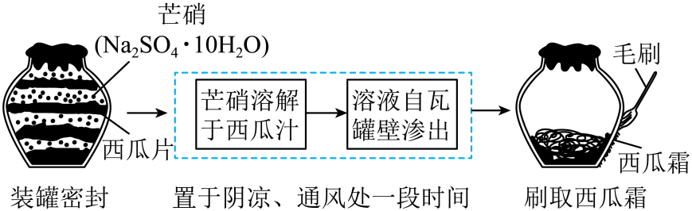
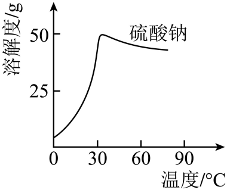

（5）《中国药典》中评价西瓜霜的质量指标之一是硫酸钠的含量。一种测量方法为：取一定量样品处理后，加入过量 $\ce{BaCl2}$ 溶液，经__________、洗涤、干燥，称量沉淀质量后计算含量。

**答案**

过滤

**解析**

加入过量氯化钡溶液后，硫酸钠与氯化钡反应生成硫酸钡沉淀，通过过滤操作将沉淀与液体分离，再经洗涤、干燥后称量沉淀质量。

---

### Q-CHEM-GD2022-17-3

```yaml
category: 真题
source: 2022 年广东省初中学业水平考试 化学 第 17 题第（3）问
source_quality: 原卷
kp: CHEM-9A-04-2b
type: 填空
grading: 自评
answer_by: 原卷解析
do: 本章只做第（3）问
other_parts: CHEM-9A-02-3a 催化剂与分解反应（第1问）、CHEM-9A-04-2c 单质、化合物与氧化物的判断（第1问）、CHEM-9A-05-2a 化学方程式的书写与含义（第2问）、CHEM-9A-03-1a 分子的基本性质及现象解释（第4问）、CHEM-9A-07-2a 化石能源的综合利用与甲烷（第5问）
review:
  概念: CHEM-9A-04-2b
```

**题干**

我国科学家研制了一种新型催化剂，实现了甲烷向重要化工原料甲醇的高效转化。反应过程的微观示意图如图1所示。


（3）反应物中的一种气体可供呼吸。利用下图中的电解水装置制取时，它会在______管（填字母）中产生。

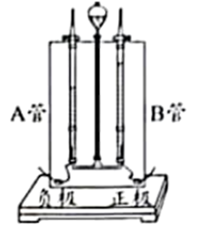

**答案**

B

**解析**

反应物中可供呼吸的气体是氧气。在电解水装置中，水通电分解“正氧负氢”，管 b 与直流电源的正极相连，因此氧气会在管 b 中产生。

---

### Q-CHEM-GD2025-02

```yaml
category: 真题
source: 2025 年广东省初中学业水平考试 化学 第 2 题
source_quality: 原卷
kp: CHEM-9A-04-2c
type: 选择
grading: 自动
answer_by: 原卷解析
review:
  概念: CHEM-9A-04-2c
```

**题干**

创新“智”造的“中国芯”所选用的单晶硅（$\ce{Si}$）属于（　　）

A. 单质
B. 化合物
C. 氧化物
D. 盐

**答案**

A

**解析**

1. A 项：单质是由同种元素组成的纯净物。单晶硅（$\ce{Si}$）是由硅元素一种元素组成的纯净物，属于单质，A 正确。
2. B 项：化合物是由不同种元素组成的纯净物，单晶硅只含一种元素，不是化合物，B 错误。
3. C 项：氧化物是由两种元素组成且其中一种是氧元素的化合物，单晶硅不含氧元素，不属于氧化物，C 错误。
4. D 项：盐是由金属离子（或铵根离子）和酸根离子组成的化合物，单晶硅不符合盐的定义，D 错误。

故选 A。

---

### Q-CHEM-GZ2022-16-2

```yaml
category: 真题
source: 2022 年广州市初中学业水平考试 化学 第 16 题第（2）问
source_quality: 原卷
kp: CHEM-9A-04-2c
type: 填空
grading: 自评
answer_by: 原卷解析
do: 本章只做第（2）问
other_parts: CHEM-9A-01-2a 常见化学仪器的识别与用途（第1问）、CHEM-9A-06-1b 碳单质的化学性质（第3问，窑炉中碳燃烧生成 CO 及还原反应）
review:
  概念: CHEM-9A-04-2c
```

**题干**

陶瓷是火与土的结晶，是中华民族文化的象征之一。

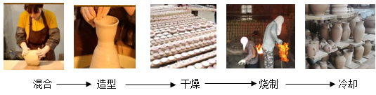

（2）烧制陶瓷的原料为黏土，某黏土的成分如下表，所列出的四种氧化物中属于非金属氧化物的是_______。(写化学式)

| 成分 | 二氧化硅 | 氧化铝 | 氧化铁 | 氧化镁 | 其它 |
| --- | --- | --- | --- | --- | --- |
| 质量分数/% | 69.51 | 14.15 | 2.55 | 1.31 | 12.48 |

**答案**

$\ce{SiO2}$

**解析**

二氧化硅中的硅元素属于非金属元素，因此二氧化硅属于非金属氧化物，化学式为 $\ce{SiO2}$；氧化铝、氧化铁、氧化镁中的铝、铁、镁均属于金属元素，对应的氧化物属于金属氧化物。

---

### Q-CHEM-GD2022-11

```yaml
category: 真题
source: 2022 年广东省初中学业水平考试 化学 第 11 题
source_quality: 原卷
kp: CHEM-9A-04-3a
type: 选择
grading: 自动
answer_by: 原卷解析
other_parts: CHEM-9A-04-3c 基于化学式的定量计算
review:
  概念: CHEM-9A-04-3a
```

**题干**

研究发现千金藤素（$\ce{C37H38N2O6}$）可抑制某些冠状病毒在细胞中的复制。下列关于千金藤素的说法正确的是（　　）

A. 属于氧化物
B. 含有氮分子
C. 由四种元素组成
D. 氢元素的质量分数最小

**答案**

C

**解析**

1. A 项：由化学式可知，千金藤素由碳、氢、氮、氧四种元素组成，不属于氧化物，不符合题意。
2. B 项：千金藤素由千金藤素分子构成，不含氮分子，不符合题意。
3. C 项：由化学式可知，千金藤素由碳、氢、氮、氧四种元素组成，符合题意。
4. D 项：千金藤素中碳、氢、氮、氧元素的质量比为 $(12 \times 37) : (1 \times 38) : (14 \times 2) : (16 \times 6) = 444 : 38 : 28 : 96 = 222 : 19 : 14 : 48$，氮元素的质量分数最小，不符合题意。

故选 C。

---

### Q-CHEM-GD2023-05

```yaml
category: 真题
source: 2023 年广东省初中学业水平考试 化学 第 5 题
source_quality: 原卷
kp: CHEM-9A-04-3a
type: 选择
grading: 自动
answer_by: 原卷解析
review:
  概念: CHEM-9A-04-3a
```

**题干**

化学用语是学习化学的工具。下列表示两个氮原子的是（　　）

A. $\ce{2N}$
B. $\ce{N2}$
C. $\ce{2NH3}$
D. $\ce{N2O4}$

**答案**

A

**解析**

1. A 项：元素符号前的数字表示原子个数，故 $\ce{2N}$ 表示 2 个氮原子，符合题意。
2. B 项：化学式中右下角的数字表示一个分子含有的该原子的个数，故 $\ce{N2}$ 表示一个氮分子中含有 2 个氮原子，不符合题意。
3. C 项：化学式前的数字表示分子个数，故 $\ce{2NH3}$ 表示 2 个氨分子，不符合题意。
4. D 项：$\ce{N2O4}$ 表示一个四氧化二氮分子中含有 2 个氮原子，不符合题意。

故选 A。

---

### Q-CHEM-GD2024-04

```yaml
category: 真题
source: 2024 年广东省初中学业水平考试 化学 第 4 题
source_quality: 原卷
kp: CHEM-9A-04-3a
type: 选择
grading: 自动
answer_by: 原卷解析
review:
  概念: CHEM-9A-04-3a
```

**题干**

化学用语是学习化学的工具。下列表示2个氯原子的是（　　）

A. $\ce{2Cl}$
B. $\ce{Cl2}$
C. $\ce{MgCl2}$
D. $\ce{2HCl}$

**答案**

A

**解析**

1. A 项：原子的表示方法是用元素符号表示一个原子，表示多个该原子就在其元素符号前加上相应的数字，故 $\ce{2Cl}$ 表示 2 个氯原子，符合题意。
2. B 项：$\ce{Cl2}$ 表示 1 个氯分子，不符合题意。
3. C 项：$\ce{MgCl2}$ 是氯化镁的化学式，表示氯化镁这种物质，不符合题意。
4. D 项：化学式前加数字表示分子个数，$\ce{2HCl}$ 表示 2 个氯化氢分子，不符合题意。

故选 A。

---

### Q-CHEM-GD2024-11

```yaml
category: 真题
source: 2024 年广东省初中学业水平考试 化学 第 11 题
source_quality: 原卷
kp: CHEM-9A-04-3a
type: 选择
grading: 自动
answer_by: 原卷解析
other_parts: CHEM-9A-04-3c 基于化学式的定量计算
review:
  概念: CHEM-9A-04-3a
```

**题干**

“百年陈皮胜黄金”。陈皮含有香芹酮($\ce{C10H14O}$)，关于香芹酮的说法正确的是（　　）

A. 由三种元素组成
B. 含有25个原子
C. 碳、氢原子个数比为 $12:1$
D. 氢元素质量分数最大

**答案**

A

**解析**

1. A 项：香芹酮由碳、氢、氧三种元素组成，说法正确，符合题意。
2. B 项：香芹酮由香芹酮分子构成，1 个香芹酮分子中含有 10 个碳原子、14 个氢原子和 1 个氧原子共 25 个原子，不能说香芹酮物质含有 25 个原子，说法错误，不符合题意。
3. C 项：香芹酮中碳、氢原子个数比为 $10:14 = 5:7 \ne 12:1$，说法错误，不符合题意。
4. D 项：香芹酮中碳、氢、氧元素的质量比为 $(12 \times 10) : (1 \times 14) : 16 = 120 : 14 : 16 = 60 : 7 : 8$，则香芹酮中碳元素的质量分数最大，说法错误，不符合题意。

故选 A。

---

### Q-CHEM-GD2025-05

```yaml
category: 真题
source: 2025 年广东省初中学业水平考试 化学 第 5 题
source_quality: 原卷
kp: CHEM-9A-04-3a
type: 选择
grading: 自动
answer_by: 原卷解析
review:
  概念: CHEM-9A-04-3a
```

**题干**

下列表述正确的是（　　）

A. 氖气：$\ce{Ne2}$
B. 氧化钠：$\ce{Na2O}$
C. 1个水分子：$\ce{H2O2}$
D. 2个氮原子：$\ce{N2}$

**答案**

B

**解析**

1. A 项：氖气是由氖原子直接构成的单质，其化学式为 $\ce{Ne}$，不是 $\ce{Ne2}$，错误。
2. B 项：氧化钠中钠元素显 $+1$ 价，氧元素显 $-2$ 价，根据化合物中正负化合价代数和为零，其化学式为 $\ce{Na2O}$，正确。
3. C 项：$\ce{H2O2}$ 是过氧化氢的化学式，1 个水分子应表示为 $\ce{H2O}$，错误。
4. D 项：原子的表示方法是在元素符号前加上相应数字，2 个氮原子应表示为 $\ce{2N}$，$\ce{N2}$ 表示氮气或 1 个氮分子，错误。

故选 B。

---

### Q-CHEM-GZ2022-15-1

```yaml
category: 真题
source: 2022 年广州市初中学业水平考试 化学 第 15 题第（1）问
source_quality: 原卷
kp: CHEM-9A-04-3a
type: 填空
grading: 自评
answer_by: 原卷解析
do: 本章只做第（1）问
other_parts: CHEM-9A-03-3b 元素周期表单元格信息（第1问第一空）、九下（第2、3问）
review:
  概念: CHEM-9A-04-3a
```

**题干**

北京冬奥会成为迄今为止第一个“碳中和”的冬奥会。碲化镉可用于制作薄膜太阳能电池，国家速滑馆“冰丝带”外墙使用了大量碲化镉发电玻璃。

（1）如图是元素周期表中元素镉、碲的相关信息，回答下列问题：

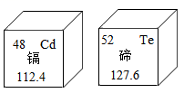

①镉的相对原子质量为_______。
②碲有多种化合价，$\ce{Te2O5}$ 读作_______。

**答案**

112.4；五氧化二碲

**解析**

1. ① 小问：在元素周期表中，元素名称下方的数字表示相对原子质量，故镉的相对原子质量为 112.4。
2. ② 小问：根据“先写后读，后写先读”，$\ce{Te2O5}$ 读作五氧化二碲。

---

### Q-CHEM-GD2024-21-1

```yaml
category: 真题
source: 2024 年广东省初中学业水平考试 化学 第 21 题第（1）问
source_quality: 原卷
kp: CHEM-9A-04-3b
type: 填空
grading: 自评
answer_by: 原卷解析
do: 本章只做第（1）问
other_parts: CHEM-9A-05-2b 根据化学方程式的简单计算（第2问）
review:
  概念: CHEM-9A-04-3b
  计算: CHEM-9A-04-3c
```

**题干**

科研人员提出一种回收利用铝冶炼产生的废渣赤泥(含 $\ce{Fe2O3}$)的新方法，助力产业逐“绿”前行。应用新方法从赤泥中提取铁的装置示意图如图1所示。


（1）$\ce{Fe2O3}$ 中铁元素的化合价是______，铁、氧元素的质量比为______。

**答案**

+3；$7:3$

**解析**

1. 第一空：$\ce{Fe2O3}$ 中氧元素显 $-2$ 价，设铁元素的化合价为 $x$。根据化合物中各元素正负化合价代数和为 0：$2x + 3 \times (-2) = 0 \implies x = +3$。
2. 第二空：$\ce{Fe2O3}$ 中铁、氧元素的质量比为 $(56 \times 2) : (16 \times 3) = 112 : 48 = 7 : 3$。

---

### Q-CHEM-GD2025-21-2-i

```yaml
category: 真题
source: 2025 年广东省初中学业水平考试 化学 第 21 题第（2）i 问
source_quality: 原卷
kp: CHEM-9A-04-3b
type: 填空
grading: 自评
answer_by: 原卷解析
do: 本章只做第（2）问第 ⅰ 小问
other_parts: CHEM-9A-07-2b 化石燃料利用对环境的影响与防治（第1问）、CHEM-9A-05-2b 根据化学方程式的简单计算（第2问第ⅱ、ⅲ小问）
review:
  概念: CHEM-9A-04-3b
  计算: CHEM-9A-04-3b
```

**题干**

甲醇（$\ce{CH3OH}$）作为燃料应用于汽车领域，有助于推动能源结构优化。

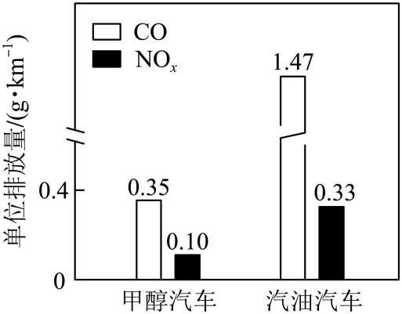

（2）$\ce{CO2}$ 制备 $\ce{CH3OH}$ 的化学方程式为 $\ce{CO2 + 3H2 ->[\text{催化剂}] CH3OH + H2O}$。
ⅰ. 该反应催化剂主要成分三氧化二铟（$\ce{In2O3}$）中 $\text{In}$ 的化合价为__________。

**答案**

+3

**解析**

在三氧化二铟（$\ce{In2O3}$）中，氧元素显 $-2$ 价。
设 $\text{In}$ 元素的化合价为 $x$。
根据化合物中各元素正负化合价代数和为 0：
$$2x + 3 \times (-2) = 0 \implies 2x = 6 \implies x = \boxed{+3}$$

---

### Q-CHEM-GD2022-16-2

```yaml
category: 真题
source: 2022 年广东省初中学业水平考试 化学 第 16 题第（2）（4）问
source_quality: 原卷
kp: CHEM-9A-04-3c
type: 填空
grading: 自评
answer_by: 原卷解析
do: 本题选做第（2）（4）问
other_parts: CHEM-9A-03-3a 元素的概念与元素符号（第3问）、九下（第1问）
review:
  概念: CHEM-9A-04-3c
  计算: CHEM-9A-04-3c
```

**题干**

炉甘石始载于《外丹本草》，主要成分为碳酸锌（$\ce{ZnCO3}$）和碱式碳酸锌，炮制后主要成分为氧化锌（$\ce{ZnO}$）可作为外用药使用。

（2）碳酸锌中锌、氧元素的原子个数比为______，质量比为______。
（4）药效高低与有效成分的含量相关。碳酸锌的抑菌活性低于相同质量的氧化锌，可能的原因是______。

**答案**

$1:3$；$65:48$；等质量的碳酸锌中锌元素的质量小于氧化锌中锌元素的质量

**解析**

1. 第（2）问：$\ce{ZnCO3}$ 中锌原子和氧原子个数比为 $1:3$；元素质量比等于相对原子质量乘以个数的比值，即 $(65 \times 1) : (16 \times 3) = 65 : 48$。
2. 第（4）问：等质量的碳酸锌中锌元素的质量小于氧化锌中锌元素的质量，所以碳酸锌的抑菌活性低于相同质量的氧化锌。

---

### Q-CHEM-GD2023-21-1

```yaml
category: 真题
source: 2023 年广东省初中学业水平考试 化学 第 21 题第（1）问
source_quality: 原卷
kp: CHEM-9A-04-3c
type: 填空
grading: 自评
answer_by: 原卷解析
do: 本章只做第（1）问
other_parts: CHEM-9A-05-2b 根据化学方程式的简单计算（第2、3问）、CHEM-9A-06-2b 一氧化碳的性质与毒性（第4问）
review:
  概念: CHEM-9A-04-3c
  计算: CHEM-9A-04-3c
```

**题干**

羰基铁粉在国防军工领域有重要应用，我国是少数几个掌握其生产技术的国家之一。制备羰基铁粉的过程如图所示。

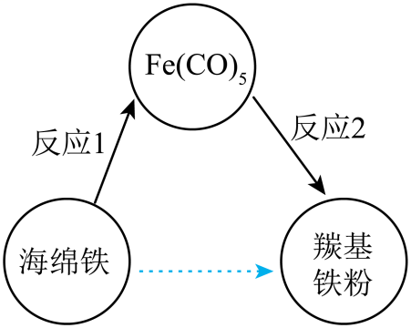
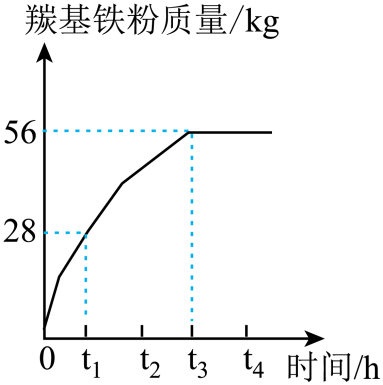

（1）$\ce{Fe(CO)5}$ 中碳、氧元素的质量比为___________。

**答案**

$3:4$

**解析**

$\ce{Fe(CO)5}$ 中碳、氧元素的质量比为 $(12 \times 5) : (16 \times 5) = 60 : 80 = 3 : 4$。

---

### Q-CHEM-GD2025-07

```yaml
category: 真题
source: 2025 年广东省初中学业水平考试 化学 第 7 题
source_quality: 原卷
kp: CHEM-9A-04-3c
type: 选择
grading: 自动
answer_by: 原卷解析
review:
  概念: CHEM-9A-04-3c
  计算: CHEM-9A-04-3c
```

**题干**

“却是南中春色别，满城都是木棉花。”木棉花中含有山奈酚（$\ce{C15H10O6}$），关于山奈酚的说法正确的是（　　）

A. 由4种元素组成
B. 碳元素的质量分数最大
C. 含有31个原子
D. 氢元素和氧元素的质量比为 $5:3$

**答案**

B

**解析**

1. A 项：由山奈酚的化学式 $\ce{C15H10O6}$ 可知，它是由碳、氢、氧 3 种元素组成，不是 4 种元素，A 错误。
2. B 项：山奈酚中碳、氢、氧元素的质量比为 $(12 \times 15) : (1 \times 10) : (16 \times 6) = 180 : 10 : 96$，可见碳元素的质量分数最大，B 正确。
3. C 项：山奈酚是由山奈酚分子构成，一个山奈酚分子中含有 $15+10+6=31$ 个原子，不能说山奈酚含有 31 个原子，C 错误。
4. D 项：山奈酚中氢元素和氧元素的质量比为 $(1 \times 10) : (16 \times 6) = 10 : 96 = 5 : 48 \ne 5 : 3$，D 错误。

故选 B。

---

### Q-CHEM-GZ2022-08

```yaml
category: 真题
source: 2022 年广州市初中学业水平考试 化学 第 8 题
source_quality: 原卷
kp: CHEM-9A-04-3c
type: 选择
grading: 自动
answer_by: 原卷解析
review:
  概念: CHEM-9A-04-3c
  计算: CHEM-9A-04-3c
```

**题干**

酚酞（$\ce{C20H14O4}$）是常见的酸碱指示剂。下列关于酚酞的说法正确的是（　　）

A. 属于无机化合物
B. 相对分子质量为 $(12 \times 20 + 1 \times 14 + 16 \times 4)\ \mathrm{g}$
C. $\ce{C}$、$\ce{H}$、$\ce{O}$ 三种元素的质量比为 $(12 \times 20) : (1 \times 14) : (16 \times 4)$
D. 碳元素的质量分数为 $\dfrac{20}{20 + 14 + 4} \times 100\%$

**答案**

C

**解析**

1. A 项：根据酚酞的化学式知：酚酞是含有碳元素的化合物，属于有机物，错误。
2. B 项：相对分子质量的单位不是“g”，而是“1”，通常省略不写，错误。
3. C 项：酚酞中碳、氢、氧三种元素的质量比为 $(12 \times 20) : (1 \times 14) : (16 \times 4) = 120 : 7 : 32$，正确。
4. D 项：酚酞中碳元素的质量分数为 $\dfrac{12 \times 20}{12 \times 20 + 1 \times 14 + 16 \times 4} \times 100\%$，错误。

故选 C。

---

### Q-CHEM-TB9A-4.1-1

```yaml
category: 课本习题
source: 人教版 化学 九年级上册 课题1 练习与应用 第 1 题（p.90）
source_quality: 课本
kp: CHEM-9A-04-1c
type: 选择
grading: 自动
answer_by: 本项目编写，待复核
review:
  概念: CHEM-9A-04-1c
```

**题干**

下列关于过滤操作的叙述中，不正确的是（　　）

A. 液面不要低于滤纸的边缘
B. 滤纸的边缘要略低于漏斗口
C. 玻璃棒要靠在三层滤纸的一边
D. 漏斗下端管口要紧靠烧杯内壁

**答案**

A

**解析**

1. A 项：过滤操作中液面必须始终低于滤纸的边缘，若液面高于滤纸边缘，液体会从滤纸与漏斗之间的缝隙直接流下导致过滤失败，故 A 叙述不正确。
2. B 项：滤纸边缘略低于漏斗口，防止液体从漏斗外壁溢出，符合“二低”规范，叙述正确。
3. C 项：倾倒液体时玻璃棒下端应轻轻靠在三层滤纸的一侧，防止戳破滤纸，符合“三靠”规范，叙述正确。
4. D 项：漏斗下端长管口紧靠承接滤液的烧杯内壁，能防止滤液飞溅并加快过滤速率，符合“三靠”规范，叙述正确。

故选 A。

---

### Q-CHEM-TB9A-4.2-1

```yaml
category: 课本习题
source: 人教版 化学 九年级上册 课题2 练习与应用 第 1 题（p.95）
source_quality: 课本
kp: CHEM-9A-04-2c
type: 选择
grading: 自动
answer_by: 本项目编写，待复核
review:
  概念: CHEM-9A-04-2c
```

**题干**

下列物质中，属于化合物的是（　　）

A. 食醋
B. 白酒
C. 糖水
D. 水

**答案**

D

**解析**

化合物是由不同种元素组成的纯净物。
1. A 项：食醋含有醋酸、水等多种物质，属于混合物，错误。
2. B 项：白酒含有酒精、水等多种成分，属于混合物，错误。
3. C 项：糖水是蔗糖溶解在水中形成的混合物，错误。
4. D 项：水是由氢元素和氧元素两种不同元素组成的纯净物，化学式为 $\ce{H2O}$，属于化合物，正确。

故选 D。

---

### Q-CHEM-TB9A-4.3-1

```yaml
category: 课本习题
source: 人教版 化学 九年级上册 课题3 练习与应用 第 1 题（p.103）
source_quality: 课本
kp: CHEM-9A-04-3a
type: 选择
grading: 自动
answer_by: 本项目编写，待复核
review:
  概念: CHEM-9A-04-3a
```

**题干**

五氧化二氮的化学式是（　　）

A. $\ce{5O2N}$
B. $\ce{O5N2}$
C. $\ce{N2O5}$
D. $\ce{2N5O}$

**答案**

C

**解析**

化学式书写和命名通常是“先写后读，后写先读”。
根据名称“五氧化二氮”，氧元素在后读作“氧化”，氮元素在前；化学式中氮原子数为 2、氧原子数为 5，氮元素写在左边、氧元素写在右边，右下方分别标出原子数，化学式为 $\ce{N2O5}$。

故选 C。
