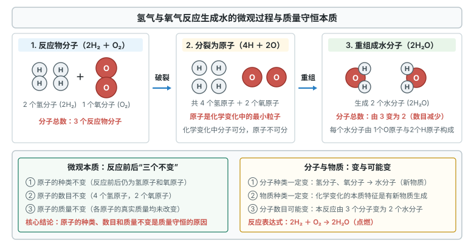
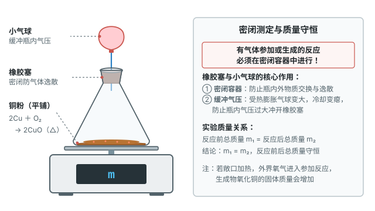
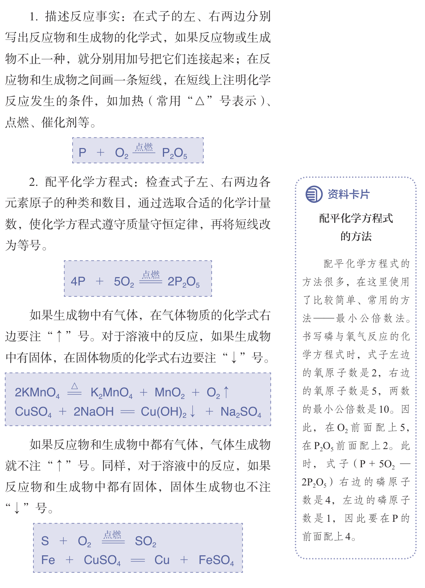

# 第五单元 化学反应的定量关系

这一章先弄清反应前后什么不变（质量守恒），再学用化学方程式表示反应，最后用方程式算质量。

标着**重点**的三个知识点，中考几乎每年都考，要花最多时间；标着**一般**的，理解装置原理就行。

## 本章前置自查

下面四件事，哪一件没把握，先回看前面单元：

1. 正确书写常见单质与简单化合物的化学式。（第四单元 课题3）
2. 根据化学式计算相对分子质量及各元素的质量比。（第四单元 课题3）
3. 说出化学变化的实质：分子分成原子，原子重新组合成新分子。（第三单元 课题1、课题2）
4. 使用托盘天平或电子天平准确称量药品的质量。（第一单元 课题2）

---

## 5.1a 质量守恒定律及其微观解释

```yaml
id: CHEM-9A-05-1a
weight: 重点
weight_note: 7 套卷直接考查 7 次
textbook: 九上 5.1 质量守恒定律，p.110, 112, 114–115
prerequisites:
  - id: CHEM-9A-03-1a
    strength: hard
    reason: 用化学反应中原子的重新组合理解质量守恒的微观本质。
  - id: CHEM-9A-03-2a
    strength: hard
    reason: 化学反应前后原子的种类、数目、质量不变是守恒的根本原因。
evidence:
  - 能完整说出质量守恒定律的内容，准确指出必须是“参加反应”和“生成的”物质质量总和相等
  - 能从微观本质解释质量守恒的原因（化学反应前后，原子的种类、数目、质量都没有改变）
  - 能根据反应前后原子种类和个数守恒，推断未知反应物或生成物的化学式或元素组成
figure: 已完成 figures/hydrogen-oxygen-water-micro.svg（氢气与氧气反应生成水的微观示意图：分子破裂与原子重组）
sources: [TB9A-5.1, GZ2023-11, GZ2022-07, GD2023-18]
walk_source: 2023 广东 18(2) 真题方法
```

### 本次只学

认识质量守恒定律，从微观原子的角度解释质量守恒的原因，并推断未知物质的组成。

### 先认住



- **质量守恒定律**：参加反应的各物质的质量总和，等于反应后生成的各物质的质量总和。一切化学反应都遵守。
- **微观本质**：反应物的分子分裂成原子，原子重新组合成新分子。反应前后**原子的种类、数目、质量都不变**。
- **六个不变**：物质总质量、元素种类、元素质量、原子种类、原子数目、原子质量。**两个一定变**：物质种类、分子种类。**一个可能变**：分子总数。
- **推断未知物**：反应前后原子种类和数目相等，据此可求未知物的化学式。

### 破题钥匙

```think
宏观: 密闭容器里反应，前后总质量不变
微观: 原子的种类、数目、质量都不变，只是重新组合
图: chem-conservation
符号: 反应前后，各种原子的个数相等
招: 守恒
结: 原子不变，所以质量不变
```

### 走一遍

任务：根据反应前后原子种类与数目守恒，推断未知生成物 $\ce{X}$ 的化学式。

已知 $\ce{KO2}$ 与水反应：

$$4\ce{KO2} + 2\ce{H2O} = 4\ce{X} + 3\ce{O2}\uparrow$$

求 $\ce{X}$ 的化学式。

第一步：数反应物（等号左边）的原子：$\ce{K}$ $\textcolor{#287fc4}{4}$ 个，$\ce{O}$ $4\times 2 + 2 = \textcolor{#287fc4}{10}$ 个，$\ce{H}$ $2\times 2 = \textcolor{#287fc4}{4}$ 个。

第二步：数已知生成物的原子：$\ce{3O2}$ 中有 $\ce{O}$ $3\times 2 = \textcolor{#287fc4}{6}$ 个，没有 $\ce{K}$、$\ce{H}$。

第三步：反应前后原子不变，所以 $\ce{4X}$ 里有 $\ce{K}$ $\textcolor{#287fc4}{4}$ 个、$\ce{H}$ $\textcolor{#287fc4}{4}$ 个、$\ce{O}$ $10 - 6 = \textcolor{#287fc4}{4}$ 个。

第四步：一个 $\ce{X}$ 里 $\ce{K}$、$\ce{O}$、$\ce{H}$ 各 $1$ 个，$\ce{X}$ 是 $\boxed{\ce{KOH}}$。

### 容易错

- 只适用于**化学反应**；水蒸发、蜡烛熔化这类物理变化不讨论。
- 只算**参加反应**和**生成**的物质；没反应完的过量反应物不算。
- 分子总数可以变：例如 $2\ce{H2} + \ce{O2} \xlongequal{\text{点燃}} 2\ce{H2O}$ 中，反应前 3 个分子，反应后 2 个分子，原子总数和总质量不变。

### 练一练

- `Q-CHEM-GZ2023-11`
- `Q-CHEM-GZ2022-07`

---

## 5.1b 质量守恒定律的实验探究

```yaml
id: CHEM-9A-05-1b
weight: 一般
weight_note: 7 套卷直接考查 1 次
textbook: 九上 5.1 质量守恒定律，p.110–113, 125
prerequisites:
  - id: CHEM-9A-05-1a
    strength: hard
    reason: 先理解质量守恒定律的宏观和微观内涵，才能设计密闭验证实验。
  - id: CHEM-9A-01-2a
    strength: soft
    reason: 验证实验中需使用托盘天平或电子天平准确称量反应前后质量。
evidence:
  - 能说明有气体参加或生成的反应验证质量守恒定律时必须在密闭容器中进行的理由
  - 能说出密闭实验装置中橡胶塞和小气球的作用，并能分析敞口称量产生质量误差的原因
figure: 已完成 figures/copper-oxidation-mass.svg（铜与氧气反应前后质量测定装置：密闭体系与天平称量）
sources: [TB9A-5.1, GZ2024-14]
```

### 本次只学

掌握验证质量守恒定律的实验装置设计原则与操作要点。

### 先认住

- **密闭容器**：反应有**气体参加**（红磷燃烧、铜粉与氧气反应）或**气体生成**（碳酸钠与盐酸产生二氧化碳）时，验证质量守恒必须在**密闭容器**中进行。
- **小气球**：系在密闭加热装置的导管上，给受热膨胀的气体留出空间，**缓冲气压**，避免橡胶塞被冲开；密闭靠橡胶塞和整个装置。
- **敞口称量**：碳酸钠与盐酸在敞口烧杯中反应，二氧化碳逸散，总质量变小。这**不是**不守恒，是逸散的气体没称到。



### 容易错

- 没有气体参加也没有气体生成的反应（如铁丝与硫酸铜溶液反应），可以敞口称量。

### 练一练

- `Q-CHEM-GZ2024-14`

---

## 5.2a 化学方程式的书写与含义

```yaml
id: CHEM-9A-05-2a
weight: 重点
weight_note: 7 套卷直接考查 8 次
textbook: 九上 5.2 化学方程式，p.117–119
prerequisites:
  - id: CHEM-9A-04-3b
    strength: hard
    reason: 正确书写反应物与生成物的化学式是书写方程式的前提。
  - id: CHEM-9A-05-1a
    strength: hard
    reason: 依据质量守恒定律配平化学方程式，使反应前后原子种类和数目相等。
evidence:
  - 能说出化学方程式表示的宏观、微观和质量三重含义
  - 能按客观事实和质量守恒两个原则，使用最小公倍数法等正确配平化学方程式
  - 能正确标注反应条件以及气体符号“$\uparrow$”、沉淀符号“$\downarrow$”
figure: 已完成 figures/tb9a-5-p119-balance-steps.png（课本 p.119 书写步骤与配平方法原页，放在先认住之后）
sources: [TB9A-5.2, GD2023-11, GD2024-16]
walk_source: 课本 p.119“书写化学方程式的具体步骤”示范（红磷在空气中燃烧）
```

### 本次只学

理解化学方程式的含义，掌握书写化学方程式的原则、配平方法和标注规范。

### 先认住

- **含义**：用化学式表示化学反应。宏观上表示反应物、生成物和条件；微观上表示粒子个数比；质量上表示质量比（“相对分子质量 $\times$ 化学计量数”之比）。
- **两个原则**：以**客观事实**为基础，不能编造物质或化学式；遵守**质量守恒**，等号两边各原子的种类和数目相等。
- **书写步骤**：①写出反应物和生成物的化学式，中间连短线；②配平，短线改为等号；③在等号上方注明条件（点燃、加热 $\Delta$、催化剂、通电等）。
- **“$\uparrow$”“$\downarrow$”**：生成物中的气体注“$\uparrow$”，难溶固体注“$\downarrow$”；反应物中已有气体，生成的气体**不注**“$\uparrow$”；溶液中反应、反应物已有固体，生成的固体**不注**“$\downarrow$”。



### 破题钥匙

```think
宏观: 氢气在氧气中燃烧，生成水
微观: 每 2 个氢分子和 1 个氧分子，生成 2 个水分子
图: chem-equation
符号: $2\ce{H2} + \ce{O2} \xlongequal{\text{点燃}} 2\ce{H2O}$
招: 守恒
结: 系数之比就是分子个数之比
```

### 走一遍

任务：写出磷在空气中燃烧生成五氧化二磷的化学方程式。

第一步：写。在式子左边写反应物化学式，右边写生成物化学式，中间连短线：

$$\ce{P + O2} \;\text{——}\; \ce{P2O5}$$

第二步：配。先配氧（两边都较多且各只出现一次），用最小公倍数法：左边 $\ce{O}$ 有 $2$ 个，右边有 $5$ 个，最小公倍数是 $\textcolor{#287fc4}{10}$。

在 $\ce{O2}$ 前配上 $10 \div 2 = \textcolor{#287fc4}{5}$，在 $\ce{P2O5}$ 前配上 $10 \div 5 = \textcolor{#287fc4}{2}$：

$$\ce{P + \textcolor{#287fc4}{5}O2} \;\text{——}\; \textcolor{#287fc4}{2}\ce{P2O5}$$

右边 $\ce{P}$ 有 $2 \times 2 = 4$ 个，左边只有 $1$ 个，在 $\ce{P}$ 前配上 $\textcolor{#287fc4}{4}$：

$$\textcolor{#287fc4}{4}\ce{P + 5O2} \;\text{——}\; 2\ce{P2O5}$$

核对：反应前后 $\ce{P}$ 都是 $4$ 个，$\ce{O}$ 都是 $10$ 个，短线改为等号。

第三步：标。等号上方写条件“点燃”；$\ce{P2O5}$ 是固体，不注“$\downarrow$”：

$$\boxed{4\ce{P} + 5\ce{O2} \xlongequal{\text{点燃}} 2\ce{P2O5}}$$

第四步：查。检查质量守恒与各物质的质量比：

$$\ce{P} : \ce{O2} : \ce{P2O5} = (4 \times 31) : (5 \times 32) : (2 \times 142) = 124 : 160 : 284 = \boxed{31 : 40 : 71}$$

### 容易错

- 配平只能改化学式**前面**的系数，**不能改右下角的角标**（不能为了凑数把 $\ce{H2O}$ 写成 $\ce{H2O2}$）。
- 条件不能漏写或写错：“点燃”不能写成“燃烧”（那是现象）；加热用“$\Delta$”。
- 反应物已有气体，生成的气体不标“$\uparrow$”（例如 $\ce{S} + \ce{O2} \xlongequal{\text{点燃}} \ce{SO2}$、$\ce{C} + \ce{O2} \xlongequal{\text{点燃}} \ce{CO2}$ 中都不标）。

### 练一练

- `Q-CHEM-GD2023-11`
- `Q-CHEM-GD2024-16-2`

---

## 5.2b 根据化学方程式的简单计算

```yaml
id: CHEM-9A-05-2b
weight: 重点
weight_note: 7 套卷直接考查 5 次
textbook: 九上 5.2 化学方程式，p.120–121
prerequisites:
  - id: CHEM-9A-05-2a
    strength: hard
    reason: 计算必须严格以配平正确的化学方程式中的各物质化学计量数比为依据。
  - id: CHEM-9A-04-3c
    strength: hard
    reason: 需要准确计算反应物与生成物的相对分子质量及相对质量比。
evidence:
  - 能熟练运用解题规范五步（设未知量、写化学方程式、找比例关系、列比例式求解、简明作答）完成化学方程式的定量计算
  - 能根据纯净反应物或生成物的质量求出未知物质的质量；（补充）能处理简单的含杂质纯度折算
figure: 不需要
sources: [TB9A-5.2, GZ2024-17, GD2024-21]
walk_source: 课本 p.120【例题 1】（加热分解高锰酸钾制取氧气）
```

### 本次只学

掌握根据化学方程式进行简单定量计算的规范步骤和计算方法。

### 先认住

- **依据**：各物质的质量比 $=$ “化学计量数 $\times$ 相对分子质量”之比。
- **五步**：
  ① 设未知量（设质量为 $x$，**不带单位**）；
  ② 写配平的化学方程式；
  ③ 写出相关物质的“计量数 $\times$ 相对分子质量”，再写已知量、未知量（已知量**带单位**）；
  ④ 列比例式，求解（结果**带单位**）；
  ⑤ 简明作答。
- **只代纯物质的质量**。**补充**（课本没讲，真题常用）：给的是含杂质的混合物，先乘纯度：纯物质质量 $=$ 总质量 $\times$ 纯度。
- **单位一致**：比例式上下（或左右）单位要相同；相对质量的乘积是纯数字，不带单位。

### 走一遍

任务：加热分解 $7.9\text{ g}$ 高锰酸钾，可以得到多少克氧气？

解：设加热分解 $\textcolor{#287fc4}{7.9}\text{ g}$ 高锰酸钾可以得到氧气的质量为 $x$。

写出化学方程式：

$$2\ce{KMnO4} \xlongequal{\Delta} \ce{K2MnO4} + \ce{MnO2} + \ce{O2}\uparrow$$

相关物质的“计量数 $\times$ 相对分子质量”和质量：

$$\begin{aligned}
& 2 \times (39 + 55 + 16 \times 4) & & 1 \times (16 \times 2) \\
& = \textcolor{#287fc4}{316} & & = \textcolor{#287fc4}{32} \\
& \textcolor{#287fc4}{7.9}\text{ g} & & x
\end{aligned}$$

列出比例式：

$$\dfrac{316}{32} = \dfrac{\textcolor{#287fc4}{7.9}\text{ g}}{x}$$

求解未知量：

$$x = \dfrac{32 \times \textcolor{#287fc4}{7.9}\text{ g}}{316} = \boxed{0.8\text{ g}}$$

答：加热分解 $7.9\text{ g}$ 高锰酸钾，可以得到 $0.8\text{ g}$ 氧气。

### 容易错

- 没配平就算，或漏乘计量数，比例就错了。
- 设 $x$ 时带了单位（$x\text{ g}$ 是错的），结果和答案里却漏了单位。
- 把含杂质的混合物总质量直接当纯物质代入。

### 练一练

- `Q-CHEM-GZ2024-17-2`
- `Q-CHEM-GD2024-21-2`

---

> 跨学科实践活动4（设计和制作简易供氧器）：用过氧化氢分解制氧气的原理，按登山、急救等场景的需氧量，用化学方程式算出试剂用量。
