# 第五单元 化学反应的定量关系 · 题目

讲义只用 `lesson.md` 里引用的题，按知识点顺序排在前面。

---

## 讲义用题（7 道）

### Q-CHEM-GZ2023-11

```yaml
category: 真题
source: 2023 年广州市初中学业水平考试 化学 第 11 题
source_quality: 原卷
kp: CHEM-9A-05-1a
type: 选择
grading: 自动
answer_by: 原卷解析
review:
  概念: CHEM-9A-05-1a
  审题: CHEM-9A-03-1a
```

**题干**

$\ce{N2}$ 是重要的化工原料，$\ce{N2}$ 和 $\ce{H2}$ 反应的微观示意图如下，下列说法正确的是（　　）

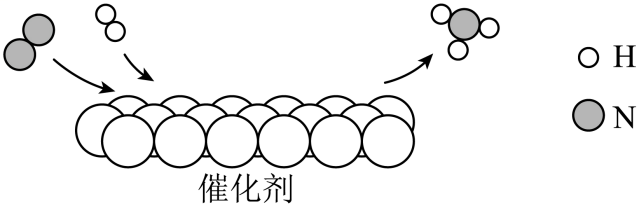

A. 常温下 $\ce{N2}$ 的化学性质很活泼
B. $\ce{N2}$ 分子和 $\ce{H2}$ 分子按个数比 $1:1$ 进行该反应
C. $\ce{NH3}$ 中 $\ce{N}$、$\ce{H}$ 元素的质量比为 $1:3$
D. 反应前后分子种类和数目发生变化

**答案**

D

**解析**

1. A 项：常温下氮气的化学性质稳定，不易与其他物质发生反应，说法错误。
2. B 项：从微观示意图可知，该反应是在催化剂作用下进行：$\ce{N2 + 3H2 ->[\text{催化剂}] 2NH3}$，因此参加反应的 $\ce{N2}$ 和 $\ce{H2}$ 分子个数比为 $1:3$，说法错误。
3. C 项：$\ce{NH3}$ 中 $\ce{N}$、$\ce{H}$ 元素的质量比为 $14 : (1 \times 3) = 14:3$，说法错误。
4. D 项：化学反应的本质是分子的分裂和原子的重新组合，反应前后分子种类改变（由 $\ce{N2}$、$\ce{H2}$ 变成 $\ce{NH3}$），反应前有 $1$ 个氮分子和 $3$ 个氢分子（共 $4$ 个分子），反应后生成 $2$ 个氨分子，分子种类和分子数目均发生变化，说法正确。

---

### Q-CHEM-GZ2022-07

```yaml
category: 真题
source: 2022 年广州市初中学业水平考试 化学 第 7 题
source_quality: 原卷
kp: CHEM-9A-05-1a
type: 选择
grading: 自动
answer_by: 原卷解析
review:
  概念: CHEM-9A-05-1a
```

**题干**

$\ce{CuCl2}$ 是重要的化工原料。一种生成 $\ce{CuCl2}$ 的反应原理如下图。下列说法正确的是（　　）

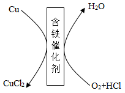

A. 该反应的生成物只有 $\ce{CuCl2}$
B. 该反应前后元素的种类没有发生变化
C. 该反应前后含铁催化剂的质量发生变化
D. 该反应属于置换反应

**答案**

B

**解析**

1. A 项：由反应原理图可知，总反应为铜、盐酸和氧气在含铁催化剂作用下反应生成氯化铜和水，生成物有氯化铜和水两种，错误。
2. B 项：根据质量守恒定律，化学反应前后元素的种类不变，反应前有铜、氢、氯、氧元素，反应后生成物中也有铜、氢、氯、氧元素，正确。
3. C 项：催化剂在化学反应前后的质量和化学性质都不变，错误。
4. D 项：该反应反应物有两种单质和一种化合物，生成物是两种化合物，不符合置换反应“单质+化合物生成另一种单质+另一种化合物”的定义，错误。（置换反应九年级下册才学，这里不认识也不影响：由 B 项正确，就能选出答案。）

---

### Q-CHEM-GZ2024-14

```yaml
category: 真题
source: 2024 年广州市初中学业水平考试 化学 第 14 题
source_quality: 原卷
kp: CHEM-9A-05-1b
type: 选择
grading: 自动
answer_by: 原卷解析
review:
  概念: CHEM-9A-05-1b
  审题: CHEM-9A-05-1a
```

**题干**

关于下列实验的说法，不正确的是（　　）

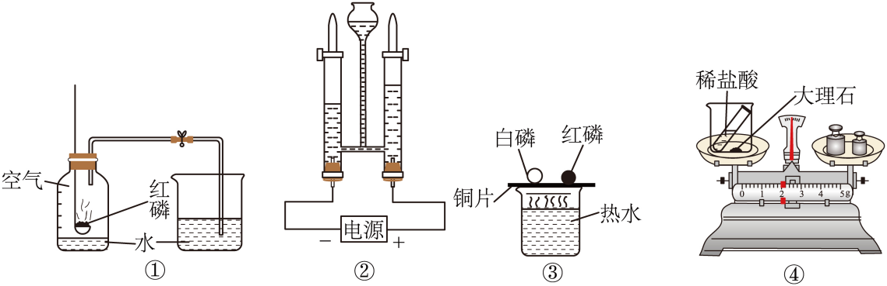

A. 实验①：集气瓶内水平面上升约 $\dfrac{1}{5}$，说明氧气约占空气体积 $\dfrac{1}{5}$
B. 实验②：电解水的玻璃管内分别生成 $\ce{H2}$ 和 $\ce{O2}$，说明水由 $\ce{H}$ 和 $\ce{O}$ 两种元素组成
C. 实验③：白磷燃烧但红磷不燃烧，说明白磷的着火点比红磷的低
D. 实验④：反应前后称量的总质量不同，说明该反应不符合质量守恒定律

**答案**

D

**解析**

1. A 项：红磷燃烧耗尽瓶内氧气，进入瓶内的水体积约占集气瓶容积的 $\dfrac{1}{5}$，说明氧气约占空气体积的 $\dfrac{1}{5}$，正确。
2. B 项：电解水生成氢气和氧气，氢气由氢元素组成，氧气由氧元素组成，根据反应前后元素种类不变可知水由氢、氧元素组成，正确。
3. C 项：薄铜片上的白磷和红磷均与氧气接触，白磷温度达到着火点燃烧，红磷未达到着火点不燃烧，说明白磷着火点更低，正确。
4. D 项：稀盐酸与大理石反应生成二氧化碳气体，装置未密闭，生成的二氧化碳逸散到了空气中导致称量质量变小；该反应依然严格遵守质量守恒定律，说法错误。

---

### Q-CHEM-GD2023-11

```yaml
category: 真题
source: 2023 年广东省初中学业水平考试 化学 第 11 题
source_quality: 原卷
kp: CHEM-9A-05-2a
type: 选择
grading: 自动
answer_by: 原卷解析
review:
  概念: CHEM-9A-05-2a
  计算: CHEM-9A-05-2a
```

**题干**

梦天舱燃烧科学柜采用 a 作燃料成功实施首次在轨点火实验。a 完全燃烧的反应微观示意图如图所示。下列说法错误的是（　　）

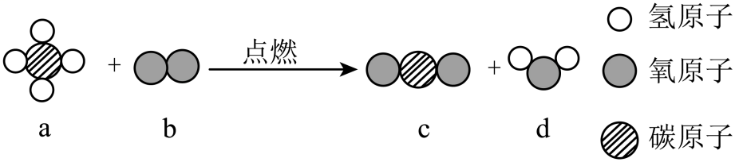

A. 反应前后元素种类不变
B. 反应前后分子个数不变
C. a 分子中 $\ce{C}$、$\ce{H}$ 原子个数比为 $1:4$
D. 反应生成 c、d 的质量比为 $22:9$

**答案**

D

**解析**

1. A 项：由质量守恒定律和微观示意图可知，反应前后均含有碳、氢、氧三种元素，元素种类不变，说法正确。
2. B 项：由微观图可知，反应是甲烷（$\ce{CH4}$）在点燃条件下与氧气反应生成二氧化碳和水，配平后的化学方程式为：$\ce{CH4 + 2O2 ->[\text{点燃}] CO2 + 2H2O}$。反应前有 $1$ 个甲烷分子和 $2$ 个氧分子（共 $3$ 个分子），反应后生成 $1$ 个二氧化碳分子和 $2$ 个水分子（共 $3$ 个分子），反应前后分子个数不变，说法正确。
3. C 项：$1$ 个 a 分子由 $1$ 个碳原子和 $4$ 个氢原子构成，$\ce{C}$、$\ce{H}$ 原子个数比为 $1:4$，说法正确。
4. D 项：根据化学方程式，生成的 c（$\ce{CO2}$）与 d（$\ce{H2O}$）的质量比为 $44 : (2 \times 18) = 44 : 36 = 11 : 9$；选项中给出的 $22:9$ 漏算了水分子前面的化学计量数 $2$，说法错误。

---

### Q-CHEM-GD2024-16-2

```yaml
category: 真题
source: 2024 年广东省初中学业水平考试 化学 第 16 题第（2）问
source_quality: 原卷
kp: CHEM-9A-05-2a
do: 本章只做第（2）问
other_parts: 第（1）问水银属于金属单质归入 CHEM-9A-04-2c，第（3）问升华与分离提纯本轮不收（非九上考点），第（4）问使燃烧更充分的措施归入 CHEM-9A-07-1b
type: 填空
grading: 自评
answer_by: 原卷解析
review:
  公式: CHEM-9A-05-2a
  计算: CHEM-9A-05-2a
```

**题干**

《天工开物》蕴含丰富的化学知识和化学思想。书中记载了银朱的制备过程，如图所示。

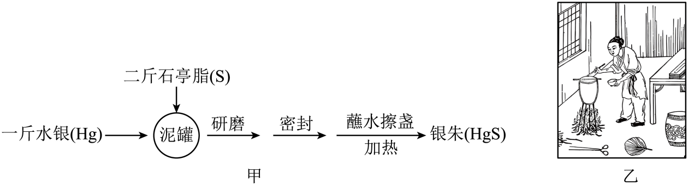

（2）“研磨”时，水银与石亭脂充分反应生成银朱，化学方程式为________________________，有剩余的反应物是_______。

**答案**

① $\ce{Hg + S ->[\text{研磨}] HgS}$
② 石亭脂（或硫、$\ce{S}$）

**解析**

1. 水银是汞（$\ce{Hg}$），石亭脂主要成分是硫（$\ce{S}$），研磨反应生成硫化汞（$\ce{HgS}$），化学方程式为 $\ce{Hg + S ->[\text{研磨}] HgS}$。
2. 反应中汞与硫参加反应的质量比为 $201 : 32$，原书中“一斤水银和二斤石亭脂”混合，硫的质量远大于按比例所需，因此石亭脂过量有剩余。

---

### Q-CHEM-GZ2024-17-2

```yaml
category: 真题
source: 2024 年广州市初中学业水平考试 化学 第 17 题第（2）（3）问
source_quality: 原卷
kp: CHEM-9A-05-2b
do: 本章只做第（2）（3）问
other_parts: 第（1）问催化剂归入 CHEM-9A-02-3a，第（4）问①②（球磨的目的、生石灰吸水的方程式、原料质量比的推算）本轮不收：综合流程与原子利用率推算超出九上考点
parts:
  - part: '2'
    kp: CHEM-9A-05-2a
    answer: '①　$\ce{CH2O}$　②　$\ce{CH2O + O2 ->[\text{羟基磷灰石}] CO2 + H2O}$'
    review: {公式: CHEM-9A-05-2a}
  - part: '3'
    kp: CHEM-9A-05-2b
    answer: '$1.6$'
    review: {计算: CHEM-9A-05-2b}
type: 综合
grading: 自评
answer_by: 原卷解析
review:
  公式: CHEM-9A-05-2a
  计算: CHEM-9A-05-2b
```

**题干**

甲醛是一种重要的化工原料，同时也是一种常见的室内空气污染物。利用羟基磷灰石【$\ce{Ca5(PO4)3OH}$】可将空气中的甲醛转化为无污染的物质，反应过程的微观示意图如下：

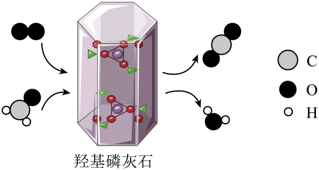

（2）甲醛的化学式为________，上述转化反应的化学方程式为________。

（3）将 $1.5\text{ g}$ 甲醛完全转化为无污染的物质，需要消耗氧气的质量为________g。

**答案**

（2）① $\ce{CH2O}$
② $\ce{CH2O + O2 ->[\text{羟基磷灰石}] CO2 + H2O}$
（3）$1.6$

**解析**

1. （2）小问：根据微观示意图，$1$ 个甲醛分子由 $1$ 个碳原子、$2$ 个氢原子和 $1$ 个氧原子构成，化学式为 $\ce{CH2O}$；甲醛在羟基磷灰石催化作用下与氧气反应生成二氧化碳和水，反应前后各原子种类与数目守恒，化学方程式为 $\ce{CH2O + O2 ->[\text{羟基磷灰石}] CO2 + H2O}$。
2. （3）小问：
   解：设需要消耗氧气的质量为 $x$。
   $$\begin{aligned}
   \ce{& CH2O + & & O2 ->[\text{羟基磷灰石}] & CO2 + H2O} \\
   & 12 + 2\times 1 + 16 & & 16 \times 2 \\
   & = 30 & & = 32 \\
   & \textcolor{#287fc4}{1.5}\text{ g} & & x
   \end{aligned}$$
   $$\dfrac{30}{32} = \dfrac{\textcolor{#287fc4}{1.5}\text{ g}}{x}$$
   $$x = \dfrac{32 \times \textcolor{#287fc4}{1.5}\text{ g}}{30} = \boxed{1.6\text{ g}}$$
   答：需要消耗氧气的质量为 1.6 g。

---

### Q-CHEM-GD2024-21-2

```yaml
category: 真题
source: 2024 年广东省初中学业水平考试 化学 第 21 题第（2）问 ii
source_quality: 原卷
kp: CHEM-9A-05-2b
do: 本章只做第（2）问 ii
other_parts: 第（1）问化合价归入 CHEM-9A-04-3b、元素质量比归入 CHEM-9A-04-3c，第（2）问 i（读图计算提取铁的质量）、iii（新旧炼铁方法的环保比较）本轮不收：涉及金属冶炼，属九下内容
type: 计算
grading: 自评
answer_by: 原卷解析
review:
  计算: CHEM-9A-05-2b
  审题: CHEM-9A-05-2b
```

**题干**

科研人员提出一种回收利用铝冶炼产生的废渣赤泥（含 $\ce{Fe2O3}$）的新方法，助力产业逐“绿”前行。应用新方法从赤泥中提取铁的装置示意图如图 1 所示。

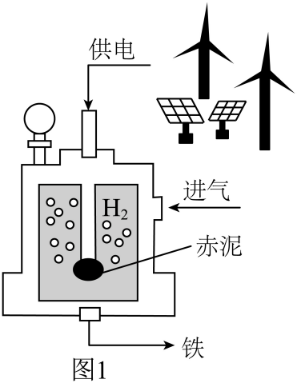

应用新方法从赤泥中提取铁发生反应的化学方程式：$\ce{3H2 + Fe2O3 ->[\text{一定条件}] 3H2O + 2Fe}$。

我国每年产生赤泥约 9000 万吨，假设赤泥中 $\ce{Fe2O3}$ 的质量分数为 30%，用新方法处理 9000 万吨赤泥，理论上可提取铁______万吨（写出计算过程）。

**答案**

1890

解：设理论上可提取铁的质量为 $x$。
赤泥中含 $\ce{Fe2O3}$ 的质量为：$9000\text{ 万吨} \times 30\% = 2700\text{ 万吨}$。

$$\begin{aligned}
\ce{& Fe2O3 + 3H2 ->[\text{一定条件}] & 2Fe + 3H2O} \\
& 56\times 2 + 16\times 3 & & 2 \times 56 \\
& = 160 & & = 112 \\
& \textcolor{#287fc4}{2700}\text{ 万吨} & & x
\end{aligned}$$

$$\dfrac{160}{112} = \dfrac{\textcolor{#287fc4}{2700}\text{ 万吨}}{x}$$

$$x = \dfrac{112 \times \textcolor{#287fc4}{2700}\text{ 万吨}}{160} = \boxed{1890\text{ 万吨}}$$

答：理论上可提取铁 1890 万吨。

**解析**

1. 审题明确：赤泥是混合物，所给的 9000 万吨不是纯净物质量，不能直接代入方程式计算；必须先根据质量分数 30% 求出纯净物 $\ce{Fe2O3}$ 的质量：$9000\text{ 万吨} \times 30\% = 2700\text{ 万吨}$。
2. 依据化学方程式 $\ce{Fe2O3 + 3H2 ->[\text{一定条件}] 2Fe + 3H2O}$，找到反应物 $\ce{Fe2O3}$ 与生成物 $\ce{Fe}$ 的质量比：$160 : 112$。
3. 列出比例式 $\dfrac{160}{112} = \dfrac{2700\text{ 万吨}}{x}$，求得 $x = \boxed{1890\text{ 万吨}}$。
4. 规范作答，写出解、设、式、比、求、答。

---

## 备选

### Q-CHEM-TB9A-5.1-1

```yaml
category: 课本习题
source: 九上 5.1 练习与应用 第 1 题，p.115
source_quality: 课本原文
kp: CHEM-9A-05-1a
type: 选择
grading: 自动
answer_by: 本项目编写，待复核
review:
  概念: CHEM-9A-05-1a
```

**题干**

化学反应前后一定不变的是（　　）。
①原子数目　②分子数目　③元素种类　④物质种类　⑤原子种类　⑥物质的总质量

A. ①②⑥
B. ①④⑥
C. ②③⑤
D. ①③⑤⑥

**答案**

D

**解析**

1. 化学反应前后原子的种类、数目、质量都不变，故原子的种类（⑤）、数目（①）一定不变；
2. 元素是质子数相同的一类原子的总称，故元素的种类（③）、质量也一定不变；
3. 反应前后各物质的总质量（⑥）遵守质量守恒定律，必然不变；
4. 化学反应的特征是生成新物质，故物质种类（④）、分子种类一定改变；分子数目（②）可能改变也可能不变。
5. 因此一定不变的是①③⑤⑥，选 D。

---

### Q-CHEM-TB9A-5.1-3

```yaml
category: 课本习题
source: 九上 5.1 练习与应用 第 3 题，p.116
source_quality: 课本原文
kp: CHEM-9A-05-1a
type: 选择
grading: 自动
answer_by: 本项目编写，待复核
review:
  概念: CHEM-9A-05-1a
  计算: CHEM-9A-05-1a
```

**题干**

$10\text{ g}$ A 与足量 B 充分反应，生成 $8\text{ g}$ C 和 $4\text{ g}$ D，则参加反应的 A 与 B 的质量比是（　　）。

A. $1:1$
B. $2:1$
C. $4:1$
D. $5:1$

**答案**

D

**解析**

1. 根据质量守恒定律，参加化学反应的各物质质量总和等于反应后生成的各物质质量总和。
2. 反应中生成 C 的质量为 $8\text{ g}$，生成 D 的质量为 $4\text{ g}$，生成物总质量为 $8\text{ g} + 4\text{ g} = 12\text{ g}$。
3. 参加反应的 A 的质量为 $10\text{ g}$，则参加反应的 B 的质量为 $12\text{ g} - 10\text{ g} = 2\text{ g}$。
4. 因此参加反应的 A 与 B 的质量比为 $10\text{ g} : 2\text{ g} = 5 : 1$，选 D。

---

### Q-CHEM-TB9A-5.2-1

```yaml
category: 课本习题
source: 九上 5.2 练习与应用 第 1 题，p.122
source_quality: 课本原文
kp: CHEM-9A-05-2a
type: 选择
grading: 自动
answer_by: 本项目编写，待复核
review:
  概念: CHEM-9A-05-2a
```

**题干**

从化学方程式中不能获得的信息是（　　）。

A. 反应物和生成物
B. 反应的快慢
C. 反应发生所需要的条件
D. 反应物和生成物的质量比

**答案**

B

**解析**

1. 化学方程式的等号左边表示反应物，右边表示生成物，故 A 能获得；
2. 等号上方或下方注明了反应条件，故 C 能获得；
3. 根据化学计量数和相对分子质量可以求出各物质的质量比，故 D 能获得；
4. 化学方程式不能反映化学反应进行的快慢程度，故选 B。

---

### Q-CHEM-TB9A-5.2-2

```yaml
category: 课本习题
source: 九上 5.2 练习与应用 第 2 题，p.122
source_quality: 课本原文
kp: CHEM-9A-05-2a
type: 选择
grading: 自动
answer_by: 本项目编写，待复核
review:
  概念: CHEM-9A-05-2a
  计算: CHEM-9A-05-2a
```

**题干**

铝在氧气中燃烧生成氧化铝。在这个反应中，铝、氧气、氧化铝的质量比是（　　）。

A. $27:32:102$
B. $108:96:204$
C. $4:3:2$
D. $27:16:43$

**答案**

B

**解析**

1. 铝与氧气反应的化学方程式为：$\ce{4Al + 3O2 ->[\text{点燃}] 2Al2O3}$。
2. 各物质的相对原子质量或相对分子质量：$\ce{Al}$ 为 $27$，$\ce{O2}$ 为 $32$，$\ce{Al2O3}$ 为 $27\times 2 + 16\times 3 = 102$。
3. 反应中铝、氧气、氧化铝的质量比等于化学计量数与相对分子质量（或相对原子质量）乘积之比：$(4\times 27) : (3\times 32) : (2\times 102) = 108 : 96 : 204$。
4. 故选 B。

---

### Q-CHEM-GD2023-18-2

```yaml
category: 真题
source: 2023 年广东省初中学业水平考试 化学 第 18 题第（2）问
source_quality: 原卷
kp: CHEM-9A-05-1a
do: 本章只做第（2）问
other_parts: 第（1）问为实验室制取氧气及性质检验，归入 CHEM-9A-02-3a
type: 填空
grading: 自评
answer_by: 原卷解析
review:
  概念: CHEM-9A-05-1a
  审题: CHEM-9A-05-1a
```

**题干**

（2）制作氧自救呼吸器


查阅资料，超氧化钾（$\ce{KO2}$）为黄色固体，分别与 $\ce{CO2}$、$\ce{H2O}$ 反应生成 $\ce{O2}$ 和白色固体、产氧效率高，适合作生氧剂。

①原理分析：$\ce{4KO2 + 2CO2 -> 2K2CO3 + 3O2 ^}$、$\ce{4KO2 + 2H2O -> 4X + 3O2 ^}$，则 $\ce{X}$ 的化学式为__________。

②动手实践：设计并制作氧自救呼吸器，如图所示，使用一段时间后，观察到生氧剂由______（填颜色变化），则基本失效。

**答案**

① $\ce{KOH}$
② 黄色变为白色

**解析**

1. ① 小问：根据质量守恒定律，化学反应前后原子的种类和数目不变。在反应物中含 $\ce{K}$、$\ce{O}$、$\ce{H}$ 原子的个数分别为 $4$、$10$、$4$；在生成物 $\ce{3O2}$ 中含 $\ce{O}$ 原子个数为 $6$，尚缺少 $4$ 个 $\ce{K}$ 原子、$4$ 个 $\ce{H}$ 原子和 $4$ 个 $\ce{O}$ 原子。由于 $\ce{X}$ 前的化学计量数为 $4$，故 $1$ 个 $\ce{X}$ 分子中含 $1$ 个 $\ce{K}$ 原子、$1$ 个 $\ce{H}$ 原子和 $1$ 个 $\ce{O}$ 原子，$\ce{X}$ 的化学式为 $\ce{KOH}$。
2. ② 小问：超氧化钾（$\ce{KO2}$）为黄色固体，与人呼出的气体中水蒸气和二氧化碳反应生成白色固体产物（碳酸钾和氢氧化钾）。当观察到生氧剂由黄色变为白色时，说明超氧化钾已完全反应，生氧剂基本失效。

---

### Q-CHEM-GZ2022-09

```yaml
category: 真题
source: 2022 年广州市初中学业水平考试 化学 第 9 题
source_quality: 原卷
kp: CHEM-9A-05-2a
type: 选择
grading: 自动
answer_by: 原卷解析
review:
  概念: CHEM-9A-05-2a
  计算: CHEM-9A-05-2a
```

**题干**

载人航天器中利用下图所示的“氧再生系统”处理宇航员排出的 $\ce{H2O}$ 和 $\ce{CO2}$。下列说法不正确的是（　　）

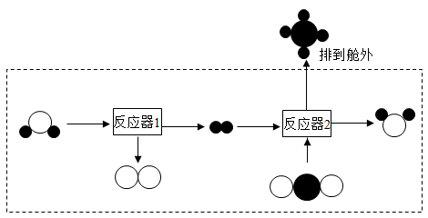

A. 排到舱外的物质是甲烷
B. 反应器 2 中消耗 $\ce{CO2}$ 和生成 $\ce{CH4}$ 的个数比为 $1:1$
C. 反应器 2 中生成 $\ce{H2O}$ 和 $\ce{CH4}$ 的质量比为 $9:8$
D. 该系统在产生 $\ce{O2}$ 的同时降低了舱内 $\ce{CO2}$ 的浓度

**答案**

C

**解析**

1. A 项：反应器 2 中二氧化碳和氢气转化为甲烷和水，甲烷被排到舱外，正确。
2. B 项：反应器 2 发生的反应为 $\ce{CO2 + 4H2 ->[\text{一定条件}] CH4 + 2H2O}$，消耗的 $\ce{CO2}$ 和生成的 $\ce{CH4}$ 分子个数比为 $1:1$，正确。
3. C 项：反应器 2 中生成 $\ce{H2O}$ 和 $\ce{CH4}$ 的质量比为 $(2\times 18) : 16 = 36 : 16 = 9 : 4$，而不是 $9:8$（漏算了水分子前面的系数 2），错误。
4. D 项：系统通过电解水产生氧气，同时将人体呼出的二氧化碳转化为甲烷排出，降低了舱内二氧化碳浓度，正确。

---

### Q-CHEM-GZ2023-15-2

```yaml
category: 真题
source: 2023 年广州市初中学业水平考试 化学 第 15 题第（2）问
source_quality: 原卷
kp: CHEM-9A-05-2b
do: 本章只做第（2）问
other_parts: 第（1）问白磷自燃归入 CHEM-9A-07-1a，第（3）问命名与离子符号归入 CHEM-9A-04-3a
type: 填空
grading: 自评
answer_by: 原卷解析
review:
  计算: CHEM-9A-05-2b
```

**题干**

磷及其化合物广泛应用于新能源汽车电池的制造，如 $\ce{LiFePO4}$ 等。

（2）测定空气中氧气含量时，消耗 $0.4\text{ g}$ 氧气至少有______g 红磷参加反应。

**答案**

0.31

**解析**

1. 设消耗 $0.4\text{ g}$ 氧气至少需要红磷的质量为 $x$。
2. 红磷燃烧的化学方程式为 $\ce{4P + 5O2 ->[\text{点燃}] 2P2O5}$。
3. 相对质量与实际质量对应关系：
   $$\begin{aligned}
   \ce{& 4P + & 5O2 ->[\text{点燃}] & 2P2O5} \\
   & 4\times 31 & 5\times 32 \\
   & = 124 & = 160 \\
   & x & 0.4\text{ g}
   \end{aligned}$$
4. 列比例式：$\dfrac{124}{160} = \dfrac{x}{0.4\text{ g}}$。
5. 解得 $x = \dfrac{124 \times 0.4\text{ g}}{160} = \boxed{0.31\text{ g}}$。

---

### Q-CHEM-GZ2023-20-3

```yaml
category: 真题
source: 2023 年广州市初中学业水平考试 化学 第 20 题第（3）问①
source_quality: 原卷
kp: CHEM-9A-05-1a
do: 本章只做第（3）问①
other_parts: 第（1）问（制取一氧化碳的发生装置）、第（2）问（一氧化碳还原氧化铁的方程式）、第（3）问②（用稀盐酸检验 Fe 与 Fe3O4）、第（4）问①②③（热分析图像与固体成分推断）本轮不收：涉及金属冶炼与酸的性质，属九下内容
type: 填空
grading: 自评
answer_by: 原卷解析
review:
  概念: CHEM-9A-05-1a
```

**题干**

某小组采用实验装置探究 $\ce{CO}$ 还原 $\ce{Fe2O3}$ 时，出现了争论。甲同学观察到固体由红色变成黑色，推断黑色固体是 $\ce{Fe}$；乙同学提出质疑，认为黑色固体可能是 $\ce{Fe3O4}$。

（3）对乙同学提出的质疑进行分析和验证。并查阅了资料：$\ce{Fe3O4}$ 可被磁铁吸引，几乎不溶于稀的酸溶液。
①定量分析物质组成可知，该反应生成 $\ce{Fe3O4}$ 是合理的，理由是________________________。

**答案**

反应前反应物中有铁、氧元素，根据质量守恒定律，化学反应前后元素种类不变

**解析**

1. 反应物为 $\ce{CO}$ 和 $\ce{Fe2O3}$，含有碳、铁、氧三种元素。
2. 根据质量守恒定律，化学反应前后元素的种类不发生改变，因此产物中出现由铁、氧两种元素组成的化合物 $\ce{Fe3O4}$ 在元素组成上是完全合理的。

---

### Q-CHEM-GD2022-17-2

```yaml
category: 真题
source: 2022 年广东省初中学业水平考试 化学 第 17 题第（2）问
source_quality: 原卷
kp: CHEM-9A-05-2a
do: 本章只做第（2）问
other_parts: 第（1）问单质与化合物分类归入 CHEM-9A-04-2c，第（3）问电解水归入 CHEM-9A-04-2b，第（4）问膜分离本轮不收；第（5）问天然气利用归入 CHEM-9A-07-2a
type: 填空
grading: 自评
answer_by: 原卷解析
review:
  公式: CHEM-9A-05-2a
```

**题干**

我国科学家研制了一种新型催化剂，实现了甲烷向重要化工原料甲醇的高效转化。反应过程的微观示意图如图所示。


（2）该反应的化学方程式为________________________。

**答案**

$\ce{CH4 + H2 + O2 ->[\text{催化剂}] CH3OH + H2O}$

**解析**

1. 由微观示意图可知，反应物为甲烷（$\ce{CH4}$）、氢气（$\ce{H2}$）和氧气（$\ce{O2}$），生成物为甲醇（$\ce{CH3OH}$）和水（$\ce{H2O}$）。
2. 在催化剂作用下反应，各分子个数比为 $1:1:1:1:1$，两边碳原子各 $1$ 个、氢原子各 $6$ 个、氧原子各 $2$ 个，已完全配平。
3. 化学方程式为 $\ce{CH4 + H2 + O2 ->[\text{催化剂}] CH3OH + H2O}$。

---

### Q-CHEM-GD2022-20-5

```yaml
category: 真题
source: 2022 年广东省初中学业水平考试 化学 第 20 题第（5）问
source_quality: 原卷
kp: CHEM-9A-05-2a
do: 本章只做第（5）问
other_parts: 第（1）问碳还原氧化铜归入 CHEM-9A-06-1b，第（2）问化合价归入 CHEM-9A-04-3b，第（3）问一氧化碳归入 CHEM-9A-06-2b，第（4）问能量变化归入 CHEM-9A-07-1c
type: 填空
grading: 自评
answer_by: 原卷解析
review:
  公式: CHEM-9A-05-2a
```

**题干**

《千里江山图》是我国传世名画之一，宋代画家王希孟创造性地将炭黑、赭石、孔雀石、蓝铜矿等矿物颜料用在不同的画层。

孔雀石【主要成分为 $\ce{Cu2(OH)2CO3}$】受热分解（反应 e），生成三种氧化物，其中一种为黑色固体。该反应的化学方程式为________________________。

**答案**

$\ce{Cu2(OH)2CO3 ->[\Delta] 2CuO + H2O + CO2 ^}$

**解析**

1. 孔雀石受热分解生成三种氧化物，黑色氧化物固体是氧化铜（$\ce{CuO}$），另外由组成元素可知还生成水（$\ce{H2O}$）和二氧化碳气体（$\ce{CO2}$）。
2. 配平：左边有 $2$ 个铜原子，在 $\ce{CuO}$ 前配 $2$；检查氢原子两边各 $2$ 个，碳原子各 $1$ 个，氧原子两边各 $5$ 个，方程式配平。
3. 反应条件为加热，注明“$\Delta$”；二氧化碳后注气体符号“$\uparrow$”，化学方程式为 $\ce{Cu2(OH)2CO3 ->[\Delta] 2CuO + H2O + CO2 ^}$。

---

### Q-CHEM-GD2023-20-2

```yaml
category: 真题
source: 2023 年广东省初中学业水平考试 化学 第 20 题第（2）问
source_quality: 原卷
kp: CHEM-9A-05-2a
do: 本章只做第（2）问
other_parts: 第（1）问二氧化碳用途归入 CHEM-9A-06-2a，第（3）问环境影响归入 CHEM-9A-07-2b
type: 综合
grading: 自评
answer_by: 原卷解析
review:
  概念: CHEM-9A-05-2a
  公式: CHEM-9A-05-2a
```

**题干**

电解水制氢联合碳酸钙分解制备氧化钙，能减少碳排放，助力碳中和。该新方法的示意图如图所示。

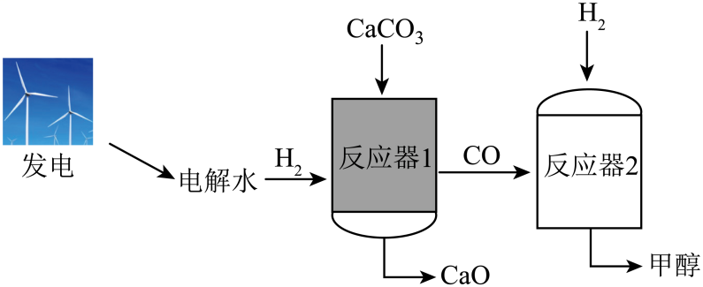

新方法：
i. 电解水属于_____反应（填基本反应类型），反应前后氢元素的化合价_____（填“升高”“降低”或“不变”）。
ii. 反应器 1：一定的 $\ce{H2}$ 环境及较低温度下 $\ce{CaCO3}$ 可与 $\ce{H2}$ 反应生成 $\ce{CaO}$、$\ce{CO}$ 和 $\ce{H2O}$。$\ce{CO}$ 与 $\ce{H2O}$ 的分子个数比为_______。
$\ce{CaCO3}$ 还可以直接分解。反应器 1 中 $\ce{CO}$、$\ce{CO2}$ 的含量随反应温度的变化如下图所示。________℃ 时，抑制 $\ce{CO2}$ 生成的效果最好。

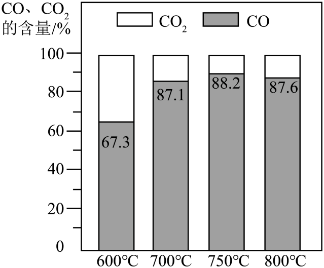

iii. 反应器 2：一定条件下，$\ce{CO}$ 与 $\ce{H2}$ 发生化合反应生成甲醇（$\ce{CH3OH}$），化学方程式为________________________。

**答案**

i. 分解；降低
ii. $1:1$；$750$
iii. $\ce{CO + 2H2 ->[\text{一定条件}] CH3OH}$

**解析**

1. i. 水在通电条件下生成氢气和氧气，由一种反应物生成两种新物质，属于分解反应；水中的氢元素显 $+1$ 价，反应生成的氢气单质中氢元素显 $0$ 价，化合价降低。
2. ii. 反应方程式为 $\ce{CaCO3 + H2 ->[\text{较低温度}] CaO + CO + H2O}$，化学计量数比为 $1:1$，故分子个数比为 $1:1$；由图可知在 $750^\circ\text{C}$ 时 $\ce{CO}$ 含量最高（$88.2\%$），$\ce{CO2}$ 含量最低（$11.8\%$），抑制效果最好。
3. iii. 一氧化碳与氢气发生化合反应生成甲醇，化学方程式为 $\ce{CO + 2H2 ->[\text{一定条件}] CH3OH}$。

---

### Q-CHEM-GD2023-21-2

```yaml
category: 真题
source: 2023 年广东省初中学业水平考试 化学 第 21 题第（2）问
source_quality: 原卷
kp: CHEM-9A-05-2b
do: 本章只做第（2）问
other_parts: 第（1）问元素质量比计算归入 CHEM-9A-04-3c，第（3）问（读图求剩余质量与完全分解的时间）、第（4）问（流程中循环利用的物质）本轮不收：图像与流程分析，不属于本章考点
type: 计算
grading: 自评
answer_by: 原卷解析
review:
  计算: CHEM-9A-05-2b
  审题: CHEM-9A-05-2b
```

**题干**

羰基铁粉在国防军工领域有重要应用，我国是少数几个掌握其生产技术的国家之一。制备羰基铁粉的过程如图所示。


反应 1 的化学方程式为 $\ce{Fe + 5CO ->[\text{高压}] Fe(CO)5}$。用 $100\text{ kg}$ 含铁 $96\%$ 的海绵铁，理论上可制备 $\ce{Fe(CO)5}$ 的质量是多少？（写出计算过程）

**答案**

336 kg

解：设理论上可制备 $\ce{Fe(CO)5}$ 的质量为 $x$。
$100\text{ kg}$ 海绵铁中含纯铁质量为：$100\text{ kg} \times 96\% = 96\text{ kg}$。

$$\begin{aligned}
\ce{& Fe + 5CO ->[\text{高压}] & Fe(CO)5} \\
& 56 & & 56 + 5\times (12 + 16) = 196 \\
& \textcolor{#287fc4}{96}\text{ kg} & & x
\end{aligned}$$

$$\dfrac{56}{196} = \dfrac{\textcolor{#287fc4}{96}\text{ kg}}{x}$$

$$x = \dfrac{196 \times \textcolor{#287fc4}{96}\text{ kg}}{56} = \boxed{336\text{ kg}}$$

答：理论上可制备 $\ce{Fe(CO)5}$ 的质量是 336 kg。

**解析**

1. 海绵铁是不纯的原料，先根据纯度求出纯铁质量：$100\text{ kg} \times 96\% = 96\text{ kg}$。
2. 依据化学方程式计算，相对原子质量：$\ce{Fe}$ 为 $56$，$\ce{Fe(CO)5}$ 相对分子质量为 $56 + 5\times 28 = 196$。
3. 列比例式求出 $x = \boxed{336\text{ kg}}$。

---

### Q-CHEM-GD2025-08

```yaml
category: 真题
source: 2025 年广东省初中学业水平考试 化学 第 8 题
source_quality: 原卷
kp: CHEM-9A-05-2a
type: 选择
grading: 自动
answer_by: 原卷解析
review:
  概念: CHEM-9A-05-2a
```

**题干**

我国科研人员研制出乙醇制氢零碳排放反应的催化剂，反应前后分子种类变化的微观示意图如图。下列说法错误的是（　　）

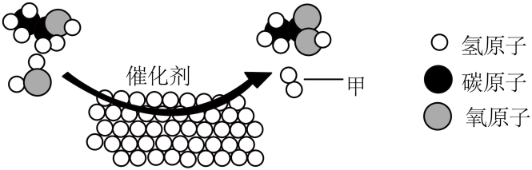

A. 甲的化学式为 $\ce{H2}$
B. 反应前后原子种类不变
C. 生成物的分子个数比为 $1:1$
D. 催化剂可以改变化学反应速率

**答案**

C

**解析**

1. A 项：由微观图可知甲由两个氢原子构成，化学式为 $\ce{H2}$，正确。
2. B 项：化学反应遵守质量守恒定律，反应前后原子种类不变，正确。
3. C 项：由微观图可知该反应为乙醇（$\ce{C2H5OH}$）与水在催化剂作用下反应生成乙酸（$\ce{CH3COOH}$）和氢气，配平的化学方程式为 $\ce{C2H5OH + H2O ->[\text{催化剂}] CH3COOH + 2H2 ^}$，生成物的分子个数比为 $1:2$（或 $2:1$），不是 $1:1$，说法错误。
4. D 项：催化剂能改变化学反应速率，正确。

---

### Q-CHEM-GD2025-20-1

```yaml
category: 真题
source: 2025 年广东省初中学业水平考试 化学 第 20 题第（1）问 ⅰ
source_quality: 原卷
kp: CHEM-9A-05-1a
do: 本章只做第（1）问 ⅰ
other_parts: 第（1）问 ⅱ（温度较高的区域）、第（2）问（加快石蜡溶解的措施）、第（3）问（氮气保护气与合金的优点）、第（4）问（渗碳曲线）本轮不收：涉及合金与金属材料，属九下内容
type: 填空
grading: 自评
answer_by: 原卷解析
review:
  概念: CHEM-9A-05-1a
  计算: CHEM-9A-05-2a
```

**题干**

金属注射成型是一种精密器件的制造技术。某种制备铁镍合金器件的主要工序如图。

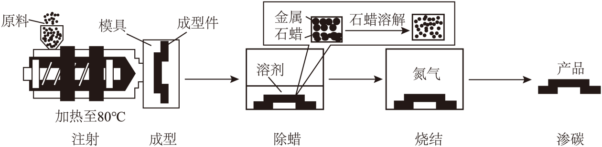

（1）原料制备
ⅰ. 制铁粉：$\ce{3H2 + Fe2O3 ->[800^\circ\text{C}] 2Fe + 3X}$，则 $\ce{X}$ 为__________，参加反应的 $\ce{H2}$ 与 $\ce{Fe2O3}$ 的质量比为__________。

**答案**

① $\ce{H2O}$
② $3:80$

**解析**

1. 根据质量守恒定律，化学反应前后原子的种类和数目不变。反应物中含有 $6$ 个 $\ce{H}$、$2$ 个 $\ce{Fe}$、$3$ 个 $\ce{O}$；生成物中已有 $2$ 个 $\ce{Fe}$，因此 $\ce{3X}$ 中必须含有 $6$ 个 $\ce{H}$ 和 $3$ 个 $\ce{O}$，故 $\ce{X}$ 的化学式为 $\ce{H2O}$。
2. 参加反应的氢气与氧化铁的质量比为 $(3\times 2) : (56\times 2 + 16\times 3) = 6 : 160 = 3 : 80$。

---

### Q-CHEM-GD2025-21-2

```yaml
category: 真题
source: 2025 年广东省初中学业水平考试 化学 第 21 题第（2）问 ⅱ
source_quality: 原卷
kp: CHEM-9A-05-2b
do: 本章只做第（2）问 ⅱ
other_parts: 第（1）问化石能源归入 CHEM-9A-07-2a 与 CHEM-9A-07-2b，第（2）问 ⅰ 化合价归入 CHEM-9A-04-3b，ⅱ、ⅲ 本章不收
type: 计算
grading: 自评
answer_by: 原卷解析
review:
  计算: CHEM-9A-05-2b
```

**题干**

甲醇（$\ce{CH3OH}$）作为燃料应用于汽车领域，有助于推动能源结构优化。

$\ce{CO2}$ 制备 $\ce{CH3OH}$ 的化学方程式为 $\ce{CO2 + 3H2 ->[\text{催化剂}] CH3OH + H2O}$。

若要生产 $48\text{ t}$ $\ce{CH3OH}$，理论上至少需消耗 $\ce{CO2}$ 的质量是多少？（写出计算过程）

**答案**

66 t

解：设理论上至少需消耗 $\ce{CO2}$ 的质量为 $x$。

$$\begin{aligned}
\ce{& CO2 + 3H2 ->[\text{催化剂}] & CH3OH + H2O} \\
& 44 & & 12 + 4\times 1 + 16 = 32 \\
& x & & 48\text{ t}
\end{aligned}$$

$$\dfrac{44}{32} = \dfrac{x}{48\text{ t}}$$

$$x = \dfrac{44 \times 48\text{ t}}{32} = \boxed{66\text{ t}}$$

答：理论上至少需消耗 $\ce{CO2}$ 的质量为 66 t。

**解析**

1. 依据已给出的化学方程式 $\ce{CO2 + 3H2 ->[\text{催化剂}] CH3OH + H2O}$。
2. 找出 $\ce{CO2}$ 与 $\ce{CH3OH}$ 的相对分子质量：$\ce{CO2}$ 为 $44$，$\ce{CH3OH}$ 为 $32$。
3. 列出比例式 $\dfrac{44}{32} = \dfrac{x}{48\text{ t}}$，求出 $x = \boxed{66\text{ t}}$。
