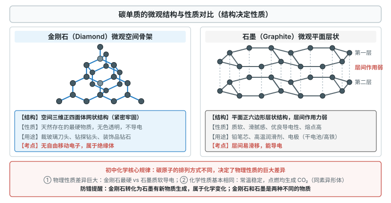
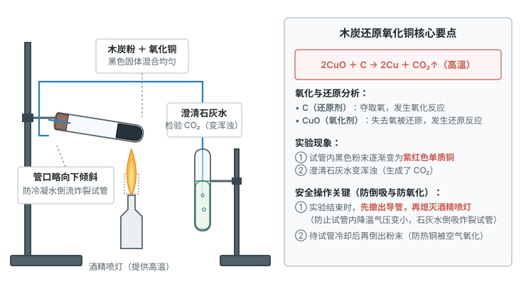
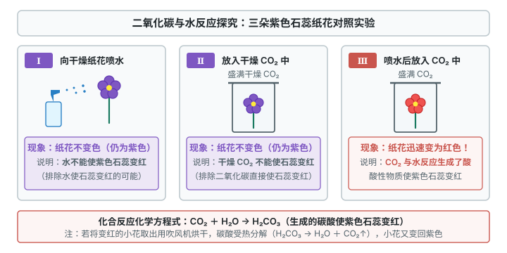
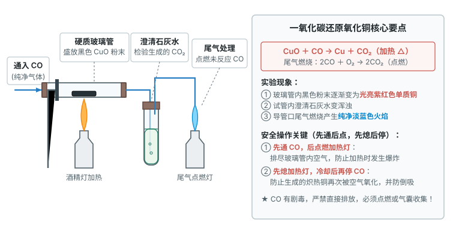
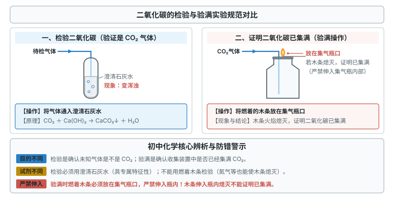
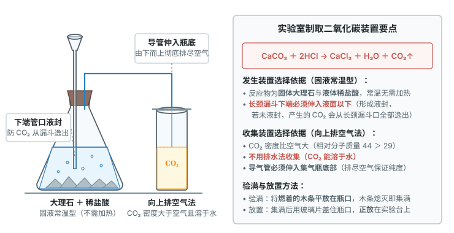
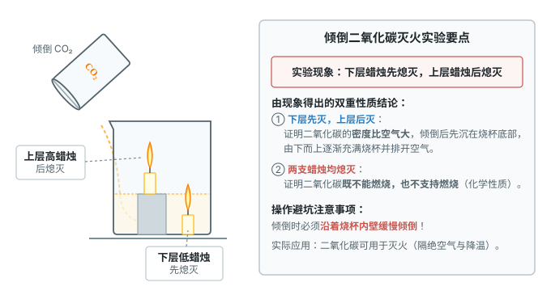
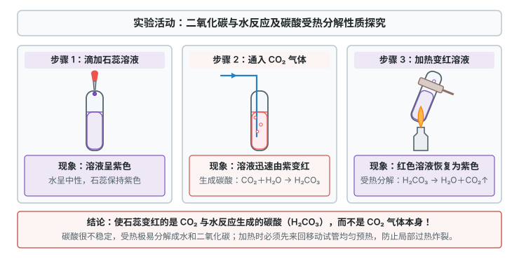

# 第六单元 碳和碳的氧化物

这一章先学碳单质，再对比二氧化碳和一氧化碳，最后学实验室制取二氧化碳的思路。

标着**重点**的四个知识点，中考几乎每年都考，要花最多时间；标着**一般**的，理解本质、规范操作就行。

## 本章前置自查

下面四件事，哪一件没把握，先回看前面单元：

1. 说出原子排列方式决定物质性质。（第三单元 课题2）
2. 结合水的性质理解物质溶于水并能与水发生化合反应。（第四单元 课题2）
3. 正确书写常见化学方程式并配平。（第五单元 课题2）
4. 说出实验室制取氧气的发生装置与收集装置的选择依据。（第二单元 课题3）

---

## 6.1a 碳单质的物理性质与微观结构

```yaml
id: CHEM-9A-06-1a
weight: 一般
weight_note: 7 套卷直接考查 2 次
textbook: 九上 6.1 碳单质的多样性，p.128–132, 134–135
prerequisites:
  - id: CHEM-9A-03-2b
    strength: hard
    reason: 碳原子不同的排列方式决定了金刚石、石墨等物理性质的巨大差异。
evidence:
  - 能说出金刚石、石墨物理性质存在巨大差异的微观原因（碳原子排列方式不同）
  - 能列举金刚石、石墨、活性炭的重要物理性质及对应的常见用途
figure: 已完成 figures/diamond-graphite-structure.svg（金刚石与石墨微观结构及性质对比示意图：正四面体空间网状与平面层状六边形）
sources: [TB9A-6.1, GD2023-17, GD2025-16]
```

### 本次只学

认识金刚石、石墨和 $\ce{C60}$ 的微观构成与物理性质差异，掌握活性炭的吸附性及用途。

### 先认住



- **同素异形与微观结构**：金刚石、石墨和 $\ce{C60}$ 都是碳单质，物理性质差异大的根本原因是**碳原子排列方式不同**。金刚石是三维正四面体网状骨架，是天然最硬的物质；石墨是平面层状排列，质软、滑腻，导电性好、熔点高；$\ce{C60}$ 是 60 个碳原子构成的足球形分子。
- **无定形碳的吸附性**：木炭、活性炭、炭黑、焦炭的主要成分也是碳单质，结构与石墨类似。活性炭疏松多孔、表面积大，**吸附能力**强，能吸附色素和异味（物理变化），用于防毒面具、制糖脱色、自来水净化。

### 容易错

- 同一种元素构成的物质不一定是纯净物：金刚石与石墨粉末混合是混合物。
- 活性炭吸附色素或气味是物理变化，没有新物质生成。

### 练一练

- `Q-CHEM-GD2023-17-4`

---

## 6.1b 碳单质的化学性质

```yaml
id: CHEM-9A-06-1b
weight: 重点
weight_note: 7 套卷直接考查 4 次
textbook: 九上 6.1 碳单质的多样性，p.132–134
prerequisites:
  - id: CHEM-9A-06-1a
    strength: soft
    reason: 认识常见碳单质的形态与组成。
  - id: CHEM-9A-05-2a
    strength: hard
    reason: 用化学方程式表达木炭的可燃性及高温还原氧化铜、氧化锡反应。
evidence:
  - 能说出常温下碳单质化学性质稳定，并能解释古代字画长久保存不变色的原因
  - 能正确书写碳在氧气中充分燃烧与不充分燃烧的化学方程式
  - 能说明木炭还原氧化铜的实验现象、操作要点，并能正确书写反应的化学方程式
figure: 已完成 figures/charcoal-reduction-cuo.svg（木炭还原氧化铜实验装置：酒精喷灯高温加热与澄清石灰水检验）
sources: [TB9A-6.1, GD2022-20, GZ2022-16, GZ2023-16]
walk_source: 人教版课本 p.133 木炭还原氧化铜实验
```

### 本次只学

掌握碳在常温下的稳定性和高温下的可燃性、还原性，理解氧化反应与还原反应。

### 先认住

- **常温稳定**：常温下碳的化学性质**不活泼**，所以古代墨汁写的字画千年不褪色。
- **高温可燃**：充分燃烧生成二氧化碳：$\ce{C + O2 ->[\text{点燃}] CO2}$（放热）；氧气不足时不充分燃烧，生成有毒的一氧化碳：$\ce{2C + O2 ->[\text{点燃}] 2CO}$。
- **高温还原**：高温下碳能夺取含氧化合物里的氧，把金属还原出来。木炭与氧化铜：$\ce{2CuO + C ->[\text{高温}] 2Cu + CO2 ^}$；**补充**（课本没有讲，做真题时常用）：焦炭还原氧化铁炼铁：$\ce{2Fe2O3 + 3C ->[\text{高温}] 4Fe + 3CO2 ^}$；高温下碳还原二氧化碳：$\ce{CO2 + C ->[\text{高温}] 2CO}$。
- **氧化反应与还原反应**：物质得到氧的反应是**氧化反应**，含氧化合物失去氧的反应是**还原反应**。木炭夺氧，发生氧化反应，是还原剂；氧化铜失氧，发生还原反应，是氧化剂。



### 破题钥匙

```think
宏观: 黑色粉末慢慢变红，生成的气体使澄清石灰水变浑浊
微观: 碳原子夺走氧化铜里的氧原子，铜原子被留下
图: chem-reduction
符号: $\ce{2CuO + C ->[\text{高温}] 2Cu + CO2 ^}$
招: 证据
结: 碳能夺氧，所以有还原性
```

### 走一遍

任务：分析木炭与氧化铜高温反应的操作、现象及化学方程式。

将刚烘干的木炭粉和氧化铜粉混合均匀装入反应管，导管插入澄清石灰水，用酒精喷灯加热。

第一步：写出反应物与生成物，配平。

反应物是 $\ce{CuO}$ 与 $\ce{C}$，生成物是 $\ce{Cu}$ 与 $\ce{CO2}$，配平得：

$$\ce{2CuO + C ->[\text{高温}] 2Cu + CO2 ^}$$

第二步：观察现象。

黑色粉末逐渐变成紫红色（生成铜），澄清石灰水变浑浊（生成二氧化碳）。

第三步：操作顺序与安全。

实验结束，先把导管从石灰水中撤出，再熄灭喷灯，防止试管内气体冷却、压强减小，石灰水倒吸炸裂热试管。待试管冷却后再倒出粉末，防止灼热的铜被空气中的氧气重新氧化。

所以该反应的方程式为：

$$\boxed{\ce{2CuO + C ->[\text{高温}] 2Cu + CO2 ^}}$$

### 容易错

- 实验结束必须**先撤导管、后熄喷灯**，否则石灰水倒吸炸裂试管。
- 反应刚结束就倒出灼热的粉末，铜会重新被氧化成黑色氧化铜。
- 漏写条件“高温”或漏注气体符号“$\uparrow$”。

### 练一练

- `Q-CHEM-GZ2023-16-2`

---

## 6.2a 二氧化碳的性质与用途

```yaml
id: CHEM-9A-06-2a
weight: 重点
weight_note: 7 套卷直接考查 6 次
textbook: 九上 6.2 碳的氧化物，p.136–140, 143–144
prerequisites:
  - id: CHEM-9A-05-2a
    strength: hard
    reason: 书写二氧化碳与澄清石灰水反应、与水反应生成碳酸的化学方程式。
  - id: CHEM-9A-04-2a
    strength: soft
    reason: 结合水的性质理解二氧化碳能溶于水并与水发生化合反应。
evidence:
  - 能说出二氧化碳的密度、溶解性及干冰升华吸热的物理性质与用途
  - 能说明二氧化碳与水、澄清石灰水反应的现象，并能正确书写化学方程式
  - 能说明二氧化碳对生活和环境的影响，并说出低碳行动的常见途径
figure: 已完成 figures/litmus-flowers-co2.svg（二氧化碳与水反应的三朵石蕊纸花对照实验）
sources: [TB9A-6.2, GD2022-20, GD2023-20, GD2024-18, GZ2023-18, GZ2024-12]
walk_source: 人教版课本 p.137–138 实验 6-5 二氧化碳与水反应探究
```

### 本次只学

掌握二氧化碳的物理、化学性质和检验方法，理解温室效应与低碳行动。

### 先认住

- **物理性质与干冰**：无色无臭的气体，密度比空气大，能溶于水（约 $1$ 体积水溶 $1$ 体积）。固态二氧化碳叫**干冰**，升华吸热，使周围温度骤降，用于冷藏保鲜、人工增雨、舞台云雾。
- **不燃不助燃**：通常**不能燃烧，也不支持燃烧**，且密度比空气大，所以可用于灭火。
- **与水反应**：二氧化碳与水化合生成碳酸：$\ce{CO2 + H2O -> H2CO3}$，碳酸使紫色石蕊溶液变红；碳酸不稳定，受热分解：$\ce{H2CO3 -> H2O + CO2 ^}$，红色又变回紫色。
- **与石灰水反应（检验二氧化碳）**：生成白色碳酸钙沉淀和水：$\ce{Ca(OH)2 + CO2 -> CaCO3 v + H2O}$，现象是**澄清石灰水变浑浊**，这是检验二氧化碳的特征反应。



### 破题钥匙

```think
宏观: 把二氧化碳通入紫色石蕊溶液，溶液变红
微观: 二氧化碳分子和水分子结合，变成碳酸分子
图: chem-co2
符号: $\ce{CO2 + H2O -> H2CO3}$
招: 证据
结: 变红的是碳酸，不是二氧化碳
```

### 走一遍

任务：用紫色石蕊小花对照实验，探究二氧化碳与水的反应。

取石蕊溶液染成紫色的干燥纸花做对比。

第一步：对照分析变色原因。

第一朵喷水，不变色，水不能使石蕊变红；第二朵直接放入干燥二氧化碳，不变色，二氧化碳本身不能使石蕊变红；第三朵喷水后放入二氧化碳，由紫变红。

第二步：得出结论，写化合反应方程式。

水与二氧化碳生成了碳酸（$\ce{H2CO3}$），碳酸显酸性使石蕊变红：

$$\ce{CO2 + H2O -> H2CO3}$$

第三步：验证碳酸不稳定。

把变红的小花吹干（或加热），又变回紫色，说明碳酸受热分解为水和二氧化碳：$\ce{H2CO3 -> H2O + CO2 ^}$。

所以二氧化碳溶于水呈酸性的方程式为：

$$\boxed{\ce{CO2 + H2O -> H2CO3}}$$

### 容易错

- 使石蕊变红的是二氧化碳与水生成的碳酸，不是二氧化碳气体本身。
- 二氧化碳无毒，但不能供给呼吸，浓度过高会使人窒息；进入久未开启的菜窖、深坑前要做灯火试验。
- 干冰升华用于人工降雨、冷藏是物理利用，不能减少二氧化碳总量；经化学反应制成化工产品才是化学利用。

### 练一练

- `Q-CHEM-GZ2024-12`
- `Q-CHEM-GZ2023-18-2`

---

## 6.2b 一氧化碳的性质与毒性

```yaml
id: CHEM-9A-06-2b
weight: 重点
weight_note: 7 套卷直接考查 6 次
textbook: 九上 6.2 碳的氧化物，p.141–143
prerequisites:
  - id: CHEM-9A-06-1b
    strength: soft
    reason: 一氧化碳可由碳不充分燃烧或二氧化碳与碳高温还原得到。
  - id: CHEM-9A-06-2a
    strength: hard
    reason: 对比一氧化碳与二氧化碳的分子构成与化学性质差异。
evidence:
  - 能说出一氧化碳的毒性机理及预防煤气中毒的措施
  - 能正确书写一氧化碳燃烧及还原氧化铜、氧化铁的化学方程式
  - 能说明一氧化碳还原金属氧化物实验中的操作顺序（先通后点、先熄后停）及尾气处理方法
figure: 已完成 figures/co-reduction-cuo.svg（一氧化碳还原氧化铜实验装置：加热硬质玻璃管与尾气点燃处理）
sources: [TB9A-6.2, GD2022-20, GD2023-21, GZ2022-14, GZ2022-16, GZ2023-20]
walk_source: 中考常见实验模型（参考广州真题 GZ2022-14 与 GZ2023-20）
```

### 本次只学

掌握一氧化碳的物理性质、毒性、可燃性、还原性，以及尾气处理与安全防护。

### 先认住

- **物理性质与毒性**：无色无臭的气体，难溶于水，密度略小于空气。**极易与血红蛋白结合**，结合能力比氧气大数百倍且不易分离，使血红蛋白不能携氧，人会缺氧窒息（煤气中毒）。所以冬天生煤火取暖要装烟囱、保持通风。
- **可燃性**：在空气中燃烧，发出**纯净的淡蓝色火焰**，放热，生成二氧化碳：$\ce{2CO + O2 ->[\text{点燃}] 2CO2}$。它是水煤气和家用燃气的成分。点燃前必须验纯，防止混有空气爆炸。
- **还原性与炼铁**：加热或高温下，一氧化碳夺取金属氧化物中的氧。与氧化铜：$\ce{CO + CuO ->[\Delta] Cu + CO2}$；**补充**（课本没有讲，做真题时常用）：高温还原氧化铁炼铁：$\ce{3CO + Fe2O3 ->[\text{高温}] 2Fe + 3CO2}$（九下第八单元会系统学）。
- **分子构成决定性质**：$\ce{CO}$ 和 $\ce{CO2}$ 都是碳、氧两种元素组成的氧化物，但**分子构成不同**（$\ce{CO2}$ 分子多一个氧原子），所以性质差异很大。



### 走一遍

任务：掌握一氧化碳还原氧化铜的操作步骤、现象、方程式和尾气处理。

加热硬质玻璃管中的黑色氧化铜，通入一氧化碳，产生的气体通入澄清石灰水，尾气用酒精灯点燃。

第一步：写方程式。

一氧化碳夺取氧化铜中的氧生成二氧化碳，自身发生氧化反应：

$$\ce{CO + CuO ->[\Delta] Cu + CO2}$$

第二步：操作顺序（先通后点、先熄后停）。

**补充**（课本没有讲，做真题时常用）：
- 开始前：先通一会儿一氧化碳，排净管内空气，再点燃酒精灯，防止一氧化碳与空气混合受热爆炸；
- 结束后：先熄灭酒精灯，继续通一氧化碳直到玻璃管冷却，防止红热的铜被空气中的氧气重新氧化，也防止石灰水倒吸炸裂玻璃管。

第三步：现象与尾气处理。

**补充**（课本没有讲，做真题时常用）：玻璃管内黑色粉末逐渐变成紫红色，石灰水变浑浊。一氧化碳有剧毒，尾气不能直接排放，要在导管口用点燃的酒精灯烧掉，转化成无毒的二氧化碳（$\ce{2CO + O2 ->[\text{点燃}] 2CO2}$），或用气囊收集。

所以核心方程式为：

$$\boxed{\ce{CO + CuO ->[\Delta] Cu + CO2}}$$

### 容易错

- 操作顺序：实验前**先通一氧化碳、后点酒精灯**；实验后**先熄酒精灯、后停通气**。
- 装置末端必须有尾气处理：一氧化碳有剧毒且难溶于水，要点燃或用气囊收集。
- 室内放一盆水不能预防煤气中毒，一氧化碳难溶于水。

### 练一练

- `Q-CHEM-GZ2022-14`
- `Q-CHEM-GD2022-20-3`

---

## 6.3a 二氧化碳实验室制取的原理与操作

```yaml
id: CHEM-9A-06-3a
weight: 一般
weight_note: 7 套卷直接考查 1 次
textbook: 九上 6.3 二氧化碳的实验室制取，p.145–146, 148–149
prerequisites:
  - id: CHEM-9A-06-2a
    strength: hard
    reason: 依据二氧化碳不燃不助燃及与石灰水反应的性质进行验满与检验。
  - id: CHEM-9A-05-2a
    strength: hard
    reason: 正确书写碳酸钙与稀盐酸反应生成二氧化碳的化学方程式。
evidence:
  - 能说出实验室制取二氧化碳的药品选择依据并正确书写反应的化学方程式
  - 能规范表述实验室制取二氧化碳的操作步骤、检验与验满方法
figure: 已完成 figures/co2-test-and-full.svg（检验与验满二氧化碳实验规范对比：通入澄清石灰水与木条平放瓶口）
sources: [TB9A-6.3, GZ2022-19]
```

### 本次只学

掌握实验室制取二氧化碳的反应原理、药品选择理由，以及操作、检验和验满步骤。

### 先认住

- **原理与药品**：用**大理石或石灰石**（主要成分 $\ce{CaCO3}$）与**稀盐酸**在常温下反应：$\ce{CaCO3 + 2HCl -> CaCl2 + H2O + CO2 ^}$。**补充**（课本没有讲，做真题时常用）：不用浓盐酸，因为它易挥发，气体中混有氯化氢；不用稀硫酸，因为生成的硫酸钙微溶，覆盖在石灰石表面阻碍反应；不用碳酸钠粉末，因为反应太快，难控制和收集。
- **操作步骤**：①连接仪器，检查气密性；②在锥形瓶或试管中加入大理石小块；③塞紧带导管和长颈漏斗的橡胶塞，固定在铁架台上；④从长颈漏斗注入稀盐酸；⑤向上排空气法收集。
- **检验与验满**：检验，把气体通入**澄清石灰水**，变浑浊就是二氧化碳；验满，把**燃着的木条平放在集气瓶口**，火焰立即熄灭说明已集满。



### 容易错

- 检验是通入澄清石灰水看浑浊，验满是木条放在瓶口看熄灭，两者不能混。
- 木条伸入瓶内熄灭，只能证明瓶内有二氧化碳，不能证明已集满；验满要放在瓶口。

### 练一练

- `Q-CHEM-GZ2022-19-1`

---

## 6.3b 二氧化碳实验室制取装置的设计与气体制备思路

```yaml
id: CHEM-9A-06-3b
weight: 重点
weight_note: 7 套卷直接考查 4 次
textbook: 九上 6.3 二氧化碳的实验室制取，p.146–149
prerequisites:
  - id: CHEM-9A-06-3a
    strength: hard
    reason: 根据反应物状态、反应条件及二氧化碳性质选择实验装置。
  - id: CHEM-9A-02-3b
    strength: hard
    reason: 迁移实验室制取氧气的发生与收集装置选择思路。
evidence:
  - 能根据反应物的状态和反应条件选择合适的气体发生装置
  - 能根据气体的密度和水溶性选择气体的收集装置，并分析排空气法的导管长短要求
  - 能归纳实验室制备气体的一般思路与仪器组合（包括长颈漏斗的液封要求）
figure: 已完成 figures/co2-preparation-collection.svg（实验室制取二氧化碳装置：固液常温型发生与向上排空气收集）
sources: [TB9A-6.3, GD2022-18, GD2024-18, GZ2022-20, GZ2023-20]
walk_source: 人教版课本 p.146–147 实验室制取二氧化碳装置探究
```

### 本次只学

掌握发生装置与收集装置的选择依据，会设计并评价二氧化碳的制备装置。

### 先认住

- **发生装置**：看**反应物状态**（固+固、固+液）和**反应条件**（是否加热、是否用催化剂）。石灰石（固）与稀盐酸（液）常温反应，选**固液常温型**。用长颈漏斗加液体时，**下端管口必须伸入液面以下**（液封），防止气体从漏斗口逸出；也可用分液漏斗或注射器，能控制滴加速率。
- **收集装置**：看**气体密度**（与空气平均相对分子质量 29 比较）、**溶解性及是否与水反应**。二氧化碳密度比空气大，能溶于水并与水反应，只能用**向上排空气法**，不能用排水法。
- **导管要求**：向上排空气法收集，**导气管必须伸到集气瓶底部**，才能把空气由下而上排净。
- **制备气体的一般思路**：定反应原理（速率适中、安全环保） → 据此定发生装置与收集装置（含干燥、净化、尾气处理） → 检验并验满。



### 走一遍

任务：根据反应原理与二氧化碳的性质，设计并评价发生与收集装置。

反应原理：大理石与稀盐酸在常温下反应。

第一步：由反应物状态与条件定发生装置。

反应物是大理石（固）和稀盐酸（液），常温、无需加热，选固液常温型。容器可用锥形瓶、平底烧瓶或试管；用长颈漏斗加酸，下端管口必须伸入液面以下形成液封，防止气体从漏斗口逸出；也可用分液漏斗代替，控制滴加速率。

第二步：由气体密度与溶解性定收集装置。

二氧化碳的相对分子质量 44 大于空气的 29，密度比空气大，又能溶于水并与水反应，所以不能用排水法，只能用向上排空气法，导气管伸到瓶底，把空气排净。

第三步：梳理制取与验满思路。

连接仪器 → 检查气密性 → 装入大理石并注入稀盐酸 → 导管伸入瓶底向上排空气收集 → 燃着木条放瓶口验满。

所以装置设计思路为：

$$\boxed{\text{反应物状态与条件决定发生装置，气体密度与溶解性决定收集装置}}$$

### 容易错

- 长颈漏斗末端没伸入液面以下，气体会从漏斗口逸出，收集不到。
- 向上排空气法导管没伸到瓶底，瓶底空气排不净，气体不纯。
- 二氧化碳不能用排水法：它能溶于水并与水反应，气体损失大。

### 练一练

- `Q-CHEM-GD2022-18-2`

---

## 6.4a 二氧化碳制取与性质实验探究

```yaml
id: CHEM-9A-06-4a
weight: 一般
weight_note: 7 套卷直接考查 1 次
textbook: 九上 6.4 实验活动3 二氧化碳的实验室制取与性质，p.154–155
prerequisites:
  - id: CHEM-9A-06-3a
    strength: hard
    reason: 依据制取原理进行实验操作和气体收集。
  - id: CHEM-9A-06-2a
    strength: hard
    reason: 通过阶梯蜡烛熄灭和石蕊变色验证二氧化碳的密度与化学性质。
evidence:
  - 能独立完成二氧化碳的制取、收集并检验其物理性质与化学性质
  - 能根据阶梯蜡烛熄灭、紫色石蕊变色等实验现象得出对应的性质结论
figure: 已完成 figures/co2-extinguish-candles.svg、figures/co2-litmus-heating.svg（倾倒二氧化碳熄灭高低蜡烛与石蕊受热变色）
sources: [TB9A-6.4, GD2024-18]
```

### 本次只学

完成二氧化碳的制取与收集，探究它的密度、灭火性及与水、澄清石灰水的反应。

### 先认住

- **制取与收集**：检查气密性后，加入大理石、注入稀盐酸；导管伸到瓶底收集；燃着木条平放瓶口验满；集满后用毛玻璃片磨砂面朝下盖住瓶口，正放在桌上。
- **倾倒二氧化碳熄灭高低蜡烛**：向放有高低两支燃着蜡烛的烧杯缓慢倾倒二氧化碳，**下层蜡烛先熄灭，上层后熄灭**。下层先灭说明**密度比空气大**；蜡烛熄灭说明**不能燃烧，也不支持燃烧**。


- **与水反应及受热分解**：向滴有石蕊的蒸馏水中通入二氧化碳，溶液由紫变红（生成碳酸，$\ce{CO2 + H2O -> H2CO3}$）；加热变红的溶液，由红变回紫（碳酸受热分解，$\ce{H2CO3 -> H2O + CO2 ^}$）；向少量澄清石灰水通入二氧化碳，石灰水变浑浊（$\ce{Ca(OH)2 + CO2 -> CaCO3 v + H2O}$）。



### 容易错

- 倾倒要沿烧杯内壁缓慢平稳，从蜡烛上方快速冲倒，可能上层蜡烛先灭，实验失败。
- 加热变红的石蕊试管要先预热，来回移动使其受热均匀，否则试管会炸裂。

### 练一练

- `Q-CHEM-GD2024-18-1`

---

> 跨学科实践活动5（基于碳中和理念设计低碳行动方案）：调查日常生活或校园中的碳排放源，结合二氧化碳的性质与吸收利用途径，设计一份家庭或校园低碳行动方案。
