# 第六单元 碳和碳的氧化物 · 题目

讲义只用 `lesson.md` 里引用的题，按知识点顺序排在前面。

---

## 讲义用题（9 道）

### Q-CHEM-GD2023-17-4

```yaml
category: 真题
source: 2023 年广东省初中学业水平考试 化学 第 17 题第（4）问
source_quality: 原卷
kp: CHEM-9A-06-1a
do: 本章只做第（4）问
other_parts: 第（1）问海水淡化用途排在首位归入科普阅读，第（2）问物理变化归入第一单元，第（3）问海水淡化原理归入第二单元，第（5）问爱护水资源归入 CHEM-9A-04-1b
type: 选填
grading: 自评
answer_by: 原卷解析
review:
  概念: CHEM-9A-06-1a
```

**题干**

地球是一个美丽的“水球”，表面约 71%被水覆盖，淡水仅占总水量的 2.5%；其余是海水或咸水海水淡化是解决人类淡水资源短缺的有效措施。全球海水淡化水用途如图1所示。

海水淡化技术主要有热分离法和膜分离法，热分离法利用热发和冷凝分离水与非挥发性物质，能耗大，成本高；膜分离法利用薄膜的选择透过性实现海水淡化，但现有薄膜的水通量低，应用受到限制，有科学家提出，给石墨烯“打上”许多特定大小的孔，制成单层纳米孔二维薄膜。可进行海水淡化。石墨烯海水淡化膜工作原理如图2所示。

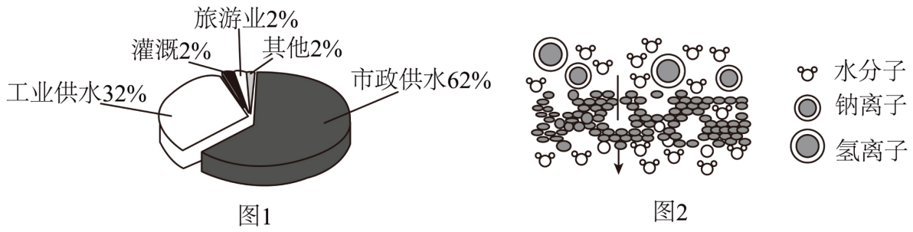

依据上文，回答下列问题。

（4）石墨烯、金刚石和 $\ce{C60}$ 属于碳单质，下列说法正确的是____（填字母）。

a. 都由碳元素组成  b. 都由碳原子构成  c. 物理性质相似

**答案**

a

**解析**

1. a 项：石墨烯、金刚石和 $\ce{C60}$ 都属于碳单质，都由碳元素组成，说法正确；
2. b 项：石墨烯、金刚石由碳原子直接构成，而 $\ce{C60}$ 是由分子构成的（每个分子由 60 个碳原子构成），说法错误；
3. c 项：石墨烯、金刚石和 $\ce{C60}$ 虽然都由碳元素组成，但是碳原子的排列方式不同，物理性质存在显著差异，说法错误。

故选 a。

---

### Q-CHEM-GZ2023-16-2

```yaml
category: 真题
source: 2023 年广州市初中学业水平考试 化学 第 16 题第（2）问①
source_quality: 原卷
kp: CHEM-9A-06-1b
do: 本章只做第（2）问①
other_parts: 第（1）问金属导电性归入九下金属物理性质，第（2）问②合金熔点归入九下合金，第（3）问①归入 CHEM-9A-06-1b、②蒸馏归入 CHEM-9A-04-1a、③防氧化反应归入九下金属冶炼，第（4）问湿法冶金归入九下金属活动性
type: 填空
grading: 自评
answer_by: 原卷解析
review:
  公式: CHEM-9A-06-1b
  审题: CHEM-9A-05-2a
```

**题干**

我国古代科技璀璨夺目，金属的冶炼与使用在当时已处于世界先进水平。

明代《天工开物》描述了锡的冶炼方法，如图a。

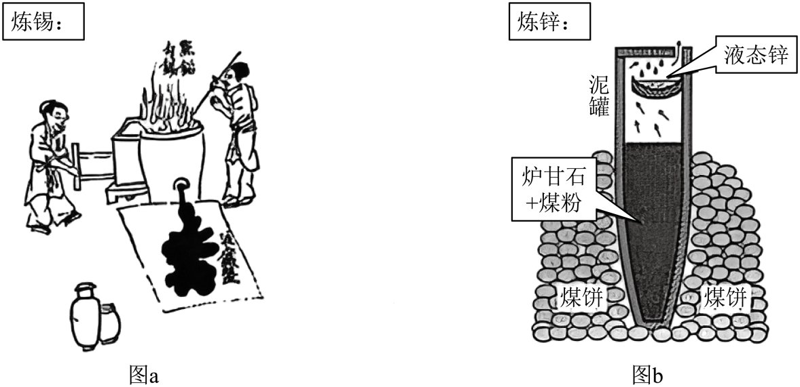

①原料锡砂中的 $\ce{SnO2}$ 和木炭反应得到锡和二氧化碳，化学方程式为______。

**答案**

$\ce{SnO2 + C ->[\text{高温}] Sn + CO2 ^}$

**解析**

原料锡砂中的 $\ce{SnO2}$ 与木炭在高温条件下反应生成金属锡（$\ce{Sn}$）和二氧化碳（$\ce{CO2}$），反应的化学方程式为 $\ce{SnO2 + C ->[\text{高温}] Sn + CO2 ^}$。

---

### Q-CHEM-GZ2024-12

```yaml
category: 真题
source: 2024 年广州市初中学业水平考试 化学 第 12 题
source_quality: 原卷
kp: CHEM-9A-06-2a
type: 选择
grading: 自动
answer_by: 原卷解析
review:
  概念: CHEM-9A-06-2a
```

**题干**

部分含碳物质的分类与相应的化合价关系如图所示。下列推断不合理的是（　　）

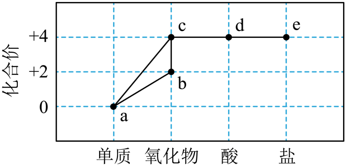

A. a可能是 $\ce{C60}$
B. b和c能相互转化
C. c能与水反应生成d
D. c不能直接转化成e

**答案**

D

**解析**

1. A 项：a 点表示单质，碳元素的化合价为 0，因此可能是 $\ce{C60}$、金刚石或石墨，推断正确；
2. B 项：b 为一氧化碳（氧化物，碳元素 +2 价），c 为二氧化碳（氧化物，碳元素 +4 价）。一氧化碳燃烧生成二氧化碳（$\ce{2CO + O2 ->[\text{点燃}] 2CO2}$），二氧化碳与碳在高温下反应生成一氧化碳（$\ce{CO2 + C ->[\text{高温}] 2CO}$），两者可以相互转化，推断正确；
3. C 项：c 为二氧化碳，d 为酸（碳酸，$\ce{H2CO3}$），二氧化碳与水反应生成碳酸（$\ce{CO2 + H2O -> H2CO3}$），因此 c 能与水反应生成 d，推断正确；
4. D 项：c 为二氧化碳，e 为碳酸盐（如碳酸钙、碳酸钠等）。二氧化碳通入澄清石灰水直接反应生成碳酸钙沉淀和水（$\ce{Ca(OH)2 + CO2 -> CaCO3 v + H2O}$），因此 c 可以直接转化成 e，推断不合理。

故选 D。

---

### Q-CHEM-GZ2023-18-2

```yaml
category: 真题
source: 2023 年广州市初中学业水平考试 化学 第 18 题第（2）问
source_quality: 原卷
kp: CHEM-9A-06-2a
do: 本章只做第（2）问
other_parts: 第（1）问氢氧化铁与盐酸反应归入九下酸碱盐，第（3）问中和反应证据获取归入九下酸碱盐，第（4）问溶液导电能力图像分析归入九下酸碱盐
type: 填空
grading: 自评
answer_by: 原卷解析
review:
  概念: CHEM-9A-06-2a
```

**题干**

通过观察和实验等方法获取证据是科学探究重要环节。

（2）向 $\ce{Ca(OH)2}$ 溶液中通入 $\ce{CO2}$，观察到______，可判断发生了反应。

**答案**

溶液变浑浊

**解析**

氢氧化钙和二氧化碳反应生成白色碳酸钙沉淀和水（$\ce{Ca(OH)2 + CO2 -> CaCO3 v + H2O}$），澄清石灰水溶液变浑浊，产生白色沉淀说明有新物质生成，能证明发生了化学反应。

---

### Q-CHEM-GZ2022-14

```yaml
category: 真题
source: 2022 年广州市初中学业水平考试 化学 第 14 题
source_quality: 原卷
kp: CHEM-9A-06-2b
type: 选择
grading: 自动
answer_by: 原卷解析
review:
  概念: CHEM-9A-06-2b
  审题: CHEM-9A-05-1b
```

**题干**

由下列实验及现象可出相应结论的是（　　）

| 选项 | 实验 | 现象 | 结论 |
| :--- | :--- | :--- | :--- |
| A | 检验氢气的纯度<br>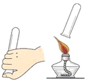 | 点燃氢气时发出尖锐爆鸣声 | 氢气较纯 |
| B | 称量盐酸和碳酸钠粉末反应前后的质量<br>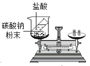 | 反应前后称量结果不同 | 参加该反应的反应物质量总和不等于生成物质量总和 |
| C | 检验某混合气体的成分<br>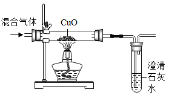 | 黑色粉末变红，澄清石灰水变浑浊 | 混合气体中可能含有 $\ce{CO}$ |
| D | 在酒精灯火焰上方罩一个冷而干燥的烧杯<br> | 烧杯内壁有无色液滴产生 | 酒精中含有碳元素和氢元素 |

A. A
B. B
C. C
D. D

**答案**

C

**解析**

1. A 项：检验氢气的纯度时，点燃氢气发出尖锐爆鸣声表明氢气不纯净，声音很小才表示气体纯净，结论错误；
2. B 项：盐酸和碳酸钠粉末反应产生氯化钠、水和二氧化碳气体，装置没有密闭，生成的二氧化碳气体逸散到空气中，所以反应前后称量结果不同；该反应遵循质量守恒定律，结论错误；
3. C 项：混合气体通过灼热氧化铜和澄清石灰水，一氧化碳与氧化铜在加热时反应产生红色的铜和二氧化碳气体，黑色粉末变红，产生的二氧化碳使澄清石灰水变浑浊，说明气体中可能含有 $\ce{CO}$，结论正确；
4. D 项：在酒精灯火焰上方罩一个冷而干燥的烧杯，内壁产生水珠只能证明酒精燃烧生成了水，说明酒精中含有氢元素；要证明含有碳元素，还需迅速倒转烧杯注入澄清石灰水，观察石灰水是否变浑浊，结论错误。

故选 C。

---

### Q-CHEM-GD2022-20-3

```yaml
category: 真题
source: 2022 年广东省初中学业水平考试 化学 第 20 题第（3）问
source_quality: 原卷
kp: CHEM-9A-06-2b
do: 本章只做第（3）问
other_parts: 第（1）问常温碳性质稳定归入 CHEM-9A-06-1b，第（2）问蓝铜矿化合价归入 CHEM-9A-04-3b，第（4）问化合反应与吸热反应归入 CHEM-9A-06-2a 与 CHEM-9A-07-1c，第（5）问孔雀石分解归入 CHEM-9A-05-2a
type: 填空
grading: 自评
answer_by: 原卷解析
review:
  概念: CHEM-9A-06-2b
  公式: CHEM-9A-04-3b
```

**题干**

《千里江山图》是我国传世名画之一，宋代画家王希孟创造性地将炭黑、赭石、孔雀石、蓝铜矿等矿物颜料用在不同的画层。

画作中所用的矿物颜料也可用于治炼金属。下图为碳元素的价类转化二维图。利用图中化合物______（写化学式）的还原性治炼赭石（主要成分为 $\ce{Fe2O3}$），反应过程中碳元素的化合价______（填“升高”“降低”或“不变”）。

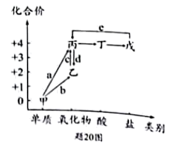

**答案**

$\ce{CO}$；升高

**解析**

1. 一氧化碳具有还原性，一氧化碳和氧化铁在高温下反应生成铁和二氧化碳（$\ce{3CO + Fe2O3 ->[\text{高温}] 2Fe + 3CO2}$），故利用图中化合物为 $\ce{CO}$；
2. 反应前一氧化碳（$\ce{CO}$）中氧元素显 -2 价，碳元素的化合价为 +2 价；反应后二氧化碳（$\ce{CO2}$）中氧元素显 -2 价，碳元素的化合价为 +4 价。因此反应过程中碳元素的化合价升高。

---

### Q-CHEM-GZ2022-19-1

```yaml
category: 真题
source: 2022 年广州市初中学业水平考试 化学 第 19 题第（1）问①②
source_quality: 原卷
kp: CHEM-9A-06-3a
do: 本章只做第（1）问①②
other_parts: 第（1）问③涉及金属活泼性、金属氧化物溶于酸及氯离子沉淀反应归入九下酸碱盐，第（2）问废液处理与碳酸钠沉淀滴定计算归入九下复分解反应与定量分析
type: 填空
grading: 自评
answer_by: 原卷解析
review:
  公式: CHEM-9A-06-3a
  概念: CHEM-9A-06-3a
```

**题干**

某校学生用盐酸和碳酸钙制备 $\ce{CO2}$，产生了大量废液。兴趣小组通过以下探究确定废液处理方案。

（1）废液成分的确定
①写出制备 $\ce{CO2}$ 的化学方程式_______。
②推测废液所含溶质
推测一：_______     推测二：$\ce{CaCl2}$ 和 $\ce{HCl}$

**答案**

① $\ce{CaCO3 + 2HCl -> CaCl2 + H2O + CO2 ^}$；② $\ce{CaCl2}$

**解析**

1. 实验室用大理石（或石灰石）的主要成分碳酸钙和盐酸反应产生氯化钙、水和二氧化碳，化学方程式为 $\ce{CaCO3 + 2HCl -> CaCl2 + H2O + CO2 ^}$；
2. 碳酸钙和盐酸恰好完全反应时溶质只有氯化钙，则推测一：$\ce{CaCl2}$；盐酸过量时溶质为 $\ce{CaCl2}$ 和 $\ce{HCl}$。

---

### Q-CHEM-GD2022-18-2

```yaml
category: 真题
source: 2022 年广东省初中学业水平考试 化学 第 18 题第（2）问
source_quality: 原卷
kp: CHEM-9A-06-3b
do: 本章只做第（2）问
other_parts: 第（1）问仪器名称试管归入第一单元实验基本技能，第（3）问pH测定归入九下溶液酸碱性，第（4）问酸碱中和反应指示剂变色归入九下酸碱盐
type: 实验
grading: 自评
answer_by: 原卷解析
review:
  概念: CHEM-9A-06-3b
  公式: CHEM-9A-02-3a
```

**题干**

具备基本化学实验技能是学习化学的基础和保证。在化学实验操作考试中，小明和小英分别抽取了I、Ⅱ两组试题。可供选择的实验药品有大理石、$\ce{KClO3}$、$\ce{MnO2}$、稀盐酸、$\ce{NaOH}$ 溶液、$\ce{H2O2}$ 溶液、酚酞溶液、石蕊溶液等，相关实验装置如图所示。

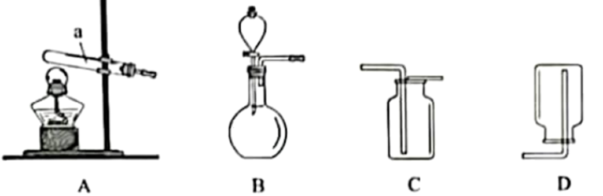

I组：$\ce{O2}$ 和 $\ce{CO2}$ 的实验室制取

（2）小明想用同一套装置分别制取 $\ce{O2}$ 和 $\ce{CO2}$，应选用发生装置______和收集装置______（填字母）。其中，制取 $\ce{O2}$ 的化学方程式为______。

**答案**

B；C；$\ce{2H2O2 ->[MnO2] 2H2O + O2 ^}$

**解析**

1. 发生装置选择：实验室制取 $\ce{CO2}$ 的发生装置为固液常温型（大理石与稀盐酸反应），实验室制取 $\ce{O2}$ 的发生装置有固固加热型和固液常温型两种；若想用同一套装置分别制取 $\ce{O2}$ 和 $\ce{CO2}$，发生装置必须选用固液常温型，应选择 B；
2. 收集装置选择：二氧化碳密度比空气大，能溶于水并与水发生反应，只能采用向上排空气法收集；氧气密度比空气大，也可以采用向上排空气法收集，故共同的收集装置应选择向上排空气装置 C；
3. 固液常温制取氧气的反应是过氧化氢溶液在二氧化锰催化作用下生成水和氧气，化学方程式为 $\ce{2H2O2 ->[MnO2] 2H2O + O2 ^}$。

---

### Q-CHEM-GD2024-18-1

```yaml
category: 真题
source: 2024 年广东省初中学业水平考试 化学 第 18 题第（1）问
source_quality: 原卷
kp: CHEM-9A-06-4a
do: 本章只做第（1）问
other_parts: 第（2）问低碳行动方案归入 CHEM-9A-06-2a
type: 实验
grading: 自评
answer_by: 原卷解析
review:
  概念: CHEM-9A-06-4a
  审题: CHEM-9A-06-2a
```

**题干**

回答下列问题：

（1）$\ce{CO2}$ 的制取及性质

i.制取 $\ce{CO2}$

组装一套便于添加稀盐酸的发生装置，需用到图1中的仪器有______(填字母)。

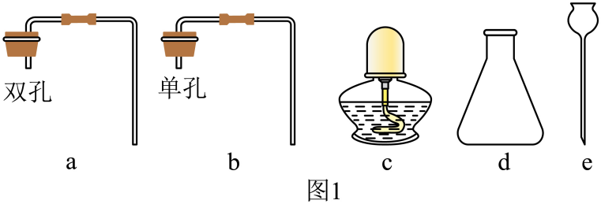

ii.性质实验

| 操作 | 现象 | 性质 |
| :--- | :--- | :--- |
| 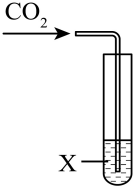 | X为澄清石灰水时，现象为______ | $\ce{CO2}$ 能与石灰水反应 |
| 同上 | X为______时，现象为______ | $\ce{CO2}$ 能与水反应生成酸性物质 |
| 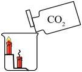 | 低处的蜡烛先熄灭，高处的蜡烛后熄灭 | ______；$\ce{CO2}$ 不燃烧，也不支持燃烧 |

**答案**

i. ade；ii. 澄清石灰水变浑浊；紫色石蕊溶液；溶液变红色；$\ce{CO2}$ 密度比空气大

**解析**

1. i 小问：组装便于添加稀盐酸的发生装置，应该选择长颈漏斗 e；制取二氧化碳的反应物为大理石和稀盐酸，属于固液常温型，选择锥形瓶 d 作反应容器；长颈漏斗和导管需要双孔橡胶塞 a 连接固定，故需要的仪器为 ade；
2. ii 小问：
   - 若 X 为澄清石灰水，澄清石灰水中的氢氧化钙与二氧化碳反应生成碳酸钙沉淀和水（$\ce{Ca(OH)2 + CO2 -> CaCO3 v + H2O}$），现象是澄清石灰水变浑浊；
   - 二氧化碳与水反应生成碳酸，碳酸显酸性，可以用紫色石蕊溶液检验，碳酸能使紫色石蕊溶液变红，故 X 为紫色石蕊溶液，现象为溶液变红色；
   - 将二氧化碳沿烧杯内壁倒入盛有燃着蜡烛的烧杯中，观察到低处的蜡烛先熄灭、高处的蜡烛后熄灭，说明二氧化碳密度比空气大，且二氧化碳不燃烧也不支持燃烧。

---

## 备选

### Q-CHEM-TB9A-6.1-1

```yaml
category: 课本习题
source: 人教版 化学 九年级上册（2022 年版课标修订）第 134 页“练习与应用”第 1 题
source_quality: 课本原文
kp: CHEM-9A-06-1a
type: 选择
grading: 自动
answer_by: 本项目编写，待复核
review:
  概念: CHEM-9A-06-1a
```

**题干**

金刚石和石墨都是由碳元素组成的单质，物理性质却有明显差异。其原因是（　　）

A. 构成它们的原子大小不同
B. 构成它们的原子数目不同
C. 金刚石和石墨由不同的原子构成
D. 金刚石和石墨中碳原子的排列方式不同

**答案**

D

**解析**

金刚石和石墨都是由碳元素组成的单质，都由同种碳原子构成，每个碳原子的大小也是相同的。但金刚石中碳原子呈立体网状骨架结构，而石墨中碳原子呈平面层状排列，即碳原子的排列方式不同，导致它们的物理性质存在巨大差异。

故选 D。

---

### Q-CHEM-TB9A-6.2-2

```yaml
category: 课本习题
source: 人教版 化学 九年级上册（2022 年版课标修订）第 143 页“练习与应用”第 2 题
source_quality: 课本原文
kp: CHEM-9A-06-2a
type: 选择
grading: 自动
answer_by: 本项目编写，待复核
review:
  概念: CHEM-9A-06-2a
```

**题干**

$\ce{CO2}$ 和 $\ce{CO}$ 具有相同的（　　）

A. 相对分子质量
B. 元素种类
C. 碳元素的质量分数
D. 分子种类

**答案**

B

**解析**

1. A 项：$\ce{CO2}$ 的相对分子质量为 $12 + 16 \times 2 = 44$，$\ce{CO}$ 的相对分子质量为 $12 + 16 = 28$，相对分子质量不同；
2. B 项：$\ce{CO2}$ 和 $\ce{CO}$ 都是由碳元素和氧元素组成的氧化物，所含元素种类完全相同；
3. C 项：$\ce{CO2}$ 中碳元素质量分数为 $\dfrac{12}{44} \times 100\% \approx 27.3\%$，$\ce{CO}$ 中碳元素质量分数为 $\dfrac{12}{28} \times 100\% \approx 42.9\%$，质量分数不同；
4. D 项：$\ce{CO2}$ 由二氧化碳分子构成，$\ce{CO}$ 由一氧化碳分子构成，分子种类不同。

故选 B。

---

### Q-CHEM-TB9A-6.3-1

```yaml
category: 课本习题
source: 人教版 化学 九年级上册（2022 年版课标修订）第 149 页“练习与应用”第 1 题
source_quality: 课本原文
kp: CHEM-9A-06-3a
type: 填空
grading: 自评
answer_by: 本项目编写，待复核
review:
  概念: CHEM-9A-06-3a
```

**题干**

实验室里采用图6-19所示的装置制取二氧化碳时，一般有5个步骤：①检查装置的气密性；②按要求组装好仪器；③向长颈漏斗中注入稀盐酸；④收集气体；⑤向锥形瓶中放入几小块石灰石。正确的操作顺序是______（填序号）。

**答案**

②①⑤③④

**解析**

实验室制取气体的常规操作顺序为：首先按要求组装连接仪器（②），然后检查装置的气密性（①），确认气密性良好后向反应容器中加入固体药品石灰石（⑤），塞紧橡胶塞后再从长颈漏斗加入液体试剂稀盐酸（③），最后用向上排空气法收集产生的二氧化碳气体（④）。因此正确的操作顺序是 ②①⑤③④。

---

### Q-CHEM-TB9A-6R-4

```yaml
category: 课本习题
source: 人教版 化学 九年级上册（2022 年版课标修订）第 152 页“复习与提高”第 4 题
source_quality: 课本原文
kp: CHEM-9A-06-2b
type: 选择
grading: 自动
answer_by: 本项目编写，待复核
review:
  概念: CHEM-9A-06-2b
  审题: CHEM-9A-06-2a
```

**题干**

下列关于 $\ce{CO}$ 和 $\ce{CO2}$ 的说法中，正确的是（　　）

A. $\ce{CO}$ 和 $\ce{CO2}$ 均能溶于水
B. $\ce{CO}$ 和 $\ce{CO2}$ 均具有可燃性
C. $\ce{CO}$ 和 $\ce{CO2}$ 均能使氧化铜还原为铜
D. $\ce{CO}$ 和 $\ce{CO2}$ 在一定条件下可以相互转化

**答案**

D

**解析**

1. A 项：$\ce{CO2}$ 能溶于水，而 $\ce{CO}$ 难溶于水，说法错误；
2. B 项：$\ce{CO}$ 具有可燃性，能在空气中燃烧生成 $\ce{CO2}$，而 $\ce{CO2}$ 既不能燃烧也不支持燃烧，说法错误；
3. C 项：$\ce{CO}$ 具有还原性，能将氧化铜还原为铜，而 $\ce{CO2}$ 没有还原性，不能还原氧化铜，说法错误；
4. D 项：$\ce{CO}$ 燃烧生成 $\ce{CO2}$（$\ce{2CO + O2 ->[\text{点燃}] 2CO2}$），$\ce{CO2}$ 与碳在高温下反应生成 $\ce{CO}$（$\ce{CO2 + C ->[\text{高温}] 2CO}$），两者在一定条件下可以相互转化，说法正确。

故选 D。

---

### Q-CHEM-TB9A-6R-8

```yaml
category: 课本习题
source: 人教版 化学 九年级上册（2022 年版课标修订）第 153 页“复习与提高”第 8 题
source_quality: 课本原文
kp: CHEM-9A-06-2a
type: 简答
grading: 自评
answer_by: 本项目编写，待复核
review:
  概念: CHEM-9A-06-2a
  公式: CHEM-9A-06-3a
```

**题干**

长期盛放澄清石灰水的试剂瓶内壁往往附着一层白色固体，这层白色固体是怎样形成的？主要成分是什么？石灰水用完后，如何除去瓶壁上的白色固体？写出有关反应的化学方程式。

**答案**

这层白色固体是空气中的二氧化碳与石灰水中的氢氧化钙反应生成的，主要成分是碳酸钙（$\ce{CaCO3}$）。

除去白色固体的方法是向瓶内加入适量稀盐酸，振荡，待白色固体溶解完全后再用水冲洗干净。

有关反应的化学方程式为：

形成白色固体：$\ce{Ca(OH)2 + CO2 -> CaCO3 v + H2O}$；

除去白色固体：$\ce{CaCO3 + 2HCl -> CaCl2 + H2O + CO2 ^}$。

**解析**

澄清石灰水中的溶质是氢氧化钙，敞口或长期存放时，氢氧化钙吸收空气中的二氧化碳生成不溶于水的白色碳酸钙沉淀并附着在瓶壁上；碳酸钙难溶于水但易溶于稀盐酸，加入稀盐酸后碳酸钙与盐酸反应生成可溶性的氯化钙、水和二氧化碳，从而洗去附着的白色固体。

---

### Q-CHEM-GD2022-20-1

```yaml
category: 真题
source: 2022 年广东省初中学业水平考试 化学 第 20 题第（1）问
source_quality: 原卷
kp: CHEM-9A-06-1b
do: 本章只做第（1）问
other_parts: 第（2）问蓝铜矿化合价归入 CHEM-9A-04-3b，第（3）问一氧化碳还原性归入 CHEM-9A-06-2b，第（4）问化合反应归入 CHEM-9A-06-2a 与 CHEM-9A-07-1c，第（5）问孔雀石分解归入 CHEM-9A-05-2a
type: 填空
grading: 自评
answer_by: 原卷解析
review:
  概念: CHEM-9A-06-1b
```

**题干**

《千里江山图》是我国传世名画之一，宋代画家王希孟创造性地将炭黑、赭石、孔雀石、蓝铜矿等矿物颜料用在不同的画层。


（1）画作用水墨打底，保存千年而不变色，说明常温下碳的化学性质______。

**答案**

不活泼

**解析**

在常温下，碳单质的化学性质不活泼（稳定），不易与其他物质发生化学反应，因此画作用水墨打底能够保存千年而不变色。

---

### Q-CHEM-GD2022-20-4

```yaml
category: 真题
source: 2022 年广东省初中学业水平考试 化学 第 20 题第（4）问
source_quality: 原卷
kp: CHEM-9A-06-2a
do: 本章只做第（4）问
other_parts: 第（1）问常温碳性质稳定归入 CHEM-9A-06-1b，第（2）问蓝铜矿化合价归入 CHEM-9A-04-3b，第（3）问一氧化碳还原性归入 CHEM-9A-06-2b，第（5）问孔雀石分解归入 CHEM-9A-05-2a
type: 填空
grading: 自评
answer_by: 原卷解析
review:
  概念: CHEM-9A-06-2a
```

**题干**

《千里江山图》是我国传世名画之一，宋代画家王希孟创造性地将炭黑、赭石、孔雀石、蓝铜矿等矿物颜料用在不同的画层。

下图为碳元素的价类转化二维图。


（4）若反应a~d均属同一种基本反应类型，则该反应类型为______，其中属于吸热反应的是______（填字母）。

**答案**

化合反应；d

**解析**

1. a 为碳充分燃烧生成二氧化碳（$\ce{C + O2 ->[\text{点燃}] CO2}$），b 为碳不充分燃烧生成一氧化碳（$\ce{2C + O2 ->[\text{点燃}] 2CO}$），c 为一氧化碳燃烧生成二氧化碳（$\ce{2CO + O2 ->[\text{点燃}] 2CO2}$），d 为二氧化碳与碳高温生成一氧化碳（$\ce{CO2 + C ->[\text{高温}] 2CO}$）；四种反应均符合“多变一”的特征，属于化合反应；
2. 燃烧反应 a、b、c 均放出热量；二氧化碳与碳在高温下反应需要持续吸收大量热量，属于吸热反应，故选 d。

---

### Q-CHEM-GD2023-20-1

```yaml
category: 真题
source: 2023 年广东省初中学业水平考试 化学 第 20 题第（1）问
source_quality: 原卷
kp: CHEM-9A-06-2a
do: 本章只做第（1）问
other_parts: 第（2）问电解水分解反应归入 CHEM-9A-04-2b、反应器生成甲醇归入 CHEM-9A-05-2a，第（3）问环境保护优点归入 CHEM-9A-07-2b
type: 填空
grading: 自评
answer_by: 原卷解析
review:
  公式: CHEM-9A-06-2a
```

**题干**

电解水制氢联合碳酸钙分解制备氧化钙，能减少碳排放，助力碳中和。该新方法的示意图如图所示。


（1）传统方法: $\ce{CaCO3}$ 在 900℃ 以上完全分解生成 $\ce{CaO}$ 和__________（填化学式）。

**答案**

$\ce{CO2}$

**解析**

碳酸钙在高温条件下分解生成氧化钙和二氧化碳（$\ce{CaCO3 ->[\text{高温}] CaO + CO2 ^}$），因此生成的氧化物化学式为 $\ce{CO2}$。

---

### Q-CHEM-GD2023-21-4

```yaml
category: 真题
source: 2023 年广东省初中学业水平考试 化学 第 21 题第（4）问
source_quality: 原卷
kp: CHEM-9A-06-2b
do: 本章只做第（4）问
other_parts: 第（1）问元素质量比计算归入 CHEM-9A-04-3c，第（2）问根据方程式计算质量归入 CHEM-9A-05-2b，第（3）问曲线数据分析归入综合
type: 填空
grading: 自评
answer_by: 原卷解析
review:
  概念: CHEM-9A-06-2b
```

**题干**

羰基铁粉在国防军工领域有重要应用，我国是少数几个掌握其生产技术的国家之一。制备羰基铁粉的过程如图所示。


（2）反应 1 的化学方程式为 $\ce{Fe + 5CO ->[\text{高压}] Fe(CO)5}$。
（3）反应 2 的化学方程式为 $\ce{Fe(CO)5 ->[\text{一定条件}] Fe + 5CO ^}$。

（4）制备羰基铁粉过程中循环利用的物质是______。

**答案**

$\ce{CO}$

**解析**

由生产工艺流程可知，反应 1 中消耗一氧化碳（$\ce{Fe + 5CO ->[\text{高压}] Fe(CO)5}$），反应 2 中分解又重新生成一氧化碳（$\ce{Fe(CO)5 ->[\text{一定条件}] Fe + 5CO ^}$），生成的一氧化碳可送回反应 1 重新参加反应，因此循环利用的物质是一氧化碳（$\ce{CO}$）。

---

### Q-CHEM-GD2024-18-2

```yaml
category: 真题
source: 2024 年广东省初中学业水平考试 化学 第 18 题第（2）问
source_quality: 原卷
kp: CHEM-9A-06-2a
do: 本章只做第（2）问
other_parts: 第（1）问二氧化碳制取与性质探究归入 CHEM-9A-06-4a
type: 实验
grading: 自评
answer_by: 原卷解析
review:
  概念: CHEM-9A-06-2a
```

**题干**

（2）低碳行动方案

同学们展示如图2所示的方案，并交流讨论、完善方案。

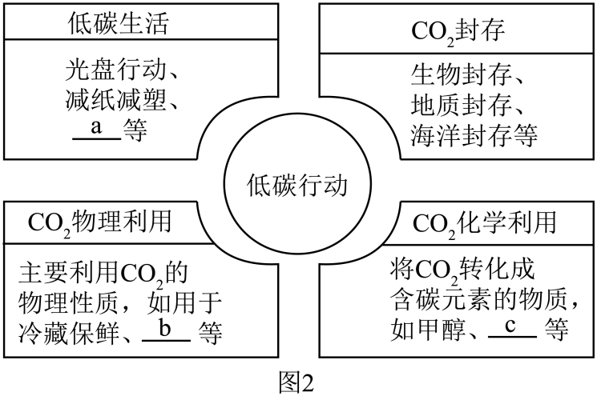

i. 完善方案中的内容(各补写一条)：a.______；b.______；c.______。
ii. $\ce{CO2}$ 物理利用______(填“能”或“不能”)从总量上减少 $\ce{CO2}$。
iii. 植树造林，利用绿色植物的______作用吸收 $\ce{CO2}$。

**答案**

i. a. 减少一次性餐具的使用（或随手关灯、低碳出行）；b. 人工降雨（或冷藏保鲜）；c. 制作碳酸饮料（或转化成甲醇）；
ii. 不能；
iii. 光合

**解析**

1. i 小问：低碳生活是指减少二氧化碳排放的生活方式，如减少一次性餐具使用、随手关灯、绿色出行等；二氧化碳的物理利用不生成新物质，如干冰用于人工降雨、冷藏保鲜；化学利用生成新物质，如制作碳酸饮料、生产尿素或甲醇；
2. ii 小问：物理利用中二氧化碳只是发生状态改变，最终仍会释放回大气中，不能从总量上减少二氧化碳；
3. iii 小问：题干空后已有“作用”二字，填“光合”；写“光合作用”同样得分。绿色植物通过光合作用吸收二氧化碳和水，在叶绿体中利用光能合成有机物并释放出氧气。

---

### Q-CHEM-GD2025-16-3

```yaml
category: 真题
source: 2025 年广东省初中学业水平考试 化学 第 16 题第（3）问
source_quality: 原卷
kp: CHEM-9A-06-1a
do: 本章只做第（3）问
other_parts: 第（1）问增大接触面积加快溶解归入 CHEM-9A-01-2a，第（2）问溶解度结晶与分子间隔归入 CHEM-9A-03-1a 与九下溶液，第（4）问微量元素归入九下化学与健康，第（5）问过滤与沉淀含量计算归入九下复分解
type: 填空
grading: 自评
answer_by: 原卷解析
review:
  概念: CHEM-9A-06-1a
```

**题干**

《疡医大全》记载西瓜霜具有治疗口腔溃疡的功效。西瓜霜（主要成分是硫酸钠）的一种炮制过程如图。


（3）若刷取的西瓜霜略呈黄色，可使用__________进行脱色。

**答案**

活性炭

**解析**

活性炭具有疏松多孔的结构，具有较强的吸附能力，能够吸附水溶液中的色素和异味，因此西瓜霜若略呈黄色可加入活性炭进行吸附脱色。

---

### Q-CHEM-GZ2022-16-3

```yaml
category: 真题
source: 2022 年广州市初中学业水平考试 化学 第 16 题第（3）问
source_quality: 原卷
kp: CHEM-9A-06-1b
do: 本章只做第（3）问
other_parts: 第（1）问仪器陶瓷材质归入 CHEM-9A-01-2a，第（2）问二氧化硅非金属氧化物归入 CHEM-9A-04-2c，第（4）问窑炉调控体积分数归入 CHEM-9A-06-2b
type: 填空
grading: 自评
answer_by: 原卷解析
review:
  公式: CHEM-9A-06-1b
  审题: CHEM-9A-05-2a
```

**题干**

陶瓷是火与土的结晶，是中华民族文化的象征之一

（3）“九秋风露越窑开，夺得千峰翠色来”描述的是著名的青瓷。
①手工制作陶瓷的过程如下图，陶瓷丰富的色彩与烧制过程中的还原反应有关。燃料(以木炭为例)在窑体内燃烧，通过两步反应生成CO，化学方程式为_______、_______。


②青瓷的“翠色”来源十分复杂。涉及窑体内的CO和瓷器表面粙料中的氧化铁在高温下反应生成氧化亚铁，化学方程式为_______。

**答案**

① $\ce{C + O2 ->[\text{点燃}] CO2}$；$\ce{CO2 + C ->[\text{高温}] 2CO}$；② $\ce{Fe2O3 + CO ->[\text{高温}] 2FeO + CO2}$

**解析**

1. 木炭先与足量氧气反应充分燃烧生成二氧化碳，化学方程式为 $\ce{C + O2 ->[\text{点燃}] CO2}$；生成的二氧化碳在高温下再与过量的碳反应被还原成一氧化碳，化学方程式为 $\ce{CO2 + C ->[\text{高温}] 2CO}$；
2. 一氧化碳与氧化铁在高温下反应生成氧化亚铁和二氧化碳，化学方程式为 $\ce{Fe2O3 + CO ->[\text{高温}] 2FeO + CO2}$。

---

### Q-CHEM-GZ2022-16-4

```yaml
category: 真题
source: 2022 年广州市初中学业水平考试 化学 第 16 题第（4）问
source_quality: 原卷
kp: CHEM-9A-06-2b
do: 本章只做第（4）问
other_parts: 第（1）问仪器陶瓷材质归入 CHEM-9A-01-2a，第（2）问非金属氧化物归入 CHEM-9A-04-2c，第（3）问两步生成一氧化碳归入 CHEM-9A-06-1b
type: 选择
grading: 自动
answer_by: 原卷解析
review:
  概念: CHEM-9A-06-2b
```

**题干**

古代窑炉(如下图)构造不断变迁。为了提高窑体内CO的体积分数，下列措施中可行的有哪些？______。（填标号）

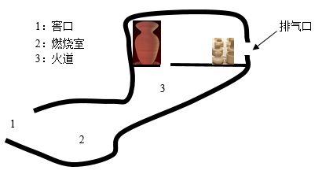

A. 相对增加燃料用量
B. 相对增加空气鼓入
C. 增加排气口数量
D. 减少排气口数量

**答案**

AD

**解析**

1. A 项：相对增加燃料木炭的用量，有利于二氧化碳在高温下充分与碳反应生成一氧化碳（$\ce{CO2 + C ->[\text{高温}] 2CO}$），能提高一氧化碳的体积分数，可行；
2. B 项：鼓入过多空气会带入过量的氧气，导致一氧化碳被进一步氧化为二氧化碳，降低一氧化碳的体积分数，不可行；
3. C 项：增加排气口数量会加速气体逸散流失，降低还原气氛，不可行；
4. D 项：减少排气口数量能延长气体在窑炉内的停留时间，促进碳与二氧化碳的反应，提高一氧化碳体积分数，可行。

故选 AD。

---

### Q-CHEM-GZ2022-20-1

```yaml
category: 真题
source: 2022 年广州市初中学业水平考试 化学 第 20 题第（1）问
source_quality: 原卷
kp: CHEM-9A-06-3b
do: 本章只做第（1）问
other_parts: 第（2）（3）问盐酸浓度与大理石形状对反应速率影响的对照实验分析归入九下化学反应速率探究
type: 填空
grading: 自评
answer_by: 原卷解析
review:
  概念: CHEM-9A-06-3b
```

**题干**

某化学兴趣小组研究影响化学反应快慢的因素。

（1）下图是实验室中常用的仪器

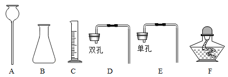

①仪器A的名称是_______。
②从上图中选择合适的仪器组装一套 $\ce{CO2}$ 发生装置，要求添加盐酸无需拆开装置，需要用到的仪器有哪些？_______(填标号)

**答案**

① 长颈漏斗；② ABD

**解析**

1. 仪器 A 的名称是长颈漏斗；
2. 实验室用稀盐酸和大理石在常温下制取二氧化碳，属于固液常温型反应；要求添加盐酸无需拆开装置，应选用长颈漏斗（A）添加液体，配以盛放固体药品的锥形瓶（B），并通过双孔橡胶塞（D）组装连接，因此需要用到的仪器是 ABD。

---

### Q-CHEM-GZ2023-16-3

```yaml
category: 真题
source: 2023 年广州市初中学业水平考试 化学 第 16 题第（3）问①
source_quality: 原卷
kp: CHEM-9A-06-1b
do: 本章只做第（3）问①
other_parts: 第（1）问电缆金属选择归入九下金属，第（2）问锡冶炼方程式归入 CHEM-9A-06-1b，第（3）问②蒸馏分离锌归入 CHEM-9A-04-1a、③防氧化反应归入九下金属，第（4）问湿法冶金归入九下金属活动性
type: 填空
grading: 自评
answer_by: 原卷解析
review:
  概念: CHEM-9A-06-1b
```

**题干**


图b为古代炼锌工艺原理示意图。炉甘石成分是 $\ce{ZnCO3}$，高温易分解生成 $\ce{ZnO}$。

①泥罐外煤饼的主要作用是燃烧提供热量，泥罐内煤粉的主要作用是______。

**答案**

作还原剂

**解析**

炉甘石受热分解生成的氧化锌与泥罐内的煤粉（主要成分为碳）在高温下发生氧化还原反应，碳夺取氧化锌中的氧生成金属锌和二氧化碳，碳单质在该反应中充当还原剂。

---

### Q-CHEM-GZ2023-20-1

```yaml
category: 真题
source: 2023 年广州市初中学业水平考试 化学 第 20 题第（1）问
source_quality: 原卷
kp: CHEM-9A-06-3b
do: 本章只做第（1）问
other_parts: 第（2）问还原反应方程式归入 CHEM-9A-06-2b，第（3）问固体成分检验归入九下酸碱盐，第（4）问热分析图像与还原反应归入九下综合复习
type: 选填
grading: 自评
answer_by: 原卷解析
review:
  概念: CHEM-9A-06-3b
```

**题干**

某小组采用图a所示实验装置探究CO还原 $\ce{Fe2O3}$ 时，出现了争论。甲同学观察到固体由红色变成黑色，推断黑色固体是Fe；乙同学提出质疑，认为黑色固体可能是 $\ce{Fe3O4}$，并查阅了资料：$\ce{Fe3O4}$ 可被磁铁吸引，几乎不溶于稀的酸溶液。

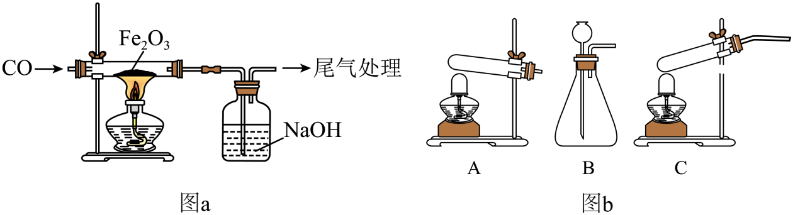

（1）制备CO的原理是：$\ce{HCOOH ->[\text{浓硫酸}][\Delta] CO ^ + H2O}$（HCOOH在常温下为液态），图b所示三种气体发生装置中，可用于制备CO的是______（填标号）。

**答案**

C

**解析**

根据制备一氧化碳的反应原理，反应物甲酸（$\ce{HCOOH}$）和催化剂浓硫酸在常温下均为液体，且反应条件需要加热，因此属于“液液加热型”或“固液加热型”发生装置；装置 A 适合固固加热，装置 B 适合固液常温，装置 C 带有加热酒精灯和盛液烧瓶，适合液体加热制备气体，因此应选 C。

---

### Q-CHEM-GZ2023-20-2

```yaml
category: 真题
source: 2023 年广州市初中学业水平考试 化学 第 20 题第（2）问
source_quality: 原卷
kp: CHEM-9A-06-2b
do: 本章只做第（2）问
other_parts: 第（1）问发生装置选择归入 CHEM-9A-06-3b，第（3）问质量守恒与成分检验归入 CHEM-9A-05-1a 及九下酸碱盐，第（4）问热分析图像分析归入九下综合
type: 填空
grading: 自评
answer_by: 原卷解析
review:
  公式: CHEM-9A-06-2b
```

**题干**

某小组采用图a所示实验装置探究CO还原 $\ce{Fe2O3}$ 时，出现了争论。甲同学观察到固体由红色变成黑色，推断黑色固体是Fe；乙同学提出质疑，认为黑色固体可能是 $\ce{Fe3O4}$，并查阅了资料：$\ce{Fe3O4}$ 可被磁铁吸引，几乎不溶于稀的酸溶液。


（2）若甲同学推断正确，反应的化学方程式为______。

**答案**

$\ce{3CO + Fe2O3 ->[\text{高温}] 2Fe + 3CO2}$

**解析**

甲同学推断黑色固体为单质铁（$\ce{Fe}$），反应物为一氧化碳（$\ce{CO}$）与氧化铁（$\ce{Fe2O3}$），反应条件为高温，一氧化碳夺取氧化铁中的氧生成铁单质和二氧化碳，配平后的化学方程式为 $\ce{3CO + Fe2O3 ->[\text{高温}] 2Fe + 3CO2}$。
