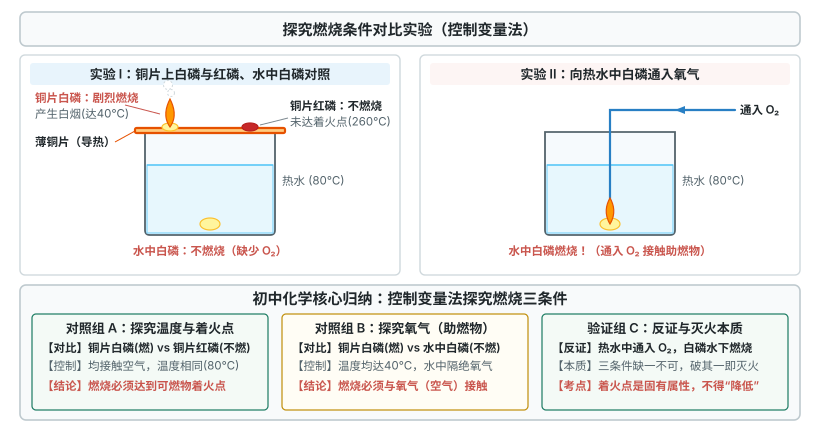
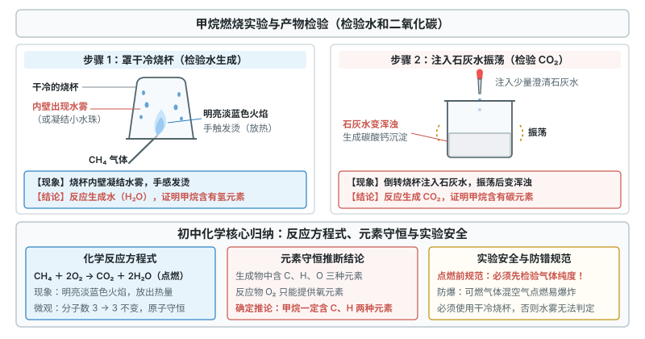
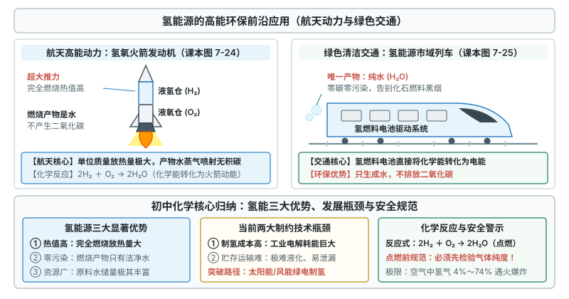

# 第七单元 能源的合理利用与开发

这一章先弄清燃烧的条件和灭火，再认识化石能源与甲烷，最后学氢能和新能源。

标着**重点**的三个知识点，中考几乎每年都考，要花最多时间；标着**一般**的四个，理解方法和规范就行。

## 本章前置自查

下面四件事，哪一件没把握，先回看前面单元：

1. 掌握氧气的化学性质，知道氧气能支持燃烧。（第二单元 课题2）
2. 正确书写常见单质与化合物燃烧的化学方程式，如碳、红磷、硫、铁等与氧气反应。（第五单元 课题2）
3. 写出水电解生成氢气和氧气的化学方程式。（第四单元 课题1、第五单元 课题2）
4. 认识控制变量法在科学探究对比实验中的基本应用。（第一单元 课题2）

---

## 7.1a 燃烧条件与灭火原理

```yaml
id: CHEM-9A-07-1a
weight: 重点
weight_note: 7 套卷直接考查 4 次
textbook: 九上 7.1 燃料的燃烧，p.158–163
prerequisites:
  - id: CHEM-9A-02-2a
    strength: hard
    reason: 燃烧需要可燃物与助燃物（氧气）接触。
evidence:
  - 能完整说出燃烧必须同时满足的三个条件，准确理解着火点的固有属性
  - 能根据燃烧条件解释常见灭火方法的化学原理（破坏三个条件之一即可灭火）
  - 能结合具体火灾情境（如油锅、电器、酒精灯着火）选择正确的灭火措施与安全防护
figure: 已完成 figures/combustion-conditions.svg（探究燃烧条件对比实验：铜片白磷燃烧与红磷不燃、水中白磷通氧燃烧）
sources: [TB9A-7.1, GD2023-16, GZ2023-15]
walk_source: 课本 p.167 练习与应用第 3 题及生活灭火实例分析方法
```

### 本次只学

记住燃烧的三个条件，用它解释灭火方法。

### 先认住



- **燃烧**：可燃物与氧气发生的发光、放热的剧烈氧化反应。
- **燃烧的三个条件**（缺一不可）：① 有可燃物；② 可燃物与氧气（或空气）接触；③ 温度达到**着火点**。
- **着火点**：物质的固有属性，一般不能改变。不能说“降低着火点”，只能说“降低温度到着火点以下”。
- **灭火**：破坏燃烧条件之一即可：① 清除或隔离可燃物（砍出森林隔离带）；② 隔绝氧气（灯帽盖灭酒精灯、锅盖盖灭油锅）；③ 降温到着火点以下（用水浇灭）。干粉灭火器隔绝空气；二氧化碳灭火器降温并隔绝空气，用于贵重仪器、图书火灾；水基型灭火器用于棉木等纤维火灾。

### 走一遍

任务：用燃烧条件分析下列灭火方法的原理。

情境一：炒菜时油锅不慎起火，应立即盖上锅盖灭火。

- 第一步：油是可燃物，油温已达着火点，锅口接触氧气。
- 第二步：盖上锅盖，油与空气隔开。
- 第三步：原理是 $\boxed{\text{隔绝氧气（或空气）}}$。不能浇水：油的密度比水小，沸油会浮在水面上继续燃烧并溅开。

情境二：扑灭森林火灾时，消防人员常在火场前方砍伐出一片树木作为隔离带。

- 第一步：燃烧物质是树木和枯枝落叶。
- 第二步：砍掉火势蔓延路径上的树木，未着火的区域就没有可燃物。
- 第三步：原理是 $\boxed{\text{清除可燃物（或隔离可燃物）}}$。

情境三：用扇子扇蜡烛火焰，一扇就灭；而用扇子扇煤炉火焰，为什么越扇越旺？

- 第一步：扇风有两个作用：空气流动带走热量，同时补充氧气。
- 第二步：蜡烛放热少，扇风带走大量热量，温度降到着火点以下，蜡烛熄灭，原理是 $\boxed{\text{降低温度到着火点以下}}$。
- 第三步：煤炉里的煤放热多，扇风带走的热量不足以降到着火点以下，新鲜空气反而提供更多氧气，煤燃烧更剧烈，越扇越旺。

### 容易错

- 着火点不能降低，只能降低温度到着火点以下。
- 电器着火不能浇水（水导电会触电），先切断电源再灭火；油锅起火也不能浇水，热油会飞溅。
- 初中所说的燃烧，指可燃物与氧气发生的发光放热的剧烈氧化反应。

### 练一练

- `Q-CHEM-GD2023-16-2`
- `Q-CHEM-GZ2023-15-1`

---

## 7.1b 燃料充分燃烧与易燃易爆安全常识

```yaml
id: CHEM-9A-07-1b
weight: 一般
weight_note: 7 套卷直接考查 3 次
textbook: 九上 7.1 燃料的燃烧，p.163–165
prerequisites:
  - id: CHEM-9A-07-1a
    strength: hard
    reason: 在燃烧三条件的基础上理解完全燃烧调控与爆炸极限。
evidence:
  - 能说出使燃料充分燃烧的两个基本条件及不充分燃烧的危害
  - 能解释有限空间内急剧燃烧引发爆炸的原理，认识常见爆炸极限与安全标志
figure: 不需要
sources: [TB9A-7.1, GD2022-02]
```

### 本次只学

知道燃料充分燃烧的条件，认识爆炸和安全标志。

### 先认住

- **充分燃烧**：① **足够多的空气（或氧气）**；② 燃料与空气**接触面积足够大**（煤粉、蜂窝煤）。不充分燃烧放热少、浪费资源，还产生一氧化碳（$\ce{CO}$）等有毒气体和炭黑烟尘。
- **爆炸**：可燃物在有限空间内急剧燃烧，大量热使气体体积迅速膨胀。常见标志：当心火灾——易燃物质、当心爆炸——爆炸性物质、禁止烟火、禁止带火种。
- **爆炸极限**：可燃气体（$\ce{H2}$、$\ce{CO}$、$\ce{CH4}$）或粉尘在空气中达到一定含量，遇火源就爆炸，这个含量范围叫爆炸极限（甲烷约 $5\% \sim 16\%$，氢气约 $4\% \sim 74\%$）。可燃性气体点燃前必须验纯。

### 容易错

- 爆炸不一定是化学变化：车胎胀破、锅炉超压是物理变化；瓦斯、火药、面粉粉尘爆炸是化学变化。
- 面粉厂、纺织车间、加油站、矿井空气中有可燃粉尘或气体，必须严禁烟火，防止静电和其他火源。

### 练一练

- `Q-CHEM-GD2022-02`

---

## 7.1c 化学反应中的能量变化

```yaml
id: CHEM-9A-07-1c
weight: 一般
weight_note: 7 套卷直接考查 2 次
textbook: 九上 7.1 燃料的燃烧，p.166–167
prerequisites:
  - id: CHEM-9A-05-1a
    strength: soft
    reason: 化学反应在发生物质变化的同时伴随着能量变化。
  - id: CHEM-9A-07-1a
    strength: soft
    reason: 燃烧是最常见的放热化学反应。
evidence:
  - 能区分化学反应中的放热现象与吸热现象，熟记常见代表性反应
  - 能联系实际生活（如自热食品发热包、燃料取暖）解释化学能与热能的转化应用
figure: 不需要
sources: [TB9A-7.1, GD2023-16]
```

### 本次只学

区分放热反应与吸热反应，了解化学能的应用。

### 先认住

- **能量变化**：化学反应生成新物质的同时伴随能量变化，通常是**吸热或放热**。
- **放热反应**：所有燃烧、生石灰与水化合（$\ce{CaO + H2O -> Ca(OH)2}$）、金属与酸反应。**吸热反应**：碳与二氧化碳高温反应（$\ce{C + CO2 ->[\text{高温}] 2CO}$）、碳酸钙高温分解（$\ce{CaCO3 ->[\text{高温}] CaO + CO2 ^}$）。
- **应用**：化学能转化为热能，用于取暖、烹饪；自热食品发热包靠氧化钙与水反应放热；工业上用于冶炼金属、火力发电、烧制陶瓷、火箭推进。

### 容易错

- 吸热反应不是“需要加热或点燃的反应”。木炭燃烧开头也要点燃，但反应中持续放热，仍是放热反应。
- 发光放热不一定是化学反应：白炽灯通电发光放热是物理变化。

### 练一练

- `Q-CHEM-GD2023-16-3`

---

## 7.2a 化石能源的综合利用与甲烷

```yaml
id: CHEM-9A-07-2a
weight: 重点
weight_note: 7 套卷直接考查 5 次
textbook: 九上 7.2 化石能源的合理利用，p.169–173
prerequisites:
  - id: CHEM-9A-07-1a
    strength: hard
    reason: 依据燃烧条件理解甲烷及化石燃料的燃烧。
  - id: CHEM-9A-05-2a
    strength: hard
    reason: 正确书写甲烷完全燃烧生成二氧化碳和水的化学方程式。
evidence:
  - 知道煤、石油、天然气是三大不可再生化石能源，能区分煤的干馏（化学变化）与石油的分馏（物理变化）
  - 熟记甲烷的化学式（$\ce{CH4}$）、物理性质及完全燃烧的化学方程式
  - 能设计或描述检验甲烷燃烧产物（$\ce{H2O}$ 与 $\ce{CO2}$）的实验步骤和现象
figure: 已完成 figures/methane-combustion.svg（甲烷燃烧产物检验实验：罩干冷烧杯检验水、注入澄清石灰水振荡检验二氧化碳）
sources: [TB9A-7.2, GD2022-12, GD2023-13]
walk_source: 课本 p.171 实验 7-2 与微观反应定量推导规范
```

### 本次只学

认识三大化石燃料，掌握甲烷的性质、燃烧方程式和产物检验。

### 先认住

- **三大化石燃料**：煤、石油、天然气，由古代生物遗骸变化形成，都是混合物，属于**不可再生能源**。煤主要含碳；石油主要含碳、氢；天然气的主要成分是**甲烷**（$\ce{CH4}$）。
- **干馏与分馏**：**煤的干馏**是隔绝空气加强热，生成焦炭、煤焦油、焦炉煤气等新物质，是**化学变化**；**石油的分馏**是利用沸点不同分离出汽油、煤油、柴油等，是**物理变化**。
- **甲烷**：无色无味，密度比空气小，极难溶于水（向下排空气法或排水法收集）；燃烧发出明亮蓝色火焰，放出大量热：$\ce{CH4 + 2O2 ->[\text{点燃}] CO2 + 2H2O}$。点燃前必须验纯。
- **产物检验**：火焰上方罩**干冷烧杯**，内壁有水雾，证明生成水；倒转烧杯注入**澄清石灰水**振荡，变浑浊，证明生成二氧化碳。可燃冰外观像冰，主要成分是甲烷水合物，能量密度高。



### 破题钥匙

```think
宏观: 甲烷燃烧发出蓝色火焰，干冷烧杯内壁有水雾，石灰水变浑浊
微观: 甲烷分子里的 C、H 原子和氧原子重新组合成二氧化碳分子和水分子
图: chem-methane
符号: $\ce{CH4 + 2O2 ->[\text{点燃}] CO2 + 2H2O}$
招: 守恒
结: 水雾证明有 H，浑浊证明有 C
```

### 走一遍

任务：写出甲烷完全燃烧的方程式，数反应前后的分子和原子，并算质量比。

第一步：按元素守恒写方程式。甲烷含碳、氢，完全燃烧时碳变成二氧化碳（$\ce{CO2}$），氢变成水（$\ce{H2O}$）。配平：

$$\ce{CH4 + 2O2 ->[\text{点燃}] CO2 + 2H2O}$$

第二步：数分子和原子。

- 反应前：$1$ 个 $\ce{CH4}$ 分子和 $2$ 个 $\ce{O2}$ 分子，共有 $\textcolor{#287fc4}{3}$ 个反应物分子；
- 反应后：$1$ 个 $\ce{CO2}$ 分子和 $2$ 个 $\ce{H2O}$ 分子，共有 $\textcolor{#287fc4}{3}$ 个生成物分子；
- 结论：反应前后**分子总数不变**（个数比 $1:2:1:2$）；原子也守恒（都是 $1$ 个碳原子、$4$ 个氢原子、$4$ 个氧原子）。

第三步：算质量比。相对原子质量：$\text{C}:12$，$\text{H}:1$，$\text{O}:16$。

$$\begin{aligned}
m(\ce{CH4}) : m(\ce{O2}) : m(\ce{CO2}) : m(\ce{H2O}) &= (12 + 1\times 4) : [2\times (16\times 2)] : (12 + 16\times 2) : [2\times (1\times 2 + 16)] \\
&= \textcolor{#287fc4}{16} : \textcolor{#287fc4}{64} : \textcolor{#287fc4}{44} : \textcolor{#287fc4}{36}
\end{aligned}$$

所以生成的二氧化碳与水的质量比为 $44:36 = \boxed{11:9}$。

### 容易错

- 口诀“煤干化，油分物”：煤的干馏有新物质，是化学变化；石油的分馏只是按沸点分离，是物理变化。
- 检验顺序不能换：先罩干冷烧杯看水雾，再倒石灰水看浑浊。先倒石灰水，其中的水会干扰对生成水的判断。
- 沼气、天然气、瓦斯的主要成分都是甲烷，但都是混合物，天然气不等于纯净的甲烷。

### 练一练

- `Q-CHEM-GD2022-12`
- `Q-CHEM-GD2023-13`

---

## 7.2b 化石燃料利用对环境的影响与防治

```yaml
id: CHEM-9A-07-2b
weight: 一般
weight_note: 7 套卷直接考查 3 次
textbook: 九上 7.2 化石能源的合理利用，p.173–175
prerequisites:
  - id: CHEM-9A-07-2a
    strength: hard
    reason: 了解化石燃料中含硫、氮杂质及其燃烧产物对大气的污染。
evidence:
  - 能准确指出酸雨形成的罪魁祸首是二氧化硫（$\ce{SO2}$）和二氧化氮（$\ce{NO2}$），知道酸雨的判定标准（$\text{pH} < 5.6$）
  - 能辨析二氧化碳温室效应与空气污染的区别，列举减少大气污染与助力“碳达峰、碳中和”的有效措施
figure: 不需要
sources: [TB9A-7.2, GZ2024-09]
```

### 本次只学

了解化石燃料对环境的危害，掌握酸雨的成因和判定标准。

### 先认住

- **酸雨**：煤和石油含硫、氮，燃烧生成的二氧化硫（$\ce{SO2}$）和二氧化氮（$\ce{NO2}$）溶于雨水形成**酸雨**。**补充**（课本没有讲，做真题时常用）：正常雨水溶有二氧化碳，$\text{pH} \approx 5.6$，**$\text{pH} < 5.6$ 才称为酸雨**。不完全燃烧还产生一氧化碳（$\ce{CO}$）和烟尘。
- **二氧化碳**：空气的天然成分，无毒，**不属于空气污染物，不形成酸雨**；但含量过高会加剧**温室效应**，使全球变暖。
- **防治措施**：少直接烧煤，用**脱硫煤**；汽车装**尾气催化净化装置**，推广乙醇汽油或新能源汽车；开发太阳能、风能等清洁能源，植树造林，推进“**碳达峰**”（2030年前）与“**碳中和**”（2060年前）。

### 容易错

- 二氧化碳不是酸雨的成因。它溶于水呈弱酸性（$\text{pH} \approx 5.6$），酸雨由二氧化硫（$\ce{SO2}$）和二氧化氮（$\ce{NO2}$）引起，标准是 $\text{pH} < 5.6$。
- 天然气（甲烷）较清洁，二氧化硫和粉尘极少，但完全燃烧仍生成二氧化碳，不是“零碳燃料”。

### 练一练

- `Q-CHEM-GZ2024-09`

---

## 7.2c 氢能及新能源的开发利用

```yaml
id: CHEM-9A-07-2c
weight: 重点
weight_note: 7 套卷直接考查 5 次
textbook: 九上 7.2 化石能源的合理利用，p.174–178
prerequisites:
  - id: CHEM-9A-05-2a
    strength: hard
    reason: 书写实验室制氢、氢气燃烧等相关化学方程式。
  - id: CHEM-9A-07-1b
    strength: hard
    reason: 氢气是可燃性气体，点燃前必须验纯以防爆炸。
evidence:
  - 能完整说出氢气作为最理想清洁能源的三大优点，以及当前未能广泛应用的制取与储运技术瓶颈
  - 能正确书写水分解制氢和氢气燃烧的化学方程式，熟记氢气点燃前必须验纯的操作规范
  - 能列举常见清洁新能源（太阳能、风能、核能、地热能、生物质能等）及其能量转化形式
figure: 已完成 figures/hydrogen-energy-application.svg（氢能源高能环保应用：氢氧火箭发动机航天动力与氢能源市域列车清洁交通）
sources: [TB9A-7.2, GZ2022-06, GZ2023-09]
walk_source: 课本 p.175–177 与中考清洁能源转化综合分析方法
```

### 本次只学

认识氢能的优点和瓶颈，掌握氢气的反应方程式，了解常见新能源。

### 先认住



- **氢能三大优点**：① **热值高**（单位质量放热约为汽油三倍）；② **产物只有水**（不排放二氧化碳：$\ce{2H2 + O2 ->[\text{点燃}] 2H2O}$）；③ **资源丰富**（水）。
- **瓶颈**：制氢耗能大、**成本高**；氢气密度极小、易燃易爆，对储运材料要求高，**贮存和运输困难**。
- **氢气的制取与安全**：工业上电解水或用化石能源制氢；实验室用锌粒与稀硫酸反应（$\ce{Zn + H2SO4 -> ZnSO4 + H2 ^}$）。氢气爆炸极限宽（$4\% \sim 74\%$），**点燃前必须验纯**。
- **新能源**：太阳能（光伏把光能转化为电能）、风能、核能、地热能、潮汐能、生物质能等，可减轻对化石燃料的依赖。

### 走一遍

任务：分析氢能从“制备 → 储运 → 航天利用”中的方程式和能量转化。

第一步：制备（绿电制氢）。风力发电机或太阳能电池板把风能、光能转化为电能，再电解水制氢：

$$\ce{2H2O ->[\text{通电}] 2H2 ^ + O2 ^}$$

能量转化：$\boxed{\text{电能转化为化学能}}$。

第二步：储运。氢分子间隔大，常温常压下密度极低。工业上加压降温使氢气液化成液氢，体积大大缩小，便于加注到火箭燃料箱。

第三步：燃烧（火箭推进）。火箭发动机中，液氢与液氧剧烈燃烧，产生推力把飞船送入太空：

$$\ce{2H2 + O2 ->[\text{点燃}] 2H2O}$$

这是化合反应，能量转化：$\boxed{\text{化学能转化为内能和机械能}}$。产物只有水，不排放二氧化碳。

### 容易错

- 液氢做火箭推进剂，是因为热值高、产物只有水，不是因为容易储存和加注，氢气恰恰极难储存和加注。
- 火箭必须自带液氧：发动机要在短时间内烧掉巨量燃料，空气中氧气体积分数仅约 $21\%$，不够用。

### 练一练

- `Q-CHEM-GZ2022-06`
- `Q-CHEM-GZ2023-09`

---

## 7.3a 燃烧条件的探究实验与改进

```yaml
id: CHEM-9A-07-3a
weight: 一般
weight_note: 7 套卷直接考查 1 次
textbook: 九上 7.3 实验活动4 燃烧条件的探究，p.181；7.1 探究燃烧的条件，p.159–160
prerequisites:
  - id: CHEM-9A-07-1a
    strength: hard
    reason: 运用控制变量法实验验证燃烧必须同时满足的三个条件。
evidence:
  - 能分析课本薄铜片白磷与红磷实验的对比逻辑，准确指出各组对比所验证的单一变量与结论
  - 能指出开放式燃烧实验的环保缺陷（生成五氧化二磷白烟污染），并能理解密闭装置等环保改进方案
figure: 不需要
sources: [TB9A-7.3, TB9A-7.1, GD2022-15]
```

### 本次只学

用控制变量的对比实验验证燃烧的三个条件，了解实验的环保改进。

### 先认住

- **薄铜片实验**：
  - 铜片上的白磷燃烧、红磷不燃烧（都接触空气、温度相同）：白磷着火点约 $40^\circ\mathrm{C}$，已达到；红磷约 $260^\circ\mathrm{C}$，未达到。说明**燃烧需要温度达到着火点**；
  - 铜片上的白磷燃烧、热水中的白磷不燃烧（温度都达到着火点）：前者接触氧气，后者隔绝氧气。说明**燃烧需要与氧气（或空气）接触**；向水中白磷通入氧气，白磷燃烧，再次证明这一点。
- **环保改进**：白磷燃烧产生大量五氧化二磷（$\ce{P2O5}$）白色粉尘，会污染空气、刺激呼吸道。改进：把反应放在带塞的试管等密闭装置中，导管口接气球收集热胀气体，做成**密闭实验**。
- **控制变量**：每次只改变一个变量，其他条件保持相同，才能得出确定的结论。

### 容易错

- 对比实验只能有一个变量；同时改变温度和氧气，就分不清是哪个起作用。
- 热水中的白磷不燃烧是因为缺氧，不是温度不够（$80^\circ\mathrm{C}$ 远高于着火点 $40^\circ\mathrm{C}$）。

### 练一练

- `Q-CHEM-GD2022-15`

---

> 跨学科实践活动6（调查家用燃料的变迁与合理使用）：调查并梳理家庭燃料从柴草、煤炭、蜂窝煤、瓶装液化石油气到管道天然气的演进，从热值、安全性、清洁程度、成本等方面评价。
