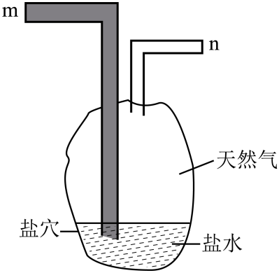
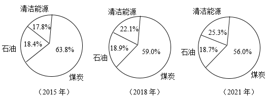
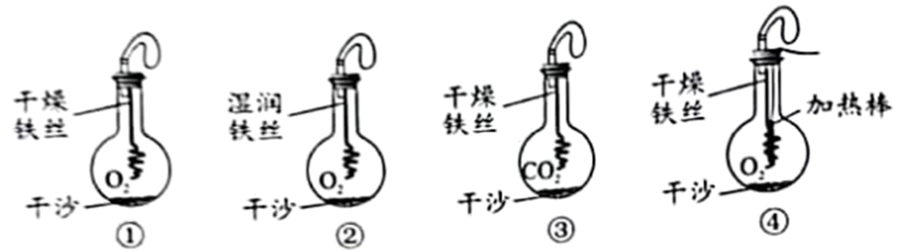
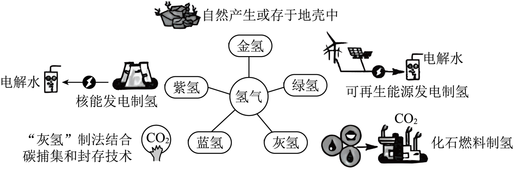
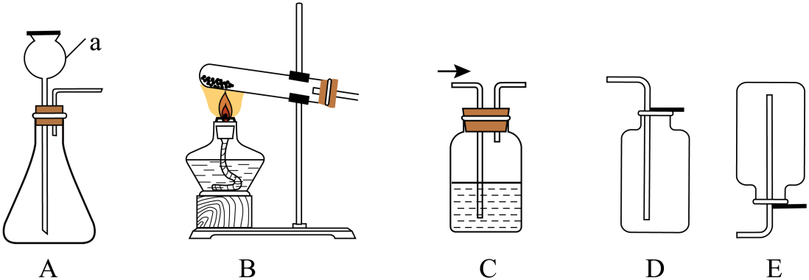
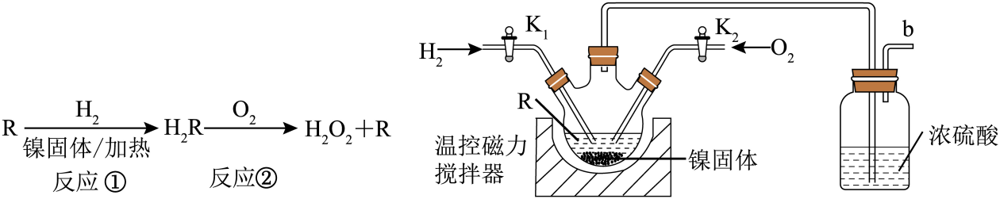

# 第七单元 能源的合理利用与开发 · 题目

讲义只用 `lesson.md` 里引用的题，按知识点顺序排在前面。

---

## 讲义用题（10 道）

### Q-CHEM-GD2023-16-2

```yaml
category: 真题
source: 2023 年广东省初中学业水平考试 化学 第 16 题 第（2）问
source_quality: 原卷
kp: CHEM-9A-07-1a
do: 本章只做第（2）问
other_parts: 第（1）问属于九下金属材料，第（3）问讲义用题见 CHEM-9A-07-1c 化学反应中的能量变化，第（4）问见 CHEM-9A-04-1b 水的净化方法与自来水生产流程，第（5）问见 CHEM-9A-03-1a 分子的基本性质及现象解释
type: 填空
grading: 自评
answer_by: 原卷解析
review:
  概念: CHEM-9A-07-1a
```

**题干**

我国是茶文化的发源地。唐代陆羽《茶经》中记载：“风炉以铜铁铸之……底一窗以为通飚漏烬之所……风能兴火，火能熟水。”“漉水囊……其格以生铜铸之。”

（2）“飚”（即风）提供燃烧所需的 ______。“烬”中含钾盐。农业上可用作______。

**答案**

空气（或氧气）；钾肥

**解析**

1. 燃烧需要助燃剂，“飚”即流动的空气，扇风能为炉火源源不断提供燃烧所必需的空气（或氧气），使火烧得更旺。
2. 草木灰等草木燃烧后的残烬中富含可溶性碳酸钾等钾盐，在农业生产中可直接作为农家钾肥使用。

---

### Q-CHEM-GZ2023-15-1

```yaml
category: 真题
source: 2023 年广州市初中学业水平考试 化学 第 15 题 第（1）问
source_quality: 原卷
kp: CHEM-9A-07-1a
do: 本章只做第（1）问
other_parts: 第（2）问见 CHEM-9A-05-2b 根据化学方程式的简单计算，第（3）问属于九下酸碱盐
type: 填空
grading: 自评
answer_by: 原卷解析
review:
  概念: CHEM-9A-07-1a
```

**题干**

磷及其化合物广泛应用于新能源汽车电池的制造，如 $\ce{LiFePO4}$ 等。

（1）白磷保存在水中可以防止自燃，主要原因是______。

**答案**

隔绝氧气（或隔绝空气）

**解析**

1. 白磷属于易燃可燃物，其着火点极低（仅约 $40^\circ\mathrm{C}$），在常温空气中容易发生缓慢氧化放出热量，积聚热量达到着火点引起自燃。
2. 实验中将白磷浸没在水中保存，主要利用水将白磷与空气中的氧气隔绝，破坏了燃烧必须与氧气接触的条件，从而有效防止其自燃。

---

### Q-CHEM-GD2022-02

```yaml
category: 真题
source: 2022 年广东省初中学业水平考试 化学 第 2 题
source_quality: 原卷
kp: CHEM-9A-07-1b
type: 选择
grading: 自动
answer_by: 原卷解析
review:
  概念: CHEM-9A-07-1b
```

**题干**

学校采购了一批含 75% 酒精的免洗消毒喷雾。你建议在存放处张贴的警示标识是（　　）

A. 
B. 
C. 
D. 

**答案**

D

**解析**

1. A 项图标为腐蚀品标志；
2. B 项图标为节约用水标志；
3. C 项图标为有毒品标志；
4. D 项图标为易燃液体标志。酒精（乙醇）易挥发、极易燃烧，常温下呈液态，属于典型的易燃液体，在存放处必须严禁烟火并张贴易燃液体警示标识。

---

### Q-CHEM-GD2023-16-3

```yaml
category: 真题
source: 2023 年广东省初中学业水平考试 化学 第 16 题 第（3）问
source_quality: 原卷
kp: CHEM-9A-07-1c
do: 本章只做第（3）问
other_parts: 第（1）问属于九下金属材料，第（2）问讲义用题见 CHEM-9A-07-1a 燃烧条件与灭火原理，第（4）问见 CHEM-9A-04-1b 水的净化方法与自来水生产流程，第（5）问见 CHEM-9A-03-1a 分子的基本性质及现象解释
type: 填空
grading: 自评
answer_by: 原卷解析
review:
  概念: CHEM-9A-07-1c
```

**题干**

我国是茶文化的发源地。唐代陆羽《茶经》中记载：“风炉以铜铁铸之……底一窗以为通飚漏烬之所……风能兴火，火能熟水。”“漉水囊……其格以生铜铸之。”

（3）“火能熟水”说明燃烧____________（填“吸收”或“放出”）热量。

**答案**

放出

**解析**

1. “火能熟水”是指利用炭火燃烧释放出的热量加热茶壶，使冷水吸收热量达到沸腾变为熟水。
2. 木炭燃烧生成二氧化碳并释放出大量的内能，这一事实直接说明燃烧反应属于放热反应，放出热量。

---

### Q-CHEM-GD2022-12

```yaml
category: 真题
source: 2022 年广东省初中学业水平考试 化学 第 12 题
source_quality: 原卷
kp: CHEM-9A-07-2a
type: 选择
grading: 自动
answer_by: 原卷解析
review:
  概念: CHEM-9A-07-2a
```

**题干**

化学与生产生活密切相关。下列说法错误的是（　　）

A. $\text{pH}<5.6$ 的降雨称为酸雨
B. 石油属于可再生能源
C. $\text{PM}_{2.5}$ 属于大气污染物
D. 铝合金的硬度比纯铝大

**答案**

B

**解析**

1. A 项：正常雨水溶解二氧化碳呈弱酸性（$\text{pH} \approx 5.6$），$\text{pH} < 5.6$ 的降水称为酸雨，正确。
2. B 项：石油是由古代动植物遗骸经过数百万年极其复杂的地质变化形成的化石燃料，储量有限，属于不可再生能源，错误。
3. C 项：$\text{PM}_{2.5}$ 是指环境空气中空气动力学当量直径小于等于 2.5 微米的颗粒物，属于大气主要颗粒污染物，正确。
4. D 项：合金的硬度通常大于其组成成分的纯金属，因此铝合金的硬度比纯铝大，正确。

---

### Q-CHEM-GD2023-13

```yaml
category: 真题
source: 2023 年广东省初中学业水平考试 化学 第 13 题
source_quality: 原卷
kp: CHEM-9A-07-2a
type: 选择
grading: 自动
answer_by: 原卷解析
review:
  概念: CHEM-9A-07-2a
```

**题干**

下列说法正确的是（　　）



A. 天然气是可再生能源
B. 天然气难溶于盐水
C. 从 m 端进气可采集盐水
D. 从 n 端进水可排天然气

**答案**

B

**解析**

1. A 项：天然气是由古代动植物遗骸经过漫长地质年代复杂的物理和化学变化形成的化石燃料，储量有限，短期内无法再生，属于不可再生能源，说法错误。
2. B 项：天然气的主要成分是甲烷（$\ce{CH4}$），甲烷结构对称，极难溶于水，也难溶于盐水，因此可以用排盐水法收集，说法正确。
3. C 项：天然气（甲烷）的密度比盐水小，m 是伸到盐水底部的长导管，从 m 端进气时，气体先进入盐水中冒泡，再从 n 端逸出，不能把盐水排出；若要用排盐水法采集天然气，应从短导管 n 端进气，盐水从长导管 m 端排出，说法错误。
4. D 项：若瓶内装满天然气，要用水将天然气排出使用，应从长导管 m 端注入水，利用水将密度较小的天然气从短导管 n 端压出，说法错误。

---

### Q-CHEM-GZ2024-09

```yaml
category: 真题
source: 2024 年广州市初中学业水平考试 化学 第 9 题
source_quality: 原卷
kp: CHEM-9A-07-2b
type: 选择
grading: 自动
answer_by: 原卷解析
review:
  概念: CHEM-9A-07-2b
```

**题干**

能源与生活息息相关。下列说法不正确的是（　　）

A. 石油属于化石燃料，是不可再生能源
B. 天然气燃烧产生的二氧化碳可造成酸雨
C. 乙醇汽油用作汽车燃料可减少空气污染
D. 太阳能电池可将太阳能转化为电能

**答案**

B

**解析**

1. A 项：煤、石油、天然气是人类广泛使用的三大化石燃料，属于古代生物演变而来的不可再生能源，说法正确。
2. B 项：造成酸雨的大气污染物主要是煤和石油燃烧排放的二氧化硫（$\ce{SO2}$）和二氧化氮（$\ce{NO2}$）；天然气完全燃烧产生的二氧化碳是空气的成分之一，会加剧温室效应，但不会形成酸雨，说法错误。
3. C 项：乙醇（$\ce{C2H5OH}$）燃烧生成二氧化碳和水，使用乙醇汽油替代普通汽油可以节约石油资源，减少汽车尾气中一氧化碳和颗粒物的排放，从而减轻空气污染，说法正确。
4. D 项：太阳能光伏发电电池利用半导体光生伏特效应，将吸收的太阳光能直接转化为电能，说法正确。

---

### Q-CHEM-GZ2022-06

```yaml
category: 真题
source: 2022 年广州市初中学业水平考试 化学 第 6 题
source_quality: 原卷
kp: CHEM-9A-07-2c
type: 选择
grading: 自动
answer_by: 原卷解析
review:
  概念: CHEM-9A-07-2c
```

**题干**

下图为我国不同年份的能源结构图，下列说法不正确的是（　　）



A. 我国能源结构中清洁能源占比呈增加趋势
B. 加大水电、风电的开发利用有利于减少环境污染
C. 天然气是比煤炭和石油更清洁的燃料
D. 液氢用作火箭燃料是因为氢气易于贮存和加注

**答案**

D

**解析**

1. A 项：由能源结构图对比可知，从 2015 年到 2021 年，清洁能源在能源总消费中的占比由 $17.8\%$ 提高到 $22.1\%$ 再到 $25.3\%$，呈增加趋势，说法正确。
2. B 项：水能、风能是清洁可再生的自然能源，加大开发利用可减少对煤炭等化石能源的消耗，减少二氧化硫、氮氧化物和粉尘等污染物的排放，有利于环境保护，说法正确。
3. C 项：天然气主要成分为甲烷，完全燃烧主要生成二氧化碳和水；而煤炭和石油中含有硫、氮等杂质，燃烧会产生大量二氧化硫和烟尘，因此天然气比煤炭和石油更加清洁，说法正确。
4. D 项：液氢被用作运载火箭高能燃料，核心原因在于氢气燃烧热值极大且产物只有水；氢气密度极小、极易燃易爆且沸点极低，在工业上极难安全贮存和加注，选项说法错误。

---

### Q-CHEM-GZ2023-09

```yaml
category: 真题
source: 2023 年广州市初中学业水平考试 化学 第 9 题
source_quality: 原卷
kp: CHEM-9A-07-2c
type: 选择
grading: 自动
answer_by: 原卷解析
review:
  概念: CHEM-9A-07-2c
```

**题干**

液氢、煤油（含 C、H 元素）、液氧可用作神州飞船运载火箭的推进剂，下列说法不正确的是（　　）

A. 火箭发射时仅靠空气不足以使燃料充分燃烧
B. 液氢和煤油完全燃烧的反应都是化合反应
C. 液氢是高能燃料且燃烧后的产物无污染
D. 飞船进入轨道后主要利用太阳能维持工作

**答案**

B

**解析**

1. A 项：火箭升空发射瞬间需要在极短时间内剧烈消耗巨量燃料以产生巨大推力，空气中氧气的体积分数仅约 $21\%$，无法满足剧烈燃烧的需求，因此必须携带液氧作为助燃剂，说法正确。
2. B 项：氢气在氧气中完全燃烧生成水（$\ce{2H2 + O2 ->[\text{点燃}] 2H2O}$），由两种物质生成一种物质，属于化合反应；而煤油含有碳、氢元素，完全燃烧生成二氧化碳和水两种化合物，不符合化合反应“多变一”的定义，说法错误。
3. C 项：液氢燃烧热值高达 $1.4\times 10^8\ \mathrm{J/kg}$，单位质量放出的热量远高于传统燃料，是优良的高能燃料；燃烧产物只有水，不向大气排放二氧化碳，说法正确。
4. D 项：飞船进入太空轨道后，展开太阳能电池帆板，主要将太阳光能转化为电能以维持飞船各项仪器的正常运转，说法正确。

---

### Q-CHEM-GD2022-15

```yaml
category: 真题
source: 2022 年广东省初中学业水平考试 化学 第 15 题
source_quality: 原卷
kp: CHEM-9A-07-3a
other_parts: 对比①②③属于九下铁生锈条件探究
type: 选择
grading: 自动
answer_by: 原卷解析
review:
  概念: CHEM-9A-07-3a
  前置: CHEM-9A-07-1a
```

**题干**

对铁生锈与燃烧条件的实验探究如图所示。下列说法正确的是（　　）



A. 对比①②可探究：接触氧气是否为铁生锈条件之一
B. 对比②③可探究：接触水是否为铁生锈的条件之一
C. 对比①④可探究：温度达到着火点是否为铁燃烧的条件之一
D. 对比③④可探究：接触氧气是否为铁燃烧的条件之一

**答案**

C

**解析**

1. A 项：实验①②都充入 $\ce{O2}$，唯一的不同是铁丝干燥还是湿润，对比①②探究的是接触水是否为铁生锈的条件之一，而不是接触氧气，说法错误。
2. B 项：实验②与③中，铁丝一湿一干，气体又分别是 $\ce{O2}$ 和 $\ce{CO2}$，水和气体两个条件都不同，不能只探究接触水，说法错误。
3. C 项：实验①与④都是干燥铁丝、充入 $\ce{O2}$，唯一的不同是④用加热棒加热，对比①④可探究温度达到着火点是否为铁燃烧的条件之一，说法正确。
4. D 项：实验③充入 $\ce{CO2}$ 且不加热，实验④充入 $\ce{O2}$ 且加热，气体和温度两个条件都不同，不能只探究接触氧气，说法错误。

---

## 备选题目（12 道）

### Q-CHEM-GD2022-17-5

```yaml
category: 真题
source: 2022 年广东省初中学业水平考试 化学 第 17 题 第（5）问
source_quality: 原卷
kp: CHEM-9A-07-2a
do: 本章只做第（5）问
other_parts: 第（1）（2）问见 CHEM-9A-05-2a 化学方程式的书写与含义，第（3）问见 CHEM-9A-04-2b 水的电解实验与水分子的构成，第（4）问见 CHEM-9A-03-1a 分子的基本性质及现象解释
type: 选填
grading: 自评
answer_by: 原卷解析
review:
  概念: CHEM-9A-07-2a
```

**题干**

我国科学家研制了一种新型催化剂，实现了甲烷向重要化工原料甲醇的高效转化。反应过程的微观示意图如图所示。


（5）主要成分为 $\ce{CH4}$ 的燃料是______（多选，填字母）。

a．煤
b．沼气
c．天然气
d．乙醇汽油

**答案**

bc

**解析**

1. a 项：煤是复杂的固态混合物，主要含碳元素，还含氢、氧、氮、硫等元素，不符合题意；
2. b 项：沼气是农家有机物在隔绝空气条件下发酵产生的可燃气体，其主要成分是甲烷，符合题意；
3. c 项：天然气是蕴藏在地下的优质气态化石能源，其最主要成分是甲烷，符合题意；
4. d 项：乙醇汽油是汽油与乙醇的混合物，主要成分不是甲烷，不符合题意。

---

### Q-CHEM-GD2023-20-3

```yaml
category: 真题
source: 2023 年广东省初中学业水平考试 化学 第 20 题 第（3）问
source_quality: 原卷
kp: CHEM-9A-07-2b
do: 本章只做第（3）问
other_parts: 第（1）问见 CHEM-9A-06-2a 二氧化碳的性质与用途，第（2）问见 CHEM-9A-05-2a 化学方程式的书写与含义
type: 简答
grading: 自评
answer_by: 原卷解析
review:
  概念: CHEM-9A-07-2b
```

**题干**

电解水制氢联合碳酸钙分解制备氧化钙，能减少碳排放，助力碳中和。该新方法的示意图如图所示。


（3）与传统方法相比，新方法的优点有__________________________（写两条）。

**答案**

减少二氧化碳排放，缓解温室效应；节约能源

**解析**

1. 传统高温煅烧法完全分解释放出大量温室气体二氧化碳；新方法中利用氢气在较低温度下与碳酸钙反应生成一氧化碳并进一步合成甲醇化工原料，有效避免了二氧化碳的直接排空，有利于减少碳排放、缓解温室效应。
2. 原卷答案的另一条优点是节约能源；写出这两条即可。

---

### Q-CHEM-GD2024-16-4

```yaml
category: 真题
source: 2024 年广东省初中学业水平考试 化学 第 16 题 第（4）问
source_quality: 原卷
kp: CHEM-9A-07-1b
do: 本章只做第（4）问
other_parts: 第（1）问见 CHEM-9A-01-1a 化学变化与物理变化的判断，第（2）问见 CHEM-9A-05-2a 化学方程式的书写与配平，第（3）问属于九上物质升华物理性质
type: 简答
grading: 自评
answer_by: 原卷解析
review:
  概念: CHEM-9A-07-1b
```

**题干**

《天工开物》蕴含丰富的化学知识和化学思想。书中记载了银朱的制备过程，如图所示。


（4）为使燃烧更充分，可采取的措施是____________________。

**答案**

鼓入充足的氧气（合理即可）

**解析**

1. 促进燃料充分燃烧的途径主要有两个：一是提供充足的氧气（或空气），二是增大燃料与氧气的接触面积。
2. 在炉中鼓入充足的氧气（或空气），可使燃料与氧气充分接触，促进燃料充分燃烧。

---

### Q-CHEM-GD2024-17

```yaml
category: 真题
source: 2024 年广东省初中学业水平考试 化学 第 17 题
source_quality: 原卷
kp: CHEM-9A-07-2c
other_parts: 第（1）问见 CHEM-9A-04-2b 水的电解实验与水分子的构成，第（3）问见 CHEM-9A-03-1a 分子的基本性质及现象解释
type: 科普阅读
grading: 自评
answer_by: 原卷解析
review:
  概念: CHEM-9A-07-2c
```

**题干**

加快能源转型升级，发展新质生产力。氢气是最理想的清洁能源，依据不同制取方式，可分为“绿氢”“灰氢”“蓝氢”“紫氢”和“金氢”等。如图带你认识“多彩”的氢。



储氢是实现氢能广泛应用的重要环节，分为物理储氢和化学储氢，前者包括高压气态、低温液态、吸附等储存方式，后者将氢气转化为其他化合物进行储存。“液氨储氢”的原理是氢气与氮气在一定条件下生成液氨，进行储存。

依据上文，回答问题。

（1）电解水制氢的化学方程式为_______。
（2）属于“绿氢”和“紫氢”的分别是_______和_______（填字母）。
a. 风能发电制氢
b. 煤燃烧发电制氢
c. 核能发电制氢
（3）从微观角度解释，氢气能被压缩储存的原因是_______。
（4）将氢气降温液化进行储存，属于物理储氢中的_______储存方式。
（5）“液氨储氢”属于_______（填“物理”或“化学”）储氢。
（6）写出氢能的一种应用_______。

**答案**

（1）$\ce{2H2O ->[\text{通电}] 2H2 ^ + O2 ^}$
（2）a；c
（3）氢分子之间存在较大间隔，受压后分子间隔变小
（4）低温液态
（5）化学
（6）作运载火箭高能燃料（或氢燃料电池汽车动力）

**解析**

1. （1）水在通电条件下分解产生氢气和氧气，化学方程式为：$\ce{2H2O ->[\text{通电}] 2H2 ^ + O2 ^}$。
2. （2）阅读图文信息可知：“绿氢”是利用可再生能源（如太阳能、风能）发电制氢，故选 a；“紫氢”是利用核能发电制氢，故选 c。
3. （3）分子之间存在间隔，气体受压后，氢分子之间的间隔缩小，因此氢气能被高压压缩储存。
4. （4）将氢气降温液化储存，利用了物质状态随温度变化，对应物理储氢中的“低温液态”储存方式。
5. （5）“液氨储氢”是通过氢气与氮气反应生成新物质氨气（$\ce{NH3}$），有新物质生成，属于化学储氢。
6. （6）氢气热值高，燃烧产物只有水，广泛用作航天火箭发动机燃料或氢燃料电池公共汽车的清洁动力能源。

---

### Q-CHEM-GD2025-21-1

```yaml
category: 真题
source: 2025 年广东省初中学业水平考试 化学 第 21 题 第（1）问
source_quality: 原卷
kp: CHEM-9A-07-2a
do: 本章只做第（1）问
other_parts: 第（2）问ⅱ见 CHEM-9A-05-2b 根据化学方程式的简单计算，第（2）问ⅰ见 CHEM-9A-04-3b 根据化学式计算化合物中化合价
type: 填空
grading: 自评
answer_by: 原卷解析
review:
  概念: CHEM-9A-07-2a
  计算: CHEM-9A-07-2b
```

**题干**

甲醇（$\ce{CH3OH}$）作为燃料应用于汽车领域，有助于推动能源结构优化。


（1）据图分析，$\ce{CO}$ 单位排放量较高的是__________汽车。每行驶 $100\ \mathrm{km}$，甲醇汽车比汽油汽车可减少排放 $\ce{NO}_x$ 的质量为__________$\mathrm{g}$。

**答案**

汽油；23

**解析**

1. 由题图柱状图数据可知：汽油汽车的 $\ce{CO}$ 单位排放量为 $1.47\ \mathrm{g/km}$，甲醇汽车为 $0.35\ \mathrm{g/km}$，因此 $\ce{CO}$ 单位排放量较高的是汽油汽车。
2. 由图可知，甲醇汽车的 $\ce{NO}_x$ 单位排放量为 $0.10\ \mathrm{g/km}$，汽油汽车为 $0.33\ \mathrm{g/km}$。
3. 每行驶 $100\ \mathrm{km}$，甲醇汽车比汽油汽车减少排放 $\ce{NO}_x$ 的质量为：$(0.33\ \mathrm{g/km} - 0.10\ \mathrm{g/km}) \times 100\ \mathrm{km} = 0.23\ \mathrm{g/km} \times 100\ \mathrm{km} = \boxed{23\ \mathrm{g}}$。

---

### Q-CHEM-GZ2024-19-2

```yaml
category: 真题
source: 2024 年广州市初中学业水平考试 化学 第 19 题 第（2）问
source_quality: 原卷
kp: CHEM-9A-07-2c
do: 本章只做第（2）问
other_parts: 第（1）问见 CHEM-9A-01-2a 常见化学仪器的识别与使用，第（3）问见 CHEM-9A-05-2a 化学方程式的书写与含义，第（4）问备选题见 CHEM-9A-07-1b 易燃易爆安全常识，第（5）（6）问属于九下酸碱盐
type: 选填
grading: 自评
answer_by: 原卷解析
review:
  概念: CHEM-9A-07-2c
```

**题干**

学习小组开展跨学科实践活动，设计装置利用 $\ce{H2}$ 和 $\ce{O2}$ 模拟工业制备 $\ce{H2O2}$，再制备供氧剂 $\ce{CaO2}$ 用于水产养殖。
 
I. $\ce{H2}$ 和 $\ce{O2}$ 的实验室制取



（2）实验室利用锌粒和稀硫酸反应制取并收集 $\ce{H2}$，需选用的装置分别是________（填标号）。利用装置 C 干燥 $\ce{H2}$，可加入的试剂是________（填名称）。

**答案**

AE；浓硫酸

**解析**

1. 锌和稀硫酸反应生成硫酸锌和氢气，该反应属于固液常温型反应，发生装置选 A；氢气密度比空气小且不与空气反应，收集装置选 E 向下排空气法。
2. 浓硫酸具有强吸水性且不与氢气反应，装置 C 中盛放浓硫酸可用于干燥氢气。

---

### Q-CHEM-GZ2024-19-4

```yaml
category: 真题
source: 2024 年广州市初中学业水平考试 化学 第 19 题 第（4）问
source_quality: 原卷
kp: CHEM-9A-07-1b
do: 本章只做第（4）问
other_parts: 第（1）问见 CHEM-9A-01-2a 常见化学仪器的识别与使用，第（2）问备选题见 CHEM-9A-07-2c 氢能及新能源的开发利用，第（3）问见 CHEM-9A-05-2a 化学方程式的书写与含义，第（5）（6）问属于九下酸碱盐
type: 简答
grading: 自评
answer_by: 原卷解析
review:
  概念: CHEM-9A-07-1b
```

**题干**

学习小组开展跨学科实践活动，设计装置利用 $\ce{H2}$ 和 $\ce{O2}$ 模拟工业制备 $\ce{H2O2}$，再制备供氧剂 $\ce{CaO2}$ 用于水产养殖。

Ⅱ. 设计装置模拟工业制备 $\ce{H2O2}$。反应过程分两步进行，流程和部分装置如下：



注：R 为液态有机物

（4）关闭 $\ce{K2}$，打开 $\ce{K1}$，利用上述装置进行反应①。加热前需先通一段时间 $\ce{H2}$，以排尽装置内的空气，原因是________。检验装置内空气已排尽的操作和现象是________。

**答案**

排尽装置内的空气，防止氢气与空气混合加热发生爆炸；将燃着的酒精灯靠近 b 口，若发出的声音很小，则说明空气已排尽

**解析**

1. 氢气具有可燃性，与空气混合达到爆炸极限（$4\% \sim 74\%$）时加热或遇明火极易发生爆炸；因此在对氢气流通装置加热前，必须先通入一段时间氢气彻底排尽装置内部残留的空气。
2. 检验氢气纯度时，将燃着的酒精灯靠近排气口（b 口）；若听到尖锐的爆鸣声说明不纯，若声音很小，则表明空气已排尽、氢气已纯净。

---

### Q-CHEM-TB9A-7.1-1

```yaml
category: 课本习题
source: 人教版 化学 九年级上册 第七单元 课题1 练习与应用 第 1 题
source_quality: 课本原文
kp: CHEM-9A-07-1c
type: 选择
grading: 自动
answer_by: 本项目编写，待复核
review:
  概念: CHEM-9A-07-1c
```

**题干**

下列说法中，正确的是（　　）

A. 化学反应伴随着能量变化
B. 化学反应过程中都会发生放热现象
C. 在化学反应中，只有燃烧才能放出热量
D. 人类利用的能量都是通过化学反应获得的

**答案**

A

**解析**

1. A 项：化学反应在生成新物质的同时，必然伴随着化学键的断裂与形成，伴随着能量的变化，通常表现为热量、光能或电能的转化，说法正确。
2. B 项：化学反应既有放热反应（如燃烧、生石灰与水反应），也有吸热反应（如碳与二氧化碳高温反应），并非都会发生放热现象，说法错误。
3. C 项：氧化钙与水化合、金属与稀酸反应等诸多非燃烧反应也能释放大量的热，并非只有燃烧才能放热，说法错误。
4. D 项：人类广泛利用的水能、风能、太阳能、地热能等主要是物理能量，并非都是通过化学反应获得的，说法错误。

---

### Q-CHEM-TB9A-7.1-3

```yaml
category: 课本习题
source: 人教版 化学 九年级上册 第七单元 课题1 练习与应用 第 3 题
source_quality: 课本原文
kp: CHEM-9A-07-1a
type: 简答
grading: 自评
answer_by: 本项目编写，待复核
review:
  概念: CHEM-9A-07-1a
```

**题干**

请回答下列问题。

（1）消防队员用高压水枪灭火，此措施依据的灭火原理是什么？
（2）用扇子扇煤炉火焰，为什么越扇越旺？用扇子扇蜡烛火焰，为什么一扇就灭？
（3）室内起火时，如果打开门窗，火反而更旺，为什么？

**答案**

（1）水喷洒在着火物表面汽化吸热，使温度降低到可燃物的着火点以下。
（2）煤炉中储热多，扇风带走的热量无法使煤的温度降到着火点以下，而送入的大量空气增加了氧气供给，故越扇越旺；蜡烛火焰热量少，扇风产生的空气流动迅速带走热量使蜡烛温度降到着火点以下，故一扇就灭。
（3）打开门窗导致空气对流，向室内涌入大量新鲜空气，为燃烧补充了充足的氧气，因此火势更旺。

**解析**

1. （1）高压水枪喷出的水雾接触高温可燃物表面时会迅速汽化，水汽化吸热带走巨量热量，使周围环境及可燃物的温度快速降低到其着火点以下，从而达到灭火目的。
2. （2）煤炉体积大、煤炭蓄热量多，扇风带来的降温效应有限，而强对流提供了大量充足的氧气，促进了剧烈完全燃烧；蜡烛火焰微小，扇风产生的气流带走的热量远远超过烛芯释放的热量，温度瞬间降到石蜡的着火点以下而熄灭。
3. （3）打开门窗后，外部空气涌入，给燃烧补充了更多氧气，所以火更旺。

---

### Q-CHEM-TB9A-7.1-4

```yaml
category: 课本习题
source: 人教版 化学 九年级上册 第七单元 课题1 练习与应用 第 4 题
source_quality: 课本原文
kp: CHEM-9A-07-1a
type: 简答
grading: 自评
answer_by: 本项目编写，待复核
review:
  概念: CHEM-9A-07-1a
```

**题干**

请综合运用化学及其他学科的知识解释下列成语。

（1）釜底抽薪；
（2）顺风吹火；
（3）钻木取火。

**答案**

（1）从锅底抽去柴薪，原理是清除可燃物，使燃烧无法继续进行。
（2）顺着风向吹风，为可燃物补充了充足的氧气（空气），促进燃料更加充分剧烈地燃烧。
（3）钻木时克服机械摩擦力做功，机械能转化为内能，使温度升高达到木材的着火点而引发燃烧。

**解析**

1. （1）“釜底抽薪”字面意思是抽去锅底燃烧的木柴，在灭火原理上对应“清除可燃物或使可燃物与其他物品隔离”，破坏了燃烧不可或缺的可燃物条件。
2. （2）“顺风吹火”是利用流动的风带来源源不断的新鲜空气，加快了空气更新、增加了氧气的供应量，并增大了氧气与可燃物的接触，促进了燃烧的进行。
3. （3）“钻木取火”是古人类获取火种的智慧，通过快速转动木棍摩擦木块，摩擦做功将机械能转化为热能，当局部热量累积使温度达到木屑的着火点且接触空气时，就会起火燃烧。

---

### Q-CHEM-TB9A-7R-1

```yaml
category: 课本习题
source: 人教版 化学 九年级上册（2022 年版课标修订）第 179 页“复习与提高”第 1 题
source_quality: 课本原文
kp: CHEM-9A-07-1a
type: 选择
grading: 自动
answer_by: 本项目编写，待复核
review:
  概念: CHEM-9A-07-1a
```

**题干**

对下列现象的解释中，合理的是（　　）

A. 吹灭蜡烛——隔绝了氧气
B. 煤粉比煤块燃烧更旺——增大了与氧气的接触面积
C. 燃气灶火焰呈黄色或橙色——燃气充分燃烧
D. 煤炉火越扇越旺——降低了煤的着火点

**答案**

B

**解析**

1. A 项：吹灭蜡烛是因为气流流动带走热量，使石蜡蒸气的温度降低到着火点以下，而不是隔绝氧气，解释不合理。
2. B 项：煤粉颗粒极小，与空气中的氧气接触面积远大于块状煤，因此燃烧更剧烈充分，解释合理。
3. C 项：燃气充分燃烧时火焰通常呈明亮的淡蓝色；若火焰呈黄色或橙色且锅底出现黑灰，说明空气不足导致不充分燃烧，解释不合理。
4. D 项：煤炉火越扇越旺是因为扇风补充了充足的氧气；煤的着火点是固有属性，不会降低，解释不合理。

---

### Q-CHEM-TB9A-7R-3

```yaml
category: 课本习题
source: 人教版 化学 九年级上册（2022 年版课标修订）第 179 页“复习与提高”第 3 题
source_quality: 课本原文
kp: CHEM-9A-07-2b
type: 选择
grading: 自动
answer_by: 本项目编写，待复核
review:
  概念: CHEM-9A-07-2b
```

**题干**

下列有关能源利用的说法中，不正确的是（　　）

A. 新能源汽车的发展减少了汽车尾气对环境的污染
B. 煤燃烧导致的酸雨对建筑物没有影响
C. 煤通过综合利用可以得到化工原料
D. 石油炼制可得到汽油、煤油和柴油

**答案**

B

**解析**

1. A 项：新能源汽车通常可以减少尾气排放，减轻碳氢化合物和氮氧化物对大气的污染，说法正确。
2. B 项：煤中含有硫元素，燃烧产生的二氧化硫会形成酸雨；酸雨（$\text{pH}<5.6$ 的酸性降水）会长期侵蚀、腐蚀建筑物和金属制品，说法错误。
3. C 项：煤通过干馏、气化、液化等综合利用工艺，可转化得到焦炉煤气、煤焦油、甲醇等基础化工原料，说法正确。
4. D 项：石油经分馏炼制，利用各组分沸点不同，可分离提纯得到石油气、汽油、煤油、柴油等重要燃料和工业基础产品，说法正确。
