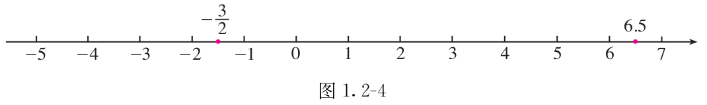
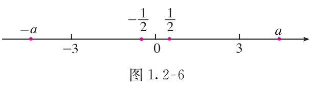
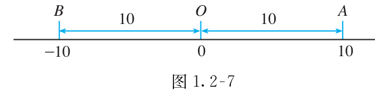
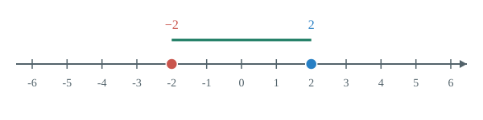
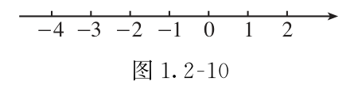

# 第一章 有理数

负号让我们能区分收入与支出、零上与零下。把数放到数轴上，再看位置、方向和距离，就能分清相反数、绝对值与大小。

## 本章前置自查

- 能区分整数、分数和小数吗？不会就回看小学数的认识。
- 能比较两个正数的大小吗？不会就回看小学分数、小数的大小比较。
- 能读出直线上的等距刻度吗？不会就回看小学用直线表示数。

## 1.1a 正负数与相反意义

```yaml
id: MATH-7A-01-1a
title: 正负数与相反意义
weight: 一般
weight_note: 九套卷直接考查2次，均为3分选择题，属于容易得分的识别题。
textbook: 七上1.1，印刷p.2–4
prerequisites: []
evidence:
- 阅读后能口头说明正数、负数和零的区别。
- 能按题目规定，用正负数表示具有相反意义的量。
figure: 不需要；先认住中的零上与零下足以说明符号的意义，不另加情境图。
method: []
sources: [TB7A-1.1]
```

### 本次只学

先看正号表示什么，再用负号表示相反意义的量。

### 先认住

- 大于 $0$ 的数叫作正数；在正数前加负号“$-$”得到负数。正数前的“$+$”可以省略，负数前的“$-$”不能省略。$0$ 既不是正数，也不是负数。
- 具有相反意义的量，可以分别用正数和负数表示。若收入记为正，支出就记为负；若向右记为正，向左就记为负。先看题目怎样规定，不只凭“增加”“减少”选符号。
- $0$ 不只表示“没有”。零上 $3\,{}^\circ\mathrm C$ 记为 $+3\,{}^\circ\mathrm C$，零下 $3\,{}^\circ\mathrm C$ 记为 $-3\,{}^\circ\mathrm C$；$0\,{}^\circ\mathrm C$ 是一个确定的温度。

### 容易错

- “不是正数”不等于“是负数”，还可能是 $0$。
- 负号表示相对于规定方向或基准的相反意义，不是数值大小的比较符号。

### 练一练

- `Q-MATH-GD2023-01`

## 1.2a 有理数分类与数轴

```yaml
id: MATH-7A-01-2a
title: 有理数分类与数轴
weight: 一般
weight_note: 未单独计次；数轴还用于七下实数、不等式解集，本点只讲分类和数的表示，不按综合题背景抬级。
textbook: 七上1.2.1–1.2.2，印刷p.7–10
prerequisites:
- id: MATH-7A-01-1a
  strength: hard
  reason: 先区分正数、负数和零，才能分类并在数轴上表示。
evidence:
- 能把有理数按正负及是否为整数分类，并正确放置零。
- 阅读后能不看定义，口头说出数轴的原点、正方向和单位长度。
- 阅读后能用先认住中的6.5和-3/2，口头说明方向及到原点的距离。
figure: 已完成 figures/tb7a-1-2-fig1-2-4.png（课本图1.2-4原图，放在先认住之后）
method: [MG16 数形结合]
sources: [TB7A-1.2-NUM, MG16]
```

### 本次只学

知道一个数属于哪一类，也知道它在数轴上怎样表示。

### 先认住

- 可以写成分数形式的数称为有理数。正整数、$0$、负整数统称为整数；有理数可以分为整数和分数，也可以分为正有理数、$0$、负有理数。有限小数和无限循环小数都可以化为分数。
- 规定了原点、正方向和单位长度的直线叫作数轴。原点表示 $0$，通常向右为正方向；相邻整数刻度之间都是一个单位长度。
- 有理数可以用数轴上的点表示。$6.5$ 在原点右侧，距原点 $6.5$ 个单位长度；$-\dfrac32$ 在原点左侧，距原点 $\dfrac32$ 个单位长度。



### 数形结合

```bridge
mode: cards
式: $-2$、$3$
图: nl-dist
形: 一个在原点左侧、一个在右侧，到原点的距离分别是 $2$ 和 $3$
色: blue
结: 先看点在原点哪侧，再按单位长度读出距离，就能写出它表示的数。
```

### 容易错

- $0$ 属于整数，但不属于正有理数或负有理数。
- 数轴的单位长度要统一；分数、小数也能用数轴上的点表示，不只在整数刻度上取点。

### 练一练

- `Q-MATH-TB7A-1.2-1`

## 1.2b 相反数与绝对值

```yaml
id: MATH-7A-01-2b
title: 相反数与绝对值
weight: 一般
weight_note: 直接考查2次，均为3分选择题；合并两种容易混淆的概念，不计实数混合运算中的背景使用。
textbook: 七上1.2.3–1.2.4，印刷p.11–14
prerequisites:
- id: MATH-7A-01-2a
  strength: hard
  reason: 用数轴上的对称位置和到原点的距离理解两个概念。
evidence:
- 能说出给定数的相反数，读懂数前的负号和括号。
- 阅读后能用先认住中的10、-10和0，口头说明绝对值及它对应的距离。
figure: 已完成 figures/tb7a-1-2-fig1-2-6.png、figures/tb7a-1-2-fig1-2-7.png（课本图1.2-6、1.2-7原图，分别放在相反数、绝对值定义之后）；另有互动数轴 widget number-line + figures/number-line-opposite-1-2b.svg（放在先认住之后）
method: [MG16 数形结合]
sources: [TB7A-1.2-OPP-ABS, MG16]
```

### 本次只学

相反数看符号和对称位置，绝对值看距离。

### 先认住

- 只有符号不同的两个数互为相反数，$0$ 的相反数是 $0$。在任意一个数前添上负号，就表示取它的相反数：$-(+5)=\boxed{-5}$，$-(-5)=\boxed{5}$，$-0=\boxed{0}$。


- 数轴上表示数 $a$ 的点与原点的距离，叫作 $a$ 的绝对值，记作 $|a|$。例如，$|10|=\boxed{10}$，$|-10|=\boxed{10}$，$|0|=\boxed{0}$。


- 正数的绝对值是它本身；负数的绝对值是它的相反数；$0$ 的绝对值是 $0$。例如，$|-0.5|=\boxed{0.5}$，$\left|-\dfrac74\right|=\boxed{\dfrac74}$。

```widget
type: number-line
mode: abs
min: -6
max: 6
value: 2
step: 0.5
```


### 数形结合

```bridge
mode: hero
式: $-3$ 与 $3$
图: nl-opp
形: 在原点两侧，到原点的距离相等
色: blue
结: 点离原点越近，绝对值越小；原点对应的绝对值是 $0$。
```

### 容易错

- $-a$ 表示 $a$ 的相反数，不表示它必为负数。$a$ 是负数时，$-a$ 是正数；$a=0$ 时，$-a=0$。
- 相反数与绝对值不同：$5$ 的相反数是 $-5$，绝对值是 $5$。绝对值不为负，但可以等于 $0$。

### 练一练

- `Q-MATH-GZ2023-01`

## 1.2c 有理数的大小比较

```yaml
id: MATH-7A-01-2c
title: 有理数的大小比较
weight: 一般
weight_note: 沿用地图的一般级；exam_hits及exam_refs当前只记GZ2024-01，共1次。地图说明仍写2次及深圳2024，冲突记入sources.md，本稿不改地图。
textbook: 七上1.2.5，印刷p.14–16
prerequisites:
- id: MATH-7A-01-2a
  strength: hard
  reason: 数轴上右边的数比左边的数大。
- id: MATH-7A-01-2b
  strength: hard
  reason: 两个负数比较大小时需要比较绝对值。
evidence:
- 阅读后能口头说明水平数轴上的左右位置怎样对应数的大小。
- 能先分清正数、负数和零，再用绝对值比较两个负数。
figure: 已完成 figures/tb7a-1-2-fig1-2-10.png（课本图1.2-10原图，放在先认住之后）
method: [MG16 数形结合]
sources: [TB7A-1.2-COMPARE]
```

### 本次只学

先看符号，再比较；两个负数的比较方向要特别留意。

### 先认住

- 在水平数轴上，从左到右就是从小到大；左边的数小于右边的数。
- 正数大于 $0$，$0$ 大于负数，正数大于负数。两个负数比较大小，绝对值大的反而小；如 $|-3|<|-7|$，但 $\boxed{-3>-7}$。
- 有括号或绝对值符号时，先化简再比较。例如，$-(-0.5)=0.5$，$|-1.5|=1.5$，所以 $\boxed{-(-0.5)<|-1.5|}$。



### 数形结合

```bridge
mode: cards
式: $-3<-1<2$
图: nl-order
形: 水平数轴上越靠右，表示的数越大
色: blue
结: 两个负数中，绝对值大的点离原点更远、位置更靠左，所以它更小。
```

### 容易错

- 比较两个负数时，不要照搬两个正数的比较方向。
- 比较数的大小看左右位置；比较绝对值大小看离原点的远近。

### 练一练

- `Q-MATH-GZ2024-01`
