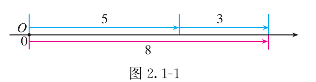
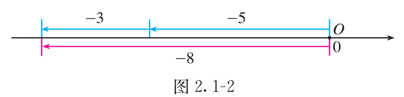

# 第二章 有理数的运算

负号有时属于数，有时表示减法。计算时先看清符号和括号，再按顺序算。
这一章还要学会简写大数，并看懂近似数精确到哪一位。

## 本章前置自查

- 能求一个数的相反数和绝对值吗？不会就回看第一章第2节“相反数”“绝对值”。
- 能在数轴上分清正方向和负方向吗？不会就回看第一章第2节“数轴”。
- 会通分、约分，把带分数化成假分数吗？不会就回看小学分数运算。

## 2.1a 有理数的加减法则

```yaml
id: MATH-7A-02-1a
weight: 一般
weight_note: 单独考查1次，广东2024第1题，3分；不把后续实数计算全部计入。
textbook: 七上2.1.1、2.1.2，印刷p.25–28、31
prerequisites:
- id: MATH-7A-01-2b
  strength: hard
  reason: 加法定符号、减法转化都要用相反数和绝对值。
evidence:
- 能按同号或异号确定和的符号，再计算绝对值。
- 能遮住讲解算例的结果，自行把减去负数转为加法并算出结果。
figure: 已完成 figures/tb7a-2-1-fig2-1-1.png、figures/tb7a-2-1-fig2-1-2.png（课本图2.1-1、2.1-2原图，放在先认住之后）
method: [MG16 数形结合]
sources: [TB7A-2.1, MG16, GD2024-01]
```

### 本次只学

先判断加数的符号；遇到减法，先转成加法。

### 先认住

- 同号两数相加，取相同的符号，把绝对值相加。异号且绝对值不等时，取绝对值较大的数的符号，用较大的绝对值减去较小的绝对值。
- 互为相反数的两个数相加得 $0$；一个数与 $0$ 相加，仍得这个数。
- 减去一个数，等于加上它的相反数：$a-b=a+(-b)$。遮住结果，自己复算：$(-3)-(-5)=(-3)+\textcolor{#287fc4}{5}=\boxed{2}$。





### 数形结合

```bridge
mode: cards
式: $5+3$
图: nl-add-pos
形: 先向右走，再向右走
色: blue
---
式: $(-5)+(-3)$
图: nl-add-neg
形: 两次都向左走
色: red
结: 同向运动的两段长度相加，终点在哪一侧，就用那一侧的符号表示结果。
```

### 容易错

- 异号相加时，要比较绝对值，不能只看哪个数排在前面。
- 减法转成加法时，被减数不变；只把减号和减数一起转换。

### 练一练

- `Q-MATH-GD2024-01`

## 2.1b 加减混合与运算律

```yaml
id: MATH-7A-02-1b
weight: 一般
weight_note: 未单独计次；是后续系数计算的基础，保持短讲解，不抬级或凑真题。
textbook: 七上2.1，印刷p.28–29、33–34
prerequisites:
- id: MATH-7A-02-1a
  strength: hard
  reason: 先把减法转为加法，再按法则和运算律计算。
evidence:
- 能把加减混合式改写成省略括号和加号的形式。
- 能把带符号的加数一起移动，并用交换律、结合律简化计算。
figure: 不需要；用带符号的加数分组说明交换与结合，不另画运算示意图。
method: []
sources: [TB7A-2.1]
```

### 本次只学

把加减混合统一成加法，再找便于计算的组合。

### 先认住

- 加法交换律：$a+b=b+a$。加法结合律：$(a+b)+c=a+(b+c)$。
- 减法先转成加法。例如 $a+b-c=a+b+(-c)$，可把它看成 $a$、$b$、$-c$ 三个数的和。
- 调整顺序时，符号跟着加数一起移动；可以先组合互为相反数的数，或容易凑成整数的数。

### 容易错

- 省略括号和加号，不是把数前面的负号去掉。
- 不能把减法当作有交换律的运算；先转为加法，再调整顺序。

### 练一练

- `Q-MATH-TB7A-2.1-5`

## 2.2a 有理数乘除与运算律

```yaml
id: MATH-7A-02-2a
weight: 一般
weight_note: 未单独计次；为后续整式与方程提供运算基础，不因此升为重点。
textbook: 七上2.2，印刷p.39–42、44、47
prerequisites:
- id: MATH-7A-01-2b
  strength: hard
  reason: 乘除法需要先判断符号，再计算绝对值。
- id: MATH-7A-02-1a
  strength: soft
  reason: 分配律中的加减运算需要加减法则。
evidence:
- 能先确定多个非零因数相乘的符号，再计算乘积。
- 能说出乘法交换律、结合律和分配律中对应的运算关系。
figure: 不需要；运算律用公式及“分别相乘”的文字解释，不新增图或互动。
method: []
sources: [TB7A-2.2]
```

### 本次只学

分清乘除的符号规则，必要时把除法转成乘法。

### 先认住

- 两个非零数相乘，同号得正，异号得负，绝对值相乘；任何数与 $0$ 相乘得 $0$。多个非零数相乘，负因数个数为偶数时积为正，为奇数时积为负。
- 除数不能为 $0$。除以非零数，等于乘它的倒数：$a\div b=a\times\dfrac1b\ (b\ne0)$。两个非零数相除，同号得正，异号得负；$0$ 除以非零数得 $0$。
- 乘法交换律：$ab=ba$；结合律：$(ab)c=a(bc)$；分配律：$a(b+c)=ab+ac$。用分配律时，括号外的数要分别乘每一个加数。

### 容易错

- 除法转乘法时，只把除数换成倒数，不把被除数也倒过来。
- 连续乘除按从左到右计算；也可先全部转成乘法，再用乘法运算律。

### 练一练

- `Q-MATH-TB7A-2.2-4`

## 2.2b 倒数的概念与识别

```yaml
id: MATH-7A-02-2b
weight: 一般
weight_note: 单独考查1次，深圳2022第1题，3分；重点区分倒数与相反数。
textbook: 七上2.2，印刷p.39–40、44
prerequisites:
- id: MATH-7A-02-2a
  strength: hard
  reason: 用两个数的乘积是否为一判断是否互为倒数。
evidence:
- 能用乘积是否为1检验两个数是否互为倒数。
- 能在选择题中区分倒数和相反数，并用讲解中的乘0法则解释0没有倒数。
figure: 不需要；乘积检验直接用算式，不把倒数画成数轴上的对称点。
method: []
sources: [TB7A-2.2, SZ2022-01, SUP-RECIPROCAL]
```

### 本次只学

判断倒数时看乘积，不只看两个数的正负号。

### 先认住

- 乘积是 $1$ 的两个数互为倒数。
- 非零数 $a$ 的倒数是 $\dfrac1a$。求负分数的倒数时，保留负号，再交换分子和分母。
- **补充**（课本没有讲，做真题时常用）：$0$ 没有倒数，因为它与任何数相乘都得 $0$，不能得到 $1$。

### 容易错

- 相反数看“和为零”，倒数看“积为一”，不能混用。
- 两个数乘积为 $-1$，不符合互为倒数的定义。

### 练一练

- `Q-MATH-SZ2022-01`

## 2.3a 乘方与有理数混合运算

```yaml
id: MATH-7A-02-3a
weight: 一般
weight_note: 单独考查1次，广东2022第2题，3分；本章不涉及幂的运算法则、零指数或负整数指数。
textbook: 七上2.3.1，印刷p.51–53、56–57
prerequisites:
- id: MATH-7A-02-2a
  strength: hard
  reason: 乘方是相同因数相乘，混合运算也要用乘除法则。
- id: MATH-7A-02-1b
  strength: hard
  reason: 乘方、乘除之后还要完成加减运算。
evidence:
- 能指出乘方算式中的底数和指数。
- 能把正数的平方展开成两个相同因数相乘，再计算。
figure: 可选·几何图；依据印刷p.51开头的面积、体积说明，左侧画边长2cm的正方形，右侧画棱长2cm的正方体，外侧分别标2²对应面积4cm²、2³对应体积8cm³。因面积数值与练题答案相同，仅规划放在练一练的解析之后，不放在作答前的讲解区；后续配图流程若不支持此位置，就不采用此图。第0秒显示完整图形及全部标注，文字放在图外空白处；不新增widget。
method: [MG16 数形结合]
sources: [TB7A-2.3, MG16]
```

### 本次只学

先看清谁是底数，再按顺序计算。

### 先认住

- 求 $n$ 个相同因数 $a$ 的积，叫作乘方，记作 $a^n$。本节 $n$ 为正整数；$a$ 是底数，$n$ 是指数，结果叫作幂。一个数也可看作它的 $1$ 次方。
- 负数的奇次幂为负，偶次幂为正；正数的正整数次幂为正，$0$ 的正整数次幂为 $0$。
- 有括号先算括号内，由内向外；括号内也按先乘方、再乘除、最后加减计算。同级运算从左到右。

### 数形结合

```bridge
mode: cards
式: $2^2$
形: 边长为 $2\ \mathrm{cm}$ 的正方形的面积
色: blue
---
式: $2^3$
形: 棱长为 $2\ \mathrm{cm}$ 的正方体的体积
色: green
```

### 容易错

- $(-2)^4$ 的底数是 $-2$；$-2^4$ 是先算 $2^4$，再取相反数，括号不能漏。
- 乘方是重复相乘，不是底数乘指数。

### 练一练

- `Q-MATH-GD2022-02`

## 2.3b 用科学记数法表示数

```yaml
id: MATH-7A-02-3b
weight: 一般
weight_note: 九套有效卷直接考查5次，均为3分选择或填空；常考但容易得分，按地图保留一般级。
textbook: 七上2.3.2，印刷p.54–55
prerequisites:
- id: MATH-7A-02-3a
  strength: hard
  reason: 用十的正整数次幂表达大数。
evidence:
- 能把大数写成符合系数范围的科学记数法形式。
- 能用整数位数或小数点移动位数确定10的指数。
figure: 可选·图解步骤图；用印刷p.54太阳半径中的696000说明696000=6.96×10⁵，标出小数点向左移动5位，旁边对应10⁵。第0秒显示原数、移动标记及完整等式，数字与标注固定，箭头不穿过数字；不用练习中的384000，不提前标出练习答案。
method: []
sources: [TB7A-2.3, GD2024-03]
```

### 本次只学

先确定前面的数，再数清小数点移动了几位。

### 先认住

- 对大于 $10$ 的数，用 $a\times10^n$ 表示，其中 $1\le a<10$，$n$ 为正整数；这种表示使用科学记数法。
- 对一个多位正整数，$n$ 等于整数位数减 $1$；也可数小数点向左移到首个非零数字后面的位数。
- 小于 $-10$ 的数可类似表示，保留原数的负号；判断前面的数是否合适时，看其绝对值是否在 $1$ 到 $10$ 之间，不含 $10$。

### 容易错

- 前面的数不能写成 $10$ 或更大，否则还要调整指数。
- “万”“亿”属于数值的一部分，先弄清原数的大小，再确定指数。

### 练一练

- `Q-MATH-GD2024-03`

## 2.3c 近似数与精确度

```yaml
id: MATH-7A-02-3c
weight: 了解
weight_note: 未发现独立设问；只解释取近似数和精确度，不增加作答题。
textbook: 七上2.3.3，印刷p.55–56
prerequisites:
- id: MATH-7A-02-3b
  strength: soft
  reason: 科学记数法便于读出大数取近似后的实际位数。
evidence:
- 能说清近似数1.8与1.80分别精确到哪一位。
figure: 不需要；直接并列保留一位和两位小数的结果，不画额外示意图。
method: []
sources: [TB7A-2.3]
```

### 先认住

- 近似数接近准确数，但可能与准确数有差别。精确度说明近似到哪一位。
- 用四舍五入法取近似数，保留到要求的位数，再看下一位决定舍去或进一；近似关系用 $\approx$，不是 $=$。
- $1.804\approx1.8$ 是精确到十分位；$1.804\approx1.80$ 是精确到百分位。作为近似数，$1.80$ 末尾的 $0$ 不能随意省略。
