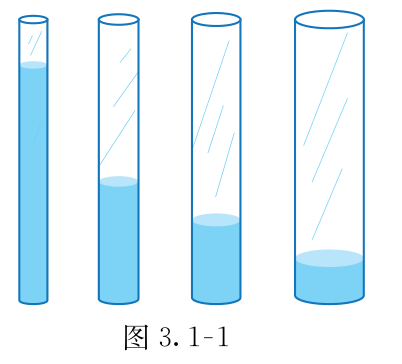

# 第三章 代数式

字母代替具体的数，把计算从一个个具体的题目推广到一类问题。列代数式能把生活中的数量和数量关系简明地表达出来，求代数式的值则让我们把一般规律随时化为具体的数值。

## 本章前置自查

- 能按运算顺序熟练进行有理数的加减乘除与乘方混合运算吗？不会就回看第二章第三节。
- 知道常见几何图形（长方形、正方形、圆柱等）的周长、面积与体积计算公式吗？不会就回看小学几何公式。
- 能读懂实际问题中的工作量、路程、总价等基本等量关系吗？不会就回看小学常见数量关系。

## 3.1a 代数式的含义与书写

```yaml
id: MATH-7A-03-1a
title: 代数式的含义与书写
weight: 了解
weight_note: 未单独考查代数式的识别或书写规范；不把列式题重复计入概念点。
textbook: 七上3.1，印刷p.69–71
prerequisites:
- id: MATH-7A-02-3a
  strength: soft
  reason: 字母代替数后仍使用加减乘除和乘方的运算顺序。
evidence:
- 能分清代数式的含义，知道单独一个数或字母也是代数式。
- 能按规范书写含有字母的式子。
figure: 不需要；代数式书写规范通过文字条目即可讲清，不需另配图。
method: []
sources: [TB7A-3.1]
```

### 本次只学

认识代数式，学会含有字母的式子的规范书写方法。

### 先认住

- 用运算符号把数或表示数的字母连接起来的式子叫作代数式。单独的一个数或表示数的字母也是代数式。这里的运算包括加、减、乘、除、乘方（开方在以后学习）。
- 式子中出现乘号时，数放在字母前，乘号写作“$\cdot$”或省略不写，如 $5\times t$ 写作 $5t$；除法运算通常写成分数形式，如 $n\div 5$ 写作 $\dfrac{n}{5}$；相同字母相乘写成幂的形式，如 $a\cdot a$ 写作 $a^2$。
- **补充**（课本没有讲，做真题时常用）：数与字母相乘时，把带分数因数写成假分数，避免与加法混淆；加减式后面跟单位时，用括号表示整个式子的单位，如 $(2n-10)\text{ 件}$。

## 3.1b 列式表达数量关系

```yaml
id: MATH-7A-03-1b
title: 列式表达数量关系
weight: 一般
weight_note: 直接考查 2 个小问：广州 2025 的成本列式、深圳 2024 的购物车长度列式；小问分值未独立标明。
textbook: 七上3.1，印刷p.69–73
prerequisites:
- id: MATH-7A-03-1a
  strength: hard
  reason: 先明确字母代表什么量，再按运算关系写式子。
evidence:
- 能根据具体情境中的数量关系，用含有字母的代数式表示未知量。
- 能分析成本按百分比降低的数量关系，准确列出代数式。
figure: 不需要；练一练题目为文字叙述的成本计算，不需另配图。
method: []
sources: [TB7A-3.1, GZ2025-22]
```

### 本次只学

理清实际问题中的数量关系，用含字母的代数式把数量关系简明地表示出来。

### 先认住

- 列代数式时，先弄清问题中有哪些量，找到量与量之间的基本关系（如工作量 $=$ 效率 $\times$ 时间，总价 $=$ 单价 $\times$ 数量，现价 $=$ 原价 $\times$ 折扣）。
- 用字母代替数后，字母与数一样参与运算；同一个代数式可以表示不同实际情境中的数量关系。
- 如无特别说明，“$a, b$ 两数的差”或“$a$ 与 $b$ 的差”都指“$a-b$”。遇到“比 $a$ 的 $2$ 倍少 $10$”时，先乘后减写成 $2a-10$。

### 容易错

- 运算顺序弄混：例如“$a, b$ 两数差的平方”是 $(a-b)^2$，而“$a, b$ 两数的平方差”是 $a^2-b^2$。
- **补充**（课本没有讲，做真题时常用）：加减式后面跟单位时，用括号括住整个式子，避免单位只对应最后一项。

### 练一练

- `Q-MATH-GZ2025-22-1`

## 3.1c 正反比例关系辨认

```yaml
id: MATH-7A-03-1c
title: 正反比例关系辨认
weight: 一般
weight_note: 修订版本节含正反比例关系，未计图象或函数性质题；用于后续函数建模，保留一般级。
textbook: 七上3.1，印刷p.73–75
prerequisites:
- id: MATH-7A-03-1b
  strength: hard
  reason: 先写数量关系，再判断比值或乘积是否保持不变。
evidence:
- 能根据两个量的比值是否一定，判断它们是否成正比例关系。
- 能根据两个量的乘积是否一定，判断它们是否成反比例关系。
figure: 已完成 figures/tb7a-3-1-fig3-1-1.png（课本图3.1-1原图，放在先认住之后）
method: [MG16 数形结合]
sources: [TB7A-3.1, MG16]
```

### 本次只学

辨认两个相关联的量成正比例关系还是反比例关系。

### 先认住

- 两个相关联的量，一个量变化，另一个量也随着变化：如果它们的**比值**一定，这两个量就成正比例关系；例如工作效率一定时，工作量与工作时间成正比例。
- 如果它们的**乘积**一定（$xy=k$，$k$ 为非零常数），这两个量就成反比例关系；例如工作总量一定时，工作效率与工作时间成反比例。
- 判断两个量成什么比例关系时，先写出它们满足的关系式，再看是比值固定还是乘积固定；若两者都不固定，则不成正比例也不成反比例。



### 数形结合

```bridge
mode: hero
式: $xy=k$
图: hyper-rect
形: 注入等量水时，底面积越大，水柱高度越小，乘积保持不变
色: blue
```

### 容易错

- **补充**（课本没有讲，做真题时常用）：不能只凭“一个增加另一个减少”判断反比例。购买两种笔的总费用一定且大于零时，两种笔的费用都为正数，一个增加，另一个减少，但乘积不固定。
- 混淆比值与乘积：成正比例是比值一定，成反比例是乘积一定（$xy=k$，$k$ 为非零常数）。

### 练一练

- `Q-MATH-TB7A-3.1-4`

## 3.2a 代数式与公式求值

```yaml
id: MATH-7A-03-2a
title: 代数式与公式求值
weight: 一般
weight_note: 直接考查 1 次，为广州 2024 的 3 分填空题；函数求值和因式分解后的求值暂不重复计入。
textbook: 七上3.2，印刷p.79–82
prerequisites:
- id: MATH-7A-03-1a
  strength: hard
  reason: 要识别代数式中的字母和运算关系。
- id: MATH-7A-02-3a
  strength: hard
  reason: 把数值代入后需要按顺序完成混合运算。
evidence:
- 能准确将给定的数值代入代数式或公式中的对应字母。
- 能运用运算律与有理数混合运算法则正确计算出代数式的值。
figure: 不需要；题图随真题 Q-MATH-GZ2024-12 提供。
method: []
sources: [TB7A-3.2, GZ2024-12]
```

### 本次只学

把具体的数代入代数式或公式中，求出代数式的值。

### 先认住

- 用数值代替代数式里的字母，按照代数式指明的运算顺序计算出的结果，叫作代数式的值。当字母取不同的数值时，代数式的值一般也不同。
- 代入数值时，补写原来省略的乘号，避免把相乘的数直接连写；负数或分数作为乘方的底数时，用括号括住，如当 $a=-3$ 时，$a^2=(-3)^2$。
- **补充**（课本没有讲，做真题时常用）：遇到 $U=IR_1+IR_2+IR_3$ 的求值，可先逆用乘法分配律写成 $I(R_1+R_2+R_3)$，再代入计算，简化运算。

### 容易错

- 负数代入乘方时漏加括号：如 $a=-3$ 时，把 $a^2$ 误算为 $-3^2=-9$，正确应为 $(-3)^2=9$。
- 忽视乘号的还原：把字母换成数字后直接连写，如 $x=2$ 时把 $5x$ 误写成 $52$，正确应为 $5\times 2=10$。

### 练一练

- `Q-MATH-GZ2024-12`
