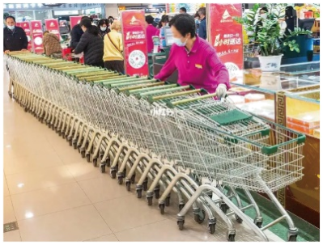
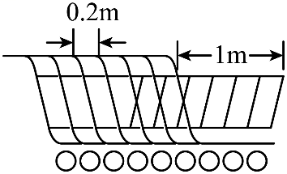

# 第三章 代数式 · 题目

## 讲义用题

### Q-MATH-GZ2025-22-1

```yaml
id: Q-MATH-GZ2025-22-1
category: 真题
source: 2025年广东省广州市中考数学真题第22题第（1）问，Word及解析版PDF第18页
source_quality: 原卷
kp: MATH-7A-03-1b
do: 本章只做第（1）问
other_parts: 第（2）问考查分式方程的应用，归入八上 MATH-8A-18-3a。
type: 解答
grading: 自评
answer_by: 原卷解析
review:
  概念: MATH-7A-03-1b
  审题: MATH-7A-03-1b
```

**题干**

智能机器人广泛应用于智慧农业．为了降低成本和提高采摘效率，某果园引进一台智能采摘机器人进行某种水果采摘．

（1）若用人工采摘的成本为 $a$ 元，相比人工采摘，用智能机器人采摘的成本可降低 $30\%$．求用智能机器人采换的成本是多少元；（用含 $a$ 的代数式表示）

**答案**

$0.7a\text{ 元}$

**解析**

1. 用人工采摘的成本为 $a$ 元，相比人工采摘，智能机器人采摘的成本降低了 $30\%$。
2. 降低的成本为 $30\%a$ 元，因此实际采摘成本为原成本减去降低的成本。
3. 用智能机器人采摘的成本为：$(1 - 30\%)a = \boxed{0.7a}\text{ 元}$。

### Q-MATH-TB7A-3.1-4

```yaml
id: Q-MATH-TB7A-3.1-4
category: 课本习题
source: 人教版数学七年级上册（根据2022年版课程标准修订）p.76，习题3.1第4题
source_quality: 课本原文
kp: MATH-7A-03-1c
type: 解答
grading: 自评
answer_by: 本项目编写，待复核
review:
  概念: MATH-7A-03-1c
  审题: MATH-7A-03-1c
```

**题干**

判断下列各题中的两个量是否成反比例关系，并说明理由：

（1）200名同学参加队列操表演，按每排人数相等的规定排列，每排的人数与排数；

（2）三角形的面积是 $6\ \mathrm{cm}^2$，它的一条边的长与这条边上的高；

（3）张华每小时可以制作 120 朵小红花，她制作的小红花朵数与制作时间．

**答案**

（1）成反比例关系。理由：每排的人数 $\times$ 排数 $= 200$（一定），两个量的乘积一定。
（2）成反比例关系。理由：由三角形面积公式得 $\frac{1}{2}\times\text{边长}\times\text{高}=6$，即 $\text{边长}\times\text{高}=12$（一定），两个量的乘积一定。
（3）不成反比例关系（成正比例关系）。理由：制作的小红花朵数 $\div$ 制作时间 $= 120$（一定），是比值一定，而不是乘积一定。

**解析**

1. （1）总人数为 $200$ 人，关系式为：每排的人数 $\times$ 排数 $= 200$。两个量的乘积一定，因此每排的人数与排数$\boxed{\text{成反比例关系}}$。
2. （2）设边长为 $a$，这条边上的高为 $h$。三角形面积 $S = \frac{1}{2}ah = 6$，整理得 $ah = \textcolor{#287fc4}{12}$。底边长与对应高的乘积一定，因此一条边的长与这条边上的高$\boxed{\text{成反比例关系}}$。
3. （3）设制作时间为 $t\ \mathrm{h}$，制作小红花朵数为 $n$ 朵。由题意得 $\dfrac{n}{t} = 120$。这两个量的比值一定，成正比例关系，乘积不固定，因此$\boxed{\text{不成反比例关系}}$。

### Q-MATH-GZ2024-12

```yaml
id: Q-MATH-GZ2024-12
category: 真题
source: 2024年广州市初中学业水平考试数学第12题，Word及解析版PDF第8页
source_quality: 原卷
kp: MATH-7A-03-2a
type: 填空
grading: 自评
answer_by: 原卷解析
review:
  概念: MATH-7A-03-2a
  计算: MATH-7A-02-3a
```

**题干**

如图，把 $R_{1}$，$R_{2}$，$R_{3}$ 三个电阻串联起来，线路 $AB$ 上的电流为 $I$，电压为 $U$，则 $U=IR_{1}+IR_{2}+IR_{3}$．当 $R_{1}=20.3$，$R_{2}=31.9$，$R_{3}=47.8$，$I=2.2$ 时，$U$ 的值为______．


**答案**

220

**解析**

1. 根据题意，电路总电压公式为 $U = IR_1 + IR_2 + IR_3$。
2. 提取公因数 $I$，逆用乘法分配律变形为：$U = I(R_1 + R_2 + R_3)$。
3. 代入已知数据 $R_1=\textcolor{#287fc4}{20.3}$，$R_2=\textcolor{#287fc4}{31.9}$，$R_3=\textcolor{#287fc4}{47.8}$，$I=\textcolor{#287fc4}{2.2}$：
   $$U = \textcolor{#287fc4}{2.2} \times (\textcolor{#287fc4}{20.3} + \textcolor{#287fc4}{31.9} + \textcolor{#287fc4}{47.8})$$
4. 先算括号内加法：$20.3 + 31.9 + 47.8 = 100$。
5. 再算乘法：$2.2 \times 100 = \boxed{220}$。
6. 故答案为 $\boxed{220}$。

## 备选

### Q-MATH-SZ2024-17-1

```yaml
id: Q-MATH-SZ2024-17-1
category: 真题
source: 2024年深圳市初中学业水平测试数学试卷第17题任务1，Word及解析版PDF第15页
source_quality: 原卷
kp: MATH-7A-03-1b
do: 本章只做任务1
other_parts: 任务2、任务3考查一元一次不等式及方案选择，归入七下 MATH-7B-11-2b。
type: 解答
grading: 自评
answer_by: 原卷解析
review:
  概念: MATH-7A-03-1b
  审题: MATH-7A-03-1b
```

**题干**

背景
【缤纷618，优惠送大家】
今年618各大电商平台促销火热，线下购物中心也亮出大招，年中大促进入“白热化”．深圳各大购物中心早在5月就开始推出618活动，进入6月更是持续加码，如图，某商场为迎接即将到来的618优惠节，采购了若干辆购物车．



素材
如图为某商场叠放的购物车，右图为购物车叠放在一起的示意图，若一辆购物车车身长 $1\,\mathrm{m}$，每增加一辆购物车，车身增加 $0.2\,\mathrm{m}$．



问题解决
任务1
若某商场采购了 $n$ 辆购物车，求车身总长 $L$ 与购物车辆数 $n$ 的表达式；

**答案**

$L = 0.8 + 0.2n$（或 $L = 1 + 0.2(n - 1)$）

**解析**

1. 依题意，第一辆购物车车身长为 $1\,\mathrm{m}$。
2. 采购 $n$ 辆购物车时，在第一辆车的基础上增加了 $n - 1$ 辆车。
3. 每增加一辆车，车身总长增加 $0.2\,\mathrm{m}$，增加的长度为 $0.2(n - 1)\,\mathrm{m}$。
4. 因此车身总长 $L$ 与数量 $n$ 的关系式为：$L = 1 + 0.2(n - 1) = \boxed{0.8 + 0.2n}\quad (\text{单位：}\mathrm{m})$。

### Q-MATH-TB7A-3.1-1

```yaml
id: Q-MATH-TB7A-3.1-1
category: 课本习题
source: 人教版数学七年级上册（根据2022年版课程标准修订）p.75，习题3.1第1题
source_quality: 课本原文
kp: MATH-7A-03-1a
type: 解答
grading: 自评
answer_by: 本项目编写，待复核
review:
  概念: MATH-7A-03-1a
  审题: MATH-7A-03-1a
```

**题干**

用代数式表示：

（1）$m$ 的 2 倍；

（2）$n$ 的 $\dfrac{2}{3}$；

（3）比 $x$ 的 2 倍少 1 的数；

（4）$a$ 的立方除以 $b$ 的商．

**答案**

（1）$2m$
（2）$\dfrac{2}{3}n$
（3）$2x - 1$
（4）$\dfrac{a^3}{b}$

**解析**

1. （1）$m$ 的 2 倍即 $2 \times m$，按书写规范乘号省略，写为 $\boxed{2m}$。
2. （2）$n$ 的 $\dfrac{2}{3}$ 即 $\dfrac{2}{3} \times n$，省略乘号写为 $\boxed{\dfrac{2}{3}n}$。
3. （3）$x$ 的 2 倍是 $2x$，比它少 1 的数写为 $\boxed{2x - 1}$。
4. （4）$a$ 的立方为 $a^3$，除以 $b$ 的商写成分数形式，为 $\boxed{\dfrac{a^3}{b}}$。

### Q-MATH-TB7A-3.2-1

```yaml
id: Q-MATH-TB7A-3.2-1
category: 课本习题
source: 人教版数学七年级上册（根据2022年版课程标准修订）p.82，习题3.2第1题
source_quality: 课本原文
kp: MATH-7A-03-2a
type: 填空
grading: 自评
answer_by: 本项目编写，待复核
review:
  概念: MATH-7A-03-2a
  计算: MATH-7A-02-3a
```

**题干**

填空题：

（1）当 $a=-1$ 时，代数式 $2-a$ 的值是______；

（2）当 $b=-\dfrac{1}{2}$ 时，代数式 $1-b^2$ 的值是______．

**答案**

（1）$3$
（2）$\dfrac{3}{4}$

**解析**

1. （1）当 $a=\textcolor{#287fc4}{-1}$ 时，代入代数式得：
   $$2 - a = 2 - (\textcolor{#287fc4}{-1}) = 2 + 1 = \boxed{3}$$
2. （2）当 $b=\textcolor{#287fc4}{-\dfrac{1}{2}}$ 时，代入代数式得：
   $$1 - b^2 = 1 - \left(\textcolor{#287fc4}{-\dfrac{1}{2}}\right)^2 = 1 - \dfrac{1}{4} = \boxed{\dfrac{3}{4}}$$

### Q-MATH-TB7A-3.2-2

```yaml
id: Q-MATH-TB7A-3.2-2
category: 课本习题
source: 人教版数学七年级上册（根据2022年版课程标准修订）p.82，习题3.2第2题
source_quality: 课本原文
kp: MATH-7A-03-2a
type: 计算
grading: 自评
answer_by: 本项目编写，待复核
review:
  概念: MATH-7A-03-2a
  计算: MATH-7A-02-3a
```

**题干**

已知 $a=12$，$b=-18$，求下表中代数式的值：

| 代数式 | $a+b$ | $a-b$ | $ab$ | $\dfrac{a}{b}$ | $\dfrac{b}{a}$ |
| :---: | :---: | :---: | :---: | :---: | :---: |
| 代数式的值 | | | | | |

**答案**

$a+b = -6$；$a-b = 30$；$ab = -216$；$\dfrac{a}{b} = -\dfrac{2}{3}$；$\dfrac{b}{a} = -\dfrac{3}{2}$

**解析**

1. 当 $a=\textcolor{#287fc4}{12}$，$b=\textcolor{#287fc4}{-18}$ 时：
2. 和：$a+b = \textcolor{#287fc4}{12} + (\textcolor{#287fc4}{-18}) = -(18-12) = \boxed{-6}$。
3. 差：$a-b = \textcolor{#287fc4}{12} - (\textcolor{#287fc4}{-18}) = 12 + 18 = \boxed{30}$。
4. 积：$ab = \textcolor{#287fc4}{12} \times (\textcolor{#287fc4}{-18}) = -(12 \times 18) = \boxed{-216}$。
5. 商 $\dfrac{a}{b}$：$\dfrac{a}{b} = \dfrac{\textcolor{#287fc4}{12}}{\textcolor{#287fc4}{-18}} = -\dfrac{12}{18} = \boxed{-\dfrac{2}{3}}$。
6. 商 $\dfrac{b}{a}$：$\dfrac{b}{a} = \dfrac{\textcolor{#287fc4}{-18}}{\textcolor{#287fc4}{12}} = -\dfrac{18}{12} = \boxed{-\dfrac{3}{2}}$。
