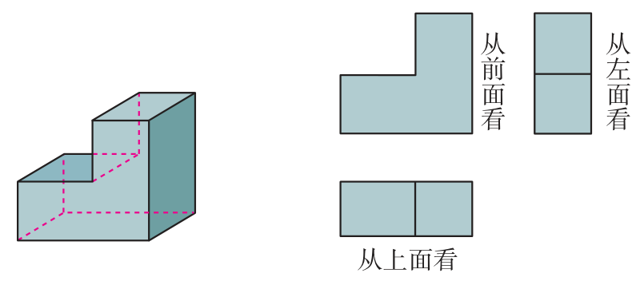
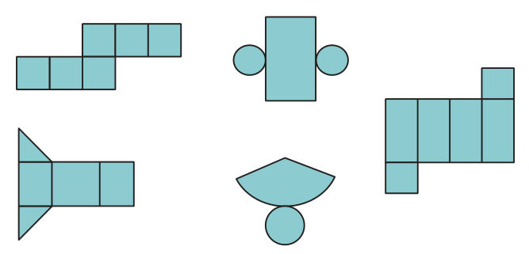
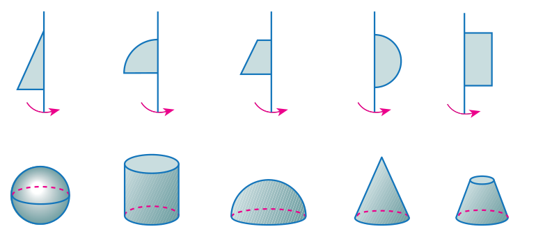
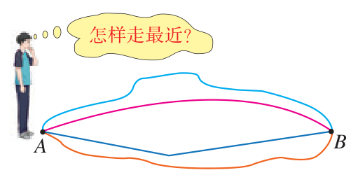
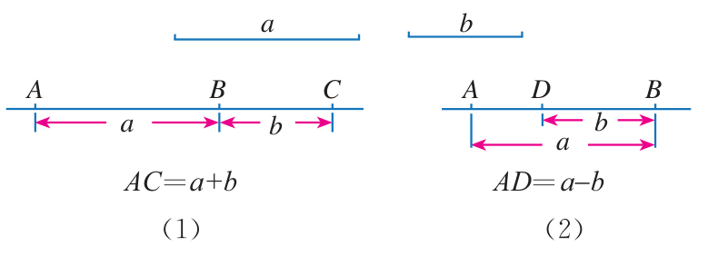
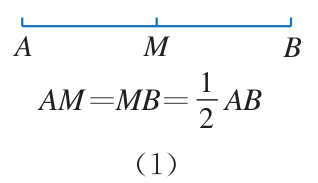
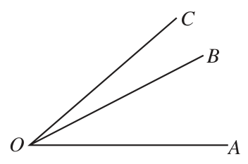
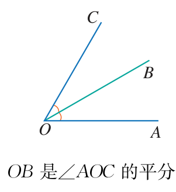
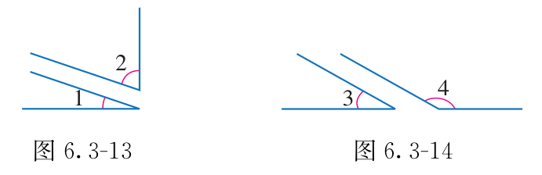

# 第六章 几何图形初步

从生活的丰富物体中抽象出几何图形。先看立体图形与三向视图、展开图，再学直线、射线、线段的长短与中点，最后掌握角的和差与余角、补角。

## 本章前置自查

1. 能区分长方形、圆与长方体、圆柱吗？不能：先回看小学直观认识的平面与立体图形。
2. 会进行有理数的加法和减法运算吗？不能：先回看第二章有理数的运算。

## 6.1a 平面图形与立体图形

```yaml
id: MATH-7A-06-1a
title: 平面图形与立体图形
weight: 了解
weight_note: 未发现只辨认两类图形的独立设问；圆锥体积、对称图形和四边形性质不属本点。
textbook: 七上 6.1，印刷p.151–153
prerequisites: []
evidence:
- 能说清立体图形与平面图形的区别。
- 能从常见实物中抽象出圆柱、圆锥、长方体等立体图形。
figure: 可选·几何图：对比长方体（立体图形，各部分不在同一平面内）与长方形（平面图形，各部分都在同一平面内）。
method: []
sources:
- 课本七上 6.1.1 节，印刷p.151–153（PDF页序索引157–159）
```

### 本次只学

认清立体图形与平面图形的本质区别，能识别常见的立体图形。

### 先认住

各部分不都在同一平面内的几何图形是立体图形（如长方体、正方体、圆柱、圆锥、球、棱柱、棱锥）。

各部分都在同一平面内的几何图形是平面图形（如线段、角、三角形、长方形、圆）。

立体图形的表面常包含平面图形（如长方体的每个侧面都是长方形，圆柱的底面是圆）。

## 6.1b 三向观察与展开图

```yaml
id: MATH-7A-06-1b
title: 三向观察与展开图
weight: 一般
weight_note: 三向观察直接考查 2 次，均为 3 分选择题；课本本节已含从前面、左面、上面看图，展开图计算题不重复计入。
textbook: 七上 6.1，印刷p.153–155
prerequisites:
- id: MATH-7A-06-1a
  strength: hard
  reason: 要识别立体图形及其对应的平面轮廓。
evidence:
- 能画出或辨认简单立体图形从前面、左面、上面看到的平面图形。
- 能根据立体图形辨认其表面展开图。
figure: 需要·几何图：课本图6.1-5、6.1-6展示三向观察，图6.1-10展示常见立体图形的表面展开图。
method: []
sources:
- 课本七上 6.1.1 节，印刷p.153–155（PDF页序索引159–161）
- 2023年广州中考数学第2题
- 2022年深圳中考数学第2题
```

### 本次只学

学会从前面、左面、上面三个方向观察立体图形，并认识常见立体图形的表面展开图。

### 先认住

从不同方向看立体图形会得到不同的平面图形：通常从前面看、从左面看、从上面看。

有些立体图形由平面图形围成，将它们的表面适当展开，可以得到该立体图形的展开图。





### 容易错

从不同方向观察组合体时，注意看遮挡关系；圆锥从上面看是一个圆中间带一点。

判断展开图时，要想象各面折回后的情形，不能只数面数。

### 练一练

- `Q-MATH-GZ2023-02`

本题只检查三向观察，不检查展开图的辨认。

## 6.1c 点线面体与面动成体

```yaml
id: MATH-7A-06-1c
title: 点线面体与面动成体
weight: 一般
weight_note: 直接考查 1 次，为广州 2025 的 3 分选择题；只要求识别旋转形成的圆锥，不涉及体积。
textbook: 七上 6.1，印刷p.155–157
prerequisites:
- id: MATH-7A-06-1a
  strength: hard
  reason: 先认出平面图形和运动后形成的立体图形。
evidence:
- 能说明体、面、线、点之间的包含与相交关系。
- 能根据平面图形绕轴旋转识别生成的立体图形。
figure: 需要·几何图：课本p.157的旋转图，静态展示平面图形、旋转轴及对应立体图形。
method: []
sources:
- 课本七上 6.1.2 节，印刷p.155–157（PDF页序索引161–163）
- 2025年广州中考数学第2题
```

### 本次只学

理解点、线、面、体的相互关系，掌握“点动成线、线动成面、面动成体”的几何运动形成规律。

### 先认住

体由面围成；面与面相交得线（直线或曲线）；线与线相交得点。点是构成图形的基本元素。

点动成线，线动成面，面动成体。

长方形绕一边所在直线旋转一周形成圆柱；直角三角形绕一条直角边所在直线旋转一周形成圆锥；半圆绕直径所在直线旋转一周形成球。



图中上下两排不按列对应：直角三角形对应圆锥，长方形对应圆柱，半圆对应球。

### 容易错

判断旋转形成的图形时，要先看旋转轴是哪一条直线。

### 练一练

- `Q-MATH-GZ2025-02`

本题只检查旋转成体，不检查点、线、面、体之间的关系。

## 6.2a 直线射线线段与表示

```yaml
id: MATH-7A-06-2a
title: 直线射线线段与表示
weight: 了解
weight_note: 未单独考查三种线的表示或两点确定直线；保留作图和几何阅读所需概念。
textbook: 七上 6.2，印刷p.162–164
prerequisites:
- id: MATH-7A-06-1a
  strength: soft
  reason: 直线、射线和线段都是基本的平面图形。
evidence:
- 能准确用字母表示直线、射线和线段。
- 能运用基本事实“两点确定一条直线”解释生活现象。
figure: 可选·几何图：并列画出直线（两端无限延伸）、射线（一端固定、另一端延伸）、线段（两个端点），标出端点与字母表示。
method: []
sources:
- 课本七上 6.2.1 节，印刷p.162–164（PDF页序索引168–170）
```

### 本次只学

掌握直线、射线、线段的特征、表示方法及“两点确定一条直线”的基本事实。

### 先认住

基本事实：经过两点有一条直线，并且只有一条直线（简述为“两点确定一条直线”）。

直线无端点，向两方无限延伸，用直线上两点的大写字母或一个小写字母表示（如直线 $AB$ 或直线 $l$）。

射线有一个端点，向一方无限延伸，端点字母必须写在前面（如射线 $OA$）；线段有两个端点，有固定长度（如线段 $AB$ 或线段 $a$）。

## 6.2b 线段比较与最短距离

```yaml
id: MATH-7A-06-2b
title: 线段比较与最短距离
weight: 一般
weight_note: 未单独计次；最短路径题还主要依赖轴对称、勾股定理或圆，不把这些综合题整题归入。
textbook: 七上 6.2，印刷p.164–166
prerequisites:
- id: MATH-7A-06-2a
  strength: hard
  reason: 先区分有长度的线段与直线、射线。
evidence:
- 能用度量法或叠合法比较两条线段的长短。
- 能运用基本事实“两点之间，线段最短”及“两点间的距离”解决实际问题。
figure: 需要·几何图：展示两点 $A$、$B$ 之间的弯曲路径与线段 $AB$，标明线段长即为两点间的距离。
method: []
sources:
- 课本七上 6.2.2 节，印刷p.164–166（PDF页序索引170–172）
- 课本习题 6.2 第 6 题，印刷p.167（PDF页序索引173）
```

### 本次只学

掌握线段长短的比较方法，理解两点间距离的意义及“两点之间，线段最短”。

### 先认住

比较两条线段长短有两种方法：度量法（用刻度尺量）和叠合法（用圆规截取使一个端点重合）。

基本事实：两点的所有连线中，线段最短（简述为“两点之间，线段最短”）。

连接两点的线段的长度，叫作这两点间的距离。



### 容易错

不能把线段本身说成距离：线段是几何图形，距离是线段的长度，是一个具体的非负数量。

### 练一练

- `Q-MATH-TB7A-6.2-6`

本题只检查“两点之间，线段最短”，不检查度量法或叠合法。

## 6.2c 线段和差与中点

```yaml
id: MATH-7A-06-2c
title: 线段和差与中点
weight: 一般
weight_note: 未单独计次；三角形中位线和四边形对角线题主要考后续性质，不仅因出现中点就计入。
textbook: 七上 6.2，印刷p.165–167
prerequisites:
- id: MATH-7A-06-2b
  strength: hard
  reason: 要会比较线段并理解两点间距离。
- id: MATH-7A-02-1a
  strength: soft
  reason: 线段长度的和差需要数的加减运算。
evidence:
- 能根据图形写出线段的和差关系式并进行长度计算。
- 能运用线段中点的性质进行线段长度的倍分计算。
figure: 需要·几何图：课本图6.2-13展示线段的和差，图6.2-16（1）展示线段中点及倍分关系。
method: [MG16 数形结合]
sources:
- 课本七上 6.2.2 节，印刷p.165–167（PDF页序索引171–173）
- 课本习题 6.2 第 5 题，印刷p.167（PDF页序索引173）
```

### 本次只学

掌握线段的和、差关系与线段中点的性质，熟练进行线段长度的计算。

### 先认住

若点 $B$ 在线段 $AC$ 上，则 $AC=AB+BC$，$AB=AC-BC$。

把一条线段分成两条相等线段的点，叫作这条线段的中点。若 $M$ 是线段 $AB$ 的中点，则 $AM=MB=\frac{1}{2}AB$，$AB=2AM=2MB$。

延长线段 $AB$ 是指从端点 $A$ 到 $B$ 的方向延长；反向延长线段 $AB$ 是指从端点 $B$ 到 $A$ 的方向延长。





### 数形结合

```bridge
mode: cards
式: $AM=MB=\frac{1}{2}AB$
图: seg-mid
形: 点 $M$ 是线段 $AB$ 的中点
色: blue
---
式: $AC=AB+BC$
图: seg-sum
形: 点 $B$ 在线段 $AC$ 上
色: green
```

### 容易错

题干没有给出图形、只给出两点间距离时，要注意点的位置可能在同侧或反侧，需分情况讨论。

### 练一练

- `Q-MATH-TB7A-6.2-5`

## 6.3a 角的表示与度分秒

```yaml
id: MATH-7A-06-3a
title: 角的表示与度分秒
weight: 了解
weight_note: 未发现主要考角的表示或度分秒换算的独立题；扇形、圆周角和三角函数题不计入。
textbook: 七上 6.3，印刷p.170–173
prerequisites:
- id: MATH-7A-06-2a
  strength: hard
  reason: 角由有公共端点的两条射线组成。
evidence:
- 能用三个大写字母、一个顶点字母、希腊字母或数字表示角。
- 能进行度、分、秒的六十进制单位换算。
figure: 可选·几何图：展示同一个角的四种表示方法（$\angle AOB$、$\angle O$、$\angle \alpha$、$\angle 1$）。
method: []
sources:
- 课本七上 6.3.1 节，印刷p.170–173（PDF页序索引176–179）
```

### 本次只学

掌握角的概念、四种表示方法以及度、分、秒的进位换算。

### 先认住

有公共端点的两条射线组成的图形叫作角；角也可以看作由一条射线绕着它的端点旋转而形成的图形。

角的四种表示法：三个大写字母（顶点字母在中间，如 $\angle AOB$）；顶点处只有一个角时用一个顶点字母（如 $\angle O$）；用希腊字母（如 $\angle \alpha$）；用数字（如 $\angle 1$）。

角的度量单位是度、分、秒，采用六十进制：$1\text{周角}=360^\circ$，$1\text{平角}=180^\circ$，$1^\circ=60'$，$1'=60''$。

## 6.3b 角的和差与平分

```yaml
id: MATH-7A-06-3b
title: 角的和差与平分
weight: 一般
weight_note: 未单独计次；尺规作角平分线及其距离性质属于后续章节，不能与本节定义合并统计。
textbook: 七上 6.3，印刷p.173–176
prerequisites:
- id: MATH-7A-06-3a
  strength: hard
  reason: 要识别角的顶点、边和度数，才能写和差关系。
- id: MATH-7A-02-1a
  strength: soft
  reason: 求角的度数需要数的加减。
evidence:
- 能进行角的和差计算及度分秒加减运算。
- 能运用角平分线的定义计算未知角的度数。
figure: 需要·几何图：课本图6.3-7展示角的和差，图6.3-10展示角平分线及倍分关系；点名依原图。
method: [MG16 数形结合]
sources:
- 课本七上 6.3.2 节，印刷p.173–176（PDF页序索引179–182）
- 课本习题 6.3 第 9 题，印刷p.178（PDF页序索引184）
```

### 本次只学

掌握角的大小比较、角的和差运算以及角平分线的定义与计算。

### 先认住

若射线 $OC$ 在 $\angle AOB$ 内部，则 $\angle AOB=\angle AOC+\angle BOC$，$\angle AOC=\angle AOB-\angle BOC$。

从一个角的顶点出发，把这个角分成两个相等的角的射线，叫作这个角的平分线。若 $OC$ 平分 $\angle AOB$，则 $\angle AOC=\angle BOC=\frac{1}{2}\angle AOB$，$\angle AOB=2\angle AOC=2\angle BOC$。

度分秒加减运算时，度与度、分与分、秒与秒分别相加减；逢 60 进 1，不够减借 1 化为 60（如 $180^\circ$ 化为 $179^\circ 60'$）。





### 数形结合

```bridge
mode: cards
式: $\angle AOC=\frac{1}{2}\angle AOB$
图: ang-bis
形: 射线 $OC$ 在角内，平分 $\angle AOB$
色: blue
```

### 容易错

画角求度数时，若未指明射线在已知角的内部还是外部，必须分两种情况讨论，避免漏解。

### 练一练

- `Q-MATH-TB7A-6.3-9`

本题只检查整数度的角和差及位置分类，不检查度分秒加减或角平分线。

## 6.3c 余角补角及其关系

```yaml
id: MATH-7A-06-3c
title: 余角补角及其关系
weight: 一般
weight_note: 直接求补角计 1 次，为广州 2025 的 3 分填空题；七下邻补角与本点有重叠，保留归类说明，不再计角的和差点。
textbook: 七上 6.3，印刷p.176–178
prerequisites:
- id: MATH-7A-06-3b
  strength: hard
  reason: 用两个角的和为直角或平角判断余角、补角。
evidence:
- 能根据互余、互补的定义计算一个角的余角和补角。
- 能运用“同角（或等角）的余角相等、补角相等”说明角相等。
figure: 需要·几何图：课本图6.3-13、6.3-14展示互余、互补关系；同角或等角的性质由正文公式说明。
method: [MG16 数形结合]
sources:
- 课本七上 6.3.3 节，印刷p.176–178（PDF页序索引182–184）
- 课本习题 6.3 第 4 题，印刷p.178（PDF页序索引184）
```

### 本次只学

掌握互为余角、互为补角的定义以及“同角（等角）的余角/补角相等”的重要性质。

### 先认住

如果两个角的和等于 $90^\circ$（直角），就说这两个角互为余角（简称互余）；锐角 $\angle \alpha$ 的余角是 $90^\circ-\angle \alpha$。

如果两个角的和等于 $180^\circ$（平角），就说这两个角互为补角（简称互补）；角 $\angle \alpha$ 的补角是 $180^\circ-\angle \alpha$。

重要性质：同角（或等角）的余角相等；同角（或等角）的补角相等。



若 $\angle 1+\angle 2=90^\circ$，$\angle 1+\angle 3=90^\circ$，则 $\angle 2=90^\circ-\angle 1=\angle 3$。补角同理，把 $90^\circ$ 换成 $180^\circ$。

### 数形结合

```bridge
mode: cards
式: $\angle 1+\angle 2=90^\circ$
图: ang-comp
形: 两角拼成一个直角
色: blue
---
式: $\angle 1+\angle 2=180^\circ$
图: ang-supp
形: 两角拼成一个平角
色: green
```

### 容易错

互余和互补只与两个角的度数之和有关，与这两个角所在的位置无关，不要求它们有公共顶点或公共边。

### 练一练

- `Q-MATH-TB7A-6.3-4`

本题只检查余角、补角的计算，不检查同角或等角的余角、补角性质。
