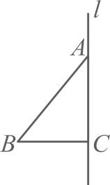
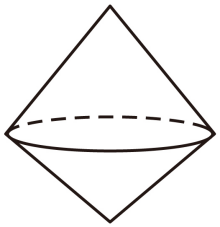
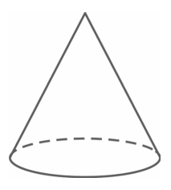
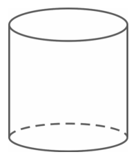
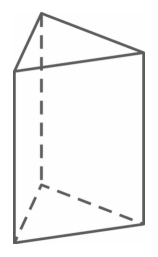
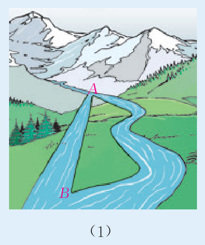
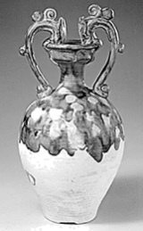
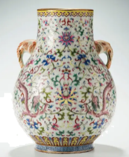
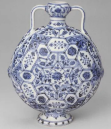
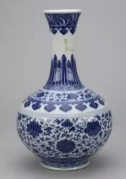

# 第六章 几何图形初步 · 练习

## 讲义用题

### Q-MATH-GZ2023-02

```yaml
id: Q-MATH-GZ2023-02
category: 真题
source: 2023年广东广州中考数学第2题，解析版PDF第1–2页
source_quality: 解析版，待原卷核对
kp: MATH-7A-06-1b
type: 选择
grading: 自动
answer_by: 原卷解析
review:
  概念: MATH-7A-06-1b
  审题: MATH-7A-06-1b
```

**题干**

一个几何体的三视图如图所示，则它表示的几何体可能是（　　）


A. 
B. 
C. 
D. 

**答案**

D

**解析**

1. 由主视图和左视图可知，该几何体上方为圆锥、下方为圆柱。
2. 由俯视图可知，圆锥底面与圆柱底面完全重合。
3. 综合判断，该几何体是圆柱上方正中放置一个同底圆锥的组合体，故选 D。

### Q-MATH-GZ2025-02

```yaml
id: Q-MATH-GZ2025-02
category: 真题
source: 2025年广东省广州市中考数学第2题，解析版PDF第1–2页
source_quality: 解析版，待原卷核对
kp: MATH-7A-06-1c
type: 选择
grading: 自动
answer_by: 原卷解析
review:
  概念: MATH-7A-06-1c
  审题: MATH-7A-06-1c
```

**题干**

如图，将 $\mathrm{Rt}\triangle ABC$ 绕直角边 $AC$ 所在直线旋转一周，可以得到的立体图形是（   ）



A. 
B. 
C. 
D. 

**答案**

B

**解析**

1. 直角三角形绕一条直角边所在的直线旋转一周后，所得到的几何体是一个圆锥。
2. 旋转轴为直角边 $AC$，底面是以直角边 $BC$ 为半径的圆。
3. 对照各选项图形，选项 B 为圆锥，故选 B。

### Q-MATH-TB7A-6.2-6

```yaml
id: Q-MATH-TB7A-6.2-6
category: 课本习题
source: 课本习题6.2第6题，印刷p.167（PDF页序索引173，第174页）
source_quality: 课本原文
kp: MATH-7A-06-2b
do: 本章只做第（1）问
other_parts: 第（2）问结合生活经验体会游览路线长度，供阅读思考，不另作考查
type: 解答
grading: 自评
answer_by: 本项目编写，待复核
review:
  概念: MATH-7A-06-2b
  审题: MATH-7A-06-2b
```

**题干**

（1）如图（1），把原来弯曲的河道改直，$A$，$B$ 两地间的河道长度有什么变化？



**答案**

$A$、$B$ 两地间的河道长度变短。

**解析**

1. 两点的所有连线中，线段最短（两点之间，线段最短）。
2. 原来弯曲的河道是曲线，改直后的河道是连接 $A$、$B$ 两点的线段。
3. 因此，改直后河道长度变短。

### Q-MATH-TB7A-6.2-5

```yaml
id: Q-MATH-TB7A-6.2-5
category: 课本习题
source: 课本习题6.2第5题，印刷p.167（PDF页序索引173，第174页）
source_quality: 课本原文
kp: MATH-7A-06-2c
type: 选择
grading: 自动
answer_by: 本项目编写，待复核
review:
  概念: MATH-7A-06-2c
  计算: MATH-7A-06-2c
  审题: MATH-7A-06-2c
```

**题干**

已知线段 $AB$，延长 $AB$ 至点 $C$，使 $BC=\frac{1}{3}AB$，$D$ 是线段 $AC$ 的中点，如果 $DC=2$，那么 $AB$ 的长为（　　）

A. 4
B. 3
C. 2
D. 1

**答案**

B

**解析**

1. 设 $AB=x$，由题意可知 $BC=\frac{1}{3}x$。
2. 则 $AC=AB+BC=x+\frac{1}{3}x=\frac{4}{3}x$。
3. 因为 $D$ 是线段 $AC$ 的中点，所以 $DC=\frac{1}{2}AC=\frac{1}{2}\times\frac{4}{3}x=\frac{2}{3}x$。
4. 由 $DC=\textcolor{#287fc4}{2}$ 得 $\frac{2}{3}x=2$，解得 $x=\boxed{3}$，故选 B。

### Q-MATH-TB7A-6.3-9

```yaml
id: Q-MATH-TB7A-6.3-9
category: 课本习题
source: 课本习题6.3第9题，印刷p.178（PDF页序索引184，第185页）
source_quality: 课本原文
kp: MATH-7A-06-3b
type: 解答
grading: 自评
answer_by: 本项目编写，待复核
review:
  概念: MATH-7A-06-3b
  计算: MATH-7A-06-3b
  审题: MATH-7A-06-3b
```

**题干**

已知 $\angle AOB=70^\circ$，以 $OA$ 为边画 $\angle AOC=32^\circ$。求 $\angle BOC$ 的度数。

**答案**

$\angle BOC$ 的度数为 $\boxed{38^\circ\text{ 或 }102^\circ}$。

**解析**

1. 当射线 $OC$ 在 $\angle AOB$ 的内部时，$\angle BOC=\angle AOB-\angle AOC=\textcolor{#287fc4}{70^\circ}-\textcolor{#287fc4}{32^\circ}=38^\circ$。
2. 当射线 $OC$ 在 $\angle AOB$ 的外部时，$\angle BOC=\angle AOB+\angle AOC=\textcolor{#287fc4}{70^\circ}+\textcolor{#287fc4}{32^\circ}=102^\circ$。
3. 综上所述，$\angle BOC$ 的度数为 $\boxed{38^\circ\text{ 或 }102^\circ}$。

### Q-MATH-TB7A-6.3-4

```yaml
id: Q-MATH-TB7A-6.3-4
category: 课本习题
source: 课本习题6.3第4题，印刷p.178（PDF页序索引184，第185页）
source_quality: 课本原文
kp: MATH-7A-06-3c
type: 解答
grading: 自评
answer_by: 本项目编写，待复核
review:
  概念: MATH-7A-06-3c
  计算: MATH-7A-06-3c
  审题: MATH-7A-06-3c
```

**题干**

一个角的补角是 $150^\circ$，这个角的余角是多少度？

**答案**

这个角的余角是 $\boxed{60^\circ}$。

**解析**

1. 设这个角为 $\angle \alpha$。
2. 因为 $\angle \alpha$ 的补角是 $150^\circ$，所以 $\angle \alpha=180^\circ-\textcolor{#287fc4}{150^\circ}=30^\circ$。
3. 所以这个角的余角为 $90^\circ-\angle \alpha=90^\circ-\textcolor{#287fc4}{30^\circ}=\boxed{60^\circ}$。

## 备选题目

### Q-MATH-SZ2022-02

```yaml
id: Q-MATH-SZ2022-02
category: 真题
source: 2022年广东省深圳市中考数学第2题，回忆版解析PDF第1页
source_quality: 回忆版，待原卷核对
kp: MATH-7A-06-1b
type: 选择
grading: 自动
answer_by: 原卷解析
review:
  概念: MATH-7A-06-1b
  审题: MATH-7A-06-1b
```

**题干**

下列图形中，主视图和左视图一样的是（    ）

A. 
B. 
C. 
D. 

**答案**

D

**解析**

1. 选项 A、B、C 中的器皿均带有双耳或单侧手柄，从正面和左面观察所见的侧耳形状不同，主视图和左视图不相同。
2. 选项 D 中的瓷瓶为轴对称旋转体，表面无突出的手柄或把手，从正面和左面观察看到的平面轮廓完全相同。
3. 因此主视图和左视图相同的是 D，故选 D。
