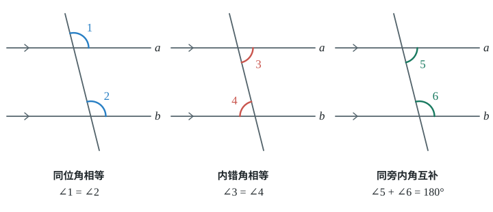
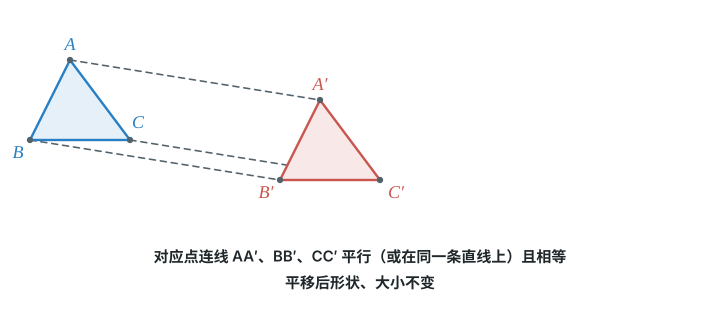

# 第柒章 相交线与平行线

在同一平面内，不重合的两条直线只有相交与平行两种位置关系。相交时看对顶角与邻补角，垂直是特殊的相交；平行时先用角判定平行，再由平行求角。平移则沿着确定的方向移动图形，大小和形状都不改变。

## 本章前置自查

1. 能指出角的顶点与两条边，并进行角度计算吗？不能：先回看角的度量。
2. 能判断两个角是否互余或互补吗？不能：先回看余角与补角。
3. 能分清直线、射线和线段的特征吗？不能：先回看线段、射线、直线。

## 7.1a 邻补角与对顶角

```yaml
id: MATH-7B-07-1a
title: 邻补角与对顶角
weight: 一般
weight_note: 九套卷直接命中1次，为邻补角求角度填空；难度低，保留基础辨认和求角度，不因几何综合题出现对顶角而加计。
textbook: 七下 7.1，印刷p.2–3
prerequisites:
- id: MATH-7A-06-3c
  strength: hard
  reason: 邻补角首先是互补的两个角，需要已知补角关系。
evidence:
- 读后自评：能根据公共顶点和边的位置辨认邻补角与对顶角，并说出它们的度数关系。
- 练习验证：能根据已知角求出邻补角的度数。
figure: 可选·几何图：两条直线相交成四个角，标注邻补角与对顶角。
method: [MG16 数形结合]
sources:
- 课本7.1.1原页，印刷p.2–3
- GZ2025-11
```

### 本次只学

认清相交线形成的邻补角与对顶角，并根据已知角求其他角的度数。

### 先认住

- 有一条公共边，另一边互为反向延长线的两个角互为邻补角；邻补角互补（两角之和为 $180^\circ$）。
- 有一个公共顶点，且两边互为反向延长线的两个角互为对顶角；对顶角相等。
- 两条直线相交成四个角，只要知道一个角的度数，其余三个角的度数都能算出。

### 数形结合

```bridge
mode: cards
式: 对顶角相等
图: ang-vert
形: 剪刀形的两个对顶角，度数相等
色: blue
---
式: 邻补角之和 $=180^\circ$
图: ang-supp
形: 一条直线被射线分成的相邻两角，合起来是平角
色: green
```

### 容易错

- 两个角互补且有公共边，但另一边不在同一条直线上，误当成邻补角。
- 两个角相等且有公共顶点，但两边不互为反向延长线，误当成对顶角。

### 练一练

- `Q-MATH-GZ2025-11`

## 7.1b 垂线与点到直线的距离

```yaml
id: MATH-7B-07-1b
title: 垂线与点到直线的距离
weight: 了解
weight_note: 九套卷无本节范围内的独立主要考点；垂线、垂线段最短和点到直线距离合讲，后续全等、圆和三角函数题不反向累计。
textbook: 七下 7.1，印刷p.3–7
prerequisites:
- id: MATH-7A-06-2a
  strength: hard
  reason: 必须能区分直线、射线和线段，才能理解垂线与垂线段。
- id: MATH-7A-06-3a
  strength: hard
  reason: 用相交形成直角判断两条直线是否垂直。
- id: MATH-7B-07-1a
  strength: soft
  reason: 垂直时四个角都是直角，可用相交线的角关系检查。
evidence:
- 能说出垂线的基本事实与垂线段最短的性质。
- 能指出点到直线的距离是垂线段的长度。
figure: 可选·几何图：直线外一点向直线引垂线段与斜线段，标注直角与线段长短。
method: []
sources:
- 课本7.1.2原页，印刷p.3–7
```

### 本次只学

认清两条直线互相垂直、垂线段最短以及点到直线的距离。

### 先认住

- 两条直线相交所成的四个角中有一个角是直角时，两直线互相垂直，记作 $a \perp b$。
- 在同一平面内，过一点有且只有一条直线与已知直线垂直。
- 连接直线外一点与直线上各点的线段中，垂线段最短；直线外一点到这条直线的垂线段的长度，叫作点到直线的距离。

## 7.1c 同位角、内错角、同旁内角

```yaml
id: MATH-7B-07-1c
title: 同位角、内错角、同旁内角
weight: 了解
weight_note: 九套卷无单独辨认三类角的位置的题；位置辨认是平行线判定和性质的前置，短讲清楚，不与平行线求角度重复计次。
textbook: 七下 7.1，印刷p.7–9
prerequisites:
- id: MATH-7A-06-3a
  strength: hard
  reason: 必须识别角的顶点和边，才能比较截线形成的角的位置。
- id: MATH-7B-07-1a
  strength: soft
  reason: 比较不同角的位置时，可借对顶角和邻补角定位。
evidence:
- 能在“三线八角”中准确找出同位角、内错角和同旁内角。
figure: 可选·几何图：“三线八角”标准图，分别标出三类角相对于被截直线和截线的位置。
method: []
sources:
- 课本7.1.3原页，印刷p.7–9
```

### 本次只学

在两条直线被第三条直线所截形成的八个角中，分清三类角的位置特征。

### 先认住

- 找角先找截线：同位角在截线的同侧、被截两直线的同一方。
- 内错角在被截两直线之间、截线的两侧。
- 同旁内角在被截两直线之间、截线的同侧。

## 7.2a 平行线概念与基本事实

```yaml
id: MATH-7B-07-2a
title: 平行线概念与基本事实
weight: 了解
weight_note: 九套卷无独立主要考点；讲清同一平面、过直线外一点的平行线唯一，以及平行关系的传递，不按所有平行图形加计。
textbook: 七下 7.2，印刷p.11–13
prerequisites:
- id: MATH-7A-06-2a
  strength: hard
  reason: 平行研究的是同一平面内两条直线的位置关系。
evidence:
- 能说出同一平面内不重合两直线的位置关系。
- 能记住平行公理并运用平行的传递性。
figure: 可选·几何图：过直线外一点画平行线，以及两条直线平行于同一直线的图示。
method: []
sources:
- 课本7.2.1原页，印刷p.11–13
```

### 本次只学

认清平行的概念，掌握平行公理及其推论。

### 先认住

- 在同一平面内，不重合的两条直线只有两种位置关系：相交与平行；不相交的两条直线互相平行，记作 $a \parallel b$。
- 基本事实（平行公理）：过直线外一点有且只有一条直线与这条直线平行。
- 平行公理推论：如果两条直线都与第三条直线平行，那么这两条直线也互相平行。

## 7.2b 用角的关系判定平行

```yaml
id: MATH-7B-07-2b
title: 用角的关系判定平行
weight: 了解
weight_note: 九套卷未找到以判定平行为主要目标的独立小问；与由平行求角的性质区分，证明综合题中间步骤不计。
textbook: 七下 7.2，印刷p.13–15
prerequisites:
- id: MATH-7B-07-1c
  strength: hard
  reason: 使用判定前必须认对同位角、内错角或同旁内角。
- id: MATH-7B-07-2a
  strength: hard
  reason: 判定的结论是两条直线平行。
evidence:
- 能根据角的关系选用同位角、内错角或同旁内角判定两直线平行。
- 能用“角的关系推出平行”写出简单的推理步骤。
figure: 可选·几何图：分别标出判定平行的三种角关系图示。
method: []
sources:
- 课本7.2.2原页，印刷p.13–15
```

### 本次只学

掌握根据角的关系判定两条直线平行的三种方法。

### 先认住

- 两条直线被第三条直线所截，如果同位角相等，那么这两条直线平行（同位角相等，两直线平行）。
- 两条直线被第三条直线所截，如果内错角相等，那么这两条直线平行（内错角相等，两直线平行）。
- 两条直线被第三条直线所截，如果同旁内角互补，那么这两条直线平行（同旁内角互补，两直线平行）。

## 7.2c 用平行线性质求角度

```yaml
id: MATH-7B-07-2c
title: 用平行线性质求角度
weight: 一般
weight_note: 九套卷直接命中7次，覆盖2022—2024三年；均为常规选择或填空，虽常见但步骤短，不升为重点，避免把性质误当判定。
textbook: 七下 7.2，印刷p.15–21
prerequisites:
- id: MATH-7B-07-1c
  strength: hard
  reason: 必须识别被平行线和截线形成的三类角。
- id: MATH-7B-07-2a
  strength: hard
  reason: 必须先确认题目给出的平行条件才能使用性质。
- id: MATH-7B-07-1a
  strength: soft
  reason: 有的求角题需要再借邻补角或对顶角换角。
evidence:
- 练习验证：能在已知两直线平行时，用同位角相等求出未知角。
- 读后自评：能说出三类角的度数关系，并分清平行线的“性质”与“判定”。
figure: 已完成 figures/parallel-angles-7-2c.svg（手写 SVG，三类角与度数关系，放在先认住之后）
method: [MG16 数形结合]
sources:
- 课本7.2.3原页，印刷p.15–21
- GD2022-04, GD2023-04, GD2024-04, GZ2024-11, SZ2022-07, SZ2023-07, SZ2024-05
```

### 本次只学

根据两直线平行的条件，利用同位角相等、内错角相等或同旁内角互补求角的度数。

### 先认住

- 两条平行直线被第三条直线所截，同位角相等（两直线平行，同位角相等）。
- 两条平行直线被第三条直线所截，内错角相等（两直线平行，内错角相等）。
- 两条平行直线被第三条直线所截，同旁内角互补（两直线平行，同旁内角互补）。



### 数形结合

```bridge
mode: cards
式: 同位角相等、内错角相等
图: par-corr
形: 图中有两直线平行
色: blue
---
式: 同旁内角之和 $=180^\circ$
图: par-sameside
形: 图中有两直线平行
色: green
```

### 容易错

- 题目还没给出平行条件，就直接根据位置断定同位角或内错角相等。
- 把“已知平行推角相等（性质）”与“已知角相等推平行（判定）”的因果关系搞反。

### 练一练

- `Q-MATH-GD2022-04`

## 7.3a 命题的题设、结论与真假

```yaml
id: MATH-7B-07-3a
title: 命题的题设、结论与真假
weight: 了解
weight_note: 九套卷无以命题结构或反例辨认为主要考点的题；合讲定义、命题、真假、反例、定理与证明，不把后续图形性质判断题全算进来。
textbook: 七下 7.3，印刷p.22–25
prerequisites:
- id: MATH-7B-07-2b
  strength: soft
  reason: 可用平行线判定说明题设与结论的分工。
- id: MATH-7B-07-2c
  strength: soft
  reason: 可用平行线性质说明真命题及推理过程。
evidence:
- 能找出命题的题设和结论，并改写为“如果……那么……”的形式。
- 能判断命题的真假，并举出反例说明假命题。
figure: 可选·几何图：展示反例图，如角平分线所分两角相等但不是对顶角。
method: []
sources:
- 课本7.3原页，印刷p.22–25
```

### 本次只学

分清命题的题设与结论，理解真命题、假命题、定理与反例。

### 先认住

- 可以判断为正确或错误的陈述语句叫作命题；命题常写成“如果……那么……”的形式，“如果”引出题设，“那么”引出结论。
- 题设成立时结论一定成立的命题是真命题；题设成立但不能保证结论成立的命题是假命题。
- 经过推理证实的真命题叫作定理；说明一个命题是假命题，只要举出一个符合题设但不满足结论的反例。

## 7.4a 平移性质与补画图形

```yaml
id: MATH-7B-07-4a
title: 平移性质与补画图形
weight: 一般
weight_note: 九套卷直接命中2次，分别求平移距离和补画平移后的圆弧；性质和作图合讲，菱形或圆的额外知识不能由本点替代。
textbook: 七下 7.4，印刷p.26–31
prerequisites:
- id: MATH-7B-07-2a
  strength: hard
  reason: 描述对应点连线及对应边平行时需要平行线概念。
evidence:
- 能说出平移不改变图形的形状和大小。
- 能按同一方向、同一距离确定对应点，画出平移后的图形。
figure: 已完成 figures/translation-7-4a.svg（手写 SVG，原图形、对应点连线及新图形，放在先认住之后）
method: [MG16 数形结合]
sources:
- 课本7.4原页，印刷p.26–31
- GZ2023-19(2), SZ2023-05
```

### 本次只学

掌握平移的性质，并能根据平移方向和距离画出平移后的图形。

### 先认住

- 在平面内，将一个图形按某一方向移动一定的距离，叫作图形的平移。
- 平移不改变图形的形状和大小，平移后的新图形与原图形完全相同。
- 连接各组对应点的线段平行（或在同一条直线上）且相等。



### 数形结合

```bridge
mode: cards
式: 对应点连线平行（或在同一条直线上）且相等
图: translate-tri
形: 图形沿同一方向移动同一距离
色: blue
```

### 容易错

- 误认为平移只能水平或竖直移动，实际上平移可以沿平面内任意方向进行。
- 画平移图形时漏连对应点，或各组对应点移动的距离不一致。

### 练一练

这道题要先会读写坐标和描点。学完“平面直角坐标系”的这些内容，再回来画图。

- `Q-MATH-GZ2023-19-2`
