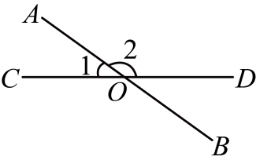
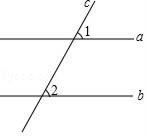
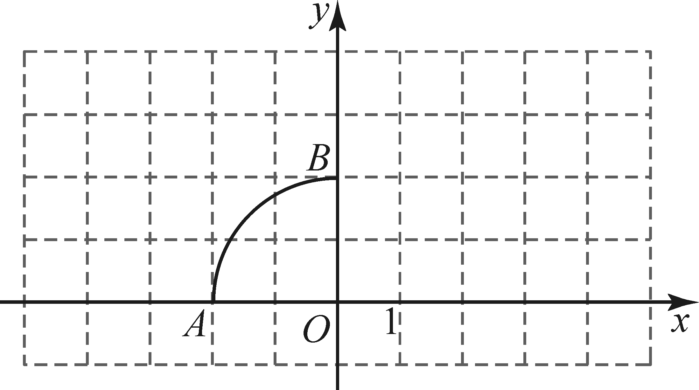
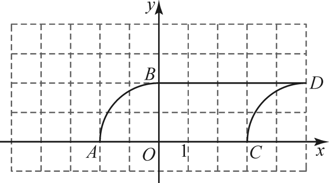
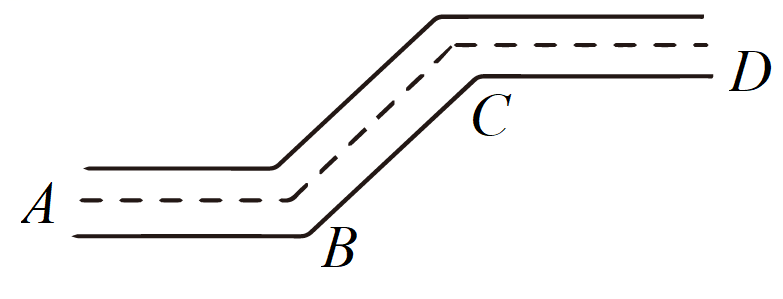
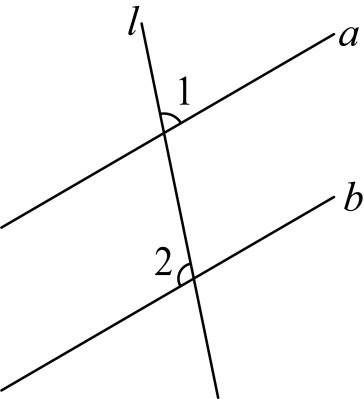
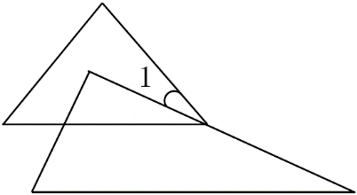
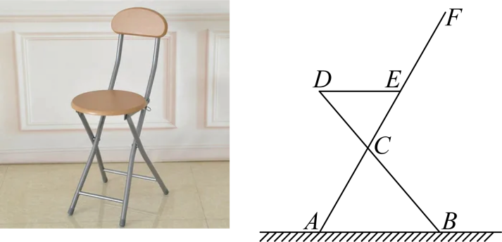

# 第柒章 相交线与平行线 · 练习

## 讲义用题

### Q-MATH-GZ2025-11

```yaml
id: Q-MATH-GZ2025-11
category: 真题
source: 2025年广东省广州市中考数学真题，第11题
source_quality: 原卷
kp: MATH-7B-07-1a
type: 填空
grading: 自评
answer_by: 原卷解析
review:
  概念: MATH-7B-07-1a
  计算: MATH-7B-07-1a
```

**题干**

如图，直线 $AB$，$CD$ 相交于点 $O$。若 $\angle 1 = 36^\circ$，则 $\angle 2$ 的度数为___°。



**答案**

$\boxed{144}$

**解析**

1. 直线 $AB$，$CD$ 相交于点 $O$，$\angle 1$ 与 $\angle 2$ 互为邻补角。
2. $\angle 2 = 180^\circ - \angle 1 = 180^\circ - \textcolor{#287fc4}{36^\circ} = \boxed{144^\circ}$。

### Q-MATH-GD2022-04

```yaml
id: Q-MATH-GD2022-04
category: 真题
source: 2022年广东省中考数学真题，第4题
source_quality: 原卷
kp: MATH-7B-07-2c
type: 选择
grading: 自动
answer_by: 原卷解析
review:
  概念: MATH-7B-07-2c
  审题: MATH-7B-07-2c
```

**题干**

如图，直线 $a$，$b$ 被直线 $c$ 所截，$a\parallel b$，$\angle 1=40^\circ$，则 $\angle 2$ 等于（ ）



A. $30^\circ$  
B. $40^\circ$  
C. $50^\circ$  
D. $60^\circ$

**答案**

B

**解析**

1. 直线 $a \parallel b$（已知），直线 $c$ 是截线。
2. $\angle 2 = \angle 1 = \textcolor{#287fc4}{40^\circ}$（两直线平行，同位角相等）。
3. 故选 B。

### Q-MATH-GZ2023-19-2

```yaml
id: Q-MATH-GZ2023-19-2
category: 真题
source: 2023年广东广州中考数学真题，第19题第（2）问
source_quality: 原卷
kp: MATH-7B-07-4a
do: 本章只做第（2）问
other_parts:
  - 第（1）问属平面直角坐标系，本章保留原题但不单独作答。
  - 第（3）问属弧长与勾股定理，已在圆那一章单独作答；本题只按第（2）问自评。
type: 作图
grading: 自评
answer_by: 原卷解析
review:
  概念: MATH-7B-07-4a
  审题: MATH-7B-07-4a
```

**题干**

如图，在平面直角坐标系中，点 $A(-2,0)$，$B(0,2)$，$\widehat{AB}$ 所在圆的圆心为 $O$。将 $\widehat{AB}$ 向右平移 $5$ 个单位，得到 $\widehat{CD}$（点 $A$ 平移后的对应点为 $C$）。



（1）点 $D$ 的坐标是________，$\widehat{CD}$ 所在圆的圆心坐标是________；

（2）在图中画出 $\widehat{CD}$，并连接 $AC$，$BD$；

（3）求由 $\widehat{AB}$，$BD$，$DC$，$CA$ 首尾依次相接所围成的封闭图形的周长。（结果保留 $\pi$）

**答案**

第（2）问：见解析作图。

**解析**

1. 点 $A(-2,0)$ 向右平移 $5$ 个单位得到对应点 $C(3,0)$，点 $B(0,2)$ 向右平移 $5$ 个单位得到对应点 $D(5,2)$（各点沿同一方向移动同一距离）。
2. 圆心 $O(0,0)$ 向右平移 $5$ 个单位得到对应圆心 $(5,0)$。
3. 以点 $(5,0)$ 为圆心、$2$ 为半径画弧 $\widehat{CD}$，并连接线段 $AC$ 与 $BD$。
4. 作图如图所示：



## 备选

### Q-MATH-GD2023-04

```yaml
id: Q-MATH-GD2023-04
category: 真题
source: 2023年广东省中考数学真题，第4题
source_quality: 原卷
kp: MATH-7B-07-2c
type: 选择
grading: 自动
answer_by: 原卷解析
review:
  概念: MATH-7B-07-2c
  审题: MATH-7B-07-2c
```

**题干**

如图，街道 $AB$ 与 $CD$ 平行，拐角 $\angle ABC = 137^\circ$，则拐角 $\angle BCD = $（ ）



A. $43^\circ$  
B. $53^\circ$  
C. $107^\circ$  
D. $137^\circ$

**答案**

D

**解析**

1. 因为 $AB \parallel CD$，拐角 $\angle ABC$ 与 $\angle BCD$ 是内错角。
2. 所以 $\angle BCD = \angle ABC = \textcolor{#287fc4}{137^\circ}$（两直线平行，内错角相等）。
3. 故选 D。

### Q-MATH-GZ2024-11

```yaml
id: Q-MATH-GZ2024-11
category: 真题
source: 2024年广东省广州市中考数学试题，第11题
source_quality: 原卷
kp: MATH-7B-07-2c
type: 填空
grading: 自评
answer_by: 原卷解析
review:
  概念: MATH-7B-07-2c
  计算: MATH-7B-07-2c
```

**题干**

如图，直线 $l$ 分别与直线 $a$，$b$ 相交，$a \parallel b$，若 $\angle 1 = 71^\circ$，则 $\angle 2$ 的度数为___。



**答案**

$\boxed{109^\circ}$

**解析**

1. 设 $\angle 1$ 的同位角为 $\angle 3$，因为 $a \parallel b$，所以 $\angle 3 = \angle 1 = \textcolor{#287fc4}{71^\circ}$（两直线平行，同位角相等）。
2. $\angle 2$ 与 $\angle 3$ 互为邻补角，故 $\angle 2 = 180^\circ - \angle 3 = 180^\circ - \textcolor{#287fc4}{71^\circ} = \boxed{109^\circ}$。

### Q-MATH-GD2024-04

```yaml
id: Q-MATH-GD2024-04
category: 真题
source: 2024年广东省中考数学试卷，第4题
source_quality: 原卷
kp: MATH-7B-07-2c
type: 选择
grading: 自动
answer_by: 原卷解析
review:
  概念: MATH-7B-07-2c
  审题: MATH-7B-07-2c
```

**题干**

如图，一把直尺、两个含 $30^\circ$ 的三角尺拼接在一起，则 $\angle ACE$ 的度数为（ ）


A. $120^\circ$  
B. $90^\circ$  
C. $60^\circ$  
D. $30^\circ$

**答案**

C

**解析**

1. $AC$ 与 $DE$ 都垂直于直尺的同一条边，所以 $AC \parallel DE$。
2. $\angle CED = 90^\circ - \textcolor{#287fc4}{30^\circ} = 60^\circ$（直角三角形的两个锐角互余）。
3. $\angle ACE = \angle CED = \textcolor{#287fc4}{60^\circ}$（两直线平行，内错角相等）。
4. 故选 C。

### Q-MATH-SZ2022-07

```yaml
id: Q-MATH-SZ2022-07
category: 真题
source: 2022年广东省深圳市中考数学真题，第7题
source_quality: 原卷
kp: MATH-7B-07-2c
type: 选择
grading: 自动
answer_by: 原卷解析
review:
  概念: MATH-7B-07-2c
  审题: MATH-7B-07-2c
```

**题干**

将一副三角板如图所示放置，斜边平行，则 $\angle 1$ 的度数为（ ）



A. $5^\circ$  
B. $10^\circ$  
C. $15^\circ$  
D. $20^\circ$

**答案**

C

**解析**

1. 上方三角板右下顶点处的锐角为 $45^\circ$，下方三角板最右端的锐角为 $30^\circ$。
2. 两条水平斜边平行，以下方三角板的上边为截线，上方右下顶点处、截线与水平斜边之间的角为 $30^\circ$（两直线平行，内错角相等）。
3. $\angle 1 = \textcolor{#287fc4}{45^\circ} - \textcolor{#287fc4}{30^\circ} = 15^\circ$。
4. 故选 C。

### Q-MATH-SZ2023-07

```yaml
id: Q-MATH-SZ2023-07
category: 真题
source: 2023年广东省深圳市中考数学真题，第7题
source_quality: 原卷
kp: MATH-7B-07-2c
type: 选择
grading: 自动
answer_by: 原卷解析
review:
  概念: MATH-7B-07-2c
  审题: MATH-7B-07-2c
```

**题干**

如图为商场某品牌椅子侧面图，$\angle DEF = 120^\circ$，$DE$ 与地面平行，$\angle ABD = 50^\circ$，则 $\angle ACB =$（ ）



A. $70^\circ$  
B. $65^\circ$  
C. $60^\circ$  
D. $50^\circ$

**答案**

A

**解析**

先学会三角形外角性质，再做这道备选题。

1. $DE \parallel AB$，所以 $\angle EDC = \angle ABD = \textcolor{#287fc4}{50^\circ}$（两直线平行，内错角相等）。
2. $\angle DEF = \angle EDC + \angle DCE$（三角形的一个外角等于与它不相邻的两个内角之和）。
3. $\angle DCE = \textcolor{#287fc4}{120^\circ} - \textcolor{#287fc4}{50^\circ} = 70^\circ$。
4. $\angle ACB = \angle DCE = \textcolor{#287fc4}{70^\circ}$（对顶角相等）。
5. 故选 A。

### Q-MATH-SZ2024-05

```yaml
id: Q-MATH-SZ2024-05
category: 真题
source: 2024年广东省深圳市中考数学试题，第5题
source_quality: 原卷
kp: MATH-7B-07-2c
type: 选择
grading: 自动
answer_by: 原卷解析
review:
  概念: MATH-7B-07-2c
  审题: MATH-7B-07-2c
```

**题干**

如图，一束平行光线照射平面镜后反射，若入射光线与平面镜夹角 $\angle 1 = 50^\circ$，则反射光线与平面镜夹角 $\angle 4$ 的度数为（ ）


A. $40^\circ$  
B. $50^\circ$  
C. $60^\circ$  
D. $70^\circ$

**答案**

B

**解析**

1. 平行光线照射平面镜反射，根据法线垂直与反射角等于入射角得反射光线与镜面夹角为 $50^\circ$。
2. 平行线同位角相等，得 $\angle 4 = \textcolor{#287fc4}{50^\circ}$。
3. 故选 B。
