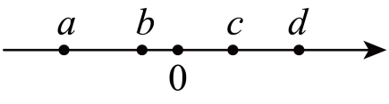

# 第八章 实数 · 练习

## 讲义用题

### Q-MATH-GD2024-07

```yaml
id: Q-MATH-GD2024-07
category: 真题
source: 2024年广东省中考数学试卷第7题
source_quality: 原卷
kp: MATH-7B-08-1b
type: 选择
grading: 自动
answer_by: 原卷解析
review:
  概念: MATH-7B-08-1b
  公式: MATH-7B-08-1b
  单位: MATH-7B-08-1b
  计算: MATH-7B-08-1b
  审题: MATH-7B-08-1b
  前置: MATH-7B-08-1a
```

**题干**

完全相同的4个正方形面积之和是100，则正方形的边长是（    ）

A. 2
B. 5
C. 10
D. 20

**答案**

B

**解析**

1. 依题意，每个正方形的面积为 $\textcolor{#287fc4}{100}\div\textcolor{#287fc4}{4}=25$。
2. 设正方形的边长为 $a$，则 $a^2=25$。
3. 因为边长为正数，所以边长为 $\sqrt{25}=\textcolor{#287fc4}{5}$。
4. 故选 $\boxed{\text{B}}$。

### Q-MATH-GZ2025-01

```yaml
id: Q-MATH-GZ2025-01
category: 真题
source: 2025年广东省广州市中考数学真题第1题
source_quality: 原卷
kp: MATH-7B-08-3a
type: 选择
grading: 自动
answer_by: 原卷解析
review:
  概念: MATH-7B-08-3a
  公式: MATH-7B-08-3a
  单位: MATH-7B-08-3a
  计算: MATH-7B-08-3a
  审题: MATH-7B-08-3a
  前置: MATH-7A-01-2a
```

**题干**

下列四个选项中，负无理数的是（   ）

A. $-\sqrt{2}$
B. $-1$
C. $0$
D. $3$

**答案**

A

**解析**

1. A 选项：$-\sqrt{2}$ 是负数，且 $\sqrt{2}$ 是无限不循环小数，不能表示为两整数之比，因此 $-\sqrt{2}$ 是负无理数，符合题意。
2. B 选项：$-1$ 是负整数，属于有理数，不符合题意。
3. C 选项：$0$ 是整数，属于有理数，既不是正数也不是负数，不符合题意。
4. D 选项：$3$ 是正整数，属于有理数，不符合题意。
5. 故选 $\boxed{\text{A}}$。

### Q-MATH-SZ2024-02

```yaml
id: Q-MATH-SZ2024-02
category: 真题
source: 2024年广东省深圳市中考数学试题第2题
source_quality: 原卷
kp: MATH-7B-08-3b
type: 选择
grading: 自动
answer_by: 原卷解析
review:
  概念: MATH-7B-08-3b
  公式: MATH-7B-08-3b
  单位: MATH-7B-08-3b
  计算: MATH-7B-08-3b
  审题: MATH-7B-08-3b
  前置: MATH-7A-01-2c
```

**题干**

如图，实数$a$，$b$，$c$，$d$在数轴上表示如下，则最小的实数为（    ）



A. $a$
B. $b$
C. $c$
D. $d$

**答案**

A

**解析**

1. 由数轴上各点的位置可知，从左到右依次为 $a<b<0<c<d$。
2. 在数轴上表示的数，右边的数总比左边的大，因此最左侧的点表示的数最小。
3. 所以最小的实数为 $a$。
4. 故选 $\boxed{\text{A}}$。

### Q-MATH-GD2023-16-1

```yaml
id: Q-MATH-GD2023-16-1
category: 真题
source: 2023年广东省中考数学真题第16题第（1）问
source_quality: 原卷
kp: MATH-7B-08-3c
do: 本章只做第（1）问
other_parts: 第（2）问为一次函数待定系数法，归入 MATH-8B-23-2b
type: 解答
grading: 自评
answer_by: 原卷解析
review:
  概念: MATH-7B-08-3c
  公式: MATH-7B-08-3c
  单位: MATH-7B-08-3c
  计算: MATH-7B-08-3c
  审题: MATH-7B-08-3c
  前置: MATH-7A-02-3a
```

**题干**

（1）计算：$\sqrt[3]{8}+|-5|+(-1)^{2023}$；

（2）已知一次函数 $y=kx+b$ 的图象经过点 $(0,1)$ 与点 $(2,5)$，求该一次函数的表达式。

**答案**

第（1）问 $\boxed{6}$。

**解析**

1. $\sqrt[3]{8}=\textcolor{#287fc4}{2}$（求立方根）。
2. $|-5|=\textcolor{#287fc4}{5}$（求绝对值）。
3. $(-1)^{2023}=\textcolor{#287fc4}{-1}$（有理数的乘方，负数的奇次幂为负）。
4. 原式 $=\textcolor{#287fc4}{2}+\textcolor{#287fc4}{5}+(\textcolor{#287fc4}{-1})=\boxed{6}$。
