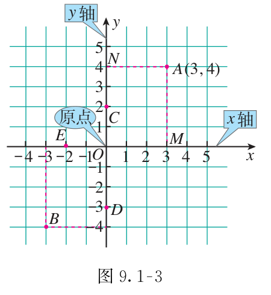
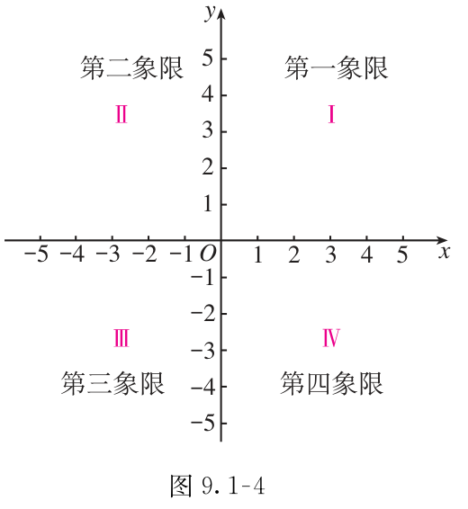
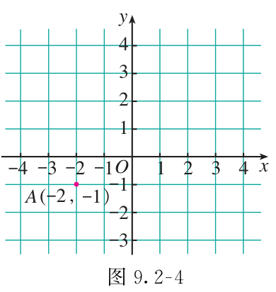
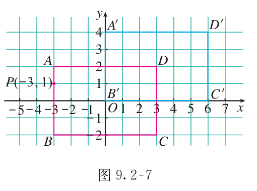

# 第九章 平面直角坐标系

平面直角坐标系架起了数与形之间的桥梁。利用水平与竖直两条数轴，平面内的任意一点都可以用一个有序实数对确定下来；反过来，也可以通过坐标研究几何图形的位置与平移规律。

## 本章前置自查

1. 能在数轴上找出实数对应的点，并读出点表示的数吗？不能：先回看七上数轴。
2. 能说出图形平移时对应点连线的平行与相等关系吗？不能：先回看七下平移的性质。

## 9.1a 读写坐标、象限与描点

```yaml
id: MATH-7B-09-1a
title: 读写坐标、象限与描点
weight: 一般
weight_note: 九套卷直接命中1次，为按表中坐标描点的独立小问；坐标轴上的点与横纵顺序易混，函数求式和绘制完整函数图象不加计。
textbook: 七下 9.1，印刷p.64–66
prerequisites:
- id: MATH-7A-01-2a
  strength: hard
  reason: 必须认识数轴的原点、方向和单位长度，才能建立两条坐标轴。
- id: MATH-7B-08-3b
  strength: soft
  reason: 可借实数与数轴的一一对应理解坐标；描整数坐标不必先学实数的扩展。
evidence:
- 能根据点的坐标在平面直角坐标系中描出点的位置。
- 讲解后自评：能读出给定点的横、纵坐标，并判断所在象限或坐标轴。
figure: 已完成 figures/tb7b-9-1-fig9-1-3.png、figures/tb7b-9-1-fig9-1-4.png（课本图9.1-3、9.1-4原图，分别放在坐标读法、象限之后）
method: [MG16 数形结合]
sources:
- 课本9.1.1节原页，印刷p.64–66
- GZ2024-23(1)
```

### 本次只学

认识平面直角坐标系，学会读写点的坐标、辨认所在象限，以及按坐标描点。

### 先认住

在平面内画两条互相垂直、原点重合的数轴，组成平面直角坐标系。水平数轴称为 $x$ 轴（横轴），向右为正方向；竖直数轴称为 $y$ 轴（纵轴），向上为正方向；两轴交点 $O$ 称为坐标原点。

坐标平面内任意一点 $P$，由点 $P$ 向 $x$ 轴作垂线，垂足在 $x$ 轴上的实数称为横坐标；向 $y$ 轴作垂线，垂足在 $y$ 轴上的实数称为纵坐标。有序实数对 $(x,y)$ 叫作点 $P$ 的坐标，横坐标写在前面，纵坐标写在后面。



两根坐标轴将平面分成四个象限（按逆时针方向）：第一象限 $(+,+)$、第二象限 $(-,+)$、第三象限 $(-,-)$、第四象限 $(+,-)$。坐标轴上的点不属于任何象限；$x$ 轴上的点纵坐标为 $0$，坐标为 $(x,0)$；$y$ 轴上的点横坐标为 $0$，坐标为 $(0,y)$；原点坐标为 $(0,0)$。



### 数形结合

```bridge
mode: cards
式: $(x,y)$ 的正负号
图: quadrants
形: 判断点落在第几象限，或哪条坐标轴上
色: blue
结: 由点分别向两条坐标轴引垂线，垂足在数轴上的读数就是该点的坐标。
```

### 容易错

颠倒横纵坐标顺序：点 $(x,y)$ 的横坐标必须写在前、纵坐标写在后，把点 $(3,2)$ 错标到 $(2,3)$。

混淆坐标轴上点的坐标特征：误以为 $x$ 轴上的点横坐标为 $0$，记住“在谁轴上谁不为零（原点除外），另一轴坐标必为 $0$”。

### 练一练

- `Q-MATH-GZ2024-23-1` 第（1）问

## 9.1b 建系描述简单几何图形

```yaml
id: MATH-7B-09-1b
title: 建系描述简单几何图形
weight: 了解
weight_note: 九套卷无以建系描述简单几何图形为独立主要目标的题；保留选原点、坐标轴和单位长度，隧道抛物线建模等综合题不加计。
textbook: 七下 9.1，印刷p.67–71
prerequisites:
- id: MATH-7B-09-1a
  strength: hard
  reason: 建系后必须能读写顶点坐标并描点连线。
evidence:
- 能根据简单图形的边长与对称性选择恰当位置建立直角坐标系，并写出各顶点坐标。
figure: 可选·几何图：长方形在不同建系方案下的顶点坐标对比（如以长方形左下顶点为原点，与以中心为原点）。课本图 9.1-6、9.1-7，印刷p.67–68。
method: [MG16 数形结合]
sources:
- 课本9.1.2节原页，印刷p.67–71
```

### 本次只学

学会建立适当的平面直角坐标系，用坐标表示简单几何图形的位置与形状。

### 先认住

建立平面直角坐标系时，要考虑图形的形状特征，方便写出图形上各点的坐标。

正方形可以以一个顶点为原点、两条相邻边所在直线为坐标轴；也可以以一条边的中点为原点、这条边所在直线为 $x$ 轴，过中点且垂直于这条边的直线为 $y$ 轴。

同一几何图形在不同的坐标系中，各顶点的坐标可能不同，但图形本身的形状和边长大小不变。

### 数形结合

```bridge
mode: cards
式: $|x_1-x_2|$
图: coord-hseg
形: 平行于 $x$ 轴的线段，长等于两端点横坐标差的绝对值
色: blue
结: 补充（课本没有讲，做真题时常用）：平行于 $y$ 轴时，取纵坐标差的绝对值。
```

## 9.2a 用坐标表示地理位置

```yaml
id: MATH-7B-09-2a
title: 用坐标表示地理位置
weight: 了解
weight_note: 九套卷无以坐标定位为主要目标的独立题；地理方位情境中的三角函数测距不计，简讲比例尺、原点和方位统一。
textbook: 七下 9.2，印刷p.72–74
prerequisites:
- id: MATH-7B-09-1a
  strength: hard
  reason: 必须能按坐标确定地点并从图上读回坐标。
- id: MATH-7B-09-1b
  strength: soft
  reason: 可借建系经验选择原点、方向与单位长度。
evidence:
- 能根据实际地点的相对位置建立坐标系，用坐标表示地理位置。
figure: 可选·几何图：以参照物为原点、正东正北为坐标轴的地理平面图及各地点坐标。课本图 9.2-1，印刷p.72。
sources:
- 课本9.2.1节原页，印刷p.72–74
```

### 本次只学

了解利用平面直角坐标系绘制地点分布图的过程，以及用方向和距离表示物体位置的方法。

### 先认住

用坐标表示地理位置的过程：选择一个恰当的参照点作为原点；通常取正东方向为 $x$ 轴正方向、正北方向为 $y$ 轴正方向；根据实际距离与图幅大小确定单位长度（比例尺）；在平面图上标出各地点并写出坐标。

用表示方向的角和距离也能确定位置。例如在航海中，以遇险船为参照，救生船在北偏东 $60^\circ$、距离 $35\ \mathrm{n\ mile}$ 处，就能确定救生船的位置。

## 9.2b 用坐标表示平移

```yaml
id: MATH-7B-09-2b
title: 用坐标表示平移
weight: 一般
weight_note: 九套卷直接命中2次，为点及圆心平移后的坐标；横纵坐标变化与方向容易混，抛物线解析式的平移不反向累计。
textbook: 七下 9.2，印刷p.74–81；7.4，印刷p.27（平移性质）
prerequisites:
- id: MATH-7B-09-1a
  strength: hard
  reason: 必须分清横坐标和纵坐标，才能写出变化后的坐标。
- id: MATH-7B-07-4a
  strength: hard
  reason: 对应点必须沿相同方向移动相同距离。
evidence:
- 能根据平移的方向和距离，由原坐标求出平移后对应点的坐标。
- 讲解后自评：能由对应点坐标的增减说出平移方向与距离。
figure: 已完成 figures/tb7b-9-2-fig9-2-4.png、figures/tb7b-9-2-fig9-2-7.png（课本图9.2-4、9.2-7原图，分别放在点平移、图形平移规律之后）
method: [MG16 数形结合]
sources:
- 课本9.2.2节原页，印刷p.74–81
- 课本7.4节原页，印刷p.27（平移性质）
- GD2022-06
- GZ2023-19(1)
```

### 本次只学

掌握点和图形在平面直角坐标系中平移时的坐标变化规律，并能由坐标变化判断平移。

### 先认住

点平移的坐标变化规律：点 $(x,y)$ 向右平移 $a$ 个单位长度得到 $(x+a,y)$，向左平移 $a$ 个单位长度得到 $(x-a,y)$；向上平移 $b$ 个单位长度得到 $(x,y+b)$，向下平移 $b$ 个单位长度得到 $(x,y-b)$（其中 $a>0, b>0$）。



简记口诀：“左减右加横坐标，下减上加纵坐标”。水平方向只改变横坐标，竖直方向只改变纵坐标；两个方向互不干扰。

图形平移的坐标变化规律：把一个图形平移，图形上所有点的坐标都按同一种规律变化；对应点的连线平行（或在同一直线上）且相等，平移后图形的形状和大小保持不变。



### 数形结合

```bridge
mode: cards
式: $(x,y)\to(x+3,\,y+2)$
图: translate-pt
形: 向右平移 $3$ 个单位，再向上平移 $2$ 个单位
色: blue
结: 横坐标加减决定向右向左平移，纵坐标加减决定向上向下平移。
```

### 容易错

混淆坐标加减与平移方向的对应：误将向左平移算作横坐标相加、向右算作相减，或者把上下平移误记到横坐标上。

图形平移时漏变顶点的某一坐标：多个顶点同时平移时，每个顶点的横坐标与纵坐标都必须同时遵循同一规则运算。

### 练一练

- `Q-MATH-GD2022-06`
