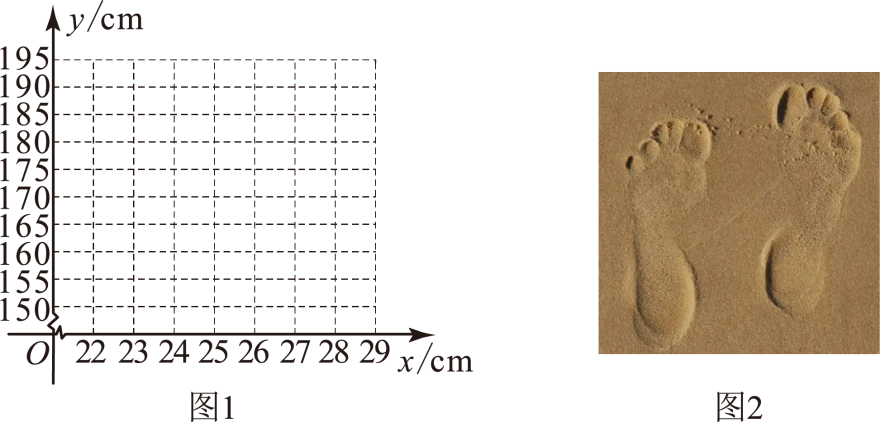
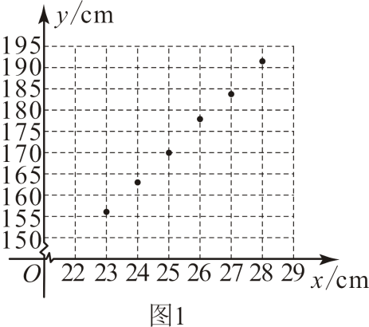

### Q-MATH-GZ2024-23-1

```yaml
id: Q-MATH-GZ2024-23-1
category: 真题
source: 2024年广东省广州市中考数学试题，第23题第（1）问（原卷版Word转PDF第6–7页；解析版PDF第18–19页）
source_quality: 原卷
kp: MATH-7B-09-1a
do: 本章只做第（1）问
other_parts:
  - 第（2）问从待选模型中选择一次函数并求解析式，归入一次函数（MATH-8B-23-2b）。
  - 第（3）问利用一次函数解析式估计身高，归入一次函数实际应用（MATH-8B-23-4a）。
type: 作图
grading: 自评
answer_by: 原卷解析
review:
  概念: MATH-7B-09-1a
  审题: MATH-7B-09-1a
```

**题干**

一个人的脚印信息往往对应着这个人某些方面的基本特征．某数学兴趣小组收集了大量不同人群的身高和脚长数据，通过对数据的整理和分析，发现身高$y$和脚长$x$之间近似存在一个函数关系，部分数据如下表：

| 脚长 $x(\mathrm{cm})$ | $\cdots$ | 23 | 24 | 25 | 26 | 27 | 28 | $\cdots$ |
| :--- | :--- | :--- | :--- | :--- | :--- | :--- | :--- | :--- |
| 身高 $y(\mathrm{cm})$ | $\cdots$ | 156 | 163 | 170 | 177 | 184 | 191 | $\cdots$ |



（1）在图1中描出表中数据对应的点$(x,y)$；

（2）根据表中数据，从$y=ax+b(a\ne 0)$和$y=\frac{k}{x}(k\ne 0)$中选择一个函数模型，使它能近似地反映身高和脚长的函数关系，并求出这个函数的解析式（不要求写出$x$的取值范围）；

（3）如图2，某场所发现了一个人的脚印，脚长约为$25.8\mathrm{cm}$，请根据（2）中求出的函数解析式，估计这个人的身高．

**答案**

第（1）问：见解析描点。

**解析**

1. 依据表格中的对应数据，各点的坐标分别为 $(23, 156)$，$(24, 163)$，$(25, 170)$，$(26, 177)$，$(27, 184)$，$(28, 191)$。
2. 在直角坐标系的横轴上找到脚长 $x$，纵轴上找到对应的身高 $y$，在网格中准确描出各点。
3. 描点如图所示：



### Q-MATH-GD2022-06

```yaml
id: Q-MATH-GD2022-06
category: 真题
source: 2022年广东省中考数学真题，第6题（原卷版Word转PDF第2页；解析版PDF第3页）
source_quality: 原卷
kp: MATH-7B-09-2b
type: 选择
grading: 自动
answer_by: 原卷解析
review:
  概念: MATH-7B-09-2b
  计算: MATH-7B-09-2b
```

**题干**

在平面直角坐标系中，将点$(1,1)$向右平移2个单位后，得到的点的坐标是（    ）

A. $(3,1)$
B. $(-1,1)$
C. $(1,3)$
D. $(1,-1)$

**答案**

A

**解析**

1. 平移的坐标变化规律：点 $(x, y)$ 向右平移 $a$ 个单位长度，得到的对应点坐标为 $(x+a, y)$。
2. 将点 $(1, 1)$ 向右平移 2 个单位，横坐标加 2，纵坐标不变，得到对应点的坐标为 $(1+2, 1) = \boxed{(3, 1)}$。
3. 因此选 A。

## 备选

### Q-MATH-GZ2023-19-1

```yaml
id: Q-MATH-GZ2023-19-1
category: 真题
source: 2023年广东广州中考数学真题，第19题第（1）问
source_quality: 原卷
kp: MATH-7B-09-2b
do: 本章只做第（1）问
other_parts:
  - 第（2）问属平移作图，已在相交线与平行线那一章（MATH-7B-07-4a）单独作答。
  - 第（3）问属弧长与勾股定理，已在圆那一章（MATH-9A-29-3a）单独作答。
type: 填空
grading: 自评
answer_by: 原卷解析
review:
  概念: MATH-7B-09-2b
  审题: MATH-7B-09-2b
```

**题干**

如图，在平面直角坐标系中，点$A(-2,0)$，$B(0,2)$，$\widehat{AB}$所在圆的圆心为$O$．将$\widehat{AB}$向右平移5个单位，得到$\widehat{CD}$（点A平移后的对应点为C）．


（1）点D的坐标是___________，$\widehat{CD}$所在圆的圆心坐标是___________；

（2）在图中画出$\widehat{CD}$，并连接$AC$，$BD$；

（3）求由$\widehat{AB}$，$BD$，$DC$，$CA$首尾依次相接所围成的封闭图形的周长．（结果保留$\pi$）

**答案**

第（1）问：$(5, 2)$，$(5, 0)$

**解析**

1. 点 $B(0, 2)$ 向右平移 5 个单位，横坐标加 5，纵坐标不变，得到点 $D$ 的坐标为 $(0+5, 2) = \boxed{(5, 2)}$。
2. 圆心 $O(0, 0)$ 向右平移 5 个单位，横坐标加 5，纵坐标不变，得到对应圆心坐标为 $(0+5, 0) = \boxed{(5, 0)}$。
