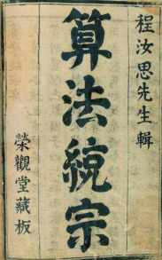

# 第十章 二元一次方程组 · 练习

## 讲义用题

### Q-MATH-TB7B-10.2-2

```yaml
id: Q-MATH-TB7B-10.2-2
category: 课本习题
source: 课本习题10.2第2题，印刷p.99（PDF索引105，显示第106页）
source_quality: 课本原文
kp: MATH-7B-10-2a
type: 计算
grading: 自评
answer_by: 本项目编写，待复核
do: 本章只做第（1）问
other_parts: 第（2）（3）（4）问保留原题，不增加本章练习量。
review:
  概念: MATH-7B-10-2a
  计算: MATH-7A-05-2b
  审题: MATH-7B-10-2a
parts:
- part: '1'
  kp: MATH-7B-10-2a
  review:
    概念: MATH-7B-10-2a
    计算: MATH-7A-05-2b
```

**题干**

用代入法解下列方程组：

（1）$\begin{cases} y=x+3, \\ 7x+5y=9; \end{cases}$

（2）$\begin{cases} 3s-t=5, \\ 5s+2t=15; \end{cases}$

（3）$\begin{cases} 2x+3y=-5, \\ 3x-4y=18; \end{cases}$

（4）$\begin{cases} \dfrac{x+y}{3}+\dfrac{x-y}{2}=6, \\ 3(x+y)-2(x-y)=28. \end{cases}$

**答案**

第（1）问：$\boxed{\begin{cases} x=-\dfrac{1}{2}, \\ y=\dfrac{5}{2} \end{cases}}$

**解析**

1. 将原方程组记为 $\begin{cases} y=x+3, & \text{\textcircled{1}} \\ 7x+5y=9. & \text{\textcircled{2}} \end{cases}$
2. 把①代入②，得 $7x+5(x+3)=9$。（代入消元）
3. 去括号，得 $7x+5x+15=9$。
4. 移项并合并同类项，得 $12x=-6$，系数化为 1 得 $x=-\dfrac{1}{2}$。
5. 把 $x=-\dfrac{1}{2}$ 代入①，得 $y=-\dfrac{1}{2}+3=\dfrac{5}{2}$。
6. 所以方程组的解是 $\boxed{\begin{cases} x=-\dfrac{1}{2}, \\ y=\dfrac{5}{2}. \end{cases}}$

### Q-MATH-TB7B-10.2-3

```yaml
id: Q-MATH-TB7B-10.2-3
category: 课本习题
source: 课本习题10.2第3题，印刷p.99（PDF索引105，显示第106页）
source_quality: 课本原文
kp: MATH-7B-10-2b
type: 计算
grading: 自评
answer_by: 本项目编写，待复核
do: 本章只做第（1）问
other_parts: 第（2）（3）（4）问保留原题，不增加本章练习量。
review:
  概念: MATH-7B-10-2b
  计算: MATH-7A-05-2b
  审题: MATH-7B-10-2b
parts:
- part: '1'
  kp: MATH-7B-10-2b
  review:
    概念: MATH-7B-10-2b
    计算: MATH-7A-05-2b
```

**题干**

用加减法解下列方程组：

（1）$\begin{cases} 3u+2t=7, \\ 6u-2t=11; \end{cases}$

（2）$\begin{cases} 2a+b=3, \\ 3a+b=4; \end{cases}$

（3）$\begin{cases} 2x-5y=7, \\ 4x-3y=7; \end{cases}$

（4）$\begin{cases} \dfrac{1}{3}x-\dfrac{3}{2}y=-3, \\ 5x+y=2. \end{cases}$

**答案**

第（1）问：$\boxed{\begin{cases} u=2, \\ t=\dfrac{1}{2} \end{cases}}$

**解析**

1. 将原方程组记为 $\begin{cases} 3u+2t=7, & \text{\textcircled{1}} \\ 6u-2t=11. & \text{\textcircled{2}} \end{cases}$
2. 观察发现未知数 $t$ 的系数互为相反数，①+②，得 $9u=18$。（加减消元）
3. 系数化为 1，解得 $u=2$。
4. 把 $u=2$ 代入①，得 $3\times2+2t=7$。
5. 解得 $2t=1$，$t=\dfrac{1}{2}$。
6. 所以方程组的解是 $\boxed{\begin{cases} u=2, \\ t=\dfrac{1}{2}. \end{cases}}$

### Q-MATH-SZ2024-07

```yaml
id: Q-MATH-SZ2024-07
category: 真题
source: 2024年广东省深圳市中考数学试题第7题，解析版PDF第5页（索引4）
source_quality: 平台导出件，待原卷核对
kp: MATH-7B-10-3a
type: 选择
grading: 自动
answer_by: 原卷解析
review:
  概念: MATH-7B-10-3a
  审题: MATH-7B-10-3a
  前置: MATH-7A-03-1b
```

**题干**

在明朝程大位《算法统宗》中有首住店诗：我问开店李三公，众客都来到店中，一房七客多七客，一房九客一房空．诗的大意是：一些客人到李三公的店中住宿，如果每一间客房住7人，那么有7人无房可住；如果每一间客房住9人，那么就空出一间房．设该店有客房x间，房客y人，则可列方程组为（    ）



A. $\begin{cases} 7x+7=y \\ 9(x-1)=y \end{cases}$

B. $\begin{cases} 7x+7=y \\ 9(x+1)=y \end{cases}$

C. $\begin{cases} 7x-7=y \\ 9(x-1)=y \end{cases}$

D. $\begin{cases} 7x+7=y \\ 9(x+1)=y \end{cases}$

**答案**

A

**解析**

1. 设该店有客房 $x$ 间，房客 $y$ 人。
2. 根据“如果每一间客房住 7 人，那么有 7 人无房可住”，客房住满后还多出 7 人，房客总数为 $7x+7$，可得等量关系 $7x+7=y$。
3. 根据“如果每一间客房住 9 人，那么就空出一间房”，说明实际只住了 $(x-1)$ 间房，房客总数为 $9(x-1)$，可得等量关系 $9(x-1)=y$。
4. 综合两个等量关系，可列出方程组 $\begin{cases} 7x+7=y, \\ 9(x-1)=y. \end{cases}$
5. 故选 $\boxed{\text{A}}$。

### Q-MATH-GD2021-11

```yaml
category: 真题
source: 2021 年广东省初中学业水平考试 数学 第 11 题
source_quality: 原卷（本地存档 Word 转 PDF 页，逐页核对）
kp: MATH-7B-10-2b
type: 填空
grading: 自评
answer_by: 原卷解析
review:
  概念: MATH-7B-10-2b
```

**题干**

二元一次方程组 $\begin{cases}x+2y=-2\\2x+y=2\end{cases}$ 的解为 ____。

**答案**

$\boxed{x=2,\ y=-2}$。

**解析**

①+② 得 $3x+3y=0$，即 $x+y=0$ ③；①−③ 得 $y=-2$，代入 ③ 得 $x=2$。

---

### Q-MATH-GD2020-21-1

```yaml
category: 真题
source: 2020 年广东省初中学业水平考试 数学 第 21 题第（1）问
source_quality: 原卷（本地存档 Word 转 PDF 页，逐页核对）
kp: MATH-7B-10-1a
type: 解答
grading: 自评
do: 本章只做第（1）问
answer_by: 原卷解析
review:
  概念: MATH-7B-10-1a
```

**题干**

已知关于 $x,y$ 的方程组 $\begin{cases}ax+2\sqrt3y=-10\sqrt3\\x+y=4\end{cases}$ 与 $\begin{cases}x-y=2\\x+by=15\end{cases}$ 的解相同。求 $a,b$ 的值。

**答案**

$\boxed{a=-4\sqrt3,\ b=12}$。

**解析**

两个方程组的解相同，先用不含 $a,b$ 的两个方程 $x+y=4$、$x-y=2$ 解出 $x=3,\ y=1$，再代入另外两个方程：$3a+2\sqrt3=-10\sqrt3$，得 $a=-4\sqrt3$；$3+b=15$，得 $b=12$。

---

## 备选

### Q-MATH-SZ2022-09

```yaml
id: Q-MATH-SZ2022-09
category: 真题
source: 2022年广东省深圳市中考数学真题第9题，解析版PDF第5页（索引4）
source_quality: 平台导出件，待原卷核对
kp: MATH-7B-10-3a
type: 选择
grading: 自动
answer_by: 原卷解析
review:
  概念: MATH-7B-10-3a
  审题: MATH-7B-10-3a
  前置: MATH-7A-03-1b
```

**题干**

张三经营了一家草场，草场里面种植上等草和下等草．他卖五捆上等草的根数减去11根，就等下七捆下等草的根数；卖七捆上等草的根数减去25根，就等于五捆下等草的根数．设上等草一捆为x根，下等草一捆为y根，则下列方程正确的是（    ）

A. $\begin{cases} 5y-11=7x \\ 7y-25=5x \end{cases}$

B. $\begin{cases} 5x+11=7y \\ 7x+25=5y \end{cases}$

C. $\begin{cases} 5x-11=7y \\ 7x-25=5y \end{cases}$

D. $\begin{cases} 7x-11=5y \\ 5x-25=7y \end{cases}$

**答案**

C

**解析**

1. 设上等草一捆为 $x$ 根，下等草一捆为 $y$ 根。
2. 根据“卖五捆上等草的根数减去 11 根，就等下七捆下等草的根数”，可列方程 $5x-11=7y$。
3. 根据“卖七捆上等草的根数减去 25 根，就等于五捆下等草的根数”，可列方程 $7x-25=5y$。
4. 联立得方程组 $\begin{cases} 5x-11=7y, \\ 7x-25=5y. \end{cases}$
5. 故选 $\boxed{\text{C}}$。
