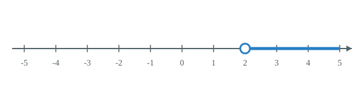

# 第十一章 不等式与不等式组

数量之间不仅有相等关系，也有不等关系。解不等式与解方程步骤类似，但两边乘除负数必须改变不等号方向；求不等式组的解集，就是找各个不等式解集的公共部分。

## 本章前置自查

1. 能熟练进行有理数的乘除运算，特别是负数的符号规则吗？不能：先回看七上第二章有理数的乘除。
2. 能熟练去括号、移项并解一元一次方程吗？不能：先回看七上第五章一元一次方程的解法。
3. 能在数轴上准确找出有理数对应的点，并理解数轴上的大小关系吗？不能：先回看七上第一章数轴。

## 11.1a 不等式、解与解集

```yaml
id: MATH-7B-11-1a
title: 不等式、解与解集
weight: 了解
weight_note: 九套卷无独立概念辨认题；认识不等号、解与解集，区分一个满足条件的数和全部解，数轴表达随解法练，不重复计次。
textbook: 七下 11.1，印刷p.121–123，p.127–128
prerequisites:
- id: MATH-7A-03-1b
  strength: hard
  reason: 用含未知数的式子表示数量后，才能把不等关系写成不等式。
- id: MATH-7A-05-1a
  strength: soft
  reason: 对照方程的解，理解不等式的一个解与全部解的区别。
evidence:
- 能用不等号表示日常生活中的大小和不等关系。
- 能分清一个具体的解与包含所有解的解集。
figure: 可选·数轴图：课本图 11.1-1 与 11.1-6（印刷 p.122、p.128）；在数轴上分别展示 x>105（空心圆圈，折线向右）与 0<=V<=210（实心圆点，两端闭区间），直观对比是否包含端点。；另有互动数轴 widget number-line + figures/solution-ray-11-1a.svg（放在先认住之后）
method: [MG16 数形结合]
sources:
- 课本11.1.1节原页，印刷p.121–123，p.127–128
```

### 本次只学

认识不等号，理解不等式的解与解集的含义。

### 先认住

- 用符号“$<$”“$>$”“$\leqslant$”“$\geqslant$”或“$\neq$”表示不等关系的式子，叫作不等式。
- 使不等式成立的未知数的值叫作不等式的解；一个含有未知数的不等式的所有的解，组成这个不等式的解集。
- 解集在数轴上表示时，不包含端点画空心圆圈，包含端点画实心圆点。

```widget
type: number-line
mode: ray
min: -5
max: 5
value: 2
rel: ">"
```


### 数形结合

```bridge
mode: hero
式: $x>2$
图: ray-gt:2
形: 空心圆圈在 $2$，向右画：不含 $2$
色: blue
---
式: $x\geqslant 2$
图: ray-ge:2
形: 实心圆点在 $2$，向右画：含 $2$
色: green
```

## 11.1b 不等式性质与变号

```yaml
id: MATH-7B-11-1b
title: 不等式性质与变号
weight: 一般
weight_note: 九套卷直接命中1次，为不等式性质选择；负数乘除需要变号是典型易错点，保留明确示例，解不等式组时不另累计一次。
textbook: 七下 11.1，印刷p.123–126
prerequisites:
- id: MATH-7B-11-1a
  strength: hard
  reason: 必须认识不等号及其方向，才能判断变形是否保持解集。
- id: MATH-7A-02-2a
  strength: hard
  reason: 乘除负数需要先掌握有理数乘除的符号规则。
- id: MATH-7A-05-1b
  strength: soft
  reason: 对照等式性质，理解不等式在乘除负数时必须额外变号。
evidence:
- 能根据不等式性质判断不等式变形是否正确。
- 两边乘除同一个负数时能主动改变不等号方向。
figure: 可选·数轴对比图：在数轴上展示两数 a<b，当同乘正数 2 时得到 2a<2b（相对位置不变），当同乘负数 -1 时得到 -a>-b（关于原点反转，大小颠倒），直观解释变号原因。
sources:
- 课本11.1.2节原页，印刷p.123–126
- 2024年广州中考数学第4题
```

### 本次只学

掌握不等式的三条基本性质，重点辨清乘除负数时的变号规则。

### 先认住

- 性质 1：不等式两边加（或减）同一个数（或式子），不等号的方向不变。若 $a>b$，则 $a \pm c > b \pm c$。
- 性质 2：不等式两边乘（或除以）同一个正数，不等号的方向不变。若 $a>b, c>0$，则 $ac>bc$（或 $\frac{a}{c}>\frac{b}{c}$）。
- 性质 3：不等式两边乘（或除以）同一个负数，不等号的方向改变。若 $a>b, c<0$，则 $ac<bc$（或 $\frac{a}{c}<\frac{b}{c}$）。

### 容易错

- 乘除负数时忘记改变不等号方向（如由 $-2x>4$ 误写成 $x>-2$）。
- 两边乘除字母未知数时，未确认字母的正负就直接变形。

### 练一练

- `Q-MATH-GZ2024-04`

## 11.2a 解一元一次不等式

```yaml
id: MATH-7B-11-2a
title: 解一元一次不等式
weight: 一般
weight_note: 九套卷无单独以解一个不等式为全部目标的题；次数为0仍保留一般，因其直接支撑6次不等式组题及4次应用小问，去分母、负数变号和端点需讲清。
textbook: 七下 11.2，印刷p.131–133，p.136
prerequisites:
- id: MATH-7B-11-1b
  strength: hard
  reason: 每一步等价变形必须依据不等式性质，尤其负数乘除变号。
- id: MATH-7A-04-2b
  strength: hard
  reason: 求解中需要正确去括号和合并同类项。
- id: MATH-7A-05-2b
  strength: soft
  reason: 可借解方程的步骤组织去分母、移项和系数化为一。
evidence:
- 能按去分母、去括号、移项、合并同类项、系数化为1的完整步骤解不等式。
- 能在数轴上正确画出不等式的解集（区分空心圈与实心点）。
figure: 可选·步骤图解：去分母、去括号、移项、合并同类项、系数化为 1 的流程步骤卡片，突出标注移项与系数化为 1（乘除负数变号）的区别。
sources:
- 课本11.2节例1、例2，印刷p.131–132
- 课本习题11.2第1题第（3）问，印刷p.136
```

### 本次只学

熟练掌握解一元一次不等式的五个步骤，把不等式化为 $x>a$ 或 $x<a$ 等形式。

### 先认住

- 只含有一个未知数，未知数的次数是 1，且含有未知数的式子都是整式的不等式，叫作一元一次不等式。
- 解一元一次不等式的一般步骤：去分母、去括号、移项、合并同类项、系数化为 1。
- 移项时项要变号，不等号方向不变；两边同乘或同除以同一个负数时，不等号方向才改变。

### 容易错

- 去分母时，不含分母的常数项漏乘公分母。
- 去括号或去分母时，括号前是负号，括号内各项没有变号。

### 练一练

- `Q-MATH-TB7B-11.2-1`

## 11.2b 列不等式解决实际问题

```yaml
id: MATH-7B-11-2b
title: 列不等式解决实际问题
weight: 一般
weight_note: 九套卷直接命中4次，来自3套卷，涉及利润下限、预算、容量与整数方案；属于常规模型，强调至少、至多及整数取值，不因同一运输题有两问而夸大覆盖面。
textbook: 七下 11.2，印刷p.133–135
prerequisites:
- id: MATH-7A-03-1b
  strength: hard
  reason: 必须把题目的数量关系写成含未知数的式子。
- id: MATH-7B-11-2a
  strength: hard
  reason: 列出数量约束后，必须能求不等式的解集并筛选实际取值。
evidence:
- 能从实际问题中找出表示不等关系的关键词（如“不少于”“最多”“超过”）。
- 能列出一元一次不等式并结合实际意义确定合理取值（如正整数）。
figure: 可选·关键词对照图：常见不等关系生活关键词（不超过、至多、不少于、至少、超过）与数学符号（<=、>=、>）的对照图解。
sources:
- 课本11.2节例2、例3，印刷p.133–134
- 2023年广东中考数学第14题
- 2023年深圳中考数学第19题第（2）问
```

### 本次只学

分析实际问题中的不等关系，建立一元一次不等式模型并结合实际情况确定取值。

### 先认住

- 抓住关键词翻译不等号：“不超过 / 不大于 / 最多”对应“$\leqslant$”；“不低于 / 不小于 / 至少”对应“$\geqslant$”；“超过 / 多于”对应“$>$”；“不足 / 少于”对应“$<$”。
- 列不等式解实际问题的基本步骤：审题找关系、设未知数、列不等式、解不等式、结合实际情境检验作答。
- **补充**（课本没有讲，做真题时常用）：$\text{利润率}=\frac{\text{售价}-\text{进价}}{\text{进价}}\times100\%$；利润率不低于 $r$ 时，$\text{售价}-\text{进价}\geqslant\text{进价}\times r$。

### 容易错

- 混淆“至少”（$\geqslant$）与“最多”（$\leqslant$），导致不等号方向列反。
- 解出不等式后忽视实际情境约束（如件数、人数必须为正整数）。

### 练一练

- `Q-MATH-GD2023-14`

## 11.3a 解不等式组并表示解集

```yaml
id: MATH-7B-11-3a
title: 解不等式组并表示解集
weight: 重点
weight_note: 九套卷直接命中6次，覆盖2022、2023、2024、2025四年，其中GD2022-16和GZ2025-17为解答题；去分母、交集、空实心端点易错，需完整讲解并兼顾整数解。
textbook: 七下 11.3，印刷p.138–141
prerequisites:
- id: MATH-7B-11-2a
  strength: hard
  reason: 必须先分别解出组内每个一元一次不等式。
- id: MATH-7B-11-1a
  strength: hard
  reason: 组的解必须同时满足各条件，需要理解解集的含义。
- id: MATH-7A-01-2a
  strength: hard
  reason: 需要用数轴表示各解集并检查它们的公共部分。
evidence:
- 能分别解出不等式组中的每个不等式，并用数轴准确确定公共部分。
- 能把不等式组的解集写成区间范围，并区分数轴上的空心圈与实心点。
figure: 可选·数轴交集图解：课本图 11.3-1、11.3-2、11.3-3（印刷 p.138–140）；在数轴上用双层折线展示不等式组两个解集的公共重叠区域，直观展示交集与无解。
method: [MG16 数形结合]
sources:
- 课本11.3节例1，印刷p.139
- 2022年广东中考数学第16题
- 2025年广州中考数学第17题
walk_source: 课本11.3例1（1），印刷p.139；PDF索引145（从0起，第146页）
```

### 本次只学

分别解出每个一元一次不等式，利用数轴确定不等式组的解集。

### 先认住

- 由几个含有同一个未知数的一元一次不等式合在一起，叫作一元一次不等式组。
- 不等式组中几个不等式解集的公共部分，叫作这个不等式组的解集；如果没有公共部分，就说这个不等式组无解。
- 解不等式组的一般步骤：① 分别求出每个不等式的解集；② 在数轴上表示各解集；③ 找出各解集的公共部分，写出不等式组的解集。
- **补充**（课本没有讲，做真题时常用）：确定两式不等式组解集的口诀是“同大取大，同小取小，大小小大中间找，大大小小找不到（无解）”。

### 数形结合

```bridge
mode: cards
式: $x>1$ 且 $x<4$
图: nl-both
形: 两条射线重叠的公共部分，双层覆盖的区间就是解集
色: blue
```

### 走一遍

解不等式组 $\begin{cases} 2x-1>x+1 & \text{\textcircled{1}} \\ x+8<4x-1 & \text{\textcircled{2}} \end{cases}$：

解不等式 ①，移项得 $2x-x>1+1$，得：
$x>\textcolor{#287fc4}{2}$。

解不等式 ②，移项得 $x-4x<-1-8$，
$-3x<-9$，
两边同除以 $\textcolor{#c9554d}{-3}$（不等号改变方向），得：
$x>\textcolor{#287fc4}{3}$。

在数轴上表示两个解集，$x>2$ 与 $x>3$ 的公共部分是 $x>3$。

所以不等式组的解集是 $\boxed{x>3}$。

### 容易错

- 两个不等式解出后，忘记取“公共部分”，把两个解简单拼在一起。
- 画数轴找公共部分时，弄混空心圆圈（$<$ 或 $>$）与实心圆点（$\leqslant$ 或 $\geqslant$）。
- 两个解集背向而行无重叠时，误以为仍有解，没有识别出“无解”。

### 练一练

- `Q-MATH-GD2022-16`
- `Q-MATH-GZ2025-17`
