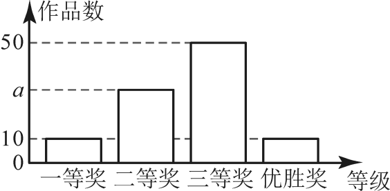

# 第十二章 数据的收集、整理与描述 · 练习

## 讲义用题

### Q-MATH-SZ2022-12

```yaml
id: Q-MATH-SZ2022-12
category: 真题
source: 2022年广东省深圳市中考数学第12题，回忆版（解析版），PDF第7页
source_quality: 回忆版，待原卷核对
kp: MATH-7B-12-1b
type: 填空
grading: 自评
answer_by: 原卷解析
review:
  概念: MATH-7B-12-1b
  公式: MATH-7B-12-1b
  计算: MATH-7B-12-1b
  审题: MATH-7B-12-1b
```

**题干**

某工厂一共有 $1200$ 人，为选拔人才，提出了一些选拔的条件，并进行了抽样调查．从中抽出 $400$ 人，发现有 $300$ 人是符合条件的，那么则该工厂 $1200$ 人中符合选拔条件的人数为________________．

**答案**

$\boxed{900\text{人}}$

**解析**

1. 样本中符合选拔条件的人数所占比例为 $\dfrac{\textcolor{#287fc4}{300}}{\textcolor{#287fc4}{400}}=\dfrac{3}{4}=75\%$．
2. 根据样本估计总体，该工厂 $1200$ 人中符合选拔条件的人数为 $\textcolor{#287fc4}{1200}\times\dfrac{3}{4}=\boxed{900\text{人}}$．

### Q-MATH-GZ2023-13

```yaml
id: Q-MATH-GZ2023-13
category: 真题
source: 2023年广东广州中考数学真题第13题，解析版
source_quality: 原卷
kp: MATH-7B-12-2a
type: 填空
grading: 自评
answer_by: 原卷解析
review:
  概念: MATH-7B-12-2a
  公式: MATH-7B-12-2a
  计算: MATH-7B-12-2a
  审题: MATH-7B-12-2a
```

**题干**

2023 年 5 月 30 日是第 7 个全国科技工作者日，某中学举行了科普知识手抄报评比活动，共有 100 件作品获得一、二、三等奖和优胜奖，根据获奖结果绘制如图所示的条形图，则 $a$ 的值为____________．若将获奖作品按四个等级所占比例绘制成扇形统计图，则“一等奖”对应扇形的圆心角度数为___________．



**答案**

$\boxed{30}$，$\boxed{36^\circ}$

**解析**

1. 由条形统计图可知，一、二、三等奖作品分别有 $\textcolor{#287fc4}{10}$ 件、$\textcolor{#287fc4}{a}$ 件、$\textcolor{#287fc4}{50}$ 件，优胜奖有 $\textcolor{#287fc4}{10}$ 件，获奖作品总件数为 $\textcolor{#287fc4}{100}$ 件．
2. 优胜奖与各等奖件数之和等于总数，解得 $a = 100 - 10 - 50 - 10 = \boxed{30}$．
3. “一等奖”作品占总获奖作品的百分比为 $\dfrac{10}{100} = 10\%$．
4. 对应扇形统计图中的圆心角度数为 $360^\circ \times 10\% = \boxed{36^\circ}$．

### Q-MATH-GZ2024-05

```yaml
id: Q-MATH-GZ2024-05
category: 真题
source: 2024年广东省广州市中考数学试题第5题，解析版
source_quality: 原卷
kp: MATH-7B-12-2b
type: 选择
grading: 自动
answer_by: 原卷解析
review:
  概念: MATH-7B-12-2b
  公式: MATH-7B-12-2b
  计算: MATH-7B-12-2b
  审题: MATH-7B-12-2b
```

**题干**

为了解公园用地面积 $x$（单位：公顷）的基本情况，某地随机调查了本地 50 个公园的用地面积，按照 $0<x\le 4$，$4<x\le 8$，$8<x\le 12$，$12<x\le 16$，$16<x\le 20$ 的分组绘制了如图所示的频数分布直方图，下列说法正确的是（    ）

A. $a$ 的值为 $20$
B. 用地面积在 $8<x\le 12$ 这一组的公园个数最多
C. 用地面积在 $4<x\le 8$ 这一组的公园个数最少
D. 这 50 个公园中有一半以上的公园用地面积超过 12 公顷


**答案**

B

**解析**

1. 由频数分布直方图可知，各组频数之和等于调查的公园总数 $50$，即 $4 + a + 16 + 12 + 8 = 50$，解得 $a = 10 \ne 20$，故 A 选项错误．
2. 各组频数分别为 $4$、$10$、$16$、$12$、$8$，其中频数最多的一组是 $8<x\le 12$（共 $16$ 个），故 B 选项正确．
3. 频数最少的一组是 $0<x\le 4$（共 $4$ 个），而 $4<x\le 8$ 组有 $10$ 个，不是最少，故 C 选项错误．
4. 用地面积超过 $12$ 公顷的公园落在后两组，个数为 $12 + 8 = 20$（个），不到总数 $50$ 的一半（$25$ 个），故 D 选项错误．
5. 综上所述，说法正确的是选项 $\boxed{\text{B}}$．

## 备选

### Q-MATH-SZ2023-18

```yaml
id: Q-MATH-SZ2023-18
category: 真题
source: 2023年广东省深圳市中考数学第18题，回忆版（解析版），PDF第11页
source_quality: 回忆版，待原卷核对
kp: MATH-7B-12-2a
type: 解答
grading: 自评
answer_by: 原卷解析
do: 本章只做第①②③问
other_parts: 第④问为加权平均数，留待八年级下册第24章数据的分析。
review:
  概念: MATH-7B-12-2a
  公式: MATH-7B-12-2a
  计算: MATH-7B-12-2a
  审题: MATH-7B-12-2a
```

**题干**

为了提高某城区居民的生活质量，政府将改造城区配套设施，并随机向某居民小区发放调查问卷（1人只能投1票），共有休闲设施，儿童设施，娱乐设施，健身设施4种选项，一共调查了 $a$ 人，其调查结果如下：

如图，为根据调查结果绘制的扇形统计图和条形统计图，请根据统计图回答下面的问题：

①调查总人数 $a=$______人；

②请补充条形统计图；

③若该城区共有 10 万居民，则其中愿意改造“娱乐设施”的约有多少人？

④改造完成后，该政府部门向甲、乙两小区下发满意度调查问卷，其结果（分数）如下：

若以 $1:1:1:1$ 进行考核，______小区满意度（分数）更高；

若以 $1:1:2:1$ 进行考核，______小区满意度（分数）更高．


**答案**

① $100$；② 见解析；③ 愿意改造“娱乐设施”的约有 $3$ 万人；④ 乙；甲．

**解析**

1. 由健身设施人数为 $40$ 人，所占百分比为 $40\%$，可得调查总人数 $a = 40 \div 40\% = \boxed{100}$（人）．
2. 娱乐设施的人数为 $100 - (17 + 13 + 40) = 30$（人），在条形统计图中将“娱乐”一栏补充高度为 $30$ 的条形．
3. 样本中愿意改造娱乐设施的比例为 $\dfrac{30}{100} = 30\%$，若该城区共有 $10$ 万居民，则约有 $10 \times 30\% = \boxed{3\text{万人}}$．
4. （第④问考核加权平均数，本章不做）．

### Q-MATH-SZ2022-18

```yaml
id: Q-MATH-SZ2022-18
category: 真题
source: 2022年广东省深圳市中考数学第18题，回忆版（解析版），PDF第11页
source_quality: 回忆版，待原卷核对
kp: MATH-7B-12-2a
type: 解答
grading: 自评
answer_by: 原卷解析
do: 本章只做第（1）（2）（3）问
other_parts: 第（4）问为抽取两人概率计算，留待九年级上册第二十五章。
review:
  概念: MATH-7B-12-2a
  公式: MATH-7B-12-2a
  计算: MATH-7B-12-2a
  审题: MATH-7B-12-2a
```

**题干**

某工厂进行厂长选拔，从中抽出一部分人进行筛选，其中有“优秀”，“良好”，“合格”，“不合格”．

（1）本次抽查总人数为________，“合格”人数的百分比为________．

（2）补全条形统计图．

（3）扇形统计图中“不合格人数”的度数为________．

（4）在“优秀”中有甲乙丙三人，现从中抽出两人，则刚好抽中甲乙两人的概率为________．


**答案**

（1）$50$ 人，$40\%$；（2）见解析；（3）$115.2^\circ$；（4）$\dfrac{1}{3}$．

**解析**

1. 由优秀人数为 $8$ 人，所占百分比为 $16\%$，可得总人数为 $8 \div 16\% = \boxed{50\text{人}}$．
2. “合格”人数为 $20$ 人，所占百分比为 $\dfrac{20}{50} = \boxed{40\%}$．
3. “不合格”人数为 $50 \times 32\% = 16$（人），在条形图中补全“不合格”条形高度为 $16$．
4. 扇形统计图中“不合格人数”所对圆心角的度数为 $360^\circ \times 32\% = \boxed{115.2^\circ}$．
5. （第（4）问为抽取两人的概率，本章不做）．

### Q-MATH-TB7B-12.1-2

```yaml
id: Q-MATH-TB7B-12.1-2
category: 课本习题
source: 课本习题12.1第2题，印刷p.157（PDF索引163，从0起算）
source_quality: 课本原文
kp: MATH-7B-12-1a
type: 选择
grading: 自动
answer_by: 本项目编写，待复核
review:
  概念: MATH-7B-12-1a
  公式: MATH-7B-12-1a
  计算: MATH-7B-12-1a
  审题: MATH-7B-12-1a
```

**题干**

要了解全校学生每周课余用于体育锻炼的时间，下列选取调查对象的方式中最合适的是（    ）

A. 随机选取一个班的学生
B. 随机选取一个体育队的学生
C. 在全校女生中随机选取 100 人
D. 在全校学生中随机选取 100 人

**答案**

D

**解析**

1. 抽样调查所选取的样本必须具有代表性和广泛性．
2. 选项 A 只选取一个班，样本缺乏广泛性；选项 B 选取体育队学生，锻炼时间明显偏长，缺乏代表性；选项 C 只选取女生，忽略了男生的情况，样本片面．
3. 选项 D 在全校学生中随机选取 100 人，使每个学生都有同等机会被抽到，具有较好的代表性和随机性．
4. 综上所述，应选 $\boxed{\text{D}}$．
