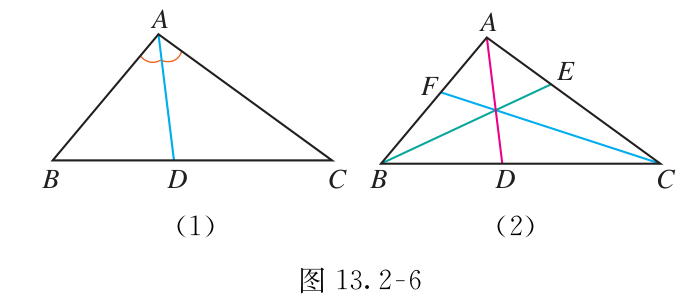
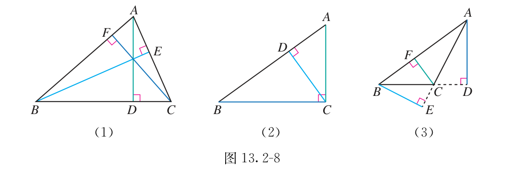
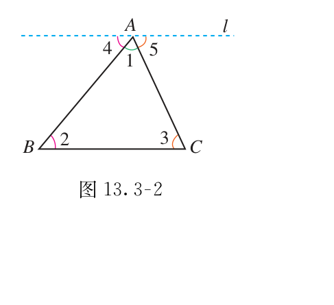

# 第十三章 三角形

三角形里的条件，不能凭图猜。先看三条边能否围成，再分清中线、角平分线和高。求角时，把零散的角放进同一个三角形。

## 本章前置自查

1. 能指出一个角的顶点和两条边吗？不能：先回看七上角的表示。
2. 能用底和高求三角形面积吗？不能：先回看小学三角形面积公式。

## 13.1a 三角形的概念与分类

```yaml
id: MATH-8A-13-1a
title: 三角形的概念与分类
weight: 了解
weight_note: 本章基础链条所必需；考频采用保守归类，不把综合题全部归到本章。
textbook: 八上 13.1，印刷p.2–4
prerequisites: []
evidence:
- 能指出一个内角的对边。
- 能说清等边三角形也属于等腰三角形。
figure: 可选·几何图：同一三角形标边、角、顶点，另用包含关系展示等边属于等腰。
method: []
sources:
- 新版课本原页，详见本章sources.md
- 九套有效卷筛查；低频及未记录不等于不考
```

### 本次只学

认清三角形的边、顶点和内角。

### 先认住

由不在同一直线上的三条线段首尾顺次相接组成的图形，叫作三角形。$\triangle ABC$ 的三边是 $AB$、$BC$、$CA$。$\angle A$ 的对边是 $BC$。

按角分：锐角、直角、钝角三角形。按边分：三边都不相等的三角形和等腰三角形；等边三角形是特殊的等腰三角形。

三个点在一条直线上，不能组成三角形。等边三角形不在等腰三角形之外另算一类。

## 13.2a 三角形的三边关系

```yaml
id: MATH-8A-13-2a
title: 三角形的三边关系
weight: 重点
weight_note: 已确认SZ2024-10涉及边长可行范围；也是等腰分类及后续几何的基础，按易错风险列重点。
textbook: 八上 13.2，印刷p.5–6
prerequisites:
- id: MATH-8A-13-1a
  strength: hard
  reason: 先认识三角形的边与等腰分类。
evidence:
- 能写出第三边的严格取值范围。
- 能检查等腰三角形的不同边长方案。
figure: 已完成 figures/triangle-inequality-13-2a.svg（两边2与7极限位置与第三边范围5<a<9；已放在 Q-MATH-TB8A-13.2-1 的解析之后）
method: [MG16 数形结合]
sources:
- 新版课本原页，详见本章sources.md
- 九套有效卷筛查；低频及未记录不等于不考
walk_source: 课本13.2例题（2），印刷p.6；PDF第13页
```

### 本次只学

求未知边的取值范围，并排除围不成三角形的情况。

### 先认住

三角形两边的和大于第三边，两边的差小于第三边。

已知两边为 $a$、$b$，第三边为 $c$，应同时满足 $\boxed{|a-b|<c<a+b}$。两个端点都不能取，且边长都为正。

### 数形结合

```bridge
mode: cards
式: $|a-b|<c<a+b$
图: tri-ineq
形: 两点之间线段最短：两边折线比第三边长
色: blue
结: 不等式两端取等号时，三条线段在同一直线上拉平共线，无法围成三角形。
```

### 走一遍

用长为 $18\text{ cm}$ 的细绳围成等腰三角形，检查能否有一边长为 $\textcolor{#287fc4}{4}\text{ cm}$：

若 $4\text{ cm}$ 为底边，腰长为 $(18-4)\div2=7\text{ cm}$；$4+7>7$，三边 $4,7,7$ 能围成三角形。

若 $4\text{ cm}$ 为腰，底边为 $18-4\times2=10\text{ cm}$；两短边和 $4+4=8<10$，不能围成三角形。

因此 $\boxed{\text{能围成底边长是 }4\text{ cm}\text{ 的等腰三角形\text{，}各边长为 }4\text{ cm}\text{，}7\text{ cm}\text{，}7\text{ cm}}$。

### 容易错

不能只检查“两边和大于第三边”。等号表示三条边拉成直线，不是三角形。等腰三角形中，已知边可能是腰，也可能是底。

### 练一练

- `Q-MATH-TB8A-13.2-1`
- `Q-MATH-TB8A-13.2-5`

## 13.2b 中线、角平分线和高

```yaml
id: MATH-8A-13-2b
title: 中线、角平分线和高
weight: 一般
weight_note: 本章基础链条所必需；考频采用保守归类，不把综合题全部归到本章。
textbook: 八上 13.2，印刷p.6–9
prerequisites:
- id: MATH-8A-13-1a
  strength: hard
  reason: 先认清顶点与对边。
evidence:
- 能从中线、角平分线和高分别写出等边、等角、直角条件。
- 能用中线解释两部分面积相等。
figure: 已完成 figures/tb8a-13-2-fig13-2-6.png（课本图13.2-6原图，放在先认住之后）、figures/tb8a-13-2-fig13-2-8.png（课本图13.2-8原图，放在先认住之后）；图13.2-5裁图缺图号未采用待重裁
method: [MG16 数形结合]
sources:
- 新版课本原页，详见本章sources.md
- 九套有效卷筛查；低频及未记录不等于不考
```

### 本次只学

把三条线各自带来的条件分开使用。

### 先认住

- 中线：顶点与对边中点的连线，分的是边。
- 角平分线：顶点到对边的一条线段，分的是角。
- 高：顶点到对边所在直线的垂线段，提供直角。

钝角三角形的高可能在三角形外。三条中线交于一点，这个交点叫作三角形的重心。匀质三角形薄板的重心也在这里，可以用它寻找平衡支点。

**补充**（课本没有讲，做真题时常用）：中线把三角形分成面积相等的两部分（底边各一半，高相同）。





### 数形结合

```bridge
mode: cards
式: $S_1=S_2=\dfrac12S_{\text{总}}$
图: tri-median
形: 中线平分底边，两个小三角形等底同高，面积相等
色: blue
```

### 容易错

不能看到一条线就同时认作中线、角平分线和高。高所垂直的是对边所在的直线，不一定是对边线段。

### 练一练

- `Q-MATH-TB8A-13.2-4`

## 13.2c 三角形的稳定性

```yaml
id: MATH-8A-13-2c
title: 三角形的稳定性
weight: 了解
weight_note: 本章基础链条所必需；考频采用保守归类，不把综合题全部归到本章。
textbook: 八上 13.2，印刷p.8
prerequisites:
- id: MATH-8A-13-1a
  strength: hard
  reason: 先认清三条边。
evidence:
- 能说明三角形支架用于加固的原因。
figure: 不需要
method: []
sources:
- 新版课本原页，详见本章sources.md
- 九套有效卷筛查；低频及未记录不等于不考
```

### 本次只学

理解三角形支架为什么不容易变形。

### 先认住

三边长度固定后，三角形的形状和大小随之固定，这叫作三角形的稳定性。实际支架常用三角形加固。

稳定性说的是几何形状；不表示材料永远不会弯曲或损坏。

## 13.3a 三角形内角和

```yaml
id: MATH-8A-13-3a
title: 三角形内角和
weight: 重点
weight_note: 内角和是全等、等腰、圆中求角的基础；综合题常隐含使用，不夸大独立考频。
textbook: 八上 13.3，印刷p.11–14
prerequisites:
- id: MATH-8A-13-1a
  strength: hard
  reason: 先认清三个内角。
evidence:
- 能按内角和列方程求角。
- 能解释三角形不可能有两个直角或两个钝角。
figure: 已完成 figures/tb8a-13-3-fig13-3-2.png（课本图13.3-2原图，放在先认住之后）
method: [MG16 数形结合]
sources:
- 新版课本原页，详见本章sources.md
- 九套有效卷筛查；低频及未记录不等于不考
walk_source: 课本习题13.3第3题，印刷p.16；PDF第23页
```

### 本次只学

把角的数量关系变成一个方程。

### 先认住

三角形的三个内角和等于 $\boxed{180^\circ}$。

直角三角形的两个锐角互余：$\angle A+\angle B=90^\circ$。一个三角形最多有一个直角，或一个钝角（由内角和推出）。

求未知角时，先把三个内角写全，再列和为 $180^\circ$ 的式子。



### 数形结合

```bridge
mode: cards
式: $\angle A+\angle B+\angle C=180^\circ$
图: tri-sum
形: 过顶点作平行线，把三个内角拼成平角
色: blue
```

### 走一遍

在 $\triangle ABC$ 中，$\angle B$ 比 $\angle A$ 大 $10^\circ$，$\angle C$ 比 $\angle B$ 大 $10^\circ$。

设 $\angle A=x^\circ$，则三个角依次为 $x^\circ$、$(x+10)^\circ$、$(x+20)^\circ$。

$x+(x+10)+(x+20)=180$，解得 $x=50$。

所以三个角为 $\boxed{50^\circ\text{，}60^\circ\text{，}70^\circ}$。

### 容易错

图里画得像直角，不等于已知直角。角平分线只分它所平分的那个角，不能把整个三角形的其他角都减半。

### 练一练

- `Q-MATH-TB8A-13.3-1`

第（1）（4）问。

- `Q-MATH-TB8A-13.3-2`

第（1）（2）问。

## 13.3b 三角形外角

```yaml
id: MATH-8A-13-3b
title: 三角形外角
weight: 一般
weight_note: 本章基础链条所必需；考频采用保守归类，不把综合题全部归到本章。
textbook: 八上 13.3，印刷p.14–16
prerequisites:
- id: MATH-8A-13-3a
  strength: hard
  reason: 外角性质由内角和推出。
evidence:
- 能区分外角的相邻内角与不相邻内角。
- 能用外角性质解释直角三角形的外角情况。
figure: 不需要
method: [MG16 数形结合]
sources:
- 新版课本原页，详见本章sources.md
- 九套有效卷筛查；低频及未记录不等于不考
```

### 本次只学

认清外角，并用不相邻的两个内角求它。

### 先认住

三角形的一边与另一边的延长线组成的角，叫作三角形的外角。

外角与相邻内角互为补角（由平角定义推出）。先查“相邻还是不相邻”，再选式子。

一个外角等于与它不相邻的两个内角之和。

**补充**（课本没有讲，做真题时常用）：一个外角大于与它不相邻的任何一个内角。

### 数形结合

```bridge
mode: cards
式: 外角 = 不相邻的两个内角之和
图: tri-ext
形: 延长一边得到外角
色: blue
```

### 容易错

不是画在三角形外面的任意角都叫外角。外角“大于内角”，只针对与它不相邻的内角。

### 练一练

- `Q-MATH-TB8A-13.3-2`

第（3）问。
