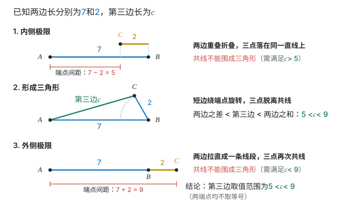
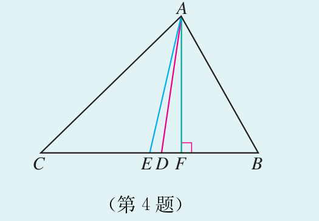
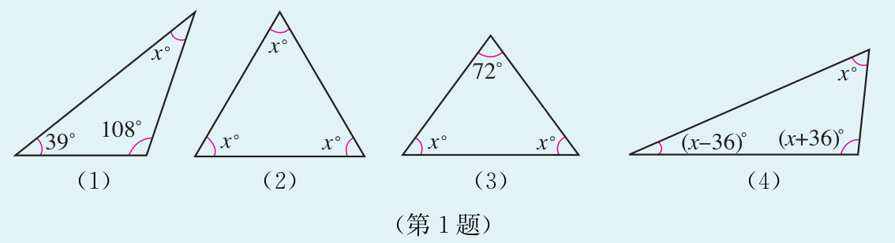

# 第十三章 三角形 · 练习

## 讲义用题

### Q-MATH-TB8A-13.2-1

```yaml
id: Q-MATH-TB8A-13.2-1
category: 课本习题
source: 课本习题13.2第1题，印刷p.9（PDF第16页）
source_quality: 课本原文
kp: MATH-8A-13-2a
type: 填空
grading: 自评
answer_by: 本项目编写，待复核
review:
  概念: MATH-8A-13-2a
  公式: MATH-8A-13-2a
  计算: MATH-8A-13-2a
  审题: MATH-8A-13-2a
```

**题干**

三角形的三边长分别为 $2$，$7$，$a$，则 $a$ 的取值范围是___。

**答案**

$\boxed{5<a<9}$。

**解析**

1. $7-2<a<7+2$（三角形三边关系）。
2. 得 $\boxed{5<a<9}$，不取两个端点。



### Q-MATH-TB8A-13.2-5

```yaml
id: Q-MATH-TB8A-13.2-5
category: 课本习题
source: 课本习题13.2第5题，印刷p.10（PDF第17页）
source_quality: 课本原文
kp: MATH-8A-13-2a
type: 解答
grading: 自评
answer_by: 本项目编写，待复核
review:
  概念: MATH-8A-13-2a
  公式: MATH-8A-13-2a
  计算: MATH-8A-13-2a
  审题: MATH-8A-13-2a
```

**题干**

一个等腰三角形的一边长为 $6$，周长为 $20$，求其他两边的长。

**答案**

$\boxed{7\text{，}7}$ 或 $\boxed{6\text{，}8}$。

**解析**

1. 若 $6$ 是底边，则两腰各为 $(20-6)\div2=7$，三边 $6,7,7$ 能组成三角形。
2. 若 $6$ 是腰，则另一腰为 $6$，底边为 $20-6-6=8$。
3. $6+6>8$，故第二种也成立；其他两边为 $\boxed{7\text{，}7}$ 或 $\boxed{6\text{，}8}$。

### Q-MATH-TB8A-13.2-4

```yaml
id: Q-MATH-TB8A-13.2-4
category: 课本习题
source: 课本习题13.2第4题，印刷p.9（PDF第16页）
source_quality: 课本原文
kp: MATH-8A-13-2b
type: 填空
grading: 自评
answer_by: 本项目编写，待复核
review: &id001
  概念: MATH-8A-13-2b
  公式: MATH-8A-13-2b
  计算: MATH-8A-13-2b
  审题: MATH-8A-13-2b
parts:
- part: '1'
  kp: MATH-8A-13-2b
  review: *id001
- part: '2'
  kp: MATH-8A-13-2b
  review: *id001
- part: '3'
  kp: MATH-8A-13-2b
  review: *id001
- part: '4'
  kp: MATH-8A-13-2b
  review: *id001
```

**题干**

如图，在 $\triangle ABC$ 中，$AE$ 是中线，$AD$ 是角平分线，$AF$ 是高。填空：

（1）$BE=$___$=\dfrac12$___；
（2）$\angle BAD=$___$=\dfrac12$___；
（3）$\angle AFB=$___$=90^\circ$；
（4）若 $BC=8$，$AF=5$，则 $S_{\triangle ABC}=$___，$S_{\triangle ABE}=$___。



**答案**

（1）$CE$，$BC$；（2）$\angle CAD$，$\angle BAC$；（3）$\angle AFC$；（4）$\boxed{20}$，$\boxed{10}$。

**解析**

1. $E$ 是 $BC$ 的中点，所以 $BE=CE=\dfrac12BC$（中线定义）。
2. $AD$ 平分 $\angle BAC$，所以 $\angle BAD=\angle CAD=\dfrac12\angle BAC$。
3. $AF\perp BC$，所以 $\angle AFB=\angle AFC=90^\circ$。
4. $S_{\triangle ABC}=\dfrac12\times8\times5=\boxed{20}$。
5. $BE=4$，故 $S_{\triangle ABE}=\dfrac12\times4\times5=\boxed{10}$（同高三角形）。

### Q-MATH-TB8A-13.3-1

```yaml
id: Q-MATH-TB8A-13.3-1
category: 课本习题
source: 课本习题13.3第1题，印刷p.16（PDF第23页）
source_quality: 课本原文
kp: MATH-8A-13-3a
type: 解答
grading: 自评
answer_by: 本项目编写，待复核
do: 本章只做第（1）（4）问
other_parts: 第（2）（3）问：同类内角和求角，保留原题，本章不作答。
review:
  概念: MATH-8A-13-3a
  公式: MATH-8A-13-3a
  计算: MATH-8A-13-3a
  审题: MATH-8A-13-3a
parts:
- part: '1'
  kp: MATH-8A-13-3a
  review:
    公式: MATH-8A-13-3a
    计算: MATH-8A-13-3a
- part: '4'
  kp: MATH-8A-13-3a
  review:
    公式: MATH-8A-13-3a
    计算: MATH-8A-13-3a
```

**题干**

求出下列各图形中 $x$ 的值。



**答案**

（1）$\boxed{x=33}$；（4）$\boxed{x=60}$。

**解析**

1. （1）$x+\textcolor{#287fc4}{39}+\textcolor{#287fc4}{108}=180$（三角形内角和）。
2. $x=180-39-108$，得 $\boxed{x=33}$。
3. （4）$x+(x-36)+(x+36)=180$（三角形内角和）。
4. $3x=180$，得 $\boxed{x=60}$；三个内角分别为 $60^\circ$、$24^\circ$、$96^\circ$。

### Q-MATH-TB8A-13.3-2

```yaml
id: Q-MATH-TB8A-13.3-2
category: 课本习题
source: 课本习题13.3第2题，印刷p.16（PDF第23页）
source_quality: 课本原文
kp: MATH-8A-13-3b
type: 解答
grading: 自评
answer_by: 本项目编写，待复核
review: &id001
  概念: MATH-8A-13-3b
  公式: MATH-8A-13-3b
  计算: MATH-8A-13-3b
  审题: MATH-8A-13-3b
parts:
- part: '1'
  kp: MATH-8A-13-3a
  review:
    概念: MATH-8A-13-3a
    公式: MATH-8A-13-3a
    计算: MATH-8A-13-3a
    审题: MATH-8A-13-3a
- part: '2'
  kp: MATH-8A-13-3a
  review:
    概念: MATH-8A-13-3a
    公式: MATH-8A-13-3a
    计算: MATH-8A-13-3a
    审题: MATH-8A-13-3a
- part: '3'
  kp: MATH-8A-13-3b
  review: *id001
```

**题干**

（1）一个三角形最多有几个直角？为什么？

（2）一个三角形最多有几个钝角？为什么？

（3）直角三角形的外角可以是锐角吗？为什么？

**答案**

（1）最多一个；（2）最多一个；（3）不可以。

**解析**

1. 两个直角的和已经为 $180^\circ$，没有空间留给第三个正角，所以最多一个直角。
2. 两个钝角的和大于 $180^\circ$，所以最多一个钝角。
3. 直角顶点处的外角为 $90^\circ$；锐角顶点处的外角为 $180^\circ$ 减去一个锐角，是钝角，所以没有锐角外角。

## 备选

无。
