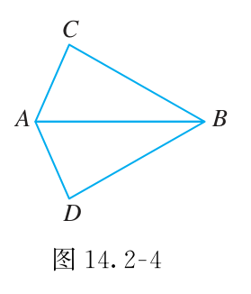
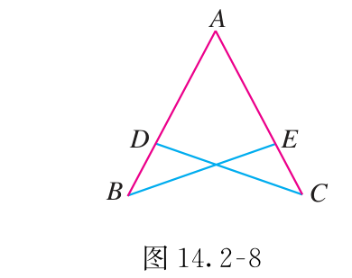
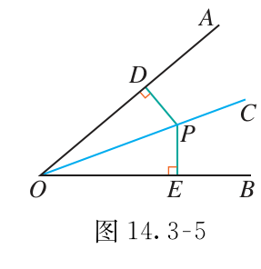

# 第十四章 全等三角形

要证明两条线段或两个角相等，常可以先证明它们所在的两个三角形全等。关键不是凑够三个条件，而是条件必须属于同一组对应关系。

## 本章前置自查

1. 能从中点写出两段相等吗？不能：回看 第十三章第2节。
2. 能用三角形内角和补出第三个角吗？不能：回看 第十三章第3节。

## 14.1a 全等三角形与对应关系

```yaml
id: MATH-8A-14-1a
title: 全等三角形与对应关系
weight: 一般
weight_note: 本章基础链条所必需；考频采用保守归类，不把综合题全部归到本章。
textbook: 八上 14.1，印刷p.29–31
prerequisites:
- id: MATH-8A-13-1a
  strength: hard
  reason: 先认识三角形的顶点、边和角。
evidence:
- 能从全等式找出三组对应边和角。
- 能按对应顶点顺序写全等式。
figure: 可选·几何图：同一对全等三角形旋转摆放，三对顶点同色，展示按顶点而非画面位置找对应。
method: []
sources:
- 新版课本原页，详见本章sources.md
- 九套有效卷筛查；低频及未记录不等于不考
```

### 本次只学

按对应顶点顺序写全等式，并取对应边角。

### 先认住

能完全重合的两个三角形叫作全等三角形。全等三角形的对应边相等、对应角相等。

若 $\triangle ABC\cong\triangle DEF$，对应顺序是 $A\leftrightarrow D$、$B\leftrightarrow E$、$C\leftrightarrow F$；因此 $AB=DE$、$BC=EF$、$AC=DF$。

### 容易错

全等三角形的位置、朝向可以不同。不能按“左边对左边”找对应，也不能把全等符号写成等号。

### 练一练

- `Q-MATH-TB8A-14.1-1`

## 14.2a 边边边：SSS

```yaml
id: MATH-8A-14-2a
title: 边边边：SSS
weight: 一般
weight_note: 本章基础链条所必需；考频采用保守归类，不把综合题全部归到本章。
textbook: 八上 14.2，印刷p.36–38
prerequisites:
- id: MATH-8A-14-1a
  strength: hard
  reason: 全等判定必须保持同一对应顺序。
evidence:
- 能检查三组对应边是否都已相等。
- 能在全等以后再使用对应角相等。
figure: 不需要
method: []
sources:
- 新版课本原页，详见本章sources.md
- 九套有效卷筛查；低频及未记录不等于不考
```

### 本次只学

用三组对应边相等证明全等。

### 先认住

三边分别相等的两个三角形全等，简称“边边边”或 $\mathrm{SSS}$。

每条边只配一条对应边。公共边可作为一组相等条件；把三个条件列完，再写全等结论。

### 容易错

三个角分别相等不能保证全等；形状一样还可能大小不同。只知道两边相等，也不够。

### 练一练

- `Q-MATH-TB8A-14.2-7`
- `Q-MATH-YN2023-18`

## 14.2b 边角边：SAS

```yaml
id: MATH-8A-14-2b
title: 边角边：SAS
weight: 重点
weight_note: GZ2023-18、GZ2025-18及综合证明中的常用路径；夹角容易漏查，列重点。
textbook: 八上 14.2，印刷p.32–34
prerequisites:
- id: MATH-8A-14-1a
  strength: hard
  reason: 先建立顶点对应。
- id: MATH-8A-13-2b
  strength: hard
  reason: 中点和角平分线能提供条件。
evidence:
- 能判断所给角是不是两边的夹角。
- 能写出完整的SAS证明及对应边结论。
figure: 已完成 figures/tb8a-14-2-ex1-fig14-2-4.png（课本图14.2-4原图，放在走一遍之后）
method: []
sources:
- 新版课本原页，详见本章sources.md
- 九套有效卷筛查；低频及未记录不等于不考
walk_source: 课本14.2例1，印刷p.33；PDF第40页
```

### 本次只学

认出两条相等边之间的夹角。

### 先认住

两边和它们的夹角分别相等的两个三角形全等，简称“边角边”或 $\mathrm{SAS}$。

先找两组边，再检查角的两条边是不是这两条边。中点、公共边、对顶角经常提供条件。

### 走一遍

若 $AC=AD$，$AB$ 平分 $\angle CAD$，要证 $\angle C=\angle D$，先找包含这两个角的 $\triangle ABC$、$\triangle ABD$。

$AC=AD$（已知）；$\angle CAB=\angle DAB$（角平分线）；$AB=AB$（公共边）。

中间的角正夹在两条边之间，故 $\triangle ABC\cong\triangle ABD$（$\mathrm{SAS}$），于是 $\boxed{\angle C=\angle D}$。



### 容易错

两边和其中一边的对角分别相等，不能直接判全等。三个条件都要对应；不要拿另一个三角形里的角拼进来。

### 练一练

- `Q-MATH-TB8A-14.2-1`
- `Q-MATH-GZ2025-18`

## 14.2c 角边角：ASA

```yaml
id: MATH-8A-14-2c
title: 角边角：ASA
weight: 重点
weight_note: 本章基础链条所必需；考频采用保守归类，不把综合题全部归到本章。
textbook: 八上 14.2，印刷p.35
prerequisites:
- id: MATH-8A-14-1a
  strength: hard
  reason: 先认对应关系。
- id: MATH-8A-13-3b
  strength: hard
  reason: 内外角之间可用补角转换。
evidence:
- 能指出两个角的夹边。
- 能把邻补角相等转成三角形内角相等，再证全等。
figure: 可选·图解步骤图：标出一条边的两个端点角，突出夹边与两角的配对。
method: []
sources:
- 新版课本原页，详见本章sources.md
- 九套有效卷筛查；低频及未记录不等于不考
walk_source: 课本14.2例2，印刷p.35；PDF第42页
```

### 本次只学

认出两个相等角之间的夹边。

### 先认住

两角和它们的夹边分别相等的两个三角形全等，简称“角边角”或 $\mathrm{ASA}$。

两个角的顶点连成的边，就是夹边。若给的是外角，可先用邻补角把它转成三角形里的角。

### 走一遍

如图，点 $D$ 在 $AB$ 上，点 $E$ 在 $AC$ 上，$AB=AC$，$\angle B=\angle C$。求证 $AD=AE$。



要取出 $AD$、$AE$，比较 $\triangle ACD$ 与 $\triangle ABE$；对应顶点是 $A\leftrightarrow A$、$C\leftrightarrow B$、$D\leftrightarrow E$。

$\angle CAD=\angle BAE$（公共角）；$AC=AB$（已知）；$\angle ACD=\angle ABE$（已知）。

$AC$、$AB$ 分别是这两组角的夹边，故 $\triangle ACD\cong\triangle ABE$（$\mathrm{ASA}$）。

因此 $\boxed{AD=AE}$（全等三角形对应边相等）。

### 容易错

有两个角相等，还需要一组对应边相等。用于ASA的边必须是这两个角的夹边。

### 练一练

- `Q-MATH-TB8A-14.2-4`

## 14.2d 角角边：AAS

```yaml
id: MATH-8A-14-2d
title: 角角边：AAS
weight: 一般
weight_note: 本章基础链条所必需；考频采用保守归类，不把综合题全部归到本章。
textbook: 八上 14.2，印刷p.35–36
prerequisites:
- id: MATH-8A-14-2c
  strength: hard
  reason: AAS可由内角和与ASA得到。
evidence:
- 能区分ASA与AAS。
- 能写出两角及相应对边三条条件。
figure: 不需要
method: []
sources:
- 新版课本原页，详见本章sources.md
- 九套有效卷筛查；低频及未记录不等于不考
```

### 本次只学

用两角及其中一角的对边证明全等。

### 先认住

两角和其中一个角的对边分别相等的两个三角形全等，简称“角角边”或 $\mathrm{AAS}$。

它不是额外凭空增加的规则：两角相等，第三角也相等，再用ASA即可判定。

### 容易错

不能只数“两个角加一条边”，还要检查这条边对应的是哪一个角。

做下面的练习时先问：公共边 $AC$ 是已知两角的夹边吗？它是 $\angle B$、$\angle D$ 的对应对边，所以用AAS，不是ASA。

### 练一练

- `Q-MATH-TB8A-14.2-5`
- `Q-MATH-GD2020-20`

## 14.2e 直角三角形的HL判定

```yaml
id: MATH-8A-14-2e
title: 直角三角形的HL判定
weight: 一般
weight_note: 本章基础链条所必需；考频采用保守归类，不把综合题全部归到本章。
textbook: 八上 14.2，印刷p.41–42
prerequisites:
- id: MATH-8A-14-1a
  strength: hard
  reason: 全等需先确定顶点对应。
- id: MATH-8A-13-2b
  strength: hard
  reason: 高提供直角条件。
evidence:
- 能先列直角条件，再列斜边和直角边。
- 能在证明中正确识别公共直角边。
figure: 不需要
method: []
sources:
- 新版课本原页，详见本章sources.md
- 九套有效卷筛查；低频及未记录不等于不考
```

### 本次只学

先确认直角，再找斜边和一条直角边。

### 先认住

斜边和一条直角边分别相等的两个直角三角形全等，简称“斜边、直角边”或 $\mathrm{HL}$。

垂直条件先变成两个直角。斜边是直角所对的边，不是图中看起来最长的那条线。

### 容易错

HL只用于两个直角三角形。普通三角形的“两边一角”，不能借HL判全等。

### 练一练

- `Q-MATH-TB8A-14.2-11`

## 14.3a 角平分线的性质与判定

```yaml
id: MATH-8A-14-3a
title: 角平分线的性质与判定
weight: 重点
weight_note: GD2022-18、GD2024-17(1)和SZ2024-06有直接或主要应用；是圆中切线证明的前置。
textbook: 八上 14.3，印刷p.48–52
prerequisites:
- id: MATH-8A-14-2e
  strength: hard
  reason: 等距性质可由直角三角形全等证明。
evidence:
- 能写出点到角两边的两个垂直距离。
- 能分别使用性质与逆向判定，不颠倒条件和结论。
- 能解释角平分线尺规作图的等距依据。
figure: 已完成 figures/tb8a-14-3-fig14-3-5.png（课本图14.3-5原图，放在先认住之后）
method: [MG16 数形结合]
sources:
- 新版课本原页，详见本章sources.md
- 九套有效卷筛查；低频及未记录不等于不考
walk_source: 课本14.3性质及逆命题证明，印刷p.49–51；PDF第56–58页
```

### 本次只学

用垂直距离判断点是否在角平分线上。

### 先认住

角平分线上的点到角两边的距离相等。反过来，角的内部到角两边距离相等的点，在角的平分线上。

距离必须用垂线段量。已知平分线时去求等距；已知内部点到两边等距时，去判平分线。

尺规作角平分线：以顶点为圆心作弧交两边，再以这两个交点为圆心、相同的适当长度为半径，在角内作弧相交，连接顶点与弧交点。

设第一道弧与角两边交于 $M$、$N$，后两弧交于 $C$。由 $OM=ON$、$MC=NC$、$OC=OC$，可用SSS证明 $\triangle OMC\cong\triangle ONC$，所以 $OC$ 平分这个角。



### 数形结合

```bridge
mode: cards
式: $d_1=d_2$
图: bis-dist
形: 点在角的平分线上，向两边引垂线段，两段距离相等；反过来，角内到两边距离相等的点必落在平分线上
色: blue
```

### 走一遍

过角内一点 $P$ 分别作 $PD\perp OA$、$PE\perp OB$。

若 $OP$ 平分 $\angle AOB$，则 $\angle PDO=\angle PEO=90^\circ$，$\angle DOP=\angle EOP$，且 $OP=OP$。因此 $\triangle ODP\cong\triangle OEP$（$\mathrm{AAS}$），得到 $\boxed{PD=PE}$。

若已知 $PD=PE$，两个直角三角形的斜边 $OP$ 又相同，便可用HL判全等，得到 $\angle DOP=\angle EOP$。

同一幅图，条件与结论交换了；先读题，再决定用哪一边。

### 容易错

点必须在角的内部，才可用逆向判定。任意连到两边的斜线段相等，不等于距离相等。尺规作图的两条后续弧半径必须相同。

### 练一练

- `Q-MATH-TB8A-14.3-6`
- `Q-MATH-TB8A-14.3-3`
- `Q-MATH-GZ2023-15`
