# 第十四章 全等三角形 · 练习

## 讲义用题

### Q-MATH-TB8A-14.1-1

```yaml
id: Q-MATH-TB8A-14.1-1
category: 课本习题
source: 课本习题14.1第1题，印刷p.31（PDF第38页）
source_quality: 课本原文
kp: MATH-8A-14-1a
type: 解答
grading: 自评
answer_by: 本项目编写，待复核
review:
  概念: MATH-8A-14-1a
  公式: MATH-8A-14-1a
  计算: MATH-8A-14-1a
  审题: MATH-8A-14-1a
```

**题干**

如图，$\triangle ABC\cong\triangle CDA$，$AB$ 和 $CD$，$BC$ 和 $DA$ 是对应边。写出其他对应边和对应角。

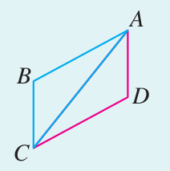

**答案**

其他对应边为 $AC$ 和 $CA$；对应角为 $\angle ABC$ 和 $\angle CDA$，$\angle BCA$ 和 $\angle DAC$，$\angle BAC$ 和 $\angle DCA$。

**解析**

1. 从全等式读出 $A\leftrightarrow C$、$B\leftrightarrow D$、$C\leftrightarrow A$。
2. 剩余边 $AC$ 的两端对应 $C,A$，故对应边为 $CA$。
3. 逐个替换角的三个字母，得到三组对应角；公共线段也可以是两个三角形的一组对应边。

### Q-MATH-TB8A-14.2-7

```yaml
id: Q-MATH-TB8A-14.2-7
category: 课本习题
source: 课本习题14.2第7题，印刷p.44（PDF第51页）
source_quality: 课本原文
kp: MATH-8A-14-2a
type: 证明
grading: 自评
answer_by: 本项目编写，待复核
review:
  概念: MATH-8A-14-2a
  公式: MATH-8A-14-2a
  计算: MATH-8A-14-2a
  审题: MATH-8A-14-2a
```

**题干**

如图，$AB=AD$，$AC=AE$，$BC=DE$。求证 $\angle BAC=\angle DAE$。

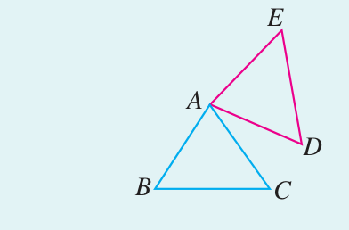

**答案**

$\boxed{\angle BAC=\angle DAE}$。

**解析**

1. 在 $\triangle ABC$ 和 $\triangle ADE$ 中，$AB=AD$，$AC=AE$，$BC=DE$。
2. $\triangle ABC\cong\triangle ADE$（$\mathrm{SSS}$）。
3. $\boxed{\angle BAC=\angle DAE}$（全等三角形对应角相等）。

### Q-MATH-TB8A-14.2-1

```yaml
id: Q-MATH-TB8A-14.2-1
category: 课本习题
source: 课本习题14.2第1题，印刷p.43（PDF第50页）
source_quality: 课本原文
kp: MATH-8A-14-2b
type: 证明
grading: 自评
answer_by: 本项目编写，待复核
review:
  概念: MATH-8A-14-2b
  公式: MATH-8A-14-2b
  计算: MATH-8A-14-2b
  审题: MATH-8A-14-2b
```

**题干**

如图，$M$ 是 $AB$ 的中点，$\angle AMC=\angle BMD$，$MC=MD$。求证 $AC=BD$。

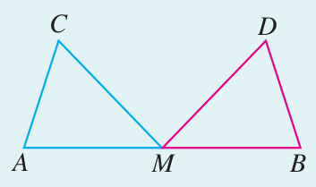

**答案**

$\boxed{AC=BD}$。

**解析**

1. $AM=BM$（$M$ 是 $AB$ 的中点）。
2. 在 $\triangle AMC$ 和 $\triangle BMD$ 中，$AM=BM$，$\angle AMC=\angle BMD$，$MC=MD$。
3. $\triangle AMC\cong\triangle BMD$（$\mathrm{SAS}$）。
4. $\boxed{AC=BD}$（全等三角形对应边相等）。

### Q-MATH-TB8A-14.2-4

```yaml
id: Q-MATH-TB8A-14.2-4
category: 课本习题
source: 课本习题14.2第4题，印刷p.44（PDF第51页）
source_quality: 课本原文
kp: MATH-8A-14-2c
type: 证明
grading: 自评
answer_by: 本项目编写，待复核
review:
  概念: MATH-8A-14-2c
  公式: MATH-8A-14-2c
  计算: MATH-8A-14-2c
  审题: MATH-8A-14-2c
```

**题干**

如图，$\angle1=\angle2$，$\angle3=\angle4$。求证 $AC=AD$。

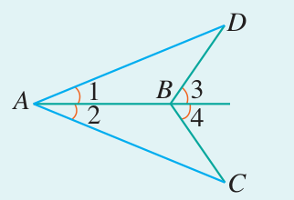

**答案**

$\boxed{AC=AD}$。

**解析**

1. $\angle DAB=\angle CAB$（$\angle1=\angle2$）。
2. $\angle ABD$ 与 $\angle3$ 互补，$\angle ABC$ 与 $\angle4$ 互补；由 $\angle3=\angle4$ 得 $\angle ABD=\angle ABC$。
3. $AB=AB$（公共边）。
4. $\triangle ABD\cong\triangle ABC$（$\mathrm{ASA}$）。
5. $\boxed{AD=AC}$（全等三角形对应边相等）。

### Q-MATH-TB8A-14.2-5

```yaml
id: Q-MATH-TB8A-14.2-5
category: 课本习题
source: 课本习题14.2第5题，印刷p.44（PDF第51页）
source_quality: 课本原文
kp: MATH-8A-14-2d
type: 证明
grading: 自评
answer_by: 本项目编写，待复核
review:
  概念: MATH-8A-14-2d
  公式: MATH-8A-14-2d
  计算: MATH-8A-14-2d
  审题: MATH-8A-14-2d
```

**题干**

如图，$\angle1=\angle2$，$\angle B=\angle D$。求证 $AB=CD$。

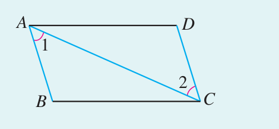

**答案**

$\boxed{AB=CD}$。

**解析**

1. 在 $\triangle ABC$ 和 $\triangle CDA$ 中，$\angle BAC=\angle DCA$，$\angle ABC=\angle CDA$（已知）。
2. $AC=CA$（公共边，也是 $\angle B$、$\angle D$ 的对应对边）。
3. $\triangle ABC\cong\triangle CDA$（$\mathrm{AAS}$）。
4. $\boxed{AB=CD}$（全等三角形对应边相等）。

### Q-MATH-TB8A-14.2-11

```yaml
id: Q-MATH-TB8A-14.2-11
category: 课本习题
source: 课本习题14.2第11题，印刷p.45（PDF第52页）
source_quality: 课本原文
kp: MATH-8A-14-2e
type: 证明
grading: 自评
answer_by: 本项目编写，待复核
review:
  概念: MATH-8A-14-2e
  公式: MATH-8A-14-2e
  计算: MATH-8A-14-2e
  审题: MATH-8A-14-2e
```

**题干**

如图，在 $\triangle ABC$ 中，$AB=AC$，$AD$ 是高。求证 $BD=CD$，$\angle BAD=\angle CAD$。

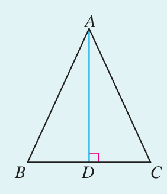

**答案**

$\boxed{BD=CD\text{，}\angle BAD=\angle CAD}$。

**解析**

1. $\angle ADB=\angle ADC=90^\circ$（$AD$ 是高）。
2. 在 $\mathrm{Rt}\triangle ADB$ 和 $\mathrm{Rt}\triangle ADC$ 中，$AB=AC$（斜边），$AD=AD$（公共直角边）。
3. $\mathrm{Rt}\triangle ADB\cong\mathrm{Rt}\triangle ADC$（$\mathrm{HL}$）。
4. $\boxed{BD=CD}$，$\boxed{\angle BAD=\angle CAD}$（全等三角形的性质）。

### Q-MATH-TB8A-14.3-6

```yaml
id: Q-MATH-TB8A-14.3-6
category: 课本习题
source: 课本习题14.3第6题，印刷p.53（PDF第60页）
source_quality: 课本原文
kp: MATH-8A-14-3a
type: 证明
grading: 自评
answer_by: 本项目编写，待复核
review:
  概念: MATH-8A-14-3a
  公式: MATH-8A-14-3a
  计算: MATH-8A-14-3a
  审题: MATH-8A-14-3a
```

**题干**

如图，$OC$ 是 $\angle AOB$ 的平分线，$P$ 是 $OC$ 上的一点，$PD\perp OA$，$PE\perp OB$，垂足分别为 $D$，$E$。$F$ 是 $OC$ 上的另一点，连接 $DF$，$EF$。求证 $DF=EF$。

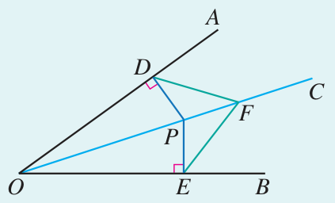

**答案**

$\boxed{DF=EF}$。

**解析**

1. $PD=PE$（角平分线上的点到角两边距离相等）。
2. 在 $\mathrm{Rt}\triangle ODP$ 和 $\mathrm{Rt}\triangle OEP$ 中，$OP=OP$，$PD=PE$，故两三角形全等（$\mathrm{HL}$），得 $OD=OE$。
3. 在 $\triangle ODF$ 和 $\triangle OEF$ 中，$OD=OE$，$\angle DOF=\angle EOF$（$OF$ 在角平分线上），$OF=OF$。
4. 两三角形全等（$\mathrm{SAS}$），所以 $\boxed{DF=EF}$。

### Q-MATH-TB8A-14.3-3

```yaml
id: Q-MATH-TB8A-14.3-3
category: 课本习题
source: 课本习题14.3第3题，印刷p.52（PDF第59页）
source_quality: 课本原文
kp: MATH-8A-14-3a
type: 证明
grading: 自评
answer_by: 本项目编写，待复核
review:
  概念: MATH-8A-14-3a
  公式: MATH-8A-14-3a
  计算: MATH-8A-14-3a
  审题: MATH-8A-14-3a
```

**题干**

如图，$CD\perp AB$，$BE\perp AC$，垂足分别为 $D$，$E$，$BE$，$CD$ 相交于点 $O$，$OB=OC$。求证 $\angle1=\angle2$。

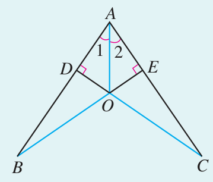

**答案**

$\boxed{\angle1=\angle2}$。

**解析**

1. $\angle BDO=\angle CEO=90^\circ$，$\angle BOD=\angle COE$（对顶角），$OB=OC$。
2. $\triangle BDO\cong\triangle CEO$（$\mathrm{AAS}$），故 $OD=OE$。
3. $OD$、$OE$ 是点 $O$ 到 $AB$、$AC$ 的距离，且 $O$ 在 $\angle BAC$ 内部。
4. $AO$ 是 $\angle BAC$ 的平分线（到角两边距离相等的角内点在角平分线上），故 $\boxed{\angle1=\angle2}$。

### Q-MATH-GZ2025-18

```yaml
category: 真题
source: 2025年广州市初中学业水平考试 数学 第18题
source_quality: 精品解析原卷Word，对照转出的PDF页核对
kp: MATH-8A-14-2b
type: 解答
grading: 自评
answer_by: 原卷解析
review:
  概念: MATH-8A-14-2b
```

**题干**

如图，$BA=BE$，$\angle1=\angle2$，$BC=BD$。求证：$\triangle ABC\cong\triangle EBD$。

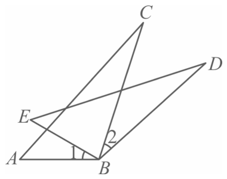

**答案**

见解析

**解析**

已知 $BA=BE$，$BC=BD$，要用“边角边”，还需要 $\angle ABC=\angle EBD$，即夹角相等。

因为 $\angle1=\angle2$，两边都加上 $\angle EBC$，得 $\angle1+\angle EBC=\angle2+\angle EBC$，即 $\angle ABC=\angle EBD$。

在 $\triangle ABC$ 和 $\triangle EBD$ 中，

$$\begin{cases}BA=BE,\\\angle ABC=\angle EBD,\\BC=BD,\end{cases}$$

所以 $\triangle ABC\cong\triangle EBD$（SAS）。

---

### Q-MATH-GZ2023-15

```yaml
category: 真题
source: 2023年广州市初中学业水平考试 数学 第15题
source_quality: 精品解析原卷Word，对照转出的PDF页核对
kp: MATH-8A-14-3a
type: 填空
grading: 自评
answer_by: 原卷解析
review:
  概念: MATH-8A-14-3a
```

**题干**

如图，已知 $AD$ 是 $\triangle ABC$ 的角平分线，$DE$，$DF$ 分别是 $\triangle ABD$ 和 $\triangle ACD$ 的高，$AE=12$，$DF=5$，则点 $E$ 到直线 $AD$ 的距离为＿＿＿＿。

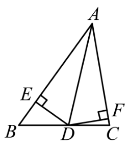

**答案**

$\dfrac{60}{13}$

**解析**

因为 $AD$ 是角平分线，$DE\perp AB$，$DF\perp AC$，所以 $DE=DF=5$。在 $\mathrm{Rt}\triangle ADE$ 中 $AD=\sqrt{AE^2+DE^2}=\sqrt{12^2+5^2}=13$。设点 $E$ 到 $AD$ 的距离为 $x$，由面积相等 $\dfrac12AD\cdot x=\dfrac12AE\cdot DE$，得 $x=\dfrac{12\times5}{13}=\dfrac{60}{13}$。

---

### Q-MATH-GD2020-20

```yaml
category: 真题
source: 2020 年广东省初中学业水平考试 数学 第 20 题
source_quality: 原卷（本地存档 Word 转 PDF 页，逐页核对）
kp: MATH-8A-14-2d
type: 解答
grading: 自评
answer_by: 原卷解析
review:
  概念: MATH-8A-14-2d
```

**题干**

如图，在 $\triangle ABC$ 中，点 $D,E$ 分别是 $AB,AC$ 边上的点，$BD=CE$，$\angle ABE=\angle ACD$，$BE$ 与 $CD$ 相交于点 $F$。求证：$\triangle ABC$ 是等腰三角形。

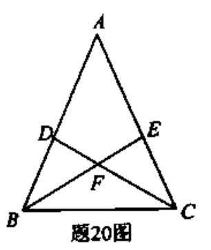

**答案**

证明见解析。

**解析**

证明：在 $\triangle BFD$ 与 $\triangle CFE$ 中，$\angle DFB=\angle EFC$（对顶角），$\angle ABE=\angle ACD$，$BD=CE$，所以 $\triangle BFD\cong\triangle CFE$（AAS），得 $\angle DBF=\angle ECF$。又 $\angle DBF+\angle ABE=\angle ECF+\angle ACD$，即 $\angle ABC=\angle ACB$，所以 $AB=AC$，$\triangle ABC$ 是等腰三角形。

---

### Q-MATH-YN2023-18

```yaml
category: 外省真题
source: 2023 年云南省初中学业水平考试 数学 第 18 题
source_quality: 原卷（外省卷，Word 转 PDF 页，逐页核对）
kp: MATH-8A-14-2a
type: 证明
grading: 自评
answer_by: 原卷解析
review:
  概念: MATH-8A-14-2a
```

**题干**

如图，$C$ 是 $BD$ 的中点，$AB=ED$，$AC=EC$。求证：$\triangle ABC\cong\triangle EDC$。

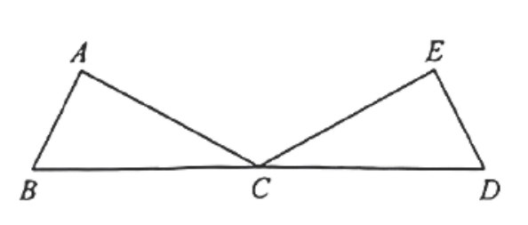

**答案**

证明见解析。

**解析**

证明：因为 $C$ 是 $BD$ 的中点，所以 $BC=DC$。在 $\triangle ABC$ 和 $\triangle EDC$ 中，$AB=ED$，$BC=DC$，$AC=EC$，所以 $\triangle ABC\cong\triangle EDC$（SSS）。

---

## 备选

无。
