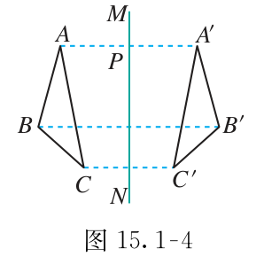
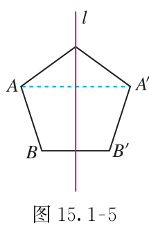
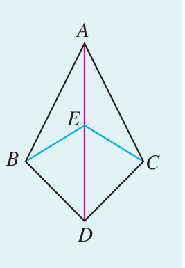
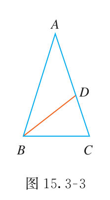
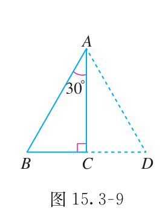

# 第十五章 轴对称

折叠能把两边对在一起，也能把“等距”变成可用的条件。遇到等腰三角形，先认清腰和底；遇到坐标轴对称，先看哪个坐标没有改变。

## 本章前置自查

1. 能按顶点顺序找全等三角形的对应边吗？不能：回看 第十四章第1节。
2. 能判断给定三边能否组成三角形吗？不能：回看 第十三章第2节。

## 15.1a 轴对称图形与成轴对称

```yaml
id: MATH-8A-15-1a
title: 轴对称图形与成轴对称
weight: 一般
weight_note: 本章基础链条所必需；考频采用保守归类，不把综合题全部归到本章。
textbook: 八上 15.1，印刷p.62–65
prerequisites:
- id: MATH-8A-14-1a
  strength: hard
  reason: 对称后重合，继而使用全等性质。
evidence:
- 能区分“轴对称图形”与“成轴对称”。
- 能由对称关系取对应边角。
figure: 已完成 figures/tb8a-15-1-fig15-1-4.png（课本图15.1-4原图，放在先认住之后）、figures/tb8a-15-1-fig15-1-5.png（课本图15.1-5原图，放在先认住之后）
method: [MG16 数形结合]
sources:
- 新版课本原页，详见本章sources.md
- 九套有效卷筛查；低频及未记录不等于不考
```

### 本次只学

区分一个图形自身对称和两个图形成轴对称。

### 先认住

一个图形沿某条直线折叠后，直线两旁的部分能互相重合，它就是轴对称图形；这条直线是对称轴。

两个图形沿某条直线折叠后能重合，就说它们关于这条直线成轴对称。成轴对称的两个图形全等，对应线段相等、对应角相等。

连接一对不重合的对称点，对称轴垂直平分这条线段。**补充**（课本没有讲，做真题时常用）：对称轴上的点与自身对应。





### 数形结合

```bridge
mode: cards
式: 对应线段相等、对应角相等
图: sym-axis
形: 两个图形对折能重合；对称点到直线的距离相等，连线垂直于这条直线
色: blue
```

### 容易错

对称轴是一条直线，不是一条有限长线段。全等不一定成轴对称；颜色和内部标记也要一起检查。

### 练一练

- `Q-MATH-TB8A-15.1-3`

## 15.1b 线段垂直平分线的性质与判定

```yaml
id: MATH-8A-15-1b
title: 线段垂直平分线的性质与判定
weight: 重点
weight_note: GZ2023-14等最短路径题主要利用轴对称；垂直平分线也是圆心定位的前置。
textbook: 八上 15.1，印刷p.65–68
prerequisites:
- id: MATH-8A-15-1a
  strength: hard
  reason: 对称轴与连接对称点的线段有垂直平分关系。
evidence:
- 能用垂直平分线推出两条线段相等。
- 能用两个等距点确定垂直平分线。
figure: 已完成 figures/tb-15-1-5.png（课本图原图，不再另画图解步骤图）
method: [MG16 数形结合]
sources:
- 新版课本原页，详见本章sources.md
- 九套有效卷筛查；低频及未记录不等于不考
walk_source: 课本习题15.1第5题，印刷p.70；PDF第77页
```

### 本次只学

从垂直平分线得到等距，也能从等距找回垂直平分线。

### 先认住

线段垂直平分线上的点到线段两端的距离相等。反过来，到线段两端距离相等的点，在这条线段的垂直平分线上。

要作 $BC$ 的垂直平分线，可分别以 $B$、$C$ 为圆心、同一适当长度为半径作弧，上下弧交点都到 $B,C$ 等距，它们的连线就是所求直线。

判断一条直线时，找到线上两个不同的等距点，就能确定这条直线。

### 数形结合

```bridge
mode: cards
式: $PA=PB$
图: perp-bis
形: 点在线段的垂直平分线上，到两端点的距离相等；反过来，到两端点距离相等的点必落在垂直平分线上
色: blue
```

### 走一遍



若 $AB=AC$，点 $A$ 在 $BC$ 的垂直平分线上；若 $DB=DC$，点 $D$ 也在这条线上。

$A,D$ 是两个不同的点，所以直线 $AD$ 就是 $BC$ 的垂直平分线。

任取 $AD$ 上的点 $E$，它到 $B,C$ 的距离相等，得到 $\boxed{EB=EC}$。

### 容易错

只过中点，不一定垂直；只垂直，不一定平分。这里比较的是到两个端点的距离，不是到两条边的距离。

### 练一练

- `Q-MATH-TB8A-15.1-4`
- `Q-MATH-GD2021-20`

## 15.1c 命题与逆命题

```yaml
id: MATH-8A-15-1c
title: 命题与逆命题
weight: 了解
weight_note: 本章基础链条所必需；考频采用保守归类，不把综合题全部归到本章。
textbook: 八上 15.1，印刷p.66–67
prerequisites: []
evidence:
- 能写出一个命题的逆命题。
- 能说明原命题为真不保证逆命题为真。
figure: 不需要
method: []
sources:
- 新版课本原页，详见本章sources.md
- 九套有效卷筛查；低频及未记录不等于不考
```

### 本次只学

交换条件和结论后，重新判断是否成立。

### 先认住

把一个命题的条件和结论交换，就得到它的逆命题。原命题为真，逆命题未必为真。

“两个实数相等，它们的平方相等”为真；反过来，平方相等的实数可能互为相反数。

逆命题不是把结论加上“不”字。性质与逆向判定都要分别确认，不能因为一边成立就自行反推。

## 15.2a 画轴对称图形与坐标轴对称

```yaml
id: MATH-8A-15-2a
title: 画轴对称图形与坐标轴对称
weight: 一般
weight_note: 本章基础链条所必需；考频采用保守归类，不把综合题全部归到本章。
textbook: 八上 15.2，印刷p.72–75、印刷p.94–95（综合与实践）
prerequisites:
- id: MATH-8A-15-1a
  strength: hard
  reason: 先理解对称点等距及对称轴垂直平分连线。
evidence:
- 能写出关于两坐标轴的对称点坐标。
- 能说清保留的坐标对应哪一个位置。
figure: 已完成 figures/axis-symmetry-15-2a.svg（点(-2,6)关于两轴对称与将军饮马最短路径；已放在 Q-MATH-TB8A-15.2P-1 的解析之后）
method:
- MG16 数形结合
sources:
- 新版课本原页，详见本章sources.md
- 九套有效卷筛查；低频及未记录不等于不考
```

### 本次只学

先找关键点的对称点，再按原顺序连接。

### 先认住

画一个点的对称点：过它向对称轴作垂线，在轴的另一侧取到轴距离相等的点。轴上的点保持不动。

点 $(x,y)$ 关于 $x$ 轴对称的点为 $(x,-y)$：横坐标不变，纵坐标互为相反数。关于 $y$ 轴对称的点为 $(-x,y)$：纵坐标不变，横坐标互为相反数。坐标为 $0$ 时仍按此规则处理，轴上的点与自身重合。

最短路径也可以用对称点处理：两点在直线同侧时，先把一点关于直线对称到另一侧，再连接它与另一点。连线与直线的交点，就是两段路径和最短的位置；因为对称不改变到直线上点的距离，折线路径便转成了直线路径。

### 数形结合

```bridge
mode: cards
式: $(x,y)\to(-x,y)$
图: sym-coord
形: 垂直于对称轴方向的坐标变号，点移到另一侧的等距位置；沿轴方向的坐标不变
色: blue
结: 坐标为 $0$ 的点留在轴上。
```

### 容易错

不要把两个坐标都变号；那不是单独关于某一坐标轴对称。关于某轴对称时，轴上的点不动。

### 练一练

- `Q-MATH-TB8A-15.2P-1`
- `Q-MATH-GD2020-03`

## 15.3a 等腰三角形的性质

```yaml
id: MATH-8A-15-3a
title: 等腰三角形的性质
weight: 重点
weight_note: 等腰性质在旋转、轴对称、圆中反复使用；分类与三线合一容易误用，列重点。
textbook: 八上 15.3，印刷p.78–80
prerequisites:
- id: MATH-8A-13-3a
  strength: hard
  reason: 求角要使用内角和。
- id: MATH-8A-13-2a
  strength: hard
  reason: 分类求边要检查三边关系。
- id: MATH-8A-14-2e
  strength: hard
  reason: 等腰性质可用直角三角形全等证明。
evidence:
- 能由两腰相等求底角。
- 能判断三线合一对应的是哪一条底边。
- 能排除等腰分类中的无效边长方案。
figure: 已完成 figures/tb8a-15-3-ex1-fig15-3-3.png（课本图15.3-3原图，放在走一遍之后）
method:
- MG16 数形结合
sources:
- 新版课本原页，详见本章sources.md
- 九套有效卷筛查；低频及未记录不等于不考
walk_source: 课本15.3例1，印刷p.79；PDF第86页
```

### 本次只学

用等边对等角，并核对三线合一的适用位置。

### 先认住

等腰三角形的两个底角相等，即等边对等角。若 $AB=AC$，相等的底角是 $\angle B$ 与 $\angle C$。

等腰三角形顶角的平分线、底边上的中线、底边上的高互相重合，简称“三线合一”。这些线必须对应顶角和底边。

只给“一边”或“一个角”时，先判断它可能是腰还是底、顶角还是底角；每一种都要满足内角和与三边关系。

### 走一遍

在 $\triangle ABC$ 中，$AB=AC$，点 $D$ 在 $AC$ 上，$BD=BC=AD$。求 $\triangle ABC$ 各角的度数。

设 $\angle A=x$。

$AD=BD$，故 $\angle ABD=\angle A=x$；外角 $\angle BDC=\angle A+\angle ABD=2x$。

$BD=BC$ 且 $AB=AC$，故 $\angle C=\angle BDC=2x$，$\angle ABC=\angle C=2x$。

在 $\triangle ABC$ 中，三个内角和为 $180^\circ$：
$x+2x+2x=180^\circ$

解得 $x=36^\circ$，因此 $\boxed{\angle A=36^\circ\text{，}\angle ABC=\angle C=72^\circ}$。

把等边转化为等角，设出未知数后利用内角和列方程求解。



### 容易错

不能对任意三角形使用三线合一，也不能对等腰三角形腰上的中线直接使用。分类求边以后，要检查能否围成三角形。

### 练一练

- `Q-MATH-TB8A-15.3-1`
- `Q-MATH-MG16-E1`
- `Q-MATH-YN2024-8`

## 15.3b 等腰三角形的判定

```yaml
id: MATH-8A-15-3b
title: 等腰三角形的判定
weight: 一般
weight_note: 本章基础链条所必需；考频采用保守归类，不把综合题全部归到本章。
textbook: 八上 15.3，印刷p.80–81
prerequisites:
- id: MATH-8A-13-1a
  strength: hard
  reason: 要知道每个角的对边。
- id: MATH-8A-15-3a
  strength: hard
  reason: 先区分性质与判定方向。
evidence:
- 能把平行线和角平分线产生的等角放进同一个三角形。
- 能从等角取到正确的两条对边。
figure: 不需要
method: []
sources:
- 新版课本原页，详见本章sources.md
- 九套有效卷筛查；低频及未记录不等于不考
```

### 本次只学

由两个内角相等，找到它们的对边。

### 先认住

如果一个三角形有两个角相等，那么这两个角所对的边也相等，即等角对等边。

看到平行线和角平分线时，先把它们带来的等角放进同一个三角形，再取对边相等。

### 容易错

不能跨两个不全等的三角形，用“角相等”直接推出“边相等”。角的对边要按顶点来找。

### 练一练

- `Q-MATH-TB8A-15.3-2`

## 15.3c 等边三角形

```yaml
id: MATH-8A-15-3c
title: 等边三角形
weight: 一般
weight_note: 本章基础链条所必需；考频采用保守归类，不把综合题全部归到本章。
textbook: 八上 15.3，印刷p.81–82
prerequisites:
- id: MATH-8A-15-3b
  strength: hard
  reason: 三个等角可以推出三边相等。
evidence:
- 能由三个60度角判定等边三角形。
- 能区别“一个60度角”和“等腰加60度角”的条件。
figure: 不需要
method: []
sources:
- 新版课本原页，详见本章sources.md
- 九套有效卷筛查；低频及未记录不等于不考
```

### 本次只学

从三边相等或角条件认出等边三角形。

### 先认住

三边都相等的三角形是等边三角形。它的三个内角都为 $60^\circ$。**补充**（课本没有讲，做真题时常用）：等边三角形三条中线（也是高、角平分线）所在直线都是它的对称轴。

三个角都相等的三角形是等边三角形；有一个角为 $60^\circ$ 的等腰三角形也是等边三角形。

### 容易错

单独一个 $60^\circ$ 角不够。若已知两个 $60^\circ$ 角，可先由内角和得到第三个。

### 练一练

- `Q-MATH-TB8A-15.3-5`

## 15.3d 含30度角的直角三角形

```yaml
id: MATH-8A-15-3d
title: 含30度角的直角三角形
weight: 一般
weight_note: 本章基础链条所必需；考频采用保守归类，不把综合题全部归到本章。
textbook: 八上 15.3，印刷p.82–84
prerequisites:
- id: MATH-8A-15-3c
  strength: hard
  reason: 可用等边三角形沿高分成两半理解。
evidence:
- 能找准30度角的对边。
- 能在直角条件下，把角度条件转成二倍边长关系。
figure: 已完成 figures/tb8a-15-3-fig15-3-9.png（课本图15.3-9原图，放在先认住之后）
method: [MG16 数形结合]
sources:
- 新版课本原页，详见本章sources.md
- 九套有效卷筛查；低频及未记录不等于不考
```

### 本次只学

找准30度角的对边与斜边。

### 先认住

在直角三角形中，$30^\circ$ 角所对的直角边等于斜边的一半。**补充**（课本没有讲，做真题时常用）：在直角三角形中，如果一条直角边等于斜边的一半，那么它所对的锐角为 $30^\circ$。

先标直角，找斜边；再标 $30^\circ$ 角，找它不相邻的那条边。



### 数形结合

```bridge
mode: hero
式: $a=\frac{1}{2}c$
图: tri-3090
形: 直角三角形中含 $30^\circ$ 锐角，它所对的直角边是斜边的一半
色: blue
```

### 容易错

30度角所对的边，不是与它相邻的直角边。没有直角条件，不能直接用“斜边的一半”。

### 练一练

- `Q-MATH-TB8A-15.3P-1`
