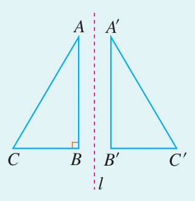
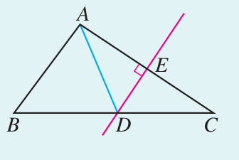
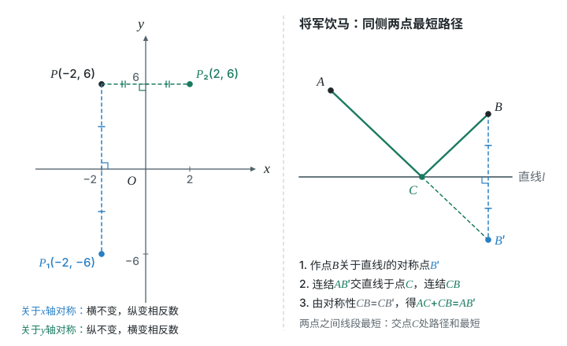
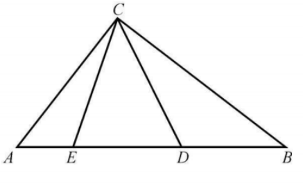
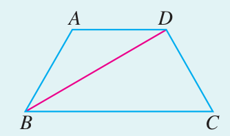
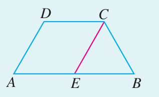
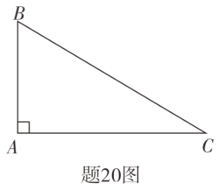

# 第十五章 轴对称 · 练习

## 讲义用题

### Q-MATH-TB8A-15.1-3

```yaml
id: Q-MATH-TB8A-15.1-3
category: 课本习题
source: 课本习题15.1第3题，印刷p.70（PDF第77页）
source_quality: 课本原文
kp: MATH-8A-15-1a
type: 解答
grading: 自评
answer_by: 本项目编写，待复核
review:
  概念: MATH-8A-15-1a
  公式: MATH-8A-15-1a
  计算: MATH-8A-15-1a
  审题: MATH-8A-15-1a
```

**题干**

如图，$\triangle ABC$ 和 $\triangle A^{\prime}B^{\prime}C^{\prime}$ 关于直线 $l$ 对称，$\angle B=90^\circ$，$A^{\prime}B^{\prime}=6$。求 $\angle B^{\prime}$ 的度数和 $AB$ 的长。



**答案**

$\boxed{\angle B^{\prime}=90^\circ\text{，}AB=6}$。

**解析**

1. 成轴对称的图形全等，对应角相等，故 $\angle B^{\prime}=\angle B=\boxed{90^\circ}$。
2. 对应边相等，故 $AB=A^{\prime}B^{\prime}=\boxed6$。

### Q-MATH-TB8A-15.1-4

```yaml
id: Q-MATH-TB8A-15.1-4
category: 课本习题
source: 课本习题15.1第4题，印刷p.70（PDF第77页）
source_quality: 课本原文
kp: MATH-8A-15-1b
type: 解答
grading: 自评
answer_by: 本项目编写，待复核
review:
  概念: MATH-8A-15-1b
  公式: MATH-8A-15-1b
  计算: MATH-8A-15-1b
  审题: MATH-8A-15-1b
```

**题干**

如图，在 $\triangle ABC$ 中，$DE$ 是 $AC$ 的垂直平分线，$AE=3$，$\triangle ABD$ 的周长为 $13$。求 $\triangle ABC$ 的周长。



**答案**

$\triangle ABC$ 的周长为 $\boxed{19}$。

**解析**

1. $AE=EC=3$，所以 $AC=2\times\textcolor{#287fc4}{3}=6$（垂直平分线的定义）。
2. 点 $D$ 在 $AC$ 的垂直平分线上，故 $DA=DC$（垂直平分线的性质）。
3. $AB+BD+DA=13$（$\triangle ABD$ 的周长）。用 $DC$ 替换 $DA$，得 $AB+BD+DC=13$。
4. $D$ 在 $BC$ 上，故 $BD+DC=BC$，于是 $AB+BC=13$。
5. $\triangle ABC$ 的周长为 $AB+BC+AC=\textcolor{#287fc4}{13}+\textcolor{#287fc4}{6}=\boxed{19}$。

### Q-MATH-TB8A-15.2P-1

```yaml
id: Q-MATH-TB8A-15.2P-1
category: 课本习题
source: 课本15.2节末练习第1题，印刷p.75；PDF第82页
source_quality: 课本原文
kp: MATH-8A-15-2a
type: 解答
grading: 自评
answer_by: 本项目编写，待复核
review:
  概念: MATH-8A-15-2a
  公式: MATH-8A-15-2a
  计算: MATH-8A-15-2a
  审题: MATH-8A-15-2a
```

**题干**

分别写出下列各点关于 $x$ 轴和 $y$ 轴对称的点的坐标：

$(-2,6)$，$(1,-2)$，$(1,3)$，$(-4,-2)$，$(1,0)$。

**答案**

关于 $x$ 轴依次为 $\boxed{(-2,-6)\text{，}(1,2)\text{，}(1,-3)\text{，}(-4,2)\text{，}(1,0)}$。

关于 $y$ 轴依次为 $\boxed{(2,6)\text{，}(-1,-2)\text{，}(-1,3)\text{，}(4,-2)\text{，}(-1,0)}$。

**解析**

1. 关于 $x$ 轴：保留横坐标，把纵坐标变为其相反数。
2. 关于 $y$ 轴：保留纵坐标，把横坐标变为其相反数。
3. $(1,0)$ 在 $x$ 轴上，关于 $x$ 轴的对称点仍是自身。



### Q-MATH-TB8A-15.3-1

```yaml
id: Q-MATH-TB8A-15.3-1
category: 课本习题
source: 课本习题15.3第1题，印刷p.84（PDF第91页）
source_quality: 课本原文
kp: MATH-8A-15-3a
type: 解答
grading: 自评
answer_by: 本项目编写，待复核
review: &id001
  概念: MATH-8A-15-3a
  公式: MATH-8A-15-3a
  计算: MATH-8A-15-3a
  审题: MATH-8A-15-3a
parts:
- part: '1'
  kp: MATH-8A-15-3a
  review: *id001
- part: '2'
  kp: MATH-8A-15-3a
  review: *id001
```

**题干**

（1）等腰三角形的一个角是 $110^\circ$，它的另外两个角是多少度？

（2）等腰三角形的一边长是 $8$，周长是 $18$，它的另外两边长是多少？

**答案**

（1）$\boxed{35^\circ\text{，}35^\circ}$；（2）$\boxed{5\text{，}5}$ 或 $\boxed{8\text{，}2}$。

**解析**

1. $110^\circ$ 不可能是底角，否则两个底角和为 $220^\circ$；因此是顶角。
2. 两个底角各为 $(180^\circ-110^\circ)\div2=\boxed{35^\circ}$。
3. 若 $8$ 是底，两腰各为 $(18-8)\div2=5$，且 $5+5>8$，成立。
4. 若 $8$ 是腰，三边为 $8,8,2$，也能组成三角形，故另外两边还可以为 $\boxed{8\text{，}2}$。

### Q-MATH-MG16-E1

```yaml
id: Q-MATH-MG16-E1
category: 导引例题
source: 思想方法导引例16.1，印刷p.132；PDF第139页；OCR行3471–3495
source_quality: 导引原文
kp: MATH-8A-15-3a
type: 解答
grading: 自评
answer_by: 本项目编写，待复核
review:
  概念: MATH-8A-15-3a
  公式: MATH-8A-15-3a
  计算: MATH-8A-15-3a
  审题: MATH-8A-15-3a
```

**题干**

如图16-2，在 $\triangle ABC$ 中，$\angle ACB=90^\circ$，点 $D$，$E$ 在 $AB$ 上，且 $AD=AC$，$BE=BC$，求 $\angle ECD$ 的度数。



**答案**

$\boxed{45^\circ}$。

**解析**

1. 设 $\angle ECD=x$，$\angle ACE=\alpha$，$\angle BCD=\beta$，则 $x+\alpha+\beta=90^\circ$。
2. $AD=AC$，所以 $\angle ADC=\angle ACD=x+\alpha$（等边对等角）。
3. $BE=BC$，所以 $\angle BEC=\angle BCE=x+\beta$（等边对等角）。
4. $D,E$ 在 $AB$ 上，故 $\angle CDE=\angle ADC$，$\angle CED=\angle BEC$。
5. 在 $\triangle CED$ 中，$x+(x+\alpha)+(x+\beta)=180^\circ$。
6. 代入第1步得 $2x+90^\circ=180^\circ$，所以 $\boxed{x=45^\circ}$。

### Q-MATH-TB8A-15.3-2

```yaml
id: Q-MATH-TB8A-15.3-2
category: 课本习题
source: 课本习题15.3第2题，印刷p.84（PDF第91页）
source_quality: 课本原文
kp: MATH-8A-15-3b
type: 证明
grading: 自评
answer_by: 本项目编写，待复核
review:
  概念: MATH-8A-15-3b
  公式: MATH-8A-15-3b
  计算: MATH-8A-15-3b
  审题: MATH-8A-15-3b
```

**题干**

如图，$AD\parallel BC$，$BD$ 平分 $\angle ABC$。求证 $AB=AD$。



**答案**

$\boxed{AB=AD}$。

**解析**

1. $\angle ADB=\angle DBC$（$AD\parallel BC$，内错角相等）。
2. $\angle ABD=\angle DBC$（$BD$ 平分 $\angle ABC$）。
3. $\angle ABD=\angle ADB$。
4. 在 $\triangle ABD$ 中，$\boxed{AD=AB}$（等角对等边）。

### Q-MATH-TB8A-15.3-5

```yaml
id: Q-MATH-TB8A-15.3-5
category: 课本习题
source: 课本习题15.3第5题，印刷p.84（PDF第91页）
source_quality: 课本原文
kp: MATH-8A-15-3c
type: 证明
grading: 自评
answer_by: 本项目编写，待复核
review:
  概念: MATH-8A-15-3c
  公式: MATH-8A-15-3c
  计算: MATH-8A-15-3c
  审题: MATH-8A-15-3c
```

**题干**

如图，$\angle A=\angle B=60^\circ$，$CE\parallel DA$，$CE$ 交 $AB$ 于点 $E$。求证：$\triangle CEB$ 是等边三角形。



**答案**

$\boxed{\triangle CEB\text{ 是等边三角形}}$。

**解析**

1. $\angle CEB=\angle DAB=60^\circ$（$CE\parallel DA$，同位角相等）。
2. $\angle CBE=\angle CBA=60^\circ$（$E$ 在 $AB$ 上）。
3. $\angle BCE=180^\circ-60^\circ-60^\circ=60^\circ$（内角和）。
4. 三个角都相等，所以 $\boxed{\triangle CEB\text{ 是等边三角形}}$。

### Q-MATH-TB8A-15.3P-1

```yaml
id: Q-MATH-TB8A-15.3P-1
category: 课本习题
source: 课本15.3含30度角直角三角形后的练习第1题，印刷p.84；PDF第91页
source_quality: 课本原文
kp: MATH-8A-15-3d
type: 解答
grading: 自评
answer_by: 本项目编写，待复核
review:
  概念: MATH-8A-15-3d
  公式: MATH-8A-15-3d
  计算: MATH-8A-15-3d
  审题: MATH-8A-15-3d
```

**题干**

在 $\mathrm{Rt}\triangle ABC$ 中，$\angle C=90^\circ$，$\angle B=2\angle A$，$\angle B$ 和 $\angle A$ 各是多少度？边 $AB$ 与 $BC$ 之间有什么关系？

**答案**

$\boxed{\angle B=60^\circ\text{，}\angle A=30^\circ\text{，}AB=2BC}$。

**解析**

1. $\angle A+\angle B=90^\circ$（直角三角形两锐角互余）。
2. $\angle B=2\angle A$，故 $3\angle A=90^\circ$，得到 $\angle A=30^\circ$，$\angle B=60^\circ$。
3. $BC$ 是 $30^\circ$ 角的对边，$AB$ 是斜边，故 $BC=\dfrac12AB$，即 $\boxed{AB=2BC}$。

### Q-MATH-GD2020-03

```yaml
category: 真题
source: 2020 年广东省初中学业水平考试 数学 第 3 题
source_quality: 原卷（本地存档 Word 转 PDF 页，逐页核对）
kp: MATH-8A-15-2a
type: 选择
grading: 自动
answer_by: 原卷解析
review:
  概念: MATH-8A-15-2a
```

**题干**

在平面直角坐标系中，点 $(3,2)$ 关于 $x$ 轴对称的点的坐标为

A．$(-3,2)$　　B．$(-2,3)$　　C．$(2,-3)$　　D．$(3,-2)$

**答案**

D

**解析**

关于 $x$ 轴对称：横坐标不变，纵坐标变为相反数。

---

### Q-MATH-GD2021-20

```yaml
category: 真题
source: 2021 年广东省初中学业水平考试 数学 第 20 题
source_quality: 原卷（本地存档 Word 转 PDF 页，逐页核对）
kp: MATH-8A-15-1b
type: 解答
grading: 自评
answer_by: 原卷解析
review:
  概念: MATH-8A-15-1b
```

**题干**

如图，在 $\mathrm{Rt}\triangle ABC$ 中，$\angle A=90^\circ$，作 $BC$ 的垂直平分线交 $AC$ 于点 $D$，延长 $AC$ 至点 $E$，使 $CE=AB$。



（1）若 $AE=1$，求 $\triangle ABD$ 的周长；

（2）若 $AD=\dfrac13BD$，求 $\tan\angle ABC$ 的值。

**答案**

（1）$\boxed{1}$；（2）$\boxed{\sqrt2}$。

**解析**

（1）连接 $BD$。$D$ 在 $BC$ 的垂直平分线上，$BD=CD$，所以 $C_{\triangle ABD}=AB+AD+BD=AB+AD+DC=AB+AC$。又 $AB=CE$，所以周长 $=AC+CE=AE=1$。（2）设 $AD=x$，则 $BD=3x$，$AC=AD+DC=4x$。在 $\mathrm{Rt}\triangle ABD$ 中，$AB=\sqrt{(3x)^2-x^2}=2\sqrt2x$，所以 $\tan\angle ABC=\dfrac{AC}{AB}=\dfrac{4x}{2\sqrt2x}=\sqrt2$。

---

### Q-MATH-YN2024-8

```yaml
category: 外省真题
source: 2024 年云南省初中学业水平考试 数学 第 8 题
source_quality: 原卷（外省卷，Word 转 PDF 页，逐页核对）
kp: MATH-8A-15-3a
type: 选择
grading: 自动
answer_by: 原卷解析
review:
  概念: MATH-8A-15-3a
```

**题干**

已知 $AF$ 是等腰 $\triangle ABC$ 底边 $BC$ 上的高，若点 $F$ 到直线 $AB$ 的距离为 $3$，则点 $F$ 到直线 $AC$ 的距离为（　　）

A．$\dfrac32$　　B．$2$　　C．$3$　　D．$\dfrac72$

**答案**

C

**解析**

因为 $AF$ 是等腰 $\triangle ABC$ 底边 $BC$ 上的高，由等腰三角形“三线合一”，$AF$ 平分 $\angle BAC$。角平分线上的点到角两边的距离相等，所以点 $F$ 到 $AC$ 的距离也是 $3$。

---

## 备选

无。
