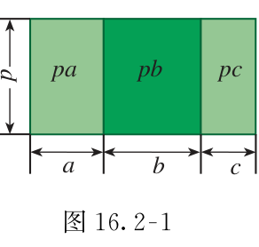
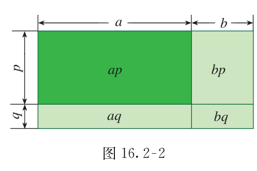
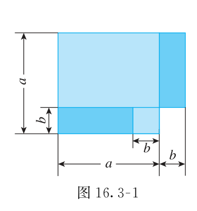
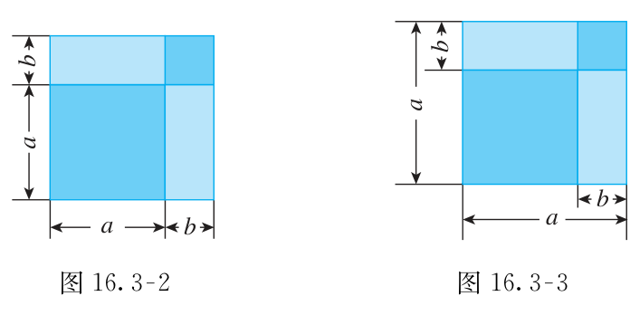

# 第十六章 整式的乘法

先认清算式的结构，再选规则。同底数幂、幂的乘方和积的乘方，外形相近，做法不同。整式乘法最后再合并同类项。

## 本章前置自查

1. 能分清系数、底数和指数吗？不能：回看七上单项式与乘方。
2. 能正确去括号并合并同类项吗？不能：回看七上整式的加减。

## 16.1a 同底数幂的乘法

```yaml
id: MATH-8A-16-1a
title: 同底数幂的乘法
weight: 一般
weight_note: 本章基础链条所必需；考频采用保守归类，不把综合题全部归到本章。
textbook: 八上 16.1，印刷p.98–99
prerequisites: []
evidence:
- 能找出相同底数，再合并指数。
- 能正确处理负底数的同底数幂相乘与符号化简。
figure: 不需要
method: []
sources:
- 新版课本原页，详见本章sources.md
- 九套有效卷筛查；低频及未记录不等于不考
```

### 本次只学

只在底数相同时，把指数相加。

### 先认住

$\boxed{a^m\cdot a^n=a^{m+n}}$，这里 $m,n$ 是正整数。底数不变，指数相加。

乘法与加法不是一条规则：同类项相加改变系数，幂相乘才按指数规则。若底数是负数，括号也是底数的一部分。

### 容易错

底数不同不能直接加指数。别把同底数幂相乘写成“指数相乘”。

### 练一练

- `Q-MATH-TB8A-16.1-1`
- `Q-MATH-GZ2024-03`

## 16.1b 幂的乘方与积的乘方

```yaml
id: MATH-8A-16-1b
title: 幂的乘方与积的乘方
weight: 重点
weight_note: GD2024-05、SZ2023-06、SZ2024-03等直接考查；是整式、分式运算的常见失分点。
textbook: 八上 16.1，印刷p.99–101
prerequisites:
- id: MATH-8A-16-1a
  strength: hard
  reason: 先理解底数与指数。
evidence:
- 能从括号位置判断使用哪条幂的运算规则。
- 能把系数、负号与各字母一起乘方。
figure: 不需要
method: []
sources:
- 新版课本原页，详见本章sources.md
- 九套有效卷筛查；低频及未记录不等于不考
walk_source: 课本习题16.1第3题（1），印刷p.101；PDF第108页
```

### 本次只学

分清“指数相乘”和“每个因式都乘方”。

### 先认住

$\boxed{(a^m)^n=a^{mn}}$；$\boxed{(ab)^n=a^nb^n}$，这里 $m,n$ 是正整数。

幂的乘方：底数不变，指数相乘。积的乘方：每个因式都要乘方，系数和负号也不能漏。

偶数次幂把负底数变为非负数；奇数次幂保留负号。括号外的负号不会自动消失。

### 走一遍

计算 $(2ab)^3$：

系数与每个字母分别乘方，$(2ab)^3=2^3a^3b^3$。

$2^3=8$，所以结果为 $\boxed{8a^3b^3}$。

不能只把字母乘方，却让系数仍是 $2$。

### 容易错

$\textcolor{#c9554d}{(a^2)^5=a^7\quad\text{（错误）}}$

正确：$(a^2)^5=a^{2\times5}=a^{10}$。

$(-a)^2=a^2$，但 $-a^2=-(a^2)$，两个式子不同。

### 练一练

- `Q-MATH-TB8A-16.1-3`
- `Q-MATH-GD2024-05`

## 16.2a 单项式乘法与单项式乘多项式

```yaml
id: MATH-8A-16-2a
title: 单项式乘法与单项式乘多项式
weight: 一般
weight_note: 本章基础链条所必需；考频采用保守归类，不把综合题全部归到本章。
textbook: 八上 16.2，印刷p.103–105
prerequisites:
- id: MATH-8A-16-1a
  strength: hard
  reason: 相同字母相乘要使用同底数幂规则。
evidence:
- 能逐项相乘而不漏掉常数项。
- 能把系数与字母分别处理，再合并结果。
figure: 已完成 figures/tb8a-16-2-fig16-2-1.png（课本图16.2-1原图，放在先认住之后）
method: [MG16 数形结合]
sources:
- 新版课本原页，详见本章sources.md
- 九套有效卷筛查；低频及未记录不等于不考
```

### 本次只学

让单项式与多项式中的每一项相乘。

### 先认住

单项式相乘：系数相乘，相同字母的幂相乘，其余字母保留。

单项式乘多项式：利用分配律，与每一项分别相乘，再把结果相加。$p(a+b+c)=pa+pb+pc$。

把多项式看作几个带符号的项；负号随相应的项一起参与运算。



### 数形结合

```bridge
mode: cards
式: $p(a+b+c)=pa+pb+pc$
图: area-dist
形: 大长方形的面积，等于三块小长方形面积之和
色: blue
```

### 容易错

不能只乘括号里的第一项。常数项也要乘；负数乘负数得正数。

### 练一练

- `Q-MATH-TB8A-16.2-2`
- `Q-MATH-SZ2024-03`

## 16.2b 多项式乘多项式

```yaml
id: MATH-8A-16-2b
title: 多项式乘多项式
weight: 重点
weight_note: 本章基础链条所必需；考频采用保守归类，不把综合题全部归到本章。
textbook: 八上 16.2，印刷p.106–107
prerequisites:
- id: MATH-8A-16-2a
  strength: hard
  reason: 先掌握单项式逐项相乘。
evidence:
- 能列出所有逐项乘积，不漏交叉项。
- 能在展开以后正确合并同类项。
figure: 已完成 figures/tb8a-16-2-fig16-2-2.png（课本图16.2-2原图，放在先认住之后）
method:
- MG16 数形结合
sources:
- 新版课本原页，详见本章sources.md
- 九套有效卷筛查；低频及未记录不等于不考
walk_source: 课本习题16.2第3题（1），印刷p.110；PDF第117页；面积解释依据16.2分配律
```

### 本次只学

每一项都乘遍，再合并同类项。

### 先认住

一个多项式的每一项，都要乘另一个多项式的每一项。

$(a+b)(p+q)=ap+aq+bp+bq$。两项乘两项，展开前先确认有四个乘积；最后才合并同类项。



### 数形结合

```bridge
mode: cards
式: $(a+b)(p+q)=ap+aq+bp+bq$
图: area-foil
形: 大长方形拆成四块小长方形，面积相加
色: blue
```

### 走一遍

计算 $(x-6)(x-3)$：

逐项相乘得 $x^2-3x-6x+18$。

合并同类项得 $\boxed{x^2-9x+18}$。

把两条边各分成两段，四个小面积对应四个乘积；负号则用带符号的运算处理，不能当负长度。

### 容易错

不能把 $(a+b)(p+q)$ 只算成 $ap+bq$。每一项带着自己的正负号相乘。

### 练一练

- `Q-MATH-TB8A-16.2-3`

## 16.2c 同底数幂的除法与整式除以单项式

```yaml
id: MATH-8A-16-2c
title: 同底数幂的除法与整式除以单项式
weight: 一般
weight_note: 本章基础链条所必需；考频采用保守归类，不把综合题全部归到本章。
textbook: 八上 16.2，印刷p.108–109
prerequisites:
- id: MATH-8A-16-1b
  strength: hard
  reason: 先算乘方，再算除法。
- id: MATH-8A-16-2a
  strength: hard
  reason: 用分配律理解逐项除法。
evidence:
- 能写出非零除式条件。
- 能逐项相除并保留原有加减关系。
figure: 不需要
method: []
sources:
- 新版课本原页，详见本章sources.md
- 九套有效卷筛查；低频及未记录不等于不考
```

### 本次只学

减指数，并让多项式每一项都除以除式。

### 先认住

$\boxed{a^m\div a^n=a^{m-n}}$，此处 $a\neq0$，$m,n$ 为正整数且 $m>n$。相同幂相除为 $1$。

单项式相除：系数相除，同底数幂相除，只在被除式中出现的因式保留。多项式除以单项式：每一项分别相除，再相加。除式必须非零。

### 容易错

被除式有三项，就要分别除三次。除以负单项式时，每一项都要检查符号。

### 练一练

- `Q-MATH-TB8A-16.2-4`

## 16.3a 平方差公式

```yaml
id: MATH-8A-16-3a
title: 平方差公式
weight: 重点
weight_note: 本章基础链条所必需；考频采用保守归类，不把综合题全部归到本章。
textbook: 八上 16.3，印刷p.112–113
prerequisites:
- id: MATH-8A-16-2b
  strength: hard
  reason: 平方差由多项式乘法展开并抵消交叉项得到。
evidence:
- 能认出相同部分与互为相反数的部分。
- 能把整个式子作为公式中的一个量。
figure: 已完成 figures/tb8a-16-3-fig16-3-1.png（课本图16.3-1原图，放在先认住之后）
method: [MG16 数形结合]
sources:
- 新版课本原页，详见本章sources.md
- 九套有效卷筛查；低频及未记录不等于不考
walk_source: 课本习题16.3第1题（4），印刷p.117；PDF第124页
```

### 本次只学

识别“相同部分加减另一部分”的乘积。

### 先认住

$\boxed{(a+b)(a-b)=a^2-b^2}$。两个括号里的相同部分是 $a$，互为相反数的部分是 $b$。

交换括号内的项时，先把相同部分放到同一位置。公式里的 $a,b$ 可以是整个式子，不一定是单个字母。



### 数形结合

```bridge
mode: cards
式: $(a+b)(a-b)=a^2-b^2$
图: area-diff
形: 边长为 $a$ 的正方形剪去边长为 $b$ 的正方形，剩下的面积 $a^2-b^2$ 拼成长 $a+b$、宽 $a-b$ 的长方形
色: blue
结: 面积剪拼只适用于 $a>b>0$；代数公式对一般的 $a,b$ 都成立。
```

### 走一遍

$(-2b-5)(2b-5)=(-5-2b)(-5+2b)$。

相同部分是 $-5$，另一部分是 $2b$，所以 $(-5)^2-(2b)^2=\boxed{25-4b^2}$。

### 容易错

平方差与两数差的平方不同。看到两个括号就套公式，会漏查“相同”和“相反”两组部分。

### 练一练

- `Q-MATH-TB8A-16.3-1`

## 16.3b 完全平方公式

```yaml
id: MATH-8A-16-3b
title: 完全平方公式
weight: 重点
weight_note: 本章基础链条所必需；考频采用保守归类，不把综合题全部归到本章。
textbook: 八上 16.3，印刷p.114–117
prerequisites:
- id: MATH-8A-16-2b
  strength: hard
  reason: 平方就是相同的两个多项式相乘。
evidence:
- 能写全两端平方项与中间二倍乘积。
- 能区别完全平方与平方差公式。
figure: 已完成 figures/tb8a-16-3-fig16-3-2-3.png（课本图16.3-2与图16.3-3原图，放在先认住之后；单图备用）
method:
- MG16 数形结合
sources:
- 新版课本原页，详见本章sources.md
- 九套有效卷筛查；低频及未记录不等于不考
walk_source: 课本习题16.3第2题（2），印刷p.117；PDF第124页
```

### 本次只学

保留中间的二倍乘积项。

### 先认住

$\boxed{(a+b)^2=a^2+2ab+b^2}$；$\boxed{(a-b)^2=a^2-2ab+b^2}$。

两端都是平方项，中间是两部分乘积的二倍。减号只改变中间项；最后的平方项仍为正。



### 数形结合

```bridge
mode: cards
式: $(a+b)^2=a^2+2ab+b^2$
图: area-sq
形: 边长 $a+b$ 的正方形，切成两块正方形和两块全等的 $ab$ 长方形
色: blue
```

### 走一遍

$(4x-3y)^2=(4x)^2-2\cdot4x\cdot3y+(3y)^2$。

所以 $\boxed{(4x-3y)^2=16x^2-24xy+9y^2}$。

中间项要先算 $2\times4\times3$，别把二倍漏掉。

### 容易错

$\textcolor{#c9554d}{(a-b)^2=a^2-b^2\quad\text{（错误）}}$

正确：$(a-b)^2=a^2-2ab+b^2$。

### 练一练

- `Q-MATH-TB8A-16.3-2`
- `Q-MATH-GD2020-18`
