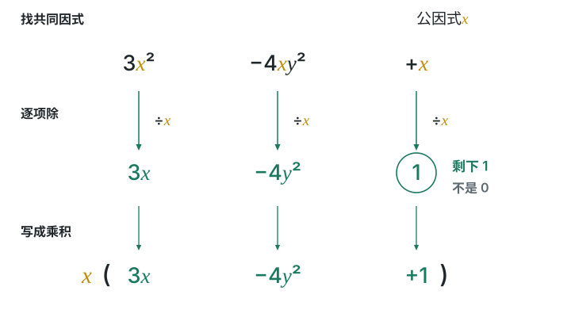

# 第十七章 因式分解

整式乘法把乘积展开，因式分解反过来把多项式写成乘积。先看有没有公因式，再看公式，最后检查还能不能分。

## 本章前置自查

1. 能展开单项式乘多项式吗？不能：回看 第十六章第2节。
2. 能写出平方差与完全平方公式吗？不能：回看第十六章第3节。

## 17.1a 因式分解的含义

```yaml
id: MATH-8A-17-1a
title: 因式分解的含义
weight: 一般
weight_note: 本章基础链条所必需；考频采用保守归类，不把综合题全部归到本章。
textbook: 八上 17.1，印刷p.124–126
prerequisites:
- id: MATH-8A-16-2b
  strength: hard
  reason: 理解展开与因式分解的相反方向。
evidence:
- 能区别因式分解与展开。
- 能检查最后的整体是不是乘积。
figure: 不需要
method: []
sources:
- 新版课本原页，详见本章sources.md
- 九套有效卷筛查；低频及未记录不等于不考
```

### 本次只学

识别是否把多项式变成了整式的乘积。

### 先认住

把一个多项式化成几个整式的积的形式，叫作因式分解。

方向是“多项式 → 乘积”。最后的整体必须是乘积；只把其中一部分改成乘积，外面还剩加法，不算完成因式分解。

展开分解后的乘积，应该回到原来的多项式。

### 容易错

把乘积展开不是因式分解。等式正确，也不表示它已经满足“整式乘积”的形式。

### 练一练

- `Q-MATH-TB8A-17.1-1`

## 17.1b 提公因式法

```yaml
id: MATH-8A-17-1b
title: 提公因式法
weight: 重点
weight_note: GZ2023-20(1)、SZ2023-12等直接或整体提取；后续分式约分及方程求解都需使用。
textbook: 八上 17.1，印刷p.124–127
prerequisites:
- id: MATH-8A-17-1a
  strength: hard
  reason: 先知道因式分解的目标形式。
- id: MATH-8A-16-2c
  strength: hard
  reason: 提取后的每一项是原项除以公因式。
evidence:
- 能找出所有项共有的因式。
- 能保留提取后余下的1。
- 能把相同括号作为整体公因式。
figure: 已完成 figures/factor-common-17-1b.svg（三步提公因式，突出原末项x除以x得到1）
method: []
sources:
- 新版课本原页，详见本章sources.md
- 九套有效卷筛查；低频及未记录不等于不考
walk_source: 课本17.1例1（2），印刷p.125；PDF第132页
```

### 本次只学

把各项都有的因式一次提出，并逐项检查余下的商。

### 先认住

各项都有的因式叫作公因式。系数取最大公约数，各字母取所有项共有的最低次幂。

提出来以后，括号里写“每一项除以公因式”的商。某项恰好等于公因式时，余下的商是 $1$，不是 $0$。公因式也可以是整个括号。

### 走一遍

$3x^2-4xy^2+x$ 的各项都含 $x$。

分别除以 $x$，得到 $3x$、$-4y^2$、$1$。



所以 $\boxed{3x^2-4xy^2+x=x(3x-4y^2+1)}$。

展开右边，能重新得到原式，末尾的 $1$ 没有丢。

### 容易错

只在部分项中出现的字母，不能提到全部项外面。提出负号或换成互为相反数的括号时，逐项检查符号。

### 练一练

- `Q-MATH-TB8A-17.1-2`
- `Q-MATH-TB8A-17.1-4`
- `Q-MATH-GD2020-11`

## 17.2a 平方差公式分解因式

```yaml
id: MATH-8A-17-2a
title: 平方差公式分解因式
weight: 重点
weight_note: 本章基础链条所必需；考频采用保守归类，不把综合题全部归到本章。
textbook: 八上 17.2，印刷p.128–129
prerequisites:
- id: MATH-8A-16-3a
  strength: hard
  reason: 把平方差公式反向使用。
- id: MATH-8A-17-1b
  strength: hard
  reason: 有公因式时先提取。
evidence:
- 能识别两个平方项及中间减号。
- 能正确处理分数平方项。
figure: 不需要
method: []
sources:
- 新版课本原页，详见本章sources.md
- 九套有效卷筛查；低频及未记录不等于不考
walk_source: 课本习题17.2第1题（1），印刷p.132；PDF第139页
```

### 本次只学

找两个平方项，中间必须是减号。

### 先认住

$\boxed{a^2-b^2=(a+b)(a-b)}$。先认出两部分分别是谁的平方，再把整体放进两个括号。

若平方差前还有公因式，先把它提出。分解后的乘积展开，应回到原式。

### 走一遍

$9a^2-16=(3a)^2-4^2$。

两部分是 $3a$ 和 $4$，所以 $\boxed{9a^2-16=(3a+4)(3a-4)}$。

### 容易错

平方和不能按平方差公式分解。公式中的两个部分可以是分数、单项式或整个括号，不能只取其中一部分。

### 练一练

- `Q-MATH-TB8A-17.2-1`
- `Q-MATH-GD2023-11`
- `Q-MATH-GZ2023-20-1`

## 17.2b 完全平方公式分解因式

```yaml
id: MATH-8A-17-2b
title: 完全平方公式分解因式
weight: 重点
weight_note: 本章基础链条所必需；考频采用保守归类，不把综合题全部归到本章。
textbook: 八上 17.2，印刷p.130–131
prerequisites:
- id: MATH-8A-16-3b
  strength: hard
  reason: 把完全平方公式反向使用。
- id: MATH-8A-17-1b
  strength: hard
  reason: 提取负号也是提公因式。
evidence:
- 能用中间二倍乘积核对完全平方式。
- 能先提出负号再分解。
figure: 不需要
method: []
sources:
- 新版课本原页，详见本章sources.md
- 九套有效卷筛查；低频及未记录不等于不考
walk_source: 课本习题17.2第2题（2），印刷p.132；PDF第139页
```

### 本次只学

检查中间项是否恰好是两部分乘积的二倍。

### 先认住

$\boxed{a^2+2ab+b^2=(a+b)^2}$；$\boxed{a^2-2ab+b^2=(a-b)^2}$。

先检查两端是否平方，再检查中间项。若整体的三项都为负，可先提出 $-1$，再检查括号里是否是完全平方。

### 走一遍

$-x^2+10xy-25y^2=-(x^2-10xy+25y^2)$。

两部分是 $x$ 与 $5y$，中间项 $-10xy=-2\cdot x\cdot5y$。

所以 $\boxed{-x^2+10xy-25y^2=-(x-5y)^2}$。

### 容易错

两个平方项还不够，中间项也必须符合二倍乘积。不能把中间项直接丢掉，或把完全平方写成平方差。

### 练一练

- `Q-MATH-TB8A-17.2-2`

## 17.2c 综合分解：检查是否分到最后

```yaml
id: MATH-8A-17-2c
title: 综合分解：检查是否分到最后
weight: 重点
weight_note: 本章基础链条所必需；考频采用保守归类，不把综合题全部归到本章。
textbook: 八上 17.2，印刷p.131–132
prerequisites:
- id: MATH-8A-17-2a
  strength: hard
  reason: 先会平方差。
- id: MATH-8A-17-2b
  strength: hard
  reason: 先会完全平方。
evidence:
- 能识别需要继续分解的平方差因式。
- 能展开结果检查是否与原式相同。
figure: 不需要
method: []
sources:
- 新版课本原页，详见本章sources.md
- 九套有效卷筛查；低频及未记录不等于不考
walk_source: 课本习题17.2第3题（3），印刷p.132；PDF第139页
```

### 本次只学

先提，再套公式；每个因式都再检查一遍。

### 先认住

分解顺序：有公因式先提；再检查平方差或完全平方；最后检查每一个因式。

“写成乘积”还不等于“分到最后”。在本节所学方法内，仍能继续用公式分解的整式因式，要继续分。

把一整个式子当作公式里的一个量，可以少展开几步。

### 走一遍

$x^4-16y^4=(x^2)^2-(4y^2)^2$。

第一次分解：$(x^2+4y^2)(x^2-4y^2)$。

第二个因式仍是平方差，继续得 $\boxed{(x^2+4y^2)(x+2y)(x-2y)}$。

第一个因式是平方和，不能再按平方差公式拆。

### 容易错

不要只看最外面的式子。平方差分解后，里面可能还藏着平方差；先核对原式再判断是否结束。

### 练一练

- `Q-MATH-TB8A-17.2-3`
- `Q-MATH-YN2024-14`
