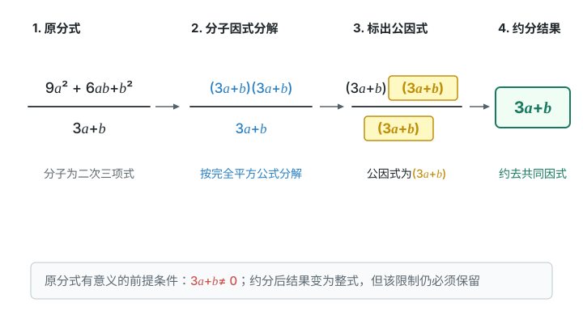
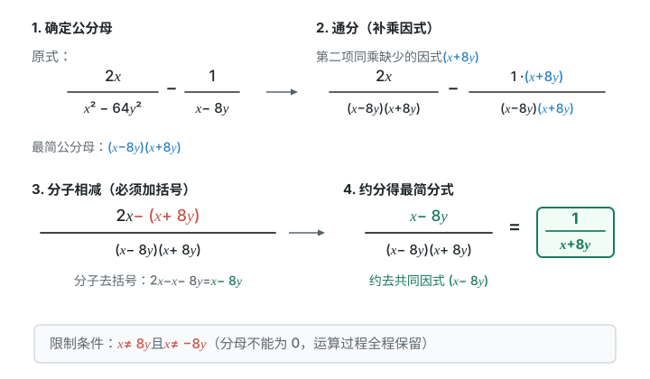
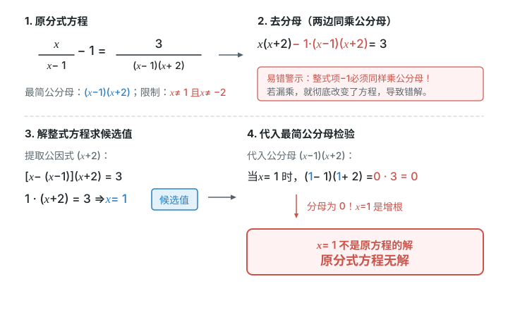

# 第十八章 分式

分式运算先守住一条底线：分母不能为零。约分以后，这条限制仍然保留。解分式方程还要验根；实际问题的答案也必须符合原情境。

## 本章前置自查

1. 能提公因式并分解平方差吗？不能：回看 第十七章第1节、第十七章第2节。
2. 能正确处理括号前的负号吗？不能：回看七上整式的加减。

## 18.1a 分式的意义与取值条件

```yaml
id: MATH-8A-18-1a
title: 分式的意义与取值条件
weight: 重点
weight_note: 九卷中的零值与定义域考频不夸大；分母非零是约分和验根的基础，按易错风险列重点。
textbook: 八上 18.1，印刷p.138–145（分式定义见p.138–139；零值条件由分式意义及p.145习题归纳）
prerequisites:
- id: MATH-8A-17-2a
  strength: hard
  reason: 含平方差的分母先分解。
evidence:
- 能写出分式有意义的全部限制。
- 能在求零值时排除分母为零的候选值。
figure: 不需要
method: []
sources:
- 新版课本原页，详见本章sources.md
- 九套有效卷筛查；低频及未记录不等于不考
walk_source: 课本18.1例1（2）（3），印刷p.139；PDF第146页
```

### 本次只学

同时检查分母非零与分子是否为零。

### 先认住

若 $A,B$ 是整式，且 $B$ 中含字母，$\dfrac AB$ 叫作分式；分子可以不含字母。

有意义：$\boxed{B\neq0}$。值为零：$\boxed{A=0\text{ 且 }B\neq0}$。

求条件时，把分母看作整体。若分母是乘积，每个因式都必须非零；若是和或差，先解整体等于零的情况，再排除。

### 走一遍

求分式 $\dfrac{x}{x-1}$ 和 $\dfrac{1}{5-3b}$ 有意义的条件：

要使分式有意义，分母不能为 $0$。

对于 $\dfrac{x}{x-1}$，令分母 $x-1\neq0$，解得 $\boxed{x\neq1}$。

对于 $\dfrac{1}{5-3b}$，令分母 $5-3b\neq0$，解得 $\boxed{b\neq\dfrac53}$。

分式有意义只看分母；求分式值为零时，先令分子为零，再检验排除使分母为零的解。

### 容易错

不要看到字母就认作分式，关键在分母。分子为零还不够；若分母也为零，原式没有意义。

### 练一练

- `Q-MATH-TB8A-18.1-3`
- `Q-MATH-TB8A-18.1-11`
- `Q-MATH-YN2023-13`

## 18.1b 分式的基本性质与约分

```yaml
id: MATH-8A-18-1b
title: 分式的基本性质与约分
weight: 重点
weight_note: 本章基础链条所必需；考频采用保守归类，不把综合题全部归到本章。
textbook: 八上 18.1，印刷p.140–144
prerequisites:
- id: MATH-8A-18-1a
  strength: hard
  reason: 约分前先确认原式有意义。
- id: MATH-8A-17-1b
  strength: hard
  reason: 公因式必须属于整体。
- id: MATH-8A-17-2b
  strength: hard
  reason: 完全平方式需要先分解。
evidence:
- 能指出约去的是哪个公因式。
- 能保留原分母带来的全部限制。
figure: 已完成 figures/fraction-cancel-18-1b.svg（分式的约分与取值限制保留）
method: []
sources:
- 新版课本原页，详见本章sources.md
- 九套有效卷筛查；低频及未记录不等于不考
walk_source: 课本习题18.1第6题（3），印刷p.145；PDF第152页
```

### 本次只学

先分解，再约去共同的因式。

### 先认住

分子、分母同乘或同除以一个不为零的整式，分式的值不变。

约分约的是公因式，不是相同的项。分子、分母若是多项式，先因式分解，再约分。没有公因式的分式叫作最简分式。

约分会使写法变短，但不能扩大原式的取值范围。

### 走一遍

$\dfrac{9a^2+6ab+b^2}{3a+b}=\dfrac{(3a+b)\cancel{(3a+b)}}{\cancel{3a+b}}$。

原式要求 $3a+b\neq0$。约去一个公因式 $3a+b$，得 $\boxed{3a+b}$，原来的非零条件仍保留。



### 容易错

$\textcolor{#c9554d}{\dfrac{x+1}{x}=1+1\quad\text{（错误）}}$

$x$ 不是整个分子 $x+1$ 的因式，不能从加法中直接约去。

### 练一练

- `Q-MATH-TB8A-18.1-6`
- `Q-MATH-GZ2023-20-2`

## 18.1c 通分与最简公分母

```yaml
id: MATH-8A-18-1c
title: 通分与最简公分母
weight: 一般
weight_note: 本章基础链条所必需；考频采用保守归类，不把综合题全部归到本章。
textbook: 八上 18.1，印刷p.143–144
prerequisites:
- id: MATH-8A-18-1b
  strength: hard
  reason: 通分使用分式基本性质。
evidence:
- 能找出分解后的最简公分母。
- 能让分子与分母同乘缺少的因式。
figure: 不需要
method: []
sources:
- 新版课本原页，详见本章sources.md
- 九套有效卷筛查；低频及未记录不等于不考
```

### 本次只学

先分解分母，再补齐缺少的因式。

### 先认住

通分把异分母分式变成同分母分式，值不变。先把各分母因式分解，最简公分母取所有不同因式及各自出现的最高次幂；数系数取最小公倍数。

分母补乘什么，分子也必须补乘同一个因式。不能只改分母。

### 容易错

$(x+1)$ 与 $(x+1)^2$ 只取最高次幂，不相乘成三次幂。$x-1$ 与 $1-x$ 互为相反数，要先整理符号。

### 练一练

- `Q-MATH-TB8A-18.1-7`

## 18.2a 分式的乘除与乘方

```yaml
id: MATH-8A-18-2a
title: 分式的乘除与乘方
weight: 重点
weight_note: 本章基础链条所必需；考频采用保守归类，不把综合题全部归到本章。
textbook: 八上 18.2，印刷p.146–149
prerequisites:
- id: MATH-8A-18-1b
  strength: hard
  reason: 乘除以后只约公因式。
- id: MATH-8A-16-1b
  strength: hard
  reason: 分子分母乘方使用幂的规则。
evidence:
- 能分解因式，并在分式乘法中约去公因式。
- 能保留原式中的全部限制。
figure: 不需要
method: []
sources:
- 新版课本原页，详见本章sources.md
- 九套有效卷筛查；低频及未记录不等于不考
walk_source: 课本习题18.2第2题（4），印刷p.150；PDF第157页
```

### 本次只学

除法先转乘法，再因式分解与约分。

### 先认住

相乘时，分子相乘、分母相乘。相除时，把除式的分子与分母颠倒后，再相乘；除式本身也必须非零。

乘方时，分子、分母分别乘方。负号、系数及各字母都要参与乘方。

先查原式限制，再分解并约去公因式；最后化为最简结果。

### 走一遍

$\dfrac{y^2-x^2}{5x^2-4xy}\div\dfrac{x+y}{5x-4y}$

先列限制：$x\neq0$，$5x-4y\neq0$，$x+y\neq0$。

改成乘倒数并分解：$\dfrac{(y-x)\cancel{(y+x)}}{x\cancel{(5x-4y)}}\cdot\dfrac{\cancel{5x-4y}}{\cancel{x+y}}$。

约去共同因式得 $\boxed{\dfrac{y-x}{x}}$；原式的全部限制保留。

### 容易错

“倒数”只针对除式，不能把被除式也颠倒。除式为零时不能做除法；化简后不能忘记原式限制。

### 练一练

- `Q-MATH-TB8A-18.2-2`

## 18.3a 分式的加减与混合运算

```yaml
id: MATH-8A-18-3a
title: 分式的加减与混合运算
weight: 重点
weight_note: 本章基础链条所必需；考频采用保守归类，不把综合题全部归到本章。
textbook: 八上 18.3，印刷p.152–154
prerequisites:
- id: MATH-8A-18-1c
  strength: hard
  reason: 异分母加减先通分。
- id: MATH-8A-18-2a
  strength: hard
  reason: 混合运算先处理乘除。
evidence:
- 能先约分或分解分母，再完成异分母加法。
- 能保留原分母带来的全部限制。
figure: 已完成 figures/fraction-add-sub-18-3a.svg（异分母分式减法与通分括号警惕）
method: []
sources:
- 新版课本原页，详见本章sources.md
- 九套有效卷筛查；低频及未记录不等于不考
walk_source: 课本习题18.3第2题（4），印刷p.155；PDF第162页
```

### 本次只学

先通分，给被减的整个分子加括号。

### 先认住

同分母：分母不变，分子相加减。异分母：先通分，再按同分母规则算。

减去一个分式时，减的是整个分子；先加括号，再去括号。混合运算先乘方，再乘除，后加减；有括号先算括号。

**补充**（课本没有讲，做真题时常用）：化简求值时，先化简，再代入；代入的值必须在原式允许范围内。

### 走一遍

$\dfrac{2x}{x^2-64y^2}-\dfrac1{x-8y}$ 的最简公分母为 $(x-8y)(x+8y)$。

通分后分子为 $2x-(x+8y)=x-8y$。

$\dfrac{\cancel{x-8y}}{\cancel{(x-8y)}(x+8y)}=\boxed{\dfrac1{x+8y}}$；原式仍要求 $x\neq8y$ 且 $x\neq-8y$。



### 容易错

分母不相同，不能直接加减分子。分母不能跟着分子相加减。负号前后的括号不能省早了。

### 练一练

- `Q-MATH-TB8A-18.3-2`
- `Q-MATH-GD2023-05`
- `Q-MATH-GD2024-14`

## 18.4a 零指数幂与负整数指数幂

```yaml
id: MATH-8A-18-4a
title: 零指数幂与负整数指数幂
weight: 重点
weight_note: 多套卷首道计算题直接考查；GD2024-16用于本章练习，答案与原解析一致。
textbook: 八上 16.1，印刷p.108（零指数幂）；八上 18.4，印刷p.158–160（负整数指数幂）
prerequisites:
- id: MATH-8A-16-1b
  strength: hard
  reason: 先认清底数、指数与括号。
evidence:
- 能把负整数指数幂改为正指数幂的倒数。
- 能按运算顺序计算含零指数幂、负整数指数幂的式子。
figure: 不需要
method: []
sources:
- 新版课本原页，详见本章sources.md
- 九套有效卷筛查；低频及未记录不等于不考
walk_source: 课本习题18.4第2题（1）的组成部分，印刷p.162；PDF第169页
```

### 本次只学

把负指数改为倒数，不把它当成负数。

### 先认住

当 $a\neq0$ 时，$\boxed{a^0=1}$，$\boxed{a^{-n}=\dfrac1{a^n}}$，其中 $n$ 为正整数。

负指数表示倒数，不表示结果一定为负。若底数为负，仍要看指数的奇偶。$0^0$ 不在这里的公式范围内。

### 走一遍

$(-2)^{-2}=\dfrac1{(\textcolor{#287fc4}{-2})^2}=\boxed{\dfrac14}$。

$\left(-\dfrac13\right)^{-3}=\dfrac1{(\textcolor{#287fc4}{-\frac13})^3}=\boxed{-27}$。

偶数次幂结果为正；奇数次幂保留负号，负指数则让它取倒数。

### 容易错

不要把 $a^{-n}$ 写成 $-a^n$。负底数外的括号不能丢；零指数公式仍要求底数非零。

### 练一练

- `Q-MATH-GD2024-16`

## 18.4b 小于1的数的科学记数法

```yaml
id: MATH-8A-18-4b
title: 小于1的数的科学记数法
weight: 一般
weight_note: 本章基础链条所必需；考频采用保守归类，不把综合题全部归到本章。
textbook: 八上 18.4，印刷p.160–162
prerequisites:
- id: MATH-8A-18-4a
  strength: hard
  reason: 负指数表示较小的十进制量。
evidence:
- 能把小于1的正数写成规范的科学记数法。
- 能用负指数倒数意义核对小数点位置。
figure: 不需要
method: []
sources:
- 新版课本原页，详见本章sources.md
- 九套有效卷筛查；低频及未记录不等于不考
```

### 本次只学

保持前面的数在1到10之间。

### 先认住

小于 $1$ 的正数可以写成 $a\times10^{-n}$，其中 $1\leq a<10$，$n$ 为正整数。

把小数点向右移几位，才使前面的数进入 $[1,10)$，指数就是负几。

若题目有单位，先统一单位再比较或计算。

### 容易错

指数不是只数小数点后有几个零。前面的数必须至少为1且小于10。

### 练一练

- `Q-MATH-TB8A-18.4-4`

## 18.5a 分式方程与验根

```yaml
id: MATH-8A-18-5a
title: 分式方程与验根
weight: 重点
weight_note: GD2024-09、GZ2024-17直接考查；漏乘与验根是本章高风险。
textbook: 八上 18.5，印刷p.164–166
prerequisites:
- id: MATH-8A-18-1c
  strength: hard
  reason: 去分母要先找最简公分母。
- id: MATH-8A-18-1a
  strength: hard
  reason: 候选值不能使原分母为零。
evidence:
- 能让等号两边的每一项都乘最简公分母。
- 能判明候选值是否为原方程的解。
figure: 已完成 figures/fraction-equation-18-5a.svg（分式方程去分母漏乘与增根检验）
method: []
sources:
- 新版课本原页，详见本章sources.md
- 九套有效卷筛查；低频及未记录不等于不考
walk_source: 课本18.5例2，印刷p.166；PDF第173页
```

### 本次只学

去分母后解整式方程，再回查原分母。

### 先认住

分母中含有未知数的方程叫作分式方程。步骤：找最简公分母 → 两边每一项都乘它 → 解整式方程 → 检验。

把所得候选值代入最简公分母；使它为零的候选值，不是原分式方程的解。若所有候选值都不合格，原方程无解。

整式项也要乘最简公分母；含字母系数时，仍要检查原式限制，不能省略检验。

### 走一遍

解 $\dfrac{x}{x-1}-1=\dfrac3{(x-1)(x+2)}$。

先排除 $x=1,-2$。两边都乘 $(x-1)(x+2)$：

$x(x+2)-(x-1)(x+2)=3$，左边的整式 $-1$ 也乘了公分母。

提取 $x+2$，得到 $[x-(x-1)](x+2)=3$，所以 $x=1$。

检验：$(\textcolor{#287fc4}{1}-1)(\textcolor{#287fc4}{1}+2)=0$，候选值不合法。因此 $\boxed{\text{原分式方程无解}}$。



### 容易错

去分母不是把每个分式的分母直接擦掉。整式项若漏乘，会换成另一个方程；不验根，会收进不合法的候选值。

### 练一练

- `Q-MATH-TB8A-18.5-1`
- `Q-MATH-GZ2024-17`

## 18.5b 分式方程的实际应用

```yaml
id: MATH-8A-18-5b
title: 分式方程的实际应用
weight: 重点
weight_note: 本章基础链条所必需；考频采用保守归类，不把综合题全部归到本章。
textbook: 八上 18.5，印刷p.167–169
prerequisites:
- id: MATH-8A-18-5a
  strength: hard
  reason: 列出分式方程以后要解方程并检验。
evidence:
- 能用工作量与工作效率表示时间，并根据用时相等列方程。
- 能检查分式合法性和实际意义。
figure: 不需要
method: []
sources:
- 新版课本原页，详见本章sources.md
- 九套有效卷筛查；低频及未记录不等于不考
walk_source: 课本习题18.5第3题，印刷p.169；PDF第176页
```

### 本次只学

用路程、速度与时间列式，并检查现实条件。

### 先认住

先设未知量及其单位，再把两边表示为同一种量。路程÷速度=时间；总工作量÷时间=效率。

时间单位必须统一。解得数值后，先检验原分母，再检查正负、大小和题目情境；最后回答所问的量。

### 走一遍

甲、乙速度比为 $3:4$，可设速度分别为 $3v$、$4v$ km/h，且 $v>0$。

甲走 $6$ km、乙走 $10$ km，乙比甲多用 $20$ min，即 $\dfrac13$ h：

$\dfrac{10}{4v}-\dfrac6{3v}=\dfrac13$。

左边为 $\dfrac1{2v}$，解得 $v=\dfrac32$。两人的速度分别为 $\boxed{4.5\text{ km/h}}$、$\boxed{6\text{ km/h}}$。

代回时间分别为 $\dfrac43$ h 和 $\dfrac53$ h，正好相差 $\dfrac13$ h。

### 容易错

“提前到达”比较的是时间，不是路程。设的是速度比例的份数，就不能把这份数直接当作两人的速度。

### 练一练

- `Q-MATH-TB8A-18.5-4`
- `Q-MATH-GZ2023-08`
