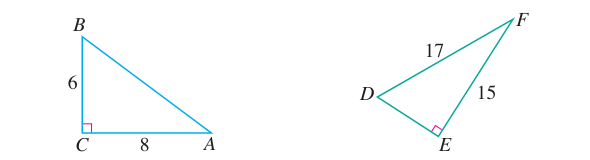
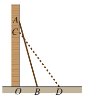

# 第二十章 勾股定理

本章学习直角三角形特有的边长关系：勾股定理及其逆定理。勾股定理用于“知二求一”，在几何计算和实际测距中架起直角与平方和的桥梁；其逆定理通过“算平方和判直角”，提供了一种纯代数计算证明垂直与直角三角形的方法。

## 本章前置自查

学习本章前，请先确认：
1. 能够熟练进行算术平方根的开方运算与二次根式化简，特别是 $\sqrt{a^2}=|a|$ 与分数、分母有理化的基本计算。
2. 明确全等三角形“边边边”（SSS）判定方法及其在几何证明中的规范书写。

## 20.1a 勾股定理与边长计算

```yaml
id: MATH-8B-20-1a
weight: 重点
textbook: 八下 20.1，印刷p.25
prerequisites: []
evidence:
- 能准确指出图中直角所对的斜边，并规范写出“两直角边平方和等于斜边平方”的几何符号表达式。
- 在已知两边长且未指定斜边时，能自觉分为“已知边全为直角边”与“较大已知边为斜边”两类解答。
- 代入数值后能一步一步完成平方计算、开平方运算及最简二次根式化简。
figure: 已完成 figures/tb20-1-ex1-triangles.png（课本图原图，不再另画图解步骤图）
weight_note: 常见易错点或后续综合题的关键步骤
sources:
- TB8B-20.1
method: [MG16 数形结合]
```

### 本次只学

掌握勾股定理内容 $a^2+b^2=c^2$，会准确辨认直角所对的斜边，并在已知直角三角形任意两边长时求出第三边长。

### 先认住

- 如果直角三角形的两条直角边长分别为 $a$，$b$，斜边长为 $c$，那么 $a^2+b^2=c^2$。
- 直角所对的边是斜边；在标准形式 $a^2+b^2=c^2$ 中，位于等号单独一侧的是斜边长的平方。认斜边只看直角对边。
- 已知两直角边长 $a$、$b$ 求斜边长 $c$：$c=\sqrt{a^2+b^2}$；已知斜边长 $c$ 与一直角边长 $a$ 求另一直角边长 $b$：$b=\sqrt{c^2-a^2}$。
- **补充**（课本没有讲，做真题时常用）：当已知两边长且无其他条件能确定斜边时，需按“两已知边均为直角边”与“较长已知边为斜边”分情况讨论；若已知直角位置或角的大小能确定斜边，则不必分类。

### 数形结合

```bridge
mode: cards
式: $a^2+b^2=c^2$
图: pyth
形: 两条直角边上的正方形面积之和，等于斜边上的正方形面积
色: blue
```

### 走一遍

在 $\text{Rt}\triangle ABC$ 中，$\angle C=90^\circ$，$AC=\textcolor{#287fc4}{8}$，$BC=\textcolor{#287fc4}{6}$，求 $AB$ 的长；在 $\text{Rt}\triangle DEF$ 中，$\angle E=90^\circ$，$DF=\textcolor{#287fc4}{17}$，$EF=\textcolor{#287fc4}{15}$，求 $DE$ 的长。



(1) 在 $\text{Rt}\triangle ABC$ 中，$\angle C=90^\circ$，所以斜边为 $AB$。
根据勾股定理：
$$
AB^2=AC^2+BC^2
$$
代入已知数值：
$$
AB^2=\textcolor{#287fc4}{8}^2+\textcolor{#287fc4}{6}^2
$$
计算平方：
$$
AB^2=64+36
$$
$$
AB^2=100
$$
因为边长为正数，两边开平方得：
$$
AB=\boxed{10}
$$

(2) 在 $\text{Rt}\triangle DEF$ 中，$\angle E=90^\circ$，所以斜边为 $DF$。
根据勾股定理：
$$
DE^2+EF^2=DF^2
$$
变形求直角边 $DE$：
$$
DE^2=DF^2-EF^2
$$
代入已知数值：
$$
DE^2=\textcolor{#287fc4}{17}^2-\textcolor{#287fc4}{15}^2
$$
计算平方：
$$
DE^2=289-225
$$
$$
DE^2=64
$$
因为边长为正数，两边开平方得：
$$
DE=\boxed{8}
$$

### 容易错

- 死记字母导致套错公式：未认准直角所对边，在斜边为 $b$ 或 $DE$ 时盲目套用 $a^2+b^2=c^2$。
- 已知斜边与一直角边求第三边时误将平方相加，算成 $b=\sqrt{c^2+a^2}$。
- 题目仅给出“两条边长分别为 6 和 10”时漏掉分类讨论，直接认定 10 是斜边或 6、10 为两直角边。

### 练一练

- `Q-MATH-TB8B-20.1-1`
- `Q-MATH-TB8B-20.2-2`

## 20.1b 勾股定理的实际应用与距离问题

```yaml
id: MATH-8B-20-1b
weight: 重点
textbook: 八下 20.1，印刷p.27
prerequisites:
- id: MATH-8B-20-1a
  strength: hard
  reason: 先辨认斜边并会用勾股定理求边长
evidence:
- 能从生活或方位情境中抽象出直角三角形模型，标出已知线段与直角关系。
- 能在示范中理解梯子滑动前后两个直角三角形的不变量，并利用勾股定理求出实际距离。
figure: 已完成 figures/tb20-1-ex3-ladder.png（课本图原图，不再另画图解步骤图）
weight_note: 常见易错点或后续综合题的关键步骤
sources:
- TB8B-20.1
method: []
```

### 本次只学

能从实际生活情境中抽象出直角三角形模型，确定各线段对应的实际量，并利用勾股定理计算距离、滑动位移或方向位置。

### 先认住

- 构建直角三角形模型：在水平线与竖直墙面、地面东西向与南北向等垂直关系中识别直角。
- 动态位移问题抓住“不变量”：例如梯子下滑过程中，梯子本身的长度作为直角三角形的斜边长保持不变。
- 实际问题中开平方取正值，最终计算结果需带上相应实际物理单位。

### 走一遍

一架长为 $\textcolor{#287fc4}{2.5}\text{ m}$ 的梯子斜靠在竖直的墙上，梯子一边的顶端位于墙面的点 $A$ 处，底端位于地面的点 $B$ 处，点 $B$ 到墙面的距离 $BO$ 为 $\textcolor{#287fc4}{0.7}\text{ m}$。如果将梯子底端沿 $OB$ 向外移动 $\textcolor{#287fc4}{0.8}\text{ m}$ 到点 $D$，梯子顶端也沿墙 $AO$ 下滑 $\textcolor{#287fc4}{0.8}\text{ m}$ 吗？



设墙面 $AO$ 与地面 $OB$ 互相垂直，即 $\angle AOB=90^\circ$。
在 $\text{Rt}\triangle AOB$ 中，梯长 $AB=\textcolor{#287fc4}{2.5}\text{ m}$，$OB=\textcolor{#287fc4}{0.7}\text{ m}$。
根据勾股定理：
$$
OA^2=AB^2-OB^2
$$
代入已知数值：
$$
OA^2=\textcolor{#287fc4}{2.5}^2-\textcolor{#287fc4}{0.7}^2
$$
计算平方：
$$
OA^2=6.25-0.49
$$
$$
OA^2=5.76
$$
开平方得：
$$
OA=2.4\text{ m}
$$
梯子底端向外移动 $\textcolor{#287fc4}{0.8}\text{ m}$ 后，到达点 $D$：
$$
OD=OB+BD=\textcolor{#287fc4}{0.7}+\textcolor{#287fc4}{0.8}=1.5\text{ m}
$$
此时梯长不变，$CD=AB=\textcolor{#287fc4}{2.5}\text{ m}$。
在 $\text{Rt}\triangle COD$ 中，根据勾股定理：
$$
OC^2=CD^2-OD^2
$$
代入已知数值：
$$
OC^2=\textcolor{#287fc4}{2.5}^2-\textcolor{#287fc4}{1.5}^2
$$
计算平方：
$$
OC^2=6.25-2.25
$$
$$
OC^2=4
$$
开平方得：
$$
OC=2\text{ m}
$$
计算顶端下滑距离：
$$
AC=OA-OC=\textcolor{#287fc4}{2.4}-\textcolor{#287fc4}{2}=0.4\text{ m}
$$
因此，当梯子底端向外移动 $0.8\text{ m}$ 时，梯子顶端并不是下滑 $0.8\text{ m}$，而是下滑 $\boxed{0.4\text{ m}}$。

### 容易错

- 误以为“底端滑移距离等于顶端下滑距离”，忽略了勾股定理平方关系的非线性特征。
- 平面方位题中未按“上北下南左西右东”画图，混淆各路段形成的直角三角形边角位置。

### 练一练

- `Q-MATH-TB8B-20.2-3`

  注：本题涉及方位垂直判定，可结合 20.2a 勾股逆定理共同练习
- `Q-MATH-GZ2023-07`

## 20.2a 勾股定理的逆定理与直角判定

```yaml
id: MATH-8B-20-2a
weight: 一般
textbook: 八下 20.2，印刷p.35
prerequisites:
- id: MATH-8B-20-1a
  strength: hard
  reason: 掌握两边平方和与斜边平方的数量关系
evidence:
- 能准确找出三角形三边中的最长边。
- 能分别独立计算较小两边平方和与最长边平方，并得出相等或不相等的规范判定结论。
figure: 不需要
weight_note: 基础步骤容易得分，保留一题核验
sources:
- TB8B-20.2
method: [MG16 数形结合]
```

### 本次只学

掌握勾股定理逆定理内容，能通过比较“较小两边平方和”与“最长边平方”判定一个三角形是否为直角三角形。

### 先认住

- 如果三角形的三边长 $a$，$b$，$c$ 满足 $a^2+b^2=c^2$，那么这个三角形是直角三角形。
- 判定步骤：先确定三边中最长的一条边，计算其余两较小边的平方和，再计算最长边的平方；若二者相等则是直角三角形，最长边所对的角是直角；若不等则不是直角三角形。
- 能够成为直角三角形三条边长的三个正整数，称为勾股数（如 3、4、5；8、15、17 等）。

### 数形结合

```bridge
mode: cards
式: $a^2+b^2=c^2$ 成立
图: pyth
形: 最大边 $c$ 所对的角是直角；若不相等则不是直角
色: blue
```

### 容易错

- 没有先找最长边，随手将前两个数平方相加去比第三个数的平方（例如给出 $a=5$，$b=4$，$c=3$ 或未排序数据）。
- 带分母或根号的三边长未化为同分母或同形式直接比大小，找错最长边。

### 练一练

- `Q-MATH-TB8B-20.2-1`
- `Q-MATH-GD2023-20`

## 20.2b 原命题与逆命题

```yaml
id: MATH-8B-20-2b
weight: 了解
textbook: 八下 20.2，印刷p.34–35；八上 15.1，印刷p.66–67
prerequisites: []
evidence:
- 能准确指出命题的题设（条件）与结论。
- 能将“如果……那么……”句式中的条件与结论对调写出逆命题。
figure: 不需要
weight_note: 直接考频有限，保留教材核心概念
sources:
- TB8B-20.2
method: []
```

### 本次只学

了解原命题与逆命题的概念，能写出一个命题的逆命题，并理解勾股定理与其逆定理的关系。

### 先认住

- 题设与结论互换的两个命题互为逆命题：如果把一个命题记为“如果 $p$，那么 $q$”，那么它的逆命题就是“如果 $q$，那么 $p$”。
- 一个命题是真命题，它的逆命题不一定是真命题；原命题与逆命题的真假性没有必然联系。
- 勾股定理揭示了直角三角形的一条性质（知直角推边长平方关系），勾股定理的逆定理提供了直角三角形的一种判定方法（知边长平方关系推直角），二者互为逆定理。

