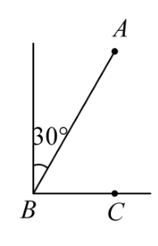
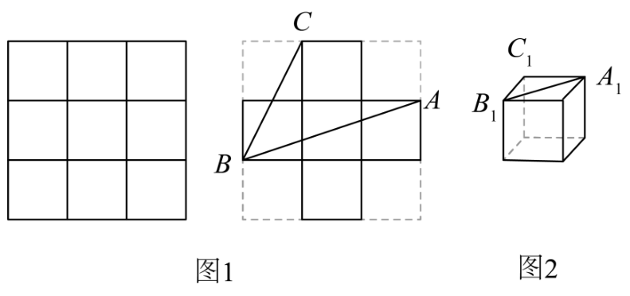

# 第二十章 勾股定理 · 练习

## 讲义用题

### Q-MATH-TB8B-20.1-1

```yaml
id: Q-MATH-TB8B-20.1-1
parts:
- {part: '1', kp: MATH-8B-20-1a}
- {part: '2', kp: MATH-8B-20-1a}
- {part: '3', kp: MATH-8B-20-1a}
category: 课本习题
source: 人教版数学八下课本第30页习题20.1第1题
source_quality: 课本原文
kp: MATH-8B-20-1a
type: 计算
grading: 自评
answer_by: 本项目编写，待复核
review:
  概念: MATH-8B-20-1a
  公式: MATH-8B-20-1a
  计算: MATH-8B-20-1a
  审题: MATH-8B-20-1a
```

**题干**

设直角三角形的两条直角边长分别为 $a$ 和 $b$，斜边长为 $c$。

(1) 已知 $a=12$，$b=5$，求 $c$；

(2) 已知 $a=3$，$c=4$，求 $b$；

(3) 已知 $c=10$，$b=9$，求 $a$。

**答案**

(1) $c=13$

(2) $b=\sqrt{7}$

(3) $a=\sqrt{19}$

**解析**

根据勾股定理，在直角三角形中，$a^2+b^2=c^2$。

(1) 已知直角边 $a=12$，$b=5$：
$$
c^2=a^2+b^2=\textcolor{#287fc4}{12}^2+\textcolor{#287fc4}{5}^2=144+25=169
$$
开平方得：
$$
c=\boxed{13}
$$

(2) 已知斜边 $c=4$，直角边 $a=3$：
$$
b^2=c^2-a^2=\textcolor{#287fc4}{4}^2-\textcolor{#287fc4}{3}^2=16-9=7
$$
开平方得：
$$
b=\boxed{\sqrt{7}}
$$

(3) 已知斜边 $c=10$，直角边 $b=9$：
$$
a^2=c^2-b^2=\textcolor{#287fc4}{10}^2-\textcolor{#287fc4}{9}^2=100-81=19
$$
开平方得：
$$
a=\boxed{\sqrt{19}}
$$

### Q-MATH-TB8B-20.2-2

```yaml
id: Q-MATH-TB8B-20.2-2
category: 课本习题
source: 人教版数学八下课本第38页习题20.2第2题
source_quality: 课本原文
kp: MATH-8B-20-1a
type: 计算
grading: 自评
answer_by: 本项目编写，待复核
review:
  概念: MATH-8B-20-1a
  公式: MATH-8B-20-1a
  计算: MATH-8B-20-1a
  审题: MATH-8B-20-1a
```

**题干**

已知三条线段的长分别为 6，10，$x$，以这三条线段为边，恰好可以构成一个直角三角形，求 $x$。

**答案**

$x=8$ 或 $x=2\sqrt{34}$

**解析**

题目未指明哪条边是斜边，需分情况讨论：

情况一：当 10 为斜边时：
$x$ 为直角边，根据勾股定理：
$$
x^2=10^2-6^2
$$
代入计算：
$$
x^2=\textcolor{#287fc4}{100}-\textcolor{#287fc4}{36}=64
$$
开平方得：
$$
x=8
$$

情况二：当 $x$ 为斜边时：
6 和 10 均为直角边，根据勾股定理：
$$
x^2=6^2+10^2
$$
代入计算：
$$
x^2=\textcolor{#287fc4}{36}+\textcolor{#287fc4}{100}=136
$$
开平方并化简二次根式：
$$
x=\sqrt{136}=\sqrt{4\times 34}=2\sqrt{34}
$$

综上所述，$x$ 的值为：
$$
\boxed{8\text{ 或 }2\sqrt{34}}
$$

### Q-MATH-TB8B-20.2-3

```yaml
id: Q-MATH-TB8B-20.2-3
category: 课本习题
source: 人教版数学八下课本第38页习题20.2第3题
source_quality: 课本原文
kp: MATH-8B-20-1b
type: 解答
grading: 自评
answer_by: 本项目编写，待复核
review:
  概念: MATH-8B-20-1b
  公式: MATH-8B-20-1b
  计算: MATH-8B-20-1b
  审题: MATH-8B-20-1b
```

**题干**

刘伟先向东走了 80 m，然后换了一个方向走了 60 m，再换第三个方向走了 100 m，此时恰好回到原地。刘伟向哪个方向走了 60 m？请说明理由。

**答案**

向正北或向正南方向走了 60 m。理由见解析。

**解析**

解：设刘伟从起点 $O$ 出发向东走到点 $A$，则 $OA=80\text{ m}$。
随后换方向走到点 $B$，则 $AB=60\text{ m}$。
最后走 $100\text{ m}$ 回到原地 $O$，则 $BO=100\text{ m}$。
在 $\triangle OAB$ 中，三边长分别为 $80\text{ m}$、$60\text{ m}$、$100\text{ m}$。
较小两边的平方和为：
$$
OA^2+AB^2=\textcolor{#287fc4}{80}^2+\textcolor{#287fc4}{60}^2=6400+3600=10000
$$
最长边的平方为：
$$
BO^2=\textcolor{#287fc4}{100}^2=10000
$$
因为 $OA^2+AB^2=BO^2$，根据勾股定理的逆定理，$\triangle OAB$ 是直角三角形，且 $\angle OAB=90^\circ$。
即射线 $AB$ 与射线 $OA$（正东方向）互相垂直。
垂直于正东方向且以 $A$ 为起点的方向有两个：正北或正南。
因此，刘伟走 60 m 的方向为：
$$
\boxed{\text{向正北或向正南}}
$$

### Q-MATH-TB8B-20.2-1

```yaml
id: Q-MATH-TB8B-20.2-1
parts:
- {part: '1', kp: MATH-8B-20-2a}
- {part: '2', kp: MATH-8B-20-2a}
- {part: '3', kp: MATH-8B-20-2a}
- {part: '4', kp: MATH-8B-20-2a}
category: 课本习题
source: 人教版数学八下课本第38页习题20.2第1题
source_quality: 课本原文
kp: MATH-8B-20-2a
type: 解答
grading: 自评
answer_by: 本项目编写，待复核
review:
  概念: MATH-8B-20-2a
  公式: MATH-8B-20-2a
  计算: MATH-8B-20-2a
  审题: MATH-8B-20-2a
```

**题干**

判断由线段 $a$，$b$，$c$ 组成的三角形是不是直角三角形：

(1) $a=9$，$b=40$，$c=41$；

(2) $a=\sqrt{41}$，$b=4$，$c=5$；

(3) $a=\frac{5}{4}$，$b=1$，$c=\frac{3}{4}$；

(4) $a=40$，$b=50$，$c=60$。

**答案**

(1) 是直角三角形

(2) 是直角三角形

(3) 是直角三角形

(4) 不是直角三角形

**解析**

根据勾股定理的逆定理，只需判断较小两边的平方和是否等于最长边的平方。

(1) 最长边为 $c=41$：
$$
a^2+b^2=\textcolor{#287fc4}{9}^2+\textcolor{#287fc4}{40}^2=81+1600=1681
$$
$$
c^2=\textcolor{#287fc4}{41}^2=1681
$$
因为 $a^2+b^2=c^2$，所以组成的三角形 $\boxed{\text{是直角三角形}}$。

(2) 因为 $5=\sqrt{25}$，$4=\sqrt{16}$，$\sqrt{41}>\sqrt{25}>\sqrt{16}$，所以最长边为 $a=\sqrt{41}$：
$$
b^2+c^2=\textcolor{#287fc4}{4}^2+\textcolor{#287fc4}{5}^2=16+25=41
$$
$$
a^2=(\textcolor{#287fc4}{\sqrt{41}})^2=41
$$
因为 $b^2+c^2=a^2$，所以组成的三角形 $\boxed{\text{是直角三角形}}$。

(3) 将各边通分：$a=\frac{5}{4}$，$b=\frac{4}{4}$，$c=\frac{3}{4}$，最长边为 $a=\frac{5}{4}$：
$$
b^2+c^2=\textcolor{#287fc4}{1}^2+\left(\textcolor{#287fc4}{\frac{3}{4}}\right)^2=1+\frac{9}{16}=\frac{25}{16}
$$
$$
a^2=\left(\textcolor{#287fc4}{\frac{5}{4}}\right)^2=\frac{25}{16}
$$
因为 $b^2+c^2=a^2$，所以组成的三角形 $\boxed{\text{是直角三角形}}$。

(4) 最长边为 $c=60$：
$$
a^2+b^2=\textcolor{#287fc4}{40}^2+\textcolor{#287fc4}{50}^2=1600+2500=4100
$$
$$
c^2=\textcolor{#287fc4}{60}^2=3600
$$
因为 $4100\neq 3600$，即 $a^2+b^2\neq c^2$，所以组成的三角形 $\boxed{\text{不是直角三角形}}$。

### Q-MATH-GZ2023-07

```yaml
category: 真题
source: 2023年广州市初中学业水平考试 数学 第7题
source_quality: 精品解析原卷Word，对照转出的PDF页核对
kp: MATH-8B-20-1b
type: 选择
grading: 自动
answer_by: 原卷解析
review:
  概念: MATH-8B-20-1b
```

**题干**

如图，海中有一小岛 $A$，在 $B$ 点测得小岛 $A$ 在北偏东 $30^\circ$ 方向上，渔船从 $B$ 点出发由西向东航行 $10$ n mile 到达 $C$ 点，在 $C$ 点测得小岛 $A$ 恰好在正北方向上，此时渔船与小岛 $A$ 的距离为（　　）n mile。



A. $\dfrac{10\sqrt3}{3}$

B. $\dfrac{20\sqrt3}{3}$

C. $20$

D. $10\sqrt3$

**答案**

D

**解析**

连接 $AC$。由题意 $\angle ABC=90^\circ-30^\circ=60^\circ$，$\angle ACB=90^\circ$，所以 $\angle BAC=30^\circ$，$AB=2BC=20$。由勾股定理 $AC=\sqrt{AB^2-BC^2}=\sqrt{20^2-10^2}=10\sqrt3$。

### Q-MATH-GD2023-20

```yaml
category: 真题
source: 2023年广东省初中学业水平考试 数学 第20题
source_quality: 精品解析原卷Word，对照转出的PDF页核对
kp: MATH-8B-20-2a
type: 解答
grading: 自评
answer_by: 原卷解析
review:
  概念: MATH-8B-20-2a
```

**题干**

综合与实践：制作无盖正方体形纸盒。

素材：一张正方形纸板。

步骤 1：如图 1，将正方形纸板的边长三等分，画出九个相同的小正方形，并剪去四个角上的小正方形；

步骤 2：如图 2，把剪好的纸板折成无盖正方体形纸盒。



（1）直接写出纸板上 $\angle ABC$ 与纸盒上 $\angle A_1B_1C_1$ 的大小关系；

（2）证明（1）中你发现的结论。

**答案**

（1）$\angle ABC=\angle A_1B_1C_1$。（2）见解析。

**解析**

（1）$\triangle ABC$ 和 $\triangle A_1B_1C_1$ 均为等腰直角三角形，$\angle ABC=\angle A_1B_1C_1=45^\circ$。（2）连接 $AC$，设小正方形边长为 1，则 $AC=BC=\sqrt{1^2+2^2}=\sqrt5$，$AB=\sqrt{1^2+3^2}=\sqrt{10}$。因为 $AC^2+BC^2=5+5=10=AB^2$，由勾股定理的逆定理，$\triangle ABC$ 是直角三角形，又 $AC=BC$，所以 $\triangle ABC$ 为等腰直角三角形，$\angle ABC=45^\circ$。在纸盒中，$A_1C_1=B_1C_1=1$ 且 $A_1C_1\perp B_1C_1$，所以 $\triangle A_1B_1C_1$ 为等腰直角三角形，$\angle A_1B_1C_1=45^\circ$，故 $\angle ABC=\angle A_1B_1C_1$。

