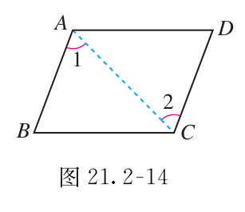
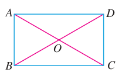
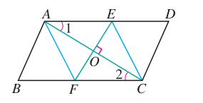

# 第二十一章 四边形

证明图形时，不要先凭外观叫它的名字。先确认已有条件，再选一条足够的判定路线。

## 本章前置自查

先确认能用平行线判断角、能证明三角形全等。计算长度时，先检查是否已得到直角。

## 21.1a 四边形的角与多边形内角和

```yaml
id: MATH-8B-21-1a
weight: 一般
textbook: 八下 21.1，印刷p.46–49
prerequisites: []
evidence:
- 能理解凸多边形内角和与外角和公式
- 能运用内角和判断四边形角度的可能性
figure: 不需要
weight_note: 基础步骤容易得分，保留一题核验
sources:
- TB8B-21.1
method: [MG16 数形结合]
```

### 本次只学

用内角和检查角度关系。

### 先认住

- 四边形的内角和是 $360^\circ$。
- $n$ 边形的内角和是 $(n-2)\times180^\circ$，其中 $n\geq3$。
- 多边形的外角和是 $360^\circ$，每个顶点取一个方向一致的外角。

### 数形结合

```bridge
mode: cards
式: $(n-2)\times180^\circ$
图: poly-diag
形: 从凸 $n$ 边形的一个顶点引对角线，分出 $n-2$ 个三角形
色: blue
结: 边数 $n$ 每增加 $1$，内部多分出一个三角形，内角和增加 $180^\circ$。
```

### 容易错

- 内角和随边数变化，外角和不变。

### 练一练

- `Q-MATH-TB8B-21.1-1`
- `Q-MATH-GD2019-13`

## 21.1b 正多边形的每个角

```yaml
id: MATH-8B-21-1b
weight: 一般
textbook: 八下 21.1，印刷p.49–52
prerequisites:
- id: MATH-8B-21-1a
  strength: hard
  reason: 先求角的总量
evidence:
- 能由边数求正多边形每个内角
- 能理解内外角互补关系
figure: 不需要
weight_note: 基础步骤容易得分，保留一题核验
sources:
- TB8B-21.1
method: []
```

### 本次只学

由角的总量求每个内角。

### 先认住

- 各个角都相等、各条边都相等的多边形是正多边形。相邻的内角与外角互补。
- **补充**（课本没有讲，做真题时常用）：正 $n$ 边形每个内角为 $\dfrac{(n-2)\times180^\circ}{n}$，每个外角为 $\dfrac{360^\circ}{n}$。

### 容易错

- 正多边形的每个内角相等，但不等于内角和。

### 练一练

- `Q-MATH-TB8B-21.1-3`

## 21.2a 平行四边形的性质

```yaml
id: MATH-8B-21-2a
weight: 一般
textbook: 八下 21.2，印刷p.54–58
prerequisites:
- id: MATH-8B-21-1a
  strength: hard
  reason: 理解相邻内角与内角和
evidence:
- 能根据两组对边平行且相等确定边长
- 能理解对角线互相平分及邻角互补关系
figure: 不需要
weight_note: 基础步骤容易得分，保留一题核验
sources:
- TB8B-21.2
method: [MG16 数形结合]
```

### 本次只学

从已知的平行四边形提取边、角和对角线关系。

### 先认住

- 两组对边分别平行、相等；两组对角分别相等。
- 相邻内角互补；两条对角线互相平分。
- 对角线不一定相等，也不一定垂直。

### 数形结合

```bridge
mode: cards
式: $OA=OC,\ OB=OD$
图: para-diag
形: 平行四边形的对角线相交，交点 $O$ 平分两条对角线
色: blue
```

### 容易错

- 对角线互相平分，不等于对角线相等。

### 练一练

- `Q-MATH-GD2022-08`

## 21.2b 平行四边形的判定

```yaml
id: MATH-8B-21-2b
weight: 重点
textbook: 八下 21.2，印刷p.59–62
prerequisites:
- id: MATH-8B-21-2a
  strength: hard
  reason: 知道平行四边形的边与对角线关系
evidence:
- 能选出一条足够的判定路线
- 能说清每个条件从哪里得到
- 能区分性质与判定
figure: 已完成 figures/tb8b-21-2-fig21-2-14.png（课本图21.2-14原图，放在先认住之后）
weight_note: 判定链是后续特殊四边形证明的起点；几何综合题中经常使用
sources:
- TB8B-21.2
method: []
```

### 本次只学

选择一条条件完整的判定路线。

### 先认住

- 两组对边分别平行，或两组对边分别相等，可判为平行四边形。
- 一组对边同时平行且相等，也足够判定。
- 两条对角线互相平分，也足够判定。
- 检查条件必须落在正确的一组对边或对角线上。



### 走一遍

在四边形 $ABCD$ 中，已知 $AB\parallel CD$ 且 $AB=CD$。证明它是平行四边形。

连接 $AC$，把四边形分成两个三角形。

由 $AB\parallel CD$，得 $\angle BAC=\angle DCA$。

又有 $AB=CD$，$AC=CA$，因此 $\triangle BAC\cong\triangle DCA$（SAS）。

所以 $BC=DA$。两组对边分别相等，故四边形 $ABCD$ 是平行四边形。

### 容易错

- 一组对边相等、另一组对边平行，不构成同一组对边的完整条件。
- 不要把要证明的性质当已知。

### 练一练

- `Q-MATH-MG8-E2`

  注：本题结合平行四边形判定与 21.3b 菱形判定，建议学完 21.3b 后作答

## 21.2c 三角形中位线

```yaml
id: MATH-8B-21-2c
weight: 一般
textbook: 八下 21.2，印刷p.63–64
prerequisites:
- id: MATH-8B-21-2b
  strength: hard
  reason: 中位线证明会构造平行四边形
evidence:
- 能确认中位线的两个端点
- 能确定对应第三边并算长度
figure: 不需要
weight_note: 基础步骤容易得分，保留一题核验
sources:
- TB8B-21.2
method: []
```

### 本次只学

先确认两点都是中点，再使用中位线定理。

### 先认住

- 连接三角形两边中点的线段，叫三角形的中位线。
- 中位线平行于第三边，并且等于第三边的一半。

### 容易错

- 中线连接顶点与对边中点；中位线连接两个中点。

### 练一练

- `Q-MATH-GD2022-05`

## 21.3a 矩形：直角与相等的对角线

```yaml
id: MATH-8B-21-3a
weight: 重点
textbook: 八下 21.3，印刷p.68–71
prerequisites:
- id: MATH-8B-21-2a
  strength: hard
  reason: 使用对边与邻角性质
- id: MATH-8B-21-2b
  strength: hard
  reason: 先建立平行四边形
evidence:
- 能用对角线相等判定已知的平行四边形
- 能把对角线交点到顶点的距离联系起来
- 能说明矩形四个角为什么是直角
figure: 已完成 figures/tb21-3-rectangle-proof.png（课本图21.3-6原图，用于走一遍矩形判定证明）
weight_note: 多卷把矩形判定或性质放在综合几何中；缺失平行四边形前提是常见陷阱
sources:
- TB8B-21.3
method: []
```

### 本次只学

判定前先确认图形属于平行四边形。

### 先认住

- 矩形是有一个角为直角的平行四边形。
- 矩形的四个角都是直角，两条对角线相等。
- 有一个直角的平行四边形，或对角线相等的平行四边形，是矩形。
- 直角三角形斜边上的中线等于斜边的一半。

### 走一遍

已知平行四边形 $ABCD$ 的对角线 $AC=BD$。证明它是矩形。



$AB=DC$，$BC=CB$，$AC=DB$，故 $\triangle ABC\cong\triangle DCB$（SSS）。

所以 $\angle ABC=\angle DCB$。

这两个角是平行四边形的相邻内角，和为 $180^\circ$。

每个角都是 $90^\circ$，所以四边形 $ABCD$ 是矩形。

### 容易错

- 只知道四边形对角线相等，不能判为矩形。
- 对角线相等与互相平分是两个条件。

### 练一练

- `Q-MATH-TB8B-21R-4`
- `Q-MATH-GZ2024-19`

## 21.3b 菱形：等边与垂直的对角线

```yaml
id: MATH-8B-21-3b
weight: 重点
textbook: 八下 21.3，印刷p.72–75
prerequisites:
- id: MATH-8B-21-2b
  strength: hard
  reason: 先确认平行四边形
- id: MATH-8B-20-1a
  strength: hard
  reason: 求直角三角形的边
evidence:
- 能根据四条边相等或对角线互相垂直平分判定菱形
- 能在几何证明中区分一组邻边相等的平行四边形判定
- 能理解对角线互相垂直与菱形面积计算的关系
figure: 已完成 figures/tb21-3-ex4-rhombus.png（课本图21.3-12原图，用于走一遍例4菱形判定证明）
weight_note: SZ2023-05直接使用菱形等边条件；判定与性质不能混用
sources:
- TB8B-21.3
method: [MG16 数形结合]
```

### 本次只学

分清等边条件与垂直条件的前提。

### 先认住

- 菱形是有一组邻边相等的平行四边形，四条边相等。
- 菱形的对角线互相垂直，且每条对角线平分一组对角。
- 有一组邻边相等，或对角线互相垂直的平行四边形，是菱形；四边相等的四边形也是菱形。
- **补充**（课本没有讲，做真题时常用）：菱形面积等于两条对角线长乘积的一半。

### 数形结合

```bridge
mode: cards
式: 面积 = 对角线之积的一半
图: rhombus
形: 菱形的两条对角线互相垂直平分，把图形分成四个全等的直角三角形
色: blue
```

### 走一遍

平行四边形 $ABCD$ 中，$AC$ 的垂直平分线分别交 $AD,BC$ 于 $E,F$，交 $AC$ 于 $O$。证明 $AFCE$ 是菱形。



$AE\parallel CF$，所以 $\angle EAO=\angle FCO$。

$\angle AOE=\angle COF$，且 $AO=CO$，故 $\triangle AOE\cong\triangle COF$（ASA）。

由全等得 $EO=FO$。于是四边形 $AFCE$ 的两条对角线 $AC,EF$ 互相平分，它是平行四边形。

又有 $AC\perp EF$，所以四边形 $AFCE$ 是菱形。

### 容易错

- 垂直的对角线不能单独判定任意四边形为菱形。
- 菱形的对角线一般不相等。

### 练一练

- `Q-MATH-MG8-E2`
- `Q-MATH-SZ2023-05`

## 21.3c 正方形：矩形与菱形条件合并

```yaml
id: MATH-8B-21-3c
weight: 重点
textbook: 八下 21.3，印刷p.76–78
prerequisites:
- id: MATH-8B-21-3a
  strength: hard
  reason: 使用矩形判定
- id: MATH-8B-21-3b
  strength: hard
  reason: 使用菱形判定
evidence:
- 能分两步完成正方形判定
- 能辨认每条路线所需的前提
- 能区分一般四边形与特殊四边形
figure: 不需要
weight_note: 复合判定条件容易漏；正方形是多卷几何综合题的背景
sources:
- TB8B-21.3
method: []
```

### 本次只学

先走到矩形或菱形，再补一个条件。

### 先认住

- 正方形同时是矩形和菱形，兼有两类图形的全部性质。
- 有一组邻边相等的矩形，或有一个直角的菱形，是正方形。
- 对角线互相垂直的矩形，或对角线相等的菱形，是正方形。

### 走一遍

已知一个平行四边形的两条对角线互相垂直且相等。它是正方形吗？

对角线相等，且已有平行四边形前提，所以它是矩形。

对角线又互相垂直，所以这个矩形还是菱形。

它同时是矩形和菱形，故是正方形。

### 容易错

- 先有平行四边形，才能用对角线相等、垂直继续判定。

### 练一练

- `Q-MATH-TB8B-21.3P-1`

  本章只做第（2）（3）（4）问
- `Q-MATH-GZ2023-14`
