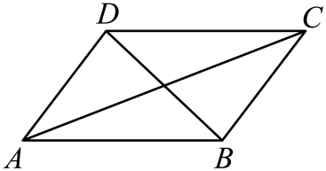
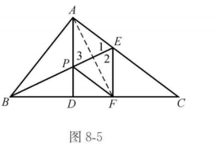
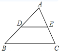
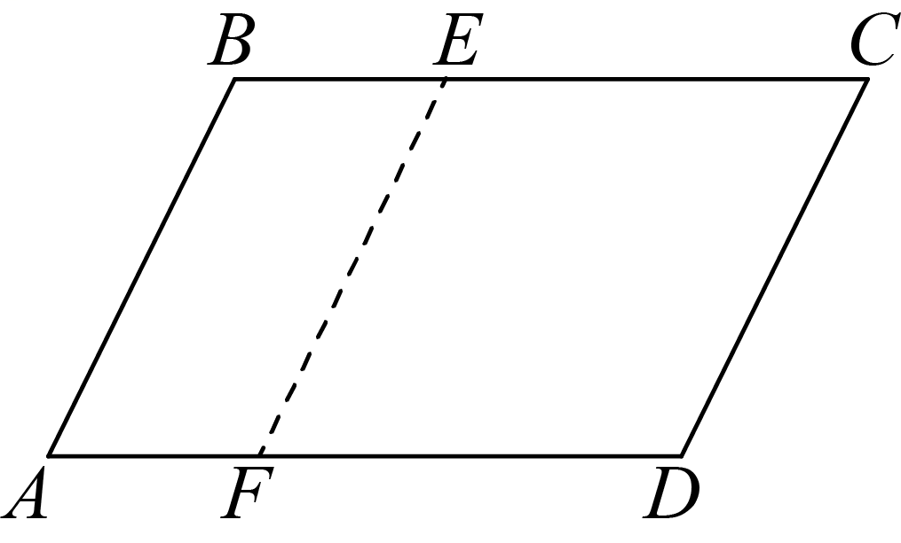
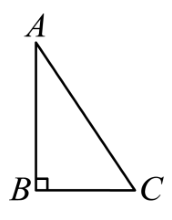
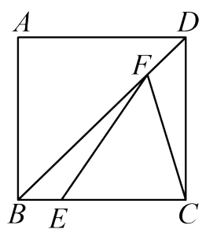

# 第二十一章 四边形 · 练习

## 讲义用题

### Q-MATH-TB8B-21.1-1

```yaml
id: Q-MATH-TB8B-21.1-1
category: 课本习题
source: 课本习题21.1第1题，印刷p.52
source_quality: 课本原文
kp: MATH-8B-21-1a
type: 简答
grading: 自评
answer_by: 本项目编写，待复核
review:
  概念: MATH-8B-21-1a
  公式: MATH-8B-21-1a
  计算: MATH-8B-21-1a
  审题: MATH-8B-21-1a
```

**题干**

四边形的四个角可以都是锐角吗？可以都是钝角吗？可以都是直角吗？为什么？

**答案**

不能都是锐角；不能都是钝角；可以都是直角。

**解析**

四个锐角的和小于 $360^\circ$，四个钝角的和大于 $360^\circ$，都与四边形内角和冲突。四个直角的和恰好为 $4\times90^\circ=360^\circ$，矩形就是这样的四边形。

### Q-MATH-TB8B-21.1-3

```yaml
id: Q-MATH-TB8B-21.1-3
category: 课本习题
source: 课本习题21.1第3题，印刷p.53
source_quality: 课本原文
kp: MATH-8B-21-1b
type: 计算
grading: 自评
answer_by: 本项目编写，待复核
review:
  概念: MATH-8B-21-1b
  公式: MATH-8B-21-1b
  计算: MATH-8B-21-1b
  审题: MATH-8B-21-1b
```

**题干**

求正五边形和正十边形的每个内角的度数。

**答案**

正五边形 $\boxed{108^\circ}$；正十边形 $\boxed{144^\circ}$。

**解析**

正五边形：$\dfrac{(\textcolor{#287fc4}{5}-2)180^\circ}{\textcolor{#287fc4}{5}}=\boxed{108^\circ}$。

正十边形：$\dfrac{(\textcolor{#287fc4}{10}-2)180^\circ}{\textcolor{#287fc4}{10}}=\boxed{144^\circ}$。

### Q-MATH-GD2022-08

```yaml
id: Q-MATH-GD2022-08
category: 真题
source: 2022年广东卷第8题；解析版PDF第3页（跨页题另见sources.md）
source_quality: 原卷
kp: MATH-8B-21-2a
type: 选择
grading: 自动
answer_by: 原卷解析
review:
  概念: MATH-8B-21-2a
  公式: MATH-8B-21-2a
  计算: MATH-8B-21-2a
  审题: MATH-8B-21-2a
```

**题干**

如图，在平行四边形 $ABCD$ 中，一定正确的是（ ）



A. $AD=CD$　B. $AC=BD$　C. $AB=CD$　D. $CD=BC$

**答案**

C

**解析**

平行四边形的两组对边分别相等，所以 $AB=CD$ 一定成立。相邻边或两条对角线不一定相等。

### Q-MATH-MG8-E2

```yaml
id: Q-MATH-MG8-E2
category: 导引例题
source: 思想方法导引第8章例8.2，印刷p.70，PDF第77页
source_quality: 导引原文
kp: MATH-8B-21-3b
type: 证明
grading: 自评
answer_by: 本项目编写，待复核
review:
  概念: MATH-8B-21-3b
  公式: MATH-8B-21-2b
  计算: MATH-8B-21-2b
  审题: MATH-8B-21-3b
secondary_kp:
- MATH-8B-21-2b
```

**题干**

如图8-5，$\mathrm{Rt}\triangle ABC$ 的角平分线 $BE$ 与斜边 $BC$ 上的高 $AD$ 相交于点 $P$，$EF\perp BC$ 于点 $F$。求证：四边形 $AEFP$ 是菱形。



**答案**

四边形 $AEFP$ 是菱形。

**解析**

$BE$ 平分 $\angle ABC$，$EA\perp BA$，$EF\perp BF$，所以 $E$ 到角的两边距离相等，$EA=EF$。

在直角三角形 $BAE,BFE$ 中，斜边 $BE$ 公共，且 $EA=EF$，故二者全等（HL）。这说明它们关于 $BE$ 对称，$BE$ 垂直平分 $AF$。

$AD\perp BC$，$EF\perp BC$，所以 $AP\parallel EF$。

在 $\triangle AEP$ 中，$\angle APE=\angle PEF$。由上述对称，$\angle PEF=\angle AEP$，所以 $AP=AE$。

$P$ 在 $AF$ 的垂直平分线上，所以 $PA=PF$。于是 $AE=EF=FP=PA$。

两组对边分别相等，先判四边形 $AEFP$ 是平行四边形。又有邻边 $AE=EF$，所以它是菱形。

### Q-MATH-GD2022-05

```yaml
id: Q-MATH-GD2022-05
category: 真题
source: 2022年广东卷第5题；解析版PDF第2页（跨页题另见sources.md）
source_quality: 原卷
kp: MATH-8B-21-2c
type: 选择
grading: 自动
answer_by: 原卷解析
review:
  概念: MATH-8B-21-2c
  公式: MATH-8B-21-2c
  计算: MATH-8B-21-2c
  审题: MATH-8B-21-2c
```

**题干**

如图，在 $\triangle ABC$ 中，$BC=4$，点 $D,E$ 分别为 $AB,AC$ 的中点，则 $DE=$（ ）



A. $\dfrac14$　B. $\dfrac12$　C. $1$　D. $2$

**答案**

D

**解析**

$DE$ 是中位线，$DE=\dfrac12BC=\dfrac12\times\textcolor{#287fc4}{4}=\boxed2$。

### Q-MATH-TB8B-21R-4

```yaml
id: Q-MATH-TB8B-21R-4
category: 课本习题
source: 课本复习题21第4题，印刷p.87
source_quality: 课本原文
kp: MATH-8B-21-3a
type: 计算
grading: 自评
answer_by: 本项目编写，待复核
review:
  概念: MATH-8B-21-3a
  公式: MATH-8B-21-3a
  计算: MATH-8B-21-3a
  审题: MATH-8B-21-3a
```

**题干**

矩形对角线组成的对顶角中，有一组是两个 $50^\circ$ 的角。对角线与各边组成的角是多少度？

**答案**

分别为 $\boxed{25^\circ}$ 和 $\boxed{65^\circ}$。

**解析**

设对角线交点为 $O$。矩形对角线相等且互相平分，所以 $O$ 到四个顶点的距离相等。

以 $50^\circ$ 为顶角的等腰三角形，两底角均为 $(180^\circ-\textcolor{#287fc4}{50}^\circ)/2=\boxed{65^\circ}$。

矩形相邻边垂直，另一种夹角为 $90^\circ-\textcolor{#287fc4}{65}^\circ=\boxed{25^\circ}$。

### Q-MATH-SZ2023-05

```yaml
id: Q-MATH-SZ2023-05
category: 真题
source: 2023年深圳卷第5题；回忆版（解析版）PDF第2页（跨页题另见sources.md）
source_quality: 回忆版，待原卷核对
kp: MATH-8B-21-3b
type: 选择
grading: 自动
answer_by: 原卷解析
review:
  概念: MATH-8B-21-3b
  公式: MATH-8B-21-3b
  计算: MATH-8B-21-3b
  审题: MATH-8B-21-3b
```

**题干**

如图，在平行四边形 $ABCD$ 中，$AB=4$，$BC=6$，将线段 $AB$ 水平向右平移 $a$ 个单位长度得到线段 $EF$，若四边形 $ECDF$ 为菱形时，则 $a$ 的值为（ ）



A. $1$　B. $2$　C. $3$　D. $4$

**答案**

B

**解析**

1. 四边形 $ABCD$ 是平行四边形，故 $CD=AB=4$。
2. 四边形 $ECDF$ 是菱形，故 $EC=CD=4$。
3. $BE=BC-EC=\textcolor{#287fc4}{6}-\textcolor{#287fc4}{4}=2$。由平移可知 $a=BE=\boxed2$，选B。

### Q-MATH-TB8B-21.3P-1

```yaml
id: Q-MATH-TB8B-21.3P-1
parts:
- {part: '2', kp: MATH-8B-21-3c}
- {part: '3', kp: MATH-8B-21-3c}
- {part: '4', kp: MATH-8B-21-3c}
category: 课本习题
source: 课本21.3练习第1题，印刷p.78（非p.70的同号练习）
source_quality: 课本原文
kp: MATH-8B-21-3c
type: 简答
grading: 自评
answer_by: 本项目编写，待复核
review:
  概念: MATH-8B-21-3c
  公式: MATH-8B-21-3c
  计算: MATH-8B-21-3c
  审题: MATH-8B-21-3c
do: 本章只做第（2）（3）（4）问
other_parts: 第（1）问已用于走一遍，不再重复练习
```

**题干**

满足下列条件的四边形是不是正方形？为什么？

（1）对角线互相垂直且相等的平行四边形；

（2）对角线互相垂直的矩形；

（3）对角线相等的菱形；

（4）对角线互相垂直平分且相等的四边形。

**答案**

（2）（3）（4）都是正方形。

**解析**

（2）矩形的对角线互相垂直，可判为菱形；矩形又是菱形，所以是正方形。

（3）菱形的对角线相等，可判为矩形；菱形又是矩形，所以是正方形。

（4）对角线互相平分，先判为平行四边形；对角线相等，判为矩形；对角线垂直，再判为正方形。

### Q-MATH-GZ2024-19

```yaml
category: 真题
source: 2024年广州市初中学业水平考试 数学 第19题
source_quality: 精品解析原卷Word，对照转出的PDF页核对
kp: MATH-8B-21-3a
type: 解答
grading: 自评
answer_by: 原卷解析
review:
  概念: MATH-8B-21-3a
```

**题干**

如图，在 $\mathrm{Rt}\triangle ABC$ 中，$\angle B=90^\circ$。



（1）尺规作图：作 $AC$ 边上的中线 $BO$（保留作图痕迹，不写作法）；

（2）在（1）所作的图中，将中线 $BO$ 绕点 $O$ 逆时针旋转 $180^\circ$ 得到 $DO$，连接 $AD$，$CD$。求证：四边形 $ABCD$ 是矩形。

**答案**

（1）作图见解析。（2）证明见解析。

**解析**

（1）作线段 $AC$ 的垂直平分线 $EF$，交 $AC$ 于点 $O$，连接 $BO$，则 $BO$ 即为所求。（2）由作图得 $AO=CO$，由旋转得 $BO=DO$，所以四边形 $ABCD$ 的对角线互相平分，是平行四边形；又 $\angle ABC=90^\circ$，所以四边形 $ABCD$ 是矩形。

### Q-MATH-GZ2023-14

```yaml
category: 真题
source: 2023年广州市初中学业水平考试 数学 第14题
source_quality: 精品解析原卷Word，对照转出的PDF页核对
kp: MATH-8B-21-3c
type: 填空
grading: 自评
answer_by: 原卷解析
review:
  概念: MATH-8B-21-3c
```

**题干**

如图，正方形 $ABCD$ 的边长为 4，点 $E$ 在边 $AB$ 上，$BE=1$，$F$ 为对角线 $BD$ 上一动点，连接 $CF$，$EF$，则 $CF+EF$ 的最小值为＿＿＿＿。



**答案**

$\sqrt{17}$

**解析**

正方形是轴对称图形，点 $A$ 与点 $C$ 关于对角线 $BD$ 对称，所以 $AF=CF$，$CF+EF=AF+EF\ge AE$，当 $A,F,E$ 三点共线（连接 $AE$ 交 $BD$ 于 $F$）时最小。$AE=\sqrt{AB^2+BE^2}=\sqrt{4^2+1^2}=\sqrt{17}$。

### Q-MATH-GD2019-13

```yaml
category: 真题
source: 2019 年广东省初中学业水平考试 数学 第 13 题
source_quality: 原卷（本地存档 Word 转 PDF 页，逐页核对）
kp: MATH-8B-21-1a
type: 填空
grading: 自评
answer_by: 原卷解析
review:
  概念: MATH-8B-21-1a
```

**题干**

一个多边形的内角和是 $1080^\circ$，这个多边形的边数是 ____。

**答案**

$\boxed{8}$。

**解析**

由 $(n-2)\times180^\circ=1080^\circ$，得 $n=8$。

