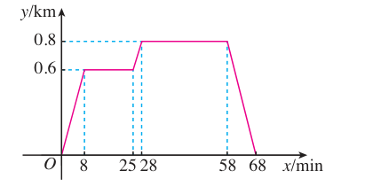

# 第二十二章 函数

本章是初中阶段函数学习的开篇。先认识变化过程中的常量与变量，再建立对应观点下的函数定义，明确自变量取值范围的求法。最后学习函数图象的列表、描点、连线画法，掌握从图象中读取变化信息解决实际问题的方法。

## 本章前置自查

在平面直角坐标系中准确描点并读出坐标，分式的分母不为零，二次根式的被开方数非负。

## 22.1a 常量与变量

```yaml
id: MATH-8B-22-1a
weight: 一般
textbook: 八下 22.1，印刷p.91
prerequisites: []
evidence:
- 能在具体文字背景或公式中圈出哪些量数值固定、哪些量数值改变。
- 给出变化情境时能用符号分别表示其中的常量与变量。
figure: 不需要
weight_note: 基础步骤容易得分，保留一题核验
sources:
- TB8B-22.1
method: []
```

### 本次只学

学会分清变化过程中的定量与变量。

### 先认住

- 在一个变化过程中，数值始终不变的量叫作常量，数值发生变化的量叫作变量。
- 固定单价等数值固定的量是常量，随状态改变而取不同数值的量是变量。
- **补充**（课本没有讲，做真题时常用）：圆周率 $\pi$ 等恒定常数与公式中的数值系数也是常量。

### 容易错

- 把圆周率 $\pi$ 或系数 $2$ 误当成字母变量。
- 脱离具体变化过程孤立判断一个量是常量还是变量。

### 练一练

- `Q-MATH-GD2022-10`

## 22.1b 函数的概念与对应关系

```yaml
id: MATH-8B-22-1b
weight: 一般
textbook: 八下 22.1，印刷p.93
prerequisites:
- id: MATH-8B-22-1a
  strength: hard
  reason: 先分清变化过程中的两个变量
evidence:
- 能根据给出的代数式判断每一个自变量取值是否对应唯一确定的函数值。
- 能准确指出给定函数关系中的自变量与函数。
figure: 不需要
weight_note: 基础步骤容易得分，保留一题核验
sources:
- TB8B-22.1
method:
- MG16 数形结合
```

### 本次只学

掌握函数的一对一或多对一对应本质。

### 先认住

- 一般地，在一个变化过程中，如果有两个变量 $x$ 与 $y$，并且对于 $x$ 的每一个确定的值，$y$ 都有唯一确定的值与其对应，那么我们就说 $x$ 是自变量，$y$ 是 $x$ 的函数。
- “唯一确定”是函数定义的核心：一个自变量的值绝不能对应两个或多个不同的函数值。
- 若当 $x=a$ 时 $y=b$，则称 $b$ 为自变量取值为 $a$ 时的函数值。

### 数形结合

```bridge
mode: cards
式: $y$ 是 $x$ 的函数
图: fn-vline
形: 图象上每个横坐标只对应唯一的纵坐标
色: blue
```

### 容易错

- 把一个自变量对应两个函数值的式子（如 $y^2=x$，$x>0$ 时 $y=\pm\sqrt{x}$）误认为函数。
- 混淆自变量与函数，颠倒因变量与自变量的从属关系。

### 练一练

- `Q-MATH-TB8B-22.1-6`

## 22.1c 自变量的取值范围

```yaml
id: MATH-8B-22-1c
weight: 一般
textbook: 八下 22.1，印刷p.94
prerequisites:
- id: MATH-8B-22-1b
  strength: hard
  reason: 先明确谁是自变量
evidence:
- 能根据实际问题中几何量的意义判断自变量是否必须大于零。
- 能在实际问题中写出符合现实情境的自变量取值范围。
figure: 不需要
weight_note: 基础步骤容易得分，保留一题核验
sources:
- TB8B-22.1
method:
- MG16 数形结合
```

### 本次只学

掌握代数式有意义与实际背景对自变量的双重限制。

### 先认住

- 确定自变量的取值范围时：纯代数关系先求式子有意义的范围；实际问题再取背景或指定范围的交集。
- 含分式时分母不能为 $0$；含二次根式时被开方数必须大于等于 $0$。
- 反映实际问题时，自变量必须符合现实情境中的几何尺寸、时间、数量等实际意义（通常大于 $0$，不可取负数或超出容量上限）。

### 数形结合

```bridge
mode: cards
式: $S=x^2$ 中 $x>0$
图: ray-gt:0
形: 边长必须为正数，图象上自变量的取值不含端点 $0$
色: blue
```

### 容易错

- 只考虑代数式运算有意义，漏掉几何边长或实际物理量必须大于零的条件。
- 在几何图形尺寸中误把大于零写成包含零的大于等于零。

### 练一练

- `Q-MATH-TB8B-22.1-4`
- `Q-MATH-GD2020-05`

## 22.2a 函数图象的画法（列表、描点、连线）

```yaml
id: MATH-8B-22-2a
weight: 一般
textbook: 八下 22.2，印刷p.101–102
prerequisites:
- id: MATH-8B-22-1b
  strength: hard
  reason: 理解对应值作为坐标点
evidence:
- 能按给定的自变量数值计算函数值并工整填写数值表。
- 能在平面直角坐标系中准确描出点对并连线。
figure: 不需要
weight_note: 基础步骤容易得分，保留一题核验
sources:
- TB8B-22.2
method:
- MG16 数形结合
```

### 本次只学

掌握描点法画函数图象的标准三步。

### 先认住

- 函数图象是把自变量与函数的每对对应值分别作为点的横、纵坐标而在坐标平面内描出的点构成的图形。
- 描点法先列表，再把对应值作为坐标描点；需要连线时，按横坐标从小到大的顺序连接。
- 列表选值要在取值范围内。连线形状由对应关系决定：同一直线上的点连成直线，曲线上的点平滑连接；分段过程保留转折点，离散数据不随意连线。

### 数形结合

```bridge
mode: cards
式: $(x,\,y)$
形: 表格中自变量与函数值的一对数，就是坐标系中的一个点；读出图象上一点的横、纵坐标，就得到同一对数。不要求所有图象都连续或都要连线
色: blue
```

### 容易错

- 描点时颠倒横、纵坐标，把 $(x, y)$ 误描为 $(y, x)$。
- 不要把转折点磨平，也不要把实际范围之外的点或线段添入图象。

### 练一练

- `Q-MATH-TB8B-22.2-8`
- `Q-MATH-SZ2024-19-1`

## 22.2b 函数图象的实际信息读取与应用

```yaml
id: MATH-8B-22-2b
weight: 重点
textbook: 八下 22.2，印刷p.104
prerequisites:
- id: MATH-8B-22-2a
  strength: hard
  reason: 理解图象上点的横纵坐标意义
- id: MATH-8B-20-1a
  strength: hard
  reason: 综合题中运用勾股定理求直角三角形边长
evidence:
- 能从图象的特殊点（起点、最高点、最低点、转折点）准确读出两坐标的对应数值。
- 能根据图象不同区段的上升、下降或平直状态解释实际运动全过程。
- 能结合图象中的横纵坐标差值计算各段的时间、路程或运动速度。
figure: 已完成 figures/tb22-2-ex2-distance.png（课本图22.2-6原图，已放在走一遍）
weight_note: 常见易错点或后续综合题的关键步骤
sources:
- TB8B-22.2
method:
- MG16 数形结合
```

### 本次只学

掌握从函数图象的关键拐点、水平段、升降趋势读取实际过程信息。

### 先认住

- 函数图象上点的横坐标表示自变量的值（如时间、路程），纵坐标表示对应的函数值（如距离、温度、面积）。
- 水平线段表示函数值随自变量的增加保持不变（实际情境中常表示停留、休息等过程）。
- 图象上升表示函数值随自变量增大而增大，图象下降表示函数值随自变量增大而减小。
- 图象拐点是运动状态或变化规律发生改变的临界点，分段分析是读图的关键。

### 数形结合

```bridge
mode: cards
式: 折线图象
图: fn-trip
形: 纵坐标反映离家距离，横坐标跨度反映所用时间，水平段反映停留
色: blue
```

### 走一遍

问题情境：李明家、食堂、图书馆在同一条直线上。李明从家去食堂吃早餐，接着去图书馆查资料，然后回家。如图反映了这个过程中，李明离家的距离 $y$（单位：$\text{km}$）与时间 $x$（单位：$\text{min}$）之间的对应关系。

根据图象回答下列问题：
(1) 食堂离李明家多远？李明从家到食堂用了多长时间？
(2) 李明吃早餐用了多长时间？
(3) 食堂离图书馆多远？李明从食堂到图书馆用了多长时间？
(4) 李明查资料用了多长时间？
(5) 图书馆离李明家多远？李明从图书馆回家的平均速度是多少？



**解与分析：**

- **第 (1) 问**：由纵坐标看出，食堂离李明家 $\textcolor{#287fc4}{0.6}\text{ km}$；由横坐标看出，李明从家到食堂用了 $\textcolor{#287fc4}{8}\text{ min}$。
- **第 (2) 问**：图象在 $x=8$ 到 $x=25$ 平行于 $x$ 轴，离家距离保持不变。由横坐标看出，李明吃早餐用了：
  $$25 - 8 = \textcolor{#287fc4}{17}\text{ min}$$
- **第 (3) 问**：由纵坐标看出，食堂离图书馆：
  $$0.8 - 0.6 = \textcolor{#287fc4}{0.2}\text{ km}$$
  由横坐标看出，李明从食堂到图书馆用了：
  $$28 - 25 = \textcolor{#287fc4}{3}\text{ min}$$
- **第 (4) 问**：图象在 $x=28$ 到 $x=58$ 水平停留，由横坐标看出，李明查资料用了：
  $$58 - 28 = \textcolor{#287fc4}{30}\text{ min}$$
- **第 (5) 问**：由纵坐标看出，图书馆离李明家 $\textcolor{#287fc4}{0.8}\text{ km}$；由横坐标看出，回家用时：
  $$68 - 58 = \textcolor{#287fc4}{10}\text{ min}$$
  由此算出李明从图书馆回家的平均速度是：
  $$\frac{0.8}{10} = \boxed{0.08}\text{ km/min}$$

### 容易错

- 混淆横坐标增量与时间间隔，看错起止时刻。
- 把距离—时间图象误当成物体的实际运动轨迹。
- 忽略分段线段的物理意义，误把停顿阶段当成继续前进。

### 练一练

- `Q-MATH-SZ2023-10`
