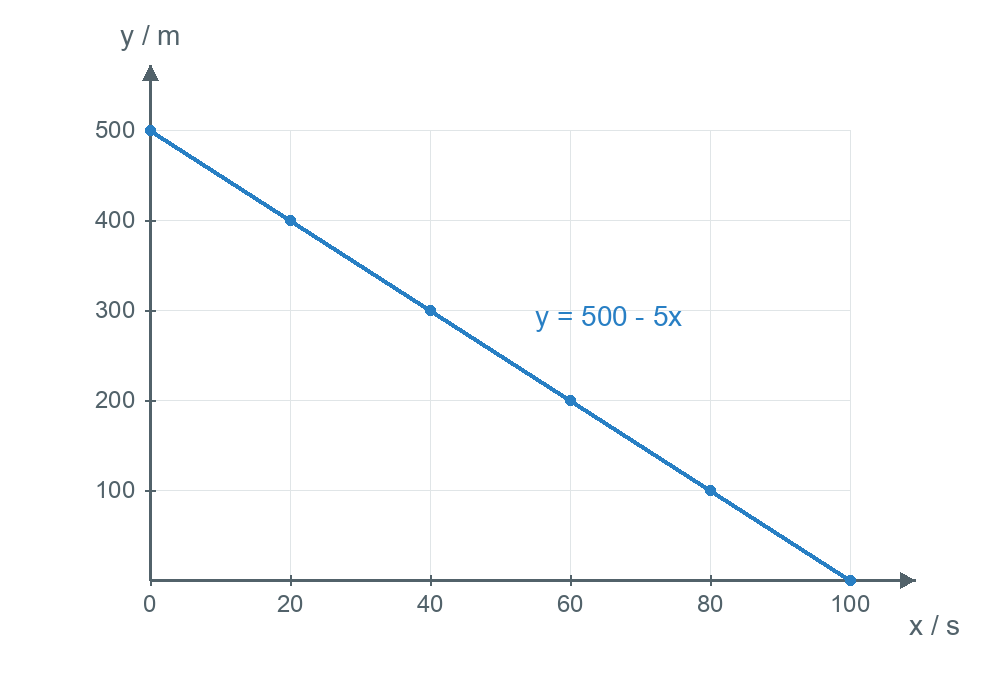

# 第二十二章 函数 · 练习

## 讲义用题

### Q-MATH-GD2022-10

```yaml
id: Q-MATH-GD2022-10
category: 真题
source: 2022年广东卷第10题；解析版PDF第4页（跨页题另见sources.md）
source_quality: 原卷
kp: MATH-8B-22-1a
type: 选择
grading: 自动
answer_by: 原卷解析
review:
  概念: MATH-8B-22-1a
  公式: MATH-8B-22-1a
  计算: MATH-8B-22-1a
  审题: MATH-8B-22-1a
```

**题干**

水中涟漪（圆形水波）不断扩大，记它的半径为 $r$，则圆周长 $C$ 与 $r$ 的关系式为 $C = 2\pi r$。下列判断正确的是（ ）

A. 2 是变量
B. $\pi$ 是变量
C. $r$ 是变量
D. $C$ 是常量

**答案**

C

**解析**

在圆周长公式 $C = 2\pi r$ 中：
1. $2$ 和 $\pi$ 是恒定不变的常数，它们是常量；
2. 圆形水波不断扩大，半径 $r$ 和周长 $C$ 的数值都在发生改变，因此 $r$ 和 $C$ 都是变量。

对照各选项：
- A 项：$2$ 是常量，判断错误；
- B 项：$\pi$ 是常量，判断错误；
- C 项：$r$ 是变量，判断正确；
- D 项：$C$ 是变量，判断错误。

故本题选 $\boxed{\text{C}}$。

### Q-MATH-TB8B-22.1-6

```yaml
id: Q-MATH-TB8B-22.1-6
parts:
- {part: '1', kp: MATH-8B-22-1b}
- {part: '2', kp: MATH-8B-22-1b}
- {part: '3', kp: MATH-8B-22-1b}
category: 课本习题
source: 人教版八下习题22.1第6题（印刷p.96）
source_quality: 课本原文
kp: MATH-8B-22-1b
type: 简答
grading: 自评
answer_by: 本项目编写，待复核
review:
  概念: MATH-8B-22-1b
  公式: MATH-8B-22-1b
  计算: MATH-8B-22-1b
  审题: MATH-8B-22-1b
```

**题干**

下列式子中的 $y$ 是 $x$ 的函数吗？为什么？

(1) $y=3x-5$；

(2) $y=\dfrac{x-2}{x-1}$；

(3) $y=\sqrt{x-1}$。

**答案**

(1) 是；
(2) 是；
(3) 是。

**解析**

根据函数定义，对于自变量 $x$ 的每一个确定的取值，函数 $y$ 必须有唯一确定的值与其对应：

(1) 对于式子 $y=3x-5$：
对于每一个实数 $x$，都有唯一确定的 $y = \textcolor{#287fc4}{3x-5}$ 与之对应。
所以 $y$ 是 $x$ 的函数。

(2) 对于式子 $y=\dfrac{x-2}{x-1}$：
当 $x \ne 1$ 时分母不为 0。
对于每一个确定的 $x$（$x \ne 1$），都有唯一确定的 $y = \textcolor{#287fc4}{\dfrac{x-2}{x-1}}$ 与之对应。
所以 $y$ 是 $x$ 的函数。

(3) 对于式子 $y=\sqrt{x-1}$：
当 $x \geqslant 1$ 时被开方数非负，算术平方根具有唯一性。
对于每一个确定的 $x$（$x \geqslant 1$），都有唯一确定的 $y = \textcolor{#287fc4}{\sqrt{x-1}}$ 与之对应。
所以 $y$ 是 $x$ 的函数。

### Q-MATH-TB8B-22.1-4

```yaml
id: Q-MATH-TB8B-22.1-4
category: 课本习题
source: 人教版八下习题22.1第4题（印刷p.96）
source_quality: 课本原文
kp: MATH-8B-22-1c
type: 计算
grading: 自评
answer_by: 本项目编写，待复核
review:
  概念: MATH-8B-22-1c
  公式: MATH-8B-22-1c
  计算: MATH-8B-22-1c
  审题: MATH-8B-22-1c
```

**题干**

一个三角形的底边长为 5，面积 $S$ 随底边上的高 $h$ 的变化而变化。指出其中的常量与变量，自变量与函数，并写出函数解析式，以及自变量的取值范围。

**答案**

常量：底边长 5，常数 $\frac{1}{2}$；
变量：面积 $S$，底边上的高 $h$；
自变量：$h$；
函数：$S$；
函数解析式：$S = \frac{5}{2}h$（或 $S = 2.5h$）；
自变量取值范围：$h > 0$。

**解析**

1. **分析常量与变量**：
三角形的底边长固定为 $\textcolor{#287fc4}{5}$，面积计算公式中的 $\frac{1}{2}$ 恒定不变，它们是常量；
底边上的高 $h$ 可以改变，面积 $S$ 随之改变，所以 $S$ 和 $h$ 是变量。

2. **自变量与函数**：
面积 $S$ 随底边上的高 $h$ 的变化而变化，所以底边上的高 $h$ 是自变量，面积 $S$ 是 $h$ 的函数。

3. **写出函数解析式**：
根据三角形面积公式：
$$S = \frac{1}{2} \times \textcolor{#287fc4}{5} \times h = \boxed{\frac{5}{2}h}$$

4. **自变量的取值范围**：
因为 $h$ 代表实际几何图形中三角形的高，线段长度必须大于零，不能为负数也不能为零，所以自变量取值范围为：
$$\boxed{h > 0}$$

### Q-MATH-TB8B-22.2-8

```yaml
id: Q-MATH-TB8B-22.2-8
category: 课本习题
source: 人教版八下习题22.2第8题（印刷p.109）
source_quality: 课本原文
kp: MATH-8B-22-2a
type: 解答
grading: 自评
answer_by: 本项目编写，待复核
review:
  概念: MATH-8B-22-2a
  计算: MATH-8B-22-2a
  审题: MATH-8B-22-2a
```

**题干**

甲、乙两车沿直路同向行驶，车速分别为 $20\ \mathrm{m/s}$ 和 $25\ \mathrm{m/s}$。现甲车在乙车前 $500\ \mathrm m$ 处，设 $x\ \mathrm s$（$0\leq x\leq100$）后两车相距 $y\ \mathrm m$。用函数解析式和图象表示 $y$ 与 $x$ 的对应关系。

**答案**

$\boxed{y=500-5x\quad(0\leq x\leq100)}$。图象是连接 $(0,500)$ 与 $(100,0)$ 的线段。



**解析**

1. $x$ 秒后，甲车向前行驶 $20x$ 米，乙车向前行驶 $25x$ 米。两车间距为 $y=\textcolor{#287fc4}{500}+\textcolor{#287fc4}{20}x-\textcolor{#287fc4}{25}x=\boxed{500-5x}$（间距等于甲车的位置减去乙车的位置）。
2. 在题目给定的范围内列表：

| $x/\mathrm s$ | 0 | 20 | 40 | 60 | 80 | 100 |
| --- | --- | --- | --- | --- | --- | --- |
| $y/\mathrm m$ | 500 | 400 | 300 | 200 | 100 | 0 |

3. 用时间作横坐标，间距作纵坐标，描出表中的六个点。它们在同一直线上，连接成从 $(0,500)$ 到 $(100,0)$ 的线段（列表、描点、连线）。
4. $x=100$ 时两车相遇，间距为 $0$。图象只表示 $0\leq x\leq100$ 的过程，不能向两端延长（题目给定的自变量范围）。

### Q-MATH-SZ2023-10

```yaml
id: Q-MATH-SZ2023-10
category: 真题
source: 2023年深圳卷第10题，回忆版（解析版），PDF第5页（跨页题另见sources.md）
source_quality: 回忆版，待原卷核对
kp: MATH-8B-22-2b
type: 选择
grading: 自动
answer_by: 原卷解析
review:
  概念: MATH-8B-22-2b
  公式: MATH-8B-22-2b
  计算: MATH-8B-22-2b
  审题: MATH-8B-22-2b
```

**题干**

如图1，在 $\mathrm{Rt}\triangle ABC$ 中，动点 $P$ 从 $A$ 点运动到 $B$ 点再到 $C$ 点后停止，速度为 $2\text{ 单位/s}$，其中 $BP$ 长与运动时间 $t$（单位：$\text{s}$）的关系如图2，则 $AC$ 的长为（ ）


A. $\frac{15\sqrt{5}}{2}$
B. $\sqrt{427}$
C. 17
D. $5\sqrt{3}$

**答案**

C

**解析**

1. **分析点 $P$ 在线段 $AB$ 上的运动**：
由图2可知，当运动开始时 $t = \textcolor{#287fc4}{0}$，点 $P$ 位于点 $A$ 处。
此时 $BP$ 的长度对应纵坐标为 $\textcolor{#287fc4}{15}$，即：
$$AB = 15$$
已知点 $P$ 的运动速度为 $v = 2\text{ 单位/s}$。
点 $P$ 从点 $A$ 运动到点 $B$ 所需的时间为：
$$t_1 = \frac{AB}{v} = \frac{15}{2} = 7.5\text{ s}$$
由计算可知到点 $B$ 时 $t = 7.5\text{ s}$，图中此处 $BP = 0$。

2. **分析点 $P$ 在线段 $BC$ 上的运动**：
由图2知，全过程的总运动时间为 $t_2 = \textcolor{#287fc4}{11.5}\text{ s}$。
因此，点 $P$ 从点 $B$ 运动到点 $C$ 所用的时间为：
$$\Delta t = 11.5 - 7.5 = \textcolor{#287fc4}{4}\text{ s}$$
线段 $BC$ 的长度为：
$$BC = v \times \Delta t = 2 \times 4 = \textcolor{#287fc4}{8}$$

3. **利用勾股定理计算 $AC$**：
在 $\mathrm{Rt}\triangle ABC$ 中，$\angle B = 90^\circ$：
根据勾股定理：
$$AC = \sqrt{AB^2 + BC^2} = \sqrt{15^2 + 8^2} = \sqrt{225 + 64} = \sqrt{289} = \boxed{17}$$

故本题选 $\boxed{\text{C}}$。

### Q-MATH-SZ2024-19-1

```yaml
category: 真题
source: 2024年深圳市中考 数学 第19题第（1）问
source_quality: 精品解析原卷Word，对照转出的PDF页核对
kp: MATH-8B-22-2a
type: 解答
grading: 自评
other_parts: 第（2）问为方案选择，本章不做
answer_by: 原卷解析
review:
  概念: MATH-8B-22-2a
```

**题干**

为了测量抛物线的开口大小，某数学兴趣小组将两把含有刻度的直尺垂直放置，并分别以水平放置的直尺和竖直放置的直尺为 $x$，$y$ 轴建立如图所示平面直角坐标系，该数学小组选择不同位置测量数据如下表所示，设 $BD$ 的读数为 $x$，$CD$ 读数为 $y$，抛物线的顶点为 $C$。


（1）（Ⅰ）列表：

| | ① | ② | ③ | ④ | ⑤ | ⑥ |
|---|---|---|---|---|---|---|
| $x$ | 0 | 2 | 3 | 4 | 5 | 6 |
| $y$ | 0 | 1 | 2.25 | 4 | 6.25 | 9 |

（Ⅱ）描点：请将表格中的 $(x,y)$ 描在图 2 中；

（Ⅲ）连线：请用平滑的曲线在图 2 中将上述点连接，并求出 $y$ 与 $x$ 的关系式。

**答案**

描点、连线见解析（点落在一条经过原点的抛物线上）；$y=\dfrac14x^2$。

**解析**

按表中数据在图 2 的坐标系中依次描出 $(0,0)$，$(2,1)$，$(3,2.25)$，$(4,4)$，$(5,6.25)$，$(6,9)$，用平滑曲线连接，是一条以原点为顶点、开口向上的抛物线。设 $y=ax^2$，把 $(2,1)$ 代入得 $a=\dfrac14$，所以 $y=\dfrac14x^2$（验证：$x=4$ 时 $y=4$，$x=6$ 时 $y=9$，均符合）。

### Q-MATH-GD2020-05

```yaml
category: 真题
source: 2020 年广东省初中学业水平考试 数学 第 5 题
source_quality: 原卷（本地存档 Word 转 PDF 页，逐页核对）
kp: MATH-8B-22-1c
type: 选择
grading: 自动
answer_by: 原卷解析
review:
  概念: MATH-8B-22-1c
```

**题干**

若式子 $\sqrt{2x-4}$ 在实数范围内有意义，则 $x$ 的取值范围是

A．$x\neq 2$　　B．$x\geq 2$　　C．$x\leq 2$　　D．$x\neq -2$

**答案**

B

**解析**

被开方数非负：$2x-4\geq 0$，得 $x\geq 2$。

