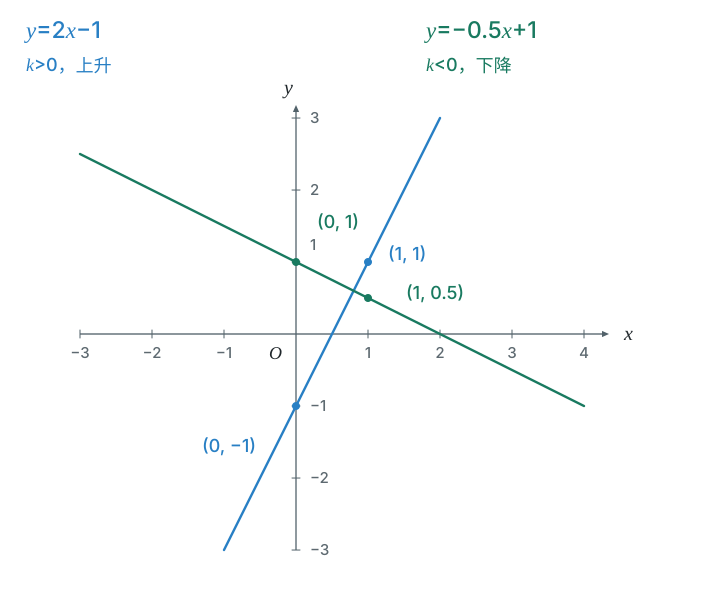
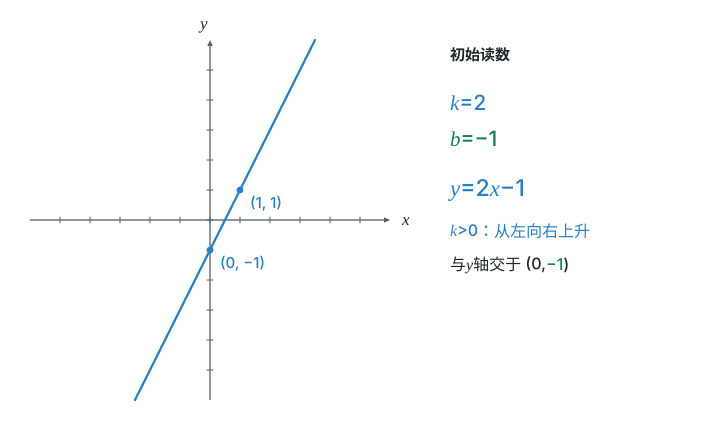
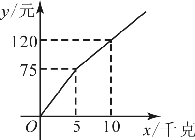

# 第二十三章 一次函数

一次函数把“每增加一点，结果怎样变化”写成直线。读图与列式互相检查，实际范围决定哪一段能用。

## 本章前置自查

先确认会代入求值、会读坐标、知道一个输入只能对应一个输出。遇到实际问题，还要写出自变量的范围。

## 23.1a 一次函数与正比例函数

```yaml
id: MATH-8B-23-1a
weight: 一般
textbook: 八下 23.1，印刷p.114–116
prerequisites:
- id: MATH-8B-22-1b
  strength: hard
  reason: 理解变量间的对应关系
evidence:
- 能整理后判断一次函数
- 能从一次函数中找出正比例函数
figure: 不需要
weight_note: 基础步骤容易得分，保留一题核验
sources:
- TB8B-23.1
method:
- MG16 数形结合
```

### 本次只学

先整理解析式，再辨认函数类型。

### 先认住

- 一次函数形如 $y=kx+b$，其中 $k,b$ 是常数，且 $k\neq0$。
- $b=0$ 时，$y=kx$ 是正比例函数；正比例函数也是一次函数。
- 先展开和整理；不要只看原式中有没有常数项。

### 数形结合

```bridge
mode: cards
式: $y=kx\ \to\ y=kx+b$
图: lin-shift
形: 正比例函数是经过原点的直线，一次函数的图象可以看作由它平移得到
色: blue
```

### 容易错

- $k=0$ 的常值函数不是一次函数。

### 练一练

- `Q-MATH-TB8B-23.1-1`

## 23.2a 直线图象与参数的含义

```yaml
id: MATH-8B-23-2a
weight: 重点
textbook: 八下 23.2，印刷p.117–121
prerequisites:
- id: MATH-8B-23-1a
  strength: hard
  reason: 认识系数与常数项
- id: MATH-8B-22-2a
  strength: hard
  reason: 完成列表、描点
evidence:
- 对正比例函数，能由 $k$ 的符号判断直线经过的象限
- 能由解析式中 $k$ 的符号判断函数值随自变量的增减性
figure: 已完成 figures/line-kb-23-2a.svg（同一等比例坐标系中画两条直线及示范的四个点）；另有 line-explorer 组件及静态图 figures/line-explorer-23-2a.svg
walk_source: 课本23.2例3，印刷p.120；PDF索引126（第127页）
weight_note: 9卷多次在图象、参数或不等式中使用；象限与实际范围易混
sources:
- TB8B-23.2
method:
- MG16 数形结合
```

### 本次只学

把直线的升降、与坐标轴的交点与解析式联系起来。

### 先认住

- $y=kx+b$ 的图象是直线，两个不同的点可确定它。
- $k>0$ 时从左向右上升；$k<0$ 时从左向右下降。
- **补充**（课本没有讲，做真题时常用）：与 $y$ 轴交于 $(0,b)$，与 $x$ 轴交于 $(-b/k,0)$。
- 正比例函数 $y=kx$ 经过哪些象限可由 $k$ 的符号判断；一般一次函数判断象限还要结合 $b$，不能只看升降。

### 数形结合

```bridge
mode: cards
式: $k>0,\ b>0$
图: lin-up
形: 从左向右上升；与 $y$ 轴的交点在原点上方
色: green
---
式: $k<0,\ b<0$
图: lin-down
形: 从左向右下降；与 $y$ 轴的交点在原点下方
色: red
结: 与 $y$ 轴的交点在原点时，$b=0$。
```

### 走一遍

画出 $y=2x-1$ 与 $y=-0.5x+1$ 的图象。

取 $x=0,1$，分别代入。

第一条：当 $x=0$ 时，$y=2\times\textcolor{#287fc4}{0}-1=-1$；当 $x=1$ 时，$y=2\times\textcolor{#287fc4}{1}-1=1$。

第二条：当 $x=0$ 时，$y=-0.5\times\textcolor{#287fc4}{0}+1=1$；当 $x=1$ 时，$y=-0.5\times\textcolor{#287fc4}{1}+1=0.5$。

第一条过 $\boxed{(0,-1),(1,1)}$，从左向右上升；第二条过 $\boxed{(0,1),(1,0.5)}$，从左向右下降。

分别描出两个点并连接、延长，就得到对应的直线。



拖动下面的滑块，看 $k$、$b$ 变化时直线怎样动。

```widget
type: line-explorer
k: {min: -3, max: 3, step: 0.5, value: 2}
b: {min: -4, max: 4, step: 1, value: -1}
points: [{x: 1}, {x: 0}]
```


### 容易错

- 坐标轴交点不属于任何象限。
- 直线的图象与实际问题允许取的线段或射线要分开。

### 练一练

- `Q-MATH-TB8B-23.2-2`
- `Q-MATH-TJ2024-16`

## 23.2b 用已知点确定解析式

```yaml
id: MATH-8B-23-2b
weight: 一般
textbook: 八下 23.2，印刷p.121–122
prerequisites:
- id: MATH-8B-23-1a
  strength: hard
  reason: 知道待确定的两个参数
- id: MATH-8B-22-1b
  strength: hard
  reason: 图象上的点满足对应关系
evidence:
- 能把两点条件写成两条方程
- 能用原有点验证解析式
figure: 不需要
weight_note: 基础步骤容易得分，保留一题核验
sources:
- TB8B-23.2
method:
- MG16 数形结合
```

### 本次只学

把点的坐标代入，解出两个待定系数。

### 先认住

- 设 $y=kx+b$，把每个已知点代入，得到关于 $k,b$ 的方程。
- **补充**（课本没有讲，做真题时常用）：求出系数后，把两个点再代回检查。

### 数形结合

```bridge
mode: cards
式: 代入已知点的坐标
形: 图象上已知点的坐标代入解析式，把位置关系转化为求系数 $k$ 与 $b$ 的方程组
色: blue
```

### 容易错

- 横坐标代入自变量，纵坐标代入函数值，顺序不能换。

### 练一练

- `Q-MATH-GD2023-16`

  本章只做第（2）问

## 23.2c 直线的上下平移

```yaml
id: MATH-8B-23-2c
weight: 一般
textbook: 八下 23.2，印刷p.119–120
prerequisites:
- id: MATH-8B-23-2a
  strength: hard
  reason: 理解一次函数的 $k$ 和常数项 $b$
evidence:
- 能写出上下平移后的解析式
- 能说明平移后直线的倾斜程度（$k$）为什么不变
figure: 不需要
weight_note: 基础步骤容易得分，保留一题核验
sources:
- TB8B-23.2
method:
- MG16 数形结合
```

### 本次只学

保持直线的倾斜程度，改变上下位置。

### 先认住

- 直线 $y=kx+b$ 向上平移 $h$ 个单位，得到 $y=kx+b+h$（$h>0$）。
- 向下平移 $h$ 个单位，得到 $y=kx+b-h$。
- 上下平移不改变直线的倾斜程度（$k$ 不变），平移前后直线平行。

### 数形结合

```bridge
mode: cards
式: $y=kx+b$ 上下平移
图: lin-shift
形: 直线沿 $y$ 轴上下平移时，倾斜程度不变（$k$ 不变），只有常数项 $b$ 改变
色: blue
```

### 容易错

- 上下平移改的是整个函数值，不是把自变量随意加减。

### 练一练

- `Q-MATH-TB8B-23.2-6`
- `Q-MATH-GZ2025-06`

## 23.3a 直线交点与方程、方程组

```yaml
id: MATH-8B-23-3a
weight: 一般
textbook: 八下 23.3，印刷p.127–130
prerequisites:
- id: MATH-8B-23-2a
  strength: hard
  reason: 知道直线上的点满足解析式
evidence:
- 能由交点解释方程组的解
- 能把交点代回两条方程核验
figure: 不需要
weight_note: 基础步骤容易得分，保留一题核验
sources:
- TB8B-23.3
method:
- MG16 数形结合
```

### 本次只学

把方程的解解释成图象上的交点。

### 先认住

- 一元一次方程 $ax+b=0$（$a \ne 0$）的解，是直线 $y=ax+b$ 与 $x$ 轴交点的横坐标。
- 两条直线交点的坐标同时满足两条方程；方程组的解就是交点坐标。

### 数形结合

```bridge
mode: cards
式: 交点坐标 = 方程组的解
图: lin-cross
形: 直线与 $x$ 轴交点的横坐标是方程的解；两条直线交点的坐标是方程组的解
色: blue
```

### 容易错

- 解一元方程取横坐标；解二元方程组要给出两个量。

### 练一练

- `Q-MATH-TB8B-23.3-3`

## 23.3b 图象与一次不等式

```yaml
id: MATH-8B-23-3b
weight: 一般
textbook: 八下 23.3，印刷p.127–130
prerequisites:
- id: MATH-8B-23-2a
  strength: hard
  reason: 理解直线的增减与交点
evidence:
- 理解直线在 $x$ 轴上方或下方与不等式解集的对应关系
- 能根据给定的一元一次不等式解集，判断对应的一次函数图象
figure: 不需要
weight_note: 基础步骤容易得分，保留一题核验
sources:
- TB8B-23.3
method:
- MG16 数形结合
```

### 本次只学

把纵坐标的比较转为横坐标的范围。

### 先认住

- $kx+b>0$ 对应直线在 $x$ 轴上方的部分；$kx+b<0$ 对应下方的部分。
- 比较两个函数值，先找交点，再判断交点两侧哪条线在上方。
- **补充**（课本没有讲，做真题时常用）：严格不等号不取交点；非严格不等号取交点。

### 数形结合

```bridge
mode: cards
式: 函数值大于 $0$
图: lin-ineq
形: 直线在 $x$ 轴上方的部分，对应的横坐标范围就是不等式的解集
色: blue
```

### 容易错

- 不能把“函数值大于零”写成“自变量大于零”。

### 练一练

- `Q-MATH-GD2024-10`

## 23.4a 用一次函数表达实际关系

```yaml
id: MATH-8B-23-4a
weight: 重点
textbook: 八下 23.4，印刷p.131–136
prerequisites:
- id: MATH-8B-23-2b
  strength: hard
  reason: 用数据确定参数
- id: MATH-8B-22-1c
  strength: hard
  reason: 检查自变量的实际限制
evidence:
- 能区分初始量与变化率
- 能写出数量之间的解析式
- 能检查求得的值是否符合实际范围
figure: 不需要
walk_source: 2022年广东卷第20题第（1）问；解析版PDF第8页（索引7）
weight_note: 多卷独立考实际模型；原点、单位和实际范围易漏
sources:
- TB8B-23.4
method:
- MG16 数形结合
```

### 本次只学

先写量与单位，再决定固定量和变化量。

### 先认住

- 先明确自变量与函数值，区分固定费用或初始量与变化部分。
- 写出关系式后，加上实际允许的范围。
- 用已知数据检查模型；代数解还要符合实际意义。

### 数形结合

```bridge
mode: cards
式: $(0,b)$ 与 $k$
图: lin-up
形: 先标出 $(0,b)$；横坐标每增加一个单位，纵坐标改变 $k$，由此确定直线的倾斜
色: blue
结: 实际图象只取允许范围内的部分。
```

### 走一遍

在弹性限度内，弹簧长度 $y$（cm）与质量 $x$（kg）满足 $y=kx+15$。测得 $x=2$ 时 $y=19$，$x=5$ 时 $y=25$。

先用一组数据求参数：$\textcolor{#287fc4}{19}=k\times\textcolor{#287fc4}{2}+15$。

$k=(\textcolor{#287fc4}{19}-15)/\textcolor{#287fc4}{2}=2$，所以 $\boxed{y=2x+15}$。

检查另一组：$2\times\textcolor{#287fc4}{5}+15=25$，符合实测数据。

$15$ cm 是未挂物体时的长度；$2$ cm/kg 是每增加单位质量的长度变化。此模型只在题设弹性限度内使用。

### 容易错

- 速度、价格等变化率要配对正确的单位。
- 不能把实际问题的数量默认成任意实数。

### 练一练

- `Q-MATH-GD2022-20`

  本章只做第（2）问

## 23.4b 分段关系与方案比较

```yaml
id: MATH-8B-23-4b
weight: 重点
textbook: 八下 23.4，印刷p.133–137
prerequisites:
- id: MATH-8B-23-4a
  strength: hard
  reason: 建立实际关系并写范围
- id: MATH-8B-23-2b
  strength: hard
  reason: 从图象上的点求直线参数
evidence:
- 能按临界点写出分段解析式
- 能解释后一段的固定部分
- 能根据预算选择对应区间并比较方案
figure: 已完成 figures/gz2023-22-1.png（原卷题图，用于走一遍）
walk_source: 2023年广州卷第22题第（1）问；解析版PDF第16–17页（索引15–16）
weight_note: GZ2023-22与SZ2024-17体现分段或方案选择；计价对象易弄错
sources:
- TB8B-23.4
method:
- MG16 数形结合
```

### 本次只学

先确定所在区间，再列式和比较。

### 先认住

- 收费或变化率改变时，要分段写关系式。
- 后一段通常包含前一段的累计结果；不能用新单价重算全部数量。
- 先用临界值确定区间，再计算；比较方案时注意固定的是预算还是数量。

### 数形结合

```bridge
mode: cards
式: 拐点与交点
图: lin-kink
形: 折线的拐点对应计费规则改变的分界点；图象交点对应两种方案费用相等的临界数量
色: blue
```

### 走一遍

甲店费用 $y_1$（元）与水果质量 $x$（kg）的图象依次经过 $(0,0),(5,75),(10,120)$。



第一段过原点，$75=k\times5$，得 $k=\textcolor{#287fc4}{75}/\textcolor{#287fc4}{5}=15$。

第二段的变化率为 $(\textcolor{#287fc4}{120}-\textcolor{#287fc4}{75})/(\textcolor{#287fc4}{10}-\textcolor{#287fc4}{5})=9$（即 $k=9$）。

第二段从已收的 $75$ 元累加，所以 $y_1=75+9(x-5)=9x+30$。

$\boxed{y_1=\begin{cases}15x,&0\leq x\leq5,\\9x+30,&x>5.\end{cases}}$

检查拐点：两段在 $x=5$ 时都得到 $75$，没有把前五千克重新计价。

### 容易错

- 折线拐点要分别检查两段是否衔接。
- 预算相同，应比较能买到的数量，不只是每千克价格。

### 练一练

- `Q-MATH-GZ2023-22`

  本章只做第（2）问
- `Q-MATH-MG15-E2`
