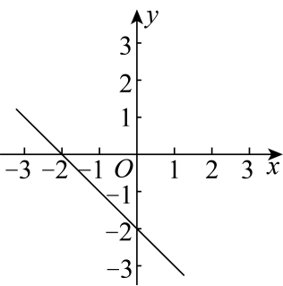
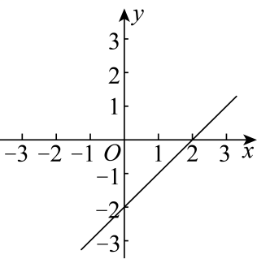
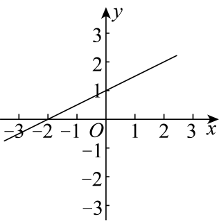
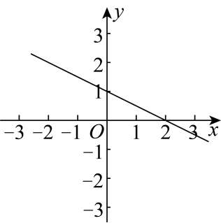
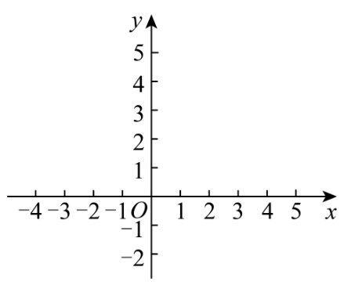

# 第二十三章 一次函数 · 练习

## 讲义用题

### Q-MATH-TB8B-23.1-1

```yaml
id: Q-MATH-TB8B-23.1-1
parts:
- {part: '1', kp: MATH-8B-23-1a}
- {part: '2', kp: MATH-8B-23-1a}
- {part: '3', kp: MATH-8B-23-1a}
- {part: '4', kp: MATH-8B-23-1a}
category: 课本习题
source: 课本习题23.1第1题，印刷p.116
source_quality: 课本原文
kp: MATH-8B-23-1a
type: 简答
grading: 自评
answer_by: 本项目编写，待复核
review:
  概念: MATH-8B-23-1a
  公式: MATH-8B-23-1a
  计算: MATH-8B-23-1a
  审题: MATH-8B-23-1a
```

**题干**

下列函数中哪些是一次函数，哪些又是正比例函数？

（1）$y=-0.2x$；（2）$y=-3(x+1)$；（3）$S=\pi r^2$；（4）$y=\dfrac x2$。

**答案**

一次函数：（1）（2）（4）；正比例函数：（1）（4）。

**解析**

（2）展开为 $y=-3x-3$，是一次函数，但常数项不为零。第（3）式的自变量 $r$ 的次数是二，不是一次函数。第（1）（4）式都是 $k\neq0$ 且常数项为零的形式。

### Q-MATH-TB8B-23.2-2

```yaml
id: Q-MATH-TB8B-23.2-2
category: 课本习题
source: 课本习题23.2第2题，印刷p.124
source_quality: 课本原文
kp: MATH-8B-23-2a
type: 填空
grading: 自评
answer_by: 本项目编写，待复核
review:
  概念: MATH-8B-23-2a
  公式: MATH-8B-23-2a
  计算: MATH-8B-23-2a
  审题: MATH-8B-23-2a
```

**题干**

函数 $y=-5x$ 的图象经过第___象限，经过点 $(0,\underline{\quad})$ 与点 $(1,\underline{\quad})$，$y$ 随 $x$ 的增大而___。

**答案**

第二、四象限；$\boxed0$；$\boxed{-5}$；减小。

**解析**

$k=-5<0$，图象过原点且从左向右下降，所以经过第二、四象限。

$x=0$ 时，$y=-5\times\textcolor{#287fc4}{0}=\boxed0$。

$x=1$ 时，$y=-5\times\textcolor{#287fc4}{1}=\boxed{-5}$。

$k<0$，函数值随自变量增大而减小。

### Q-MATH-GD2023-16

```yaml
id: Q-MATH-GD2023-16
parts:
- {part: '2', kp: MATH-8B-23-2b}
category: 真题
source: 2023年广东卷第16题；解析版PDF第8页（跨页题另见sources.md）
source_quality: 原卷
kp: MATH-8B-23-2b
type: 计算
grading: 自评
answer_by: 原卷解析
review:
  概念: MATH-8B-23-2b
  公式: MATH-8B-23-2b
  计算: MATH-8B-23-2b
  审题: MATH-8B-23-2b
do: 本章只做第（2）问
other_parts: 第（1）问是实数计算，不作为本章练习；题干原样保留
```

**题干**

（1）计算：$\sqrt[3]8+|-5|+(-1)^{2023}$；

（2）已知一次函数 $y=kx+b$ 的图象经过点 $(0,1)$ 与点 $(2,5)$，求该一次函数的表达式。

**答案**

第（2）问 $\boxed{y=2x+1}$。

**解析**

代入 $(0,1)$：$1=k\times0+b$，所以 $b=1$。

代入 $(2,5)$：$5=2k+1$，所以 $k=(\textcolor{#287fc4}{5}-\textcolor{#287fc4}{1})/\textcolor{#287fc4}{2}=2$。

代回检查两个点后，得到 $\boxed{y=2x+1}$。

### Q-MATH-TB8B-23.2-6

```yaml
id: Q-MATH-TB8B-23.2-6
category: 课本习题
source: 课本习题23.2第6题，印刷p.124
source_quality: 课本原文
kp: MATH-8B-23-2c
type: 简答
grading: 自评
answer_by: 本项目编写，待复核
review:
  概念: MATH-8B-23-2c
  公式: MATH-8B-23-2c
  计算: MATH-8B-23-2c
  审题: MATH-8B-23-2c
```

**题干**

将一次函数 $y=-2x+1$ 的图象向上平移 $2$ 个单位长度，能得到哪个函数的图象？向下平移 $3$ 个单位长度呢？

**答案**

向上：$\boxed{y=-2x+3}$；向下：$\boxed{y=-2x-2}$。

**解析**

向上平移，函数值增加 $2$：$y=-2x+1+\textcolor{#287fc4}{2}=\boxed{-2x+3}$。

向下平移，函数值减少 $3$：$y=-2x+1-\textcolor{#287fc4}{3}=\boxed{-2x-2}$。

### Q-MATH-TB8B-23.3-3

```yaml
id: Q-MATH-TB8B-23.3-3
category: 课本习题
source: 课本习题23.3第3题，印刷p.130
source_quality: 课本原文
kp: MATH-8B-23-3a
type: 简答
grading: 自评
answer_by: 本项目编写，待复核
review:
  概念: MATH-8B-23-3a
  公式: MATH-8B-23-3a
  计算: MATH-8B-23-3a
  审题: MATH-8B-23-3a
```

**题干**

利用函数的图象解方程组 $\begin{cases}3x+2y=5,\\2x-y=8.\end{cases}$

**答案**

$\boxed{x=3,\ y=-2}$。

**解析**

两条直线分别写成 $y=-\frac32x+\frac52$ 与 $y=2x-8$。

第一条可取 $(1,1),(3,-2)$；第二条可取 $(3,-2),(4,0)$，据此画出两直线。

两直线交于 $(3,-2)$，所以方程组的解为 $\boxed{x=3,\ y=-2}$。

检验：$3\times3+2\times(-2)=5$，$2\times3-(-2)=8$，同时满足两式。

### Q-MATH-GD2024-10

```yaml
id: Q-MATH-GD2024-10
category: 真题
source: 2024年广东卷第10题；解析版PDF第5页（跨页题另见sources.md）
source_quality: 原卷
kp: MATH-8B-23-3b
type: 选择
grading: 自动
answer_by: 原卷解析
review:
  概念: MATH-8B-23-3b
  公式: MATH-8B-23-3b
  计算: MATH-8B-23-3b
  审题: MATH-8B-23-3b
```

**题干**

已知不等式 $kx+b<0$ 的解集是 $x<2$，则一次函数 $y=kx+b$ 的图象大致是（ ）

A. 

B. 

C. 

D. 

**答案**

B

**解析**

$kx+b=0$ 的临界值是 $x=2$，所以直线过 $(2,0)$。

当 $x<2$ 时，函数值为负，直线在横轴下方；因此直线从左向右上升。

四图中只有B满足两条条件。

### Q-MATH-GD2022-20

```yaml
id: Q-MATH-GD2022-20
parts:
- {part: '2', kp: MATH-8B-23-4a}
category: 真题
source: 2022年广东卷第20题；解析版PDF第8页（跨页题另见sources.md）
source_quality: 原卷
kp: MATH-8B-23-4a
type: 计算
grading: 自评
answer_by: 原卷解析
review:
  概念: MATH-8B-23-4a
  公式: MATH-8B-23-4a
  计算: MATH-8B-23-4a
  审题: MATH-8B-23-4a
do: 本章只做第（2）问
other_parts: 第（1）问已用于走一遍；保留原问，不重复练习
```

**题干**

物理实验证实：在弹性限度内，某弹簧长度 $y$（cm）与所挂物体质量 $x$（kg）满足函数关系 $y=kx+15$。下表是测量物体质量时，该弹簧长度与所挂物体质量的数量关系。

| $x$ | $0$ | $2$ | $5$ |
| --- | --- | --- | --- |
| $y$ | $15$ | $19$ | $25$ |

（1）求 $y$ 与 $x$ 的函数关系式；

（2）当弹簧长度为 $20$ cm 时，求所挂物体的质量。

**答案**

第（2）问 $\boxed{2.5\ \mathrm{kg}}$。

**解析**

由第（1）问所得 $y=2x+15$。

代入长度：$\textcolor{#287fc4}{20}=2x+15$。

$x=(\textcolor{#287fc4}{20}-15)/2=\boxed{2.5\ \mathrm{kg}}$。

### Q-MATH-GZ2023-22

```yaml
id: Q-MATH-GZ2023-22
parts:
- {part: '2', kp: MATH-8B-23-4b}
category: 真题
source: 2023年广州卷第22题；解析版PDF第16页（跨页题另见sources.md）
source_quality: 原卷
kp: MATH-8B-23-4b
type: 计算
grading: 自评
answer_by: 原卷解析
review:
  概念: MATH-8B-23-4b
  公式: MATH-8B-23-4b
  计算: MATH-8B-23-4b
  审题: MATH-8B-23-4b
do: 本章只做第（2）问
other_parts: 第（1）问已用于走一遍；保留原问，不重复练习
```

**题干**

因活动需要购买某种水果，数学活动小组的同学通过市场调查得知：在甲商店购买该水果的费用 $y_1$（元）与该水果的质量 $x$（千克）之间的关系如图所示；在乙商店购买该水果的费用 $y_2$（元）与该水果的质量 $x$（千克）之间的函数解析式为 $y_2=10x$（$x\geq0$）。


（1）求 $y_1$ 与 $x$ 之间的函数解析式；

（2）现计划用 $600$ 元购买该水果，选甲、乙哪家商店能购买该水果更多一些？

**答案**

选甲商店；甲可买 $\boxed{\dfrac{190}3\ \mathrm{kg}}$，乙可买 $\boxed{60\ \mathrm{kg}}$。

**解析**

甲店预算 $600>75$，使用后一段 $y_1=9x+30$。

$600=9x+30$，所以 $x=(\textcolor{#287fc4}{600}-30)/9=\boxed{\frac{190}3\ \mathrm{kg}}$。

乙店：$600=10x$，$x=\textcolor{#287fc4}{600}/10=\boxed{60\ \mathrm{kg}}$。

$190/3>60$，同样预算在甲商店买得更多。

### Q-MATH-MG15-E2

```yaml
id: Q-MATH-MG15-E2
parts:
- {part: '1', kp: MATH-8B-23-4b}
- {part: '2', kp: MATH-8B-23-4b}
category: 导引例题
source: 思想方法导引第15章例15.2，印刷p.123，PDF第130页
source_quality: 导引原文
kp: MATH-8B-23-4b
type: 计算
grading: 自评
answer_by: 导引原解
review:
  概念: MATH-8B-23-4b
  公式: MATH-8B-23-4b
  计算: MATH-8B-23-4b
  审题: MATH-8B-23-4b
```

**题干**

某工厂加工一批零件，按每个 $2$ 元计件给工人付酬。为提前交货，实行了奖励措施：加工的零件数超过 $100$ 个，但没有超过 $200$ 个，超过部分每个增加 $0.2$ 元；超过 $200$ 个，除以上规定外，超过部分每个再增加 $0.3$ 元。

（1）设工人加工 $x$ 个零件获得报酬 $y$ 元，求 $y$ 与 $x$ 的函数；

（2）某工人得到了报酬 $378.2$ 元，他加工了多少个零件？

**答案**

（1）$\boxed{y=\begin{cases}2x,&0<x\leq100,\\2.2x-20,&100<x\leq200,\\2.5x-80,&x>200,\end{cases}}$，其中 $x$ 为正整数；（2）$\boxed{181\text{ 个}}$。

**解析**

（1）前 $100$ 个按每个 $2$ 元计算，所以 $y=2x$。

第 $101$ 至 $200$ 个，每个为 $2+0.2=2.2$ 元，$y=2\times100+2.2(x-100)=2.2x-20$。

第 $201$ 个起，每个为 $2+0.2+0.3=2.5$ 元，$y=2\times100+2.2\times100+2.5(x-200)=2.5x-80$。

（2）加工 $100$ 个报酬为 $200$ 元，$200$ 个报酬为 $420$ 元。

$200<378.2<420$，所以使用中间一段：$2.2x-20=378.2$。

$x=(\textcolor{#287fc4}{378.2}+20)/2.2=\boxed{181\text{ 个}}$，位于所用区间。

### Q-MATH-GZ2025-06

```yaml
category: 真题
source: 2025年广州市初中学业水平考试 数学 第6题
source_quality: 精品解析原卷Word，对照转出的PDF页核对
kp: MATH-8B-23-2c
type: 选择
grading: 自动
answer_by: 原卷解析
review:
  概念: MATH-8B-23-2c
```

**题干**

如图，在平面直角坐标系中，点 $A(-3,1)$，点 $B(-1,1)$，若将直线 $y=x$ 向上平移 $d$ 个单位长度后与线段 $AB$ 有交点，则 $d$ 的取值范围是（　　）



A. $-3\le d\le -1$

B. $1\le d\le 3$

C. $-4\le d\le -2$

D. $2\le d\le 4$

**答案**

D

**解析**

直线 $y=x$ 向上平移 $d$ 个单位长度后得 $y=x+d$。过点 $A(-3,1)$ 时，$1=-3+d$，$d=4$；过点 $B(-1,1)$ 时，$1=-1+d$，$d=2$。所以 $2\le d\le 4$。

### Q-MATH-TJ2024-16

```yaml
category: 外省真题
source: 2024 年天津市初中学业水平考试 数学 第 16 题
source_quality: 原卷（外省卷，Word 转 PDF 页，逐页核对）
kp: MATH-8B-23-2a
type: 填空
grading: 自评
answer_by: 原卷解析
review:
  概念: MATH-8B-23-2a
```

**题干**

若正比例函数 $y=kx$（$k$ 是常数，$k\neq0$）的图象经过第一、第三象限，则 $k$ 的值可以是 ______（写出一个即可）。

**答案**

$\boxed{1}$（答案不唯一，只要 $k>0$ 即可）

**解析**

正比例函数 $y=kx$ 的图象是过原点的直线：$k>0$ 时经过第一、第三象限，$k<0$ 时经过第二、第四象限。所以 $k>0$，取 $\boxed{k=1}$ 即可。

