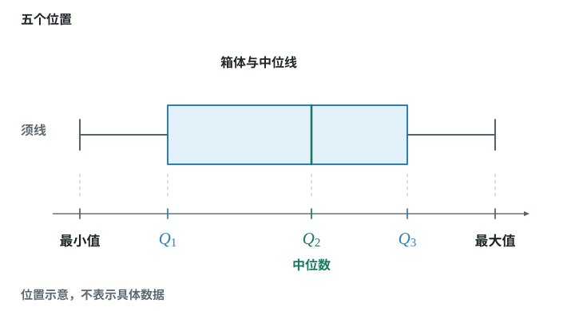

# 第二十四章 数据的分析

平均数说明整体水平，中位数说明中间位置，众数说明最常出现的值。方差说明波动大小，箱线图帮助看分布，分组要看各组内部是否接近。

## 本章前置自查

先检查会把数据排序、会算平均数和平方。数据表里的每一个重复值，都算一个数据。

## 24.1a 算术平均数

```yaml
id: MATH-8B-24-1a
weight: 一般
textbook: 八下 24.1，印刷p.149–150
prerequisites: []
evidence:
- 能列出总和除以总个数的算式
- 能解释平均数反映的是整体水平
figure: 不需要
weight_note: 基础步骤容易得分，保留一题核验
sources:
- TB8B-24.1
method:
- MG16 数形结合
```

### 本次只学

用所有数据共同说明平均水平。

### 先认住

- $\bar x=\dfrac{x_1+x_2+\cdots+x_n}{n}$，$n$ 是数据的总个数。
- 每个重复值都参加计算；**补充**（课本没有讲，做真题时常用）：平均数不一定是原数据中的某个值。
- 极大或极小的数据会影响平均数。

### 数形结合

```bridge
mode: cards
式: 平均数 $\bar x$
图: stat-mean
形: 对应纵坐标为 $\bar x$ 的水平线；它表示平均水平，不要求通过任何一个散点
色: blue
```

### 容易错

- 不要把数据种类的个数当成数据总个数。

### 练一练

- `Q-MATH-TB8B-24.1P-1`

  本章只做第（1）问
- `Q-MATH-GD2023-21-1`

## 24.1b 加权平均数

```yaml
id: MATH-8B-24-1b
weight: 重点
textbook: 八下 24.1，印刷p.150–154
prerequisites:
- id: MATH-8B-24-1a
  strength: hard
  reason: 知道等权时的平均数
evidence:
- 能提取数据与相应的权
- 能计算加权平均数
- 能解释改变权为何改变排名
figure: 不需要
weight_note: GD2024-19、GZ2025-20直接考权重；等权与不等权容易混
sources:
- TB8B-24.1
method:
- MG16 数形结合
```

### 本次只学

把每项数据与它的权配对。

### 先认住

- $\bar x=\dfrac{x_1w_1+x_2w_2+\cdots+x_nw_n}{w_1+w_2+\cdots+w_n}$。
- 权表示重要程度或次数，必须与对应数据配对。
- **补充**（课本没有讲，做真题时常用）：各权相同时，加权平均数就是算术平均数；各项权按百分比给出且和为 100% 时，分母为 1。

### 数形结合

```bridge
mode: cards
式: 频数 = 权
形: 条形统计图中各条形的高度表示频数，它对应加权平均数公式中各数据的权
色: blue
```

### 走一遍

两名演讲选手的“内容、语言、形象”成绩分别为 A：$85,95,95$，B：$95,85,95$。三项的权分别为 $50\%,40\%,10\%$。谁排名在前？

权之和为 $50\%+40\%+10\%=1$。

A：$85\times50\%+95\times40\%+95\times10\%$。

$=\textcolor{#287fc4}{42.5}+\textcolor{#287fc4}{38}+\textcolor{#287fc4}{9.5}=\boxed{90}$。

B：$95\times50\%+85\times40\%+95\times10\%$。

$=\textcolor{#287fc4}{47.5}+\textcolor{#287fc4}{34}+\textcolor{#287fc4}{9.5}=\boxed{91}$。

B排名在前。两人的单项总和相同，但B在权重最大的内容项上得分更高。

### 容易错

- 不能把不同权的数据直接相加后除以项目数。
- 按比例给权时，分母不能漏。

### 练一练

- `Q-MATH-GD2024-19`

## 24.1c 中位数与众数

```yaml
id: MATH-8B-24-1c
weight: 重点
textbook: 八下 24.1，印刷p.157–160
prerequisites:
- id: MATH-8B-24-1a
  strength: hard
  reason: 偶数个数据需要算两数平均
evidence:
- 能对一组数据进行排序并求出中位数
- 能找出数据中出现次数最多的众数
figure: 不需要
weight_note: 多卷直接考中位数或众数；极端值、位置与频数容易混
sources:
- TB8B-24.1
method:
- MG16 数形结合
```

### 本次只学

先排序找中位数，再统计频数找众数。

### 先认住

- 中位数是排序后居中的数；偶数个数据取中间两个数的平均数。
- 众数是出现次数最多的数据，可能不止一个；没有相同数据时，这组数据没有众数。
- 中位数对极端值不敏感；众数反映最常出现的值。

### 数形结合

```bridge
mode: cards
式: 中位数
形: 看排序位置：把数值数据从小到大排好，找中间一个或两个数
色: blue
---
式: 众数
形: 看频数：在频数条形图中，找最高条形对应的数据值或类别，不把条形高度当成众数
色: green
```

### 走一遍

在一次男子马拉松长跑比赛中，随机抽取 12 名选手所用的时间（单位：$\text{min}$）如下：
$$136,\ 140,\ 129,\ 180,\ 124,\ 154,\ 146,\ 145,\ 158,\ 175,\ 165,\ 148$$

(1) 这组样本数据的中位数是多少？
(2) 一名选手所用的时间是 $142\text{ min}$，推测他的成绩是否超过这次比赛中一半以上选手的成绩？

**步骤 1：将数据从小到大排序**
$$124,\ 129,\ 136,\ 140,\ 145,\ 146,\ 148,\ 154,\ 158,\ 165,\ 175,\ 180$$

**步骤 2：求中位数**
共有 12 个数据（偶数个），居中的两个数据是第 6 个和第 7 个，分别为 146 和 148。
中位数：
$$\frac{\textcolor{#287fc4}{146} + \textcolor{#287fc4}{148}}{2} = \boxed{147\ \mathrm{min}}$$

**步骤 3：推测成绩**
在马拉松比赛中，用时越短成绩越好。这名选手用时 $142\text{ min} < 147\text{ min}$，小于中位数，可以推测他的成绩超过了一半以上选手的成绩。
（这是利用样本中位数对总体进行的估计，并非全体选手的精确排名。）

### 容易错

- 找中位数前必须排序。
- 众数是数据值，不是它出现的次数。

### 练一练

- `Q-MATH-GZ2024-21`

  本章只做第（1）问

## 24.2a 离差与离差平方和

```yaml
id: MATH-8B-24-2a
weight: 了解
textbook: 八下 24.2，印刷p.167–170
prerequisites:
- id: MATH-8B-24-1a
  strength: hard
  reason: 先求平均数
evidence:
- 理解离差之和为零，不能用它比较波动
- 理解离差平方和与方差的区别
figure: 不需要
weight_note: 直接考频有限，保留教材核心概念
sources:
- TB8B-24.2
method:
- MG16 数形结合
```

### 本次只学

知道如何把偏离平均数的程度变成非负量。

### 先认住

- 数据 $x_i$ 的离差是 $x_i-\bar x$；全部离差的和为零。
- 离差平方和 $d^2=(x_1-\bar x)^2+(x_2-\bar x)^2+\cdots+(x_n-\bar x)^2$，把各个离差的平方相加。
- 直接比较离差平方和时，数据个数应相同；个数不同时再看方差。

### 数形结合

```bridge
mode: cards
式: 离差 $x_i-\bar x$
图: stat-dev
形: 点的纵坐标减去平均水平线的纵坐标；在线上方为正，在线下方为负
色: blue
结: 把离差平方后相加，正负不会抵消。
```

## 24.2b 方差与稳定性

```yaml
id: MATH-8B-24-2b
weight: 重点
textbook: 八下 24.2，印刷p.168–171
prerequisites:
- id: MATH-8B-24-2a
  strength: hard
  reason: 理解离差平方和
evidence:
- 能先求平均数再求方差
- 能解释小方差对应较小波动
- 能区分平均水平与稳定性
figure: 不需要
weight_note: GD2023-21、SZ2024-16直接使用方差与稳定性
sources:
- TB8B-24.2
method:
- MG16 数形结合
```

### 本次只学

先求均值，再求每个离差的平方的平均数。

### 先认住

- 方差 $s^2=\dfrac{(x_1-\bar x)^2+(x_2-\bar x)^2+\cdots+(x_n-\bar x)^2}{n}$；先把各个离差平方相加，再除以数据个数 $n$。
- 同类数据比较时，方差越小，波动越小，表现越稳定。
- 评价整体表现，要把平均水平与稳定性分开看。

### 数形结合

```bridge
mode: cards
式: 方差小
图: stat-tight
形: 散点紧密集中在平均水平线附近，数据稳定
色: green
---
式: 方差大
图: stat-wide
形: 散点离平均水平线远，数据不稳定
色: red
```

### 走一遍

两名运动员各射击10次，成绩（环）为：甲 $9,7,9,10,10,8,9,10,5,10$；乙 $9,10,7,8,10,9,9,8,7,9$。谁发挥更稳定？

先求均值：$\bar x_{\text{甲}}=87/10=8.7$，$\bar x_{\text{乙}}=86/10=8.6$。

甲有3个9、4个10、1个7、1个8、1个5。

$s_{\text{甲}}^2=[3(9-8.7)^2+4(10-8.7)^2+(7-8.7)^2+(8-8.7)^2+(5-8.7)^2]/10$。

$=[\textcolor{#287fc4}{0.27}+\textcolor{#287fc4}{6.76}+\textcolor{#287fc4}{2.89}+\textcolor{#287fc4}{0.49}+\textcolor{#287fc4}{13.69}]/10=\boxed{2.41}$。

乙有4个9、2个10、2个7、2个8。

$s_{\text{乙}}^2=[4(9-8.6)^2+2(10-8.6)^2+2(7-8.6)^2+2(8-8.6)^2]/10$。

$=[\textcolor{#287fc4}{0.64}+\textcolor{#287fc4}{3.92}+\textcolor{#287fc4}{5.12}+\textcolor{#287fc4}{0.72}]/10=\boxed{1.04}$。

乙的方差较小，发挥更稳定。

### 容易错

- 离差要平方，最后还要除以数据个数。
- 稳定不等于水平高，不能只看方差选成绩。

### 练一练

- `Q-MATH-TB8B-24.2-2`
- `Q-MATH-GD2023-21-2`

## 24.3a 四分位数与箱线图

```yaml
id: MATH-8B-24-3a
weight: 一般
textbook: 八下 24.3，印刷p.176–180
prerequisites:
- id: MATH-8B-24-1c
  strength: hard
  reason: 掌握中位数的求法
evidence:
- 能算出三个四分位数
- 能用五数画箱线图并解释分布
figure: 已完成 figures/boxplot-structure-24-3a.svg（三步对应五数、箱体、中位线与须线，不带具体数据）
weight_note: 新版新增；本批9卷无直接命中，但课本要求基本计算与读图
sources:
- TB8B-24.3
method:
- MG16 数形结合
```

### 本次只学

用五个特征数说明数据分布。

### 先认住

- 先排序，第二四分位数 $Q_2$ 是中位数；再分别求中位数左右两半组的中位数 $Q_1,Q_3$。
- 数据个数为奇数时，不把正中间那个数据放入两半组；其他重复值照常保留。
- 箱线图用最小值、$Q_1,Q_2,Q_3$、最大值；箱体从 $Q_1$ 到 $Q_3$，箱内标出 $Q_2$。



### 数形结合

```bridge
mode: cards
式: 最小值、$Q_1$、中位数、$Q_3$、最大值
图: stat-box
形: 最小值与最大值构成两端，四分位数确定箱体两端与中位线
色: blue
```

### 容易错

- 不能按原来的顺序取四分位数。
- 排除的是中间那个位置，不是删掉所有与中位数相等的值。

### 练一练

- `Q-MATH-TB8B-24.3-2`

## 24.4a 按组内离差平方和最小分组

```yaml
id: MATH-8B-24-4a
weight: 一般
textbook: 八下 24.4，印刷p.182–185
prerequisites:
- id: MATH-8B-24-2a
  strength: hard
  reason: 会计算离差平方和
evidence:
- 能列出全部相邻切分位置
- 能算出各方案的平方和并选择最小者
figure: 不需要
weight_note: 新版新增；本批9卷无直接命中，保留一次完整枚举，不扩成复杂聚类
sources:
- TB8B-24.4
method:
- MG16 数形结合
```

### 本次只学

对排序后的相邻间隔逐个比较。

### 先认住

- 先排序，在每个相邻间隔把数据分成两组。
- 各组用本组平均数求离差平方和，再把两组的平方和相加。
- 比较全部候选间隔，选择总和最小的分组。

### 容易错

- 每组减的是本组均值，不是全体均值。

### 练一练

- `Q-MATH-TB8B-24.4-1`
