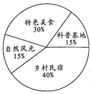
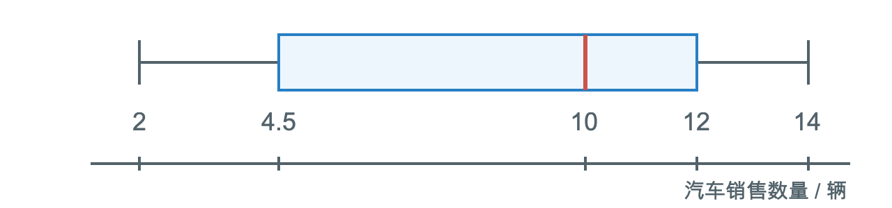

# 第二十四章 数据的分析 · 练习

## 讲义用题

### Q-MATH-TB8B-24.1P-1

```yaml
id: Q-MATH-TB8B-24.1P-1
parts:
- {part: '1', kp: MATH-8B-24-1a}
category: 课本习题
source: 课本24.1练习第1题，印刷p.152
source_quality: 课本原文
kp: MATH-8B-24-1a
type: 计算
grading: 自评
answer_by: 本项目编写，待复核
review:
  概念: MATH-8B-24-1a
  公式: MATH-8B-24-1a
  计算: MATH-8B-24-1a
  审题: MATH-8B-24-1a
do: 本章只做第（1）问
other_parts: 第（2）问加权平均数原样保留；本章已经另选GD2024-19练习加权平均数
```

**题干**

某公司欲招聘一名公关人员。对甲、乙两位应试者进行了面试和笔试，他们的成绩（百分制）如下表所示。

| 应试者 | 面试 | 笔试 |
| --- | --- | --- |
| 甲 | 86 | 90 |
| 乙 | 92 | 83 |

（1）如果公司认为面试和笔试成绩同等重要，从他们的成绩看，谁将被录取？

（2）如果公司认为，作为公关人员面试成绩应该比笔试成绩更重要，并分别赋予它们6和4的权，计算甲、乙两人各自的平均成绩，谁将被录取？

**答案**

第（1）问：甲平均 $\boxed{88}$，乙平均 $\boxed{87.5}$；甲将被录取。

**解析**

甲：$(\textcolor{#287fc4}{86}+\textcolor{#287fc4}{90})/2=\boxed{88}$。

乙：$(\textcolor{#287fc4}{92}+\textcolor{#287fc4}{83})/2=\boxed{87.5}$。

甲的平均成绩较高，所以甲将被录取。

### Q-MATH-GD2024-19

```yaml
id: Q-MATH-GD2024-19
parts:
- {part: '1', kp: MATH-8B-24-1b}
- {part: '2', kp: MATH-8B-24-1b}
- {part: '3', kp: MATH-8B-24-1b}
category: 真题
source: 2024年广东卷第19题；解析版PDF第11页（跨页题另见sources.md）
source_quality: 原卷
kp: MATH-8B-24-1b
type: 简答
grading: 自评
answer_by: 原卷解析；第（3）问示例为本项目编写，待复核
review:
  概念: MATH-8B-24-1b
  公式: MATH-8B-24-1b
  计算: MATH-8B-24-1b
  审题: MATH-8B-24-1b
```

**题干**

端午假期，王先生计划与家人一同前往景区游玩，为了选择一个最合适的景区，王先生对A、B、C三个景区进行了调查与评估。他依据特色美食、自然风光、乡村民宿及科普基地四个方面，为每个景区评分（10分制）。三个景区的得分如下表所示：

| 景区 | 特色美食 | 自然风光 | 乡村民宿 | 科普基地 |
| --- | --- | --- | --- | --- |
| A | 6 | 8 | 7 | 9 |
| B | 7 | 7 | 8 | 7 |
| C | 8 | 8 | 6 | 6 |



（1）若四项所占百分比如图所示，通过计算回答：王先生会选择哪个景区去游玩？

（2）如果王先生认为四项同等重要，通过计算回答：王先生将会选择哪个景区去游玩？

（3）如果你是王先生，请按你认为的各项“重要程度”设计四项得分的百分比，选择最合适的景区，并说明理由。

**答案**

（1）B景区；（2）A景区；（3）答案不唯一，示例见解析。

**解析**

（1）图中权为 $30\%,15\%,40\%,15\%$，和为1。

A：$6\times0.30+8\times0.15+7\times0.40+9\times0.15=\boxed{7.15}$。

B：$7\times0.30+7\times0.15+8\times0.40+7\times0.15=\boxed{7.40}$。

C：$8\times0.30+8\times0.15+6\times0.40+6\times0.15=\boxed{6.90}$。

B最高，所以选B。

（2）同等重要时，每项权都是 $1/4$。

A：$(6+8+7+9)/4=\boxed{7.50}$；B：$(7+7+8+7)/4=\boxed{7.25}$；C：$(8+8+6+6)/4=\boxed{7.00}$。

A最高，所以选A。

（3）例如最看重特色美食，权依次设为 $70\%,10\%,10\%,10\%$，四项仍全部计入，权之和为1。

三景区得分依次为 $6.6,7.1,7.6$，所以选C。理由是这组权把美食放在首位；其他合理设计也可。

### Q-MATH-GZ2024-21

```yaml
id: Q-MATH-GZ2024-21
parts:
- {part: '1', kp: MATH-8B-24-1c}
category: 真题
source: 2024年广州卷第21题；解析版PDF第16页（跨页题另见sources.md）
source_quality: 原卷
kp: MATH-8B-24-1c
type: 简答
grading: 自评
answer_by: 原卷解析
review:
  概念: MATH-8B-24-1c
  公式: MATH-8B-24-1c
  计算: MATH-8B-24-1c
  审题: MATH-8B-24-1c
do: 本章只做第（1）问
other_parts: 第（2）问属于概率，不归入本章考频；原题完整保留
```

**题干**

善于提问是应用人工智能解决问题的重要因素之一。为了解同学们的提问水平，对A、B两组同学进行问卷调查，并根据结果对每名同学的提问水平进行评分，得分情况如下（单位：分）：

| A组 | 75 | 78 | 82 | 82 | 84 | 86 | 87 | 88 | 93 | 95 |
| --- | --- | --- | --- | --- | --- | --- | --- | --- | --- | --- |
| B组 | 75 | 77 | 80 | 83 | 85 | 86 | 88 | 88 | 92 | 96 |

（1）求A组同学得分的中位数和众数；

（2）现从A、B两组得分超过90分的4名同学中随机抽取2名同学参与访谈，求这2名同学恰好来自同一组的概率。

**答案**

第（1）问：中位数 $\boxed{85}$，众数 $\boxed{82}$。

**解析**

A组已经按从小到大排列，共10个数据。

第5、第6个数据为84与86，中位数 $=(\textcolor{#287fc4}{84}+\textcolor{#287fc4}{86})/2=\boxed{85}$。

82出现2次，其余数值各出现1次，故众数为 $\boxed{82}$。

### Q-MATH-TB8B-24.2-2

```yaml
id: Q-MATH-TB8B-24.2-2
parts:
- {part: '1', kp: MATH-8B-24-2b}
- {part: '2', kp: MATH-8B-24-2b}
category: 课本习题
source: 课本习题24.2第2题，印刷p.174–175
source_quality: 课本原文
kp: MATH-8B-24-2b
type: 计算
grading: 自评
answer_by: 本项目编写，待复核
review:
  概念: MATH-8B-24-2b
  公式: MATH-8B-24-2b
  计算: MATH-8B-24-2b
  审题: MATH-8B-24-2b
```

**题干**

甲、乙两台包装机同时包装食盐，分别从中随机抽出10袋，测得它们的实际质量（单位：g）如下表所示。

| 甲 | 501 | 506 | 508 | 508 | 497 | 508 | 506 | 508 | 507 | 499 |
| --- | --- | --- | --- | --- | --- | --- | --- | --- | --- | --- |
| 乙 | 505 | 507 | 505 | 498 | 505 | 506 | 505 | 505 | 506 | 506 |

（1）分别计算两组数据的平均数和方差；

（2）哪台包装机包装食盐的质量比较稳定？

**答案**

（1）两组平均数均为 $\boxed{504.8\ \mathrm g}$；甲方差 $\boxed{15.76}$，乙方差 $\boxed{5.56}$。（2）乙更稳定。

**解析**

（1）两组数据总和均为5048，各有10个数据，所以 $\bar x_{\text{甲}}=\bar x_{\text{乙}}=\textcolor{#287fc4}{5048}/10=\boxed{504.8\ \mathrm g}$。

甲的离差平方和为：

$(501-504.8)^2+2(506-504.8)^2+4(508-504.8)^2+(497-504.8)^2+(507-504.8)^2+(499-504.8)^2$

$=14.44+2.88+40.96+60.84+4.84+33.64=157.6$。

$s_{\text{甲}}^2=\textcolor{#287fc4}{157.6}/10=\boxed{15.76}$。

乙的离差平方和为：

$5(505-504.8)^2+(507-504.8)^2+(498-504.8)^2+3(506-504.8)^2$

$=0.20+4.84+46.24+4.32=55.6$。

$s_{\text{乙}}^2=\textcolor{#287fc4}{55.6}/10=\boxed{5.56}$。

（2）两组均值相同，乙方差较小，包装质量更稳定。

### Q-MATH-TB8B-24.3-2

```yaml
id: Q-MATH-TB8B-24.3-2
parts:
- {part: '1', kp: MATH-8B-24-3a}
- {part: '2', kp: MATH-8B-24-3a}
category: 课本习题
source: 课本习题24.3第2题，印刷p.180
source_quality: 课本原文
kp: MATH-8B-24-3a
type: 计算
grading: 自评
answer_by: 本项目编写，待复核
review:
  概念: MATH-8B-24-3a
  公式: MATH-8B-24-3a
  计算: MATH-8B-24-3a
  审题: MATH-8B-24-3a
```

**题干**

一家汽车零售店的9名销售人员10月份销售的汽车数量（单位：辆）如下：

$12\quad10\quad3\quad9\quad10\quad12\quad2\quad6\quad14$

（1）计算汽车销售数量的四分位数；

（2）画箱线图并分析汽车销售数量的特点。

**答案**

（1）$\boxed{Q_1=4.5,\ Q_2=10,\ Q_3=12}$。（2）图与分析见解析。

**解析**

（1）排序得到 $2,3,6,9,10,10,12,12,14$。共有9个数据，第5个是10，所以 $Q_2=\boxed{10}$。

去掉正中间那个位置。下半组为 $2,3,6,9$，$Q_1=(\textcolor{#287fc4}{3}+\textcolor{#287fc4}{6})/2=\boxed{4.5}$。

上半组为 $10,12,12,14$，$Q_3=(\textcolor{#287fc4}{12}+\textcolor{#287fc4}{12})/2=\boxed{12}$。

（2）五数为 $2,4.5,10,12,14$，据此画图。



销售数从2到14，极差为12。中位数为10，箱体从4.5到12；中位数更靠近箱体右端，下半部的分布跨度更大。

### Q-MATH-TB8B-24.4-1

```yaml
id: Q-MATH-TB8B-24.4-1
category: 课本习题
source: 课本习题24.4第1题，印刷p.186
source_quality: 课本原文
kp: MATH-8B-24-4a
type: 计算
grading: 自评
answer_by: 本项目编写，待复核
review:
  概念: MATH-8B-24-4a
  公式: MATH-8B-24-4a
  计算: MATH-8B-24-4a
  审题: MATH-8B-24-4a
```

**题干**

在引体向上测试中，5名同学完成的个数分别为13，15，7，9，12。根据组内离差平方和最小原则，把这5名同学引体向上的个数分为两组。

**答案**

$\boxed{\{7,9\}\text{ 和 }\{12,13,15\}}$。

**解析**

先排序：$7,9,12,13,15$，有4个相邻切分间隔。

以第2个间隔为例，两组是 $\{7,9\}$ 与 $\{12,13,15\}$，均值分别为8与 $40/3$。

第一组平方和 $=(7-8)^2+(9-8)^2=2$。

第二组平方和 $=(12-40/3)^2+(13-40/3)^2+(15-40/3)^2=14/3$。

两组总和 $=2+14/3=20/3$。

| 切分后两组 | 第一组均值 | 第二组均值 | 组内平方和总和 |
| --- | --- | --- | --- |
| $\{7\}$；$\{9,12,13,15\}$ | $7$ | $49/4$ | $75/4$ |
| $\{7,9\}$；$\{12,13,15\}$ | $8$ | $40/3$ | $20/3$ |
| $\{7,9,12\}$；$\{13,15\}$ | $28/3$ | $14$ | $44/3$ |
| $\{7,9,12,13\}$；$\{15\}$ | $41/4$ | $15$ | $91/4$ |

$20/3$ 最小，所以分为 $\boxed{\{7,9\}\text{ 与 }\{12,13,15\}}$。

### Q-MATH-GD2023-21-1

```yaml
category: 真题
source: 2023年广东省初中学业水平考试 数学 第21题第（1）问
source_quality: 精品解析原卷Word，对照转出的PDF页核对
kp: MATH-8B-24-1a
type: 填空
grading: 自评
answer_by: 原卷解析
review:
  概念: MATH-8B-24-1a
```

**题干**

小红家到学校有两条公共汽车线路，为了解两条线路的乘车所用时间，小红做了试验，第一周（5 个工作日）选择 A 线路，第二周（5 个工作日）选择 B 线路，每天在固定时间段内乘车 2 次并分别记录所用时间，数据统计如下：（单位：min）

| 试验序号 | 1 | 2 | 3 | 4 | 5 | 6 | 7 | 8 | 9 | 10 |
|---|---|---|---|---|---|---|---|---|---|---|
| A 线路所用时间 | 15 | 32 | 15 | 16 | 34 | 18 | 21 | 14 | 35 | 20 |
| B 线路所用时间 | 25 | 29 | 23 | 25 | 27 | 26 | 31 | 28 | 30 | 24 |

根据以上信息：

| | 平均数 | 中位数 | 众数 | 方差 |
|---|---|---|---|---|
| A 线路所用时间 | 22 | $a$ | 15 | 63.2 |
| B 线路所用时间 | $b$ | 26.5 | $c$ | 6.36 |

（1）填空：$a=$＿＿＿＿；$b=$＿＿＿＿；$c=$＿＿＿＿。

**答案**

$a=19$，$b=26.8$，$c=25$

**解析**

A 线路的 10 个数从小到大排列：14，15，15，16，18，20，21，32，34，35，中间两个数是 18，20，中位数 $a=\dfrac{18+20}{2}=19$。B 线路平均数 $b=\dfrac{25+29+23+25+27+26+31+28+30+24}{10}=26.8$。B 线路中 25 出现两次，其余各一次，众数 $c=25$。

### Q-MATH-GD2023-21-2

```yaml
category: 真题
source: 2023年广东省初中学业水平考试 数学 第21题第（2）问
source_quality: 精品解析原卷Word，对照转出的PDF页核对
kp: MATH-8B-24-2b
type: 解答
grading: 自评
answer_by: 原卷解析
review:
  概念: MATH-8B-24-2b
```

**题干**

小红家到学校有两条公共汽车线路，为了解两条线路的乘车所用时间，小红做了试验，第一周（5 个工作日）选择 A 线路，第二周（5 个工作日）选择 B 线路，每天在固定时间段内乘车 2 次并分别记录所用时间，数据统计如下：（单位：min）

| 试验序号 | 1 | 2 | 3 | 4 | 5 | 6 | 7 | 8 | 9 | 10 |
|---|---|---|---|---|---|---|---|---|---|---|
| A 线路所用时间 | 15 | 32 | 15 | 16 | 34 | 18 | 21 | 14 | 35 | 20 |
| B 线路所用时间 | 25 | 29 | 23 | 25 | 27 | 26 | 31 | 28 | 30 | 24 |

根据以上信息：

| | 平均数 | 中位数 | 众数 | 方差 |
|---|---|---|---|---|
| A 线路所用时间 | 22 | $a$ | 15 | 63.2 |
| B 线路所用时间 | $b$ | 26.5 | $c$ | 6.36 |

（2）应用你所学的统计知识，帮助小红分析如何选择乘车线路。

**答案**

见解析（A 线路平均时间短、中位数小，但方差大，时间不稳定；B 线路平均时间稍长，但方差小，时间更稳定。可结合上学剩余时间选择。）

**解析**

A 线路所用时间的平均数、中位数都小于 B 线路，但方差较大，说明 A 线路较快，但容易出现拥堵；B 线路较慢，但交通通畅、时间稳定。建议：如果剩余时间较短（如 21 分钟），选 A 线路，因为 A 线路不超过 21 分钟的次数有 7 次，而 B 线路都大于 21 分钟；如果剩余时间不短也不长（如 31 分钟），选 B 线路，因为 B 线路都不超过 31 分钟，而 A 线路有 3 次超过 31 分钟，选 B 线路可确保不迟到；如果剩余时间足够长（如 36 分钟），选 A 线路，在保证不迟到的情况下，选平均时间更少的线路。

