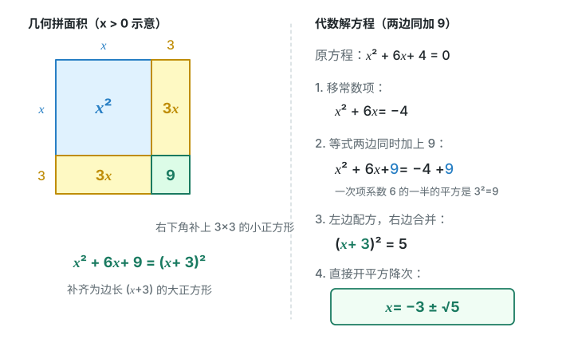
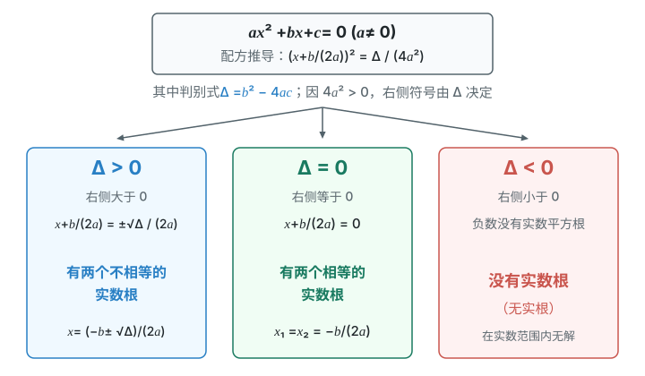
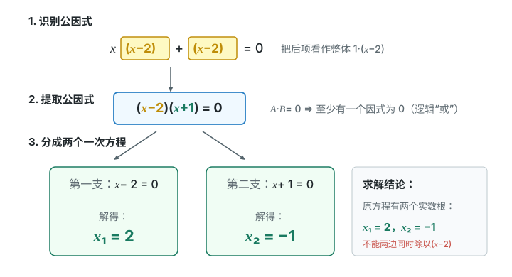
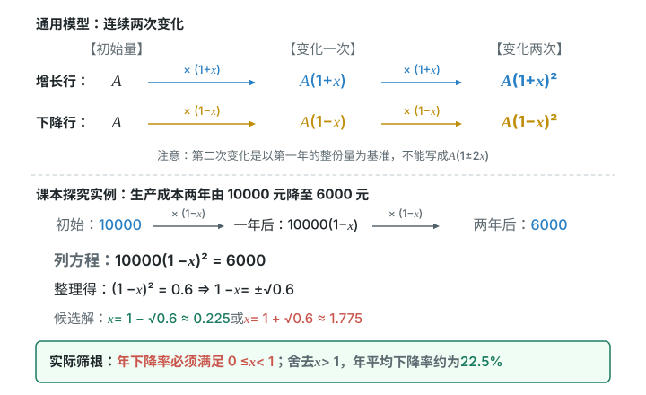

# 第二十五章 一元二次方程

平方使方程变成二次。把平方变回一次，是这一章求根的关键。
算出根还不算结束。边长要为正，人数和球队数还要是整数。

## 本章前置自查

- 会移项、去括号、解一元一次方程。不会就回看七上第五章第2节“解一元一次方程”。
- 会求平方根，知道正数有正负两个平方根。不会就回看七下第八章第1节“平方根”。
- 会展开完全平方、提公因式和用平方差分解因式。不会就回看八上第十六章第3节“乘法公式”、第十七章第1、2节“提公因式法”“公式法”。
- 会用矩形面积、周长和勾股定理列式。不会就回看八下第二十章第1节“勾股定理”；面积、周长回看小学长方形部分。

## 25.1a 认识一般形式与各项系数

```yaml
id: MATH-9A-25-1a
weight: 了解
weight_note: 9套卷未单独要求辨认一般形式或写系数；作为本章起点简述，系数识别在后续公式计算中使用
textbook: 九上25.1，p.2–4
prerequisites:
- {id: MATH-8A-16-2b, strength: hard, reason: 先展开整式并合并同类项}
evidence:
- 能说出一元二次方程的一般形式及二次项系数不为0的条件。
figure: 不需要；一般形式直接与各项名称对应，不另制作装饰图。
sources: [TB9A-25.1]
```

### 先认住

- 只含一个未知数，含未知数的式子都是整式，未知数的最高次数是 $2$，这样的方程叫作一元二次方程。
- 一般形式是 $ax^2+bx+c=0\ (a\ne0)$。$a$ 是二次项系数，$b$ 是一次项系数，$c$ 是常数项；它们都带自己的符号。
- 先展开、移项、合并，再认系数。缺少一次项或常数项时，对应系数是 $0$；$a=0$ 时不再是一元二次方程。

## 25.1b 用根的意义代入求值

```yaml
id: MATH-9A-25-1b
weight: 一般
weight_note: 3次，代入求参数或整体求值；步骤短，重点检查代入位置
textbook: 九上25.1，p.3–4
prerequisites:
- {id: MATH-9A-25-1a, strength: hard, reason: 认清方程及其中的未知数}
- {id: MATH-7A-05-2a, strength: soft, reason: 代入后解一元一次方程}
evidence:
- 能把给定的根代入方程，而不是把参数也一起替换。
- 能由代入后的等式求出参数，并代回检查。
figure: 可选；图解步骤图。左列原方程，中列只替换未知数的位置，右列检查等式；代入的数用蓝色，三列和最终检查在初始状态全部可见，不使用函数图象。
sources: [TB9A-25.1, GD2022-14]
```

### 本次只学

把“它是根”翻译成“代入后等式成立”。

### 先认住

- 使方程左右两边相等的未知数的值，叫作方程的根。
- 已知一个根，只替换未知数。其余字母仍是待求的参数。
- 求出参数后，把根和参数一起代回原方程检查。

### 容易错

- 已知一个根，不表示两个根都等于这个数。
- 根代入每一个含未知数的位置，不能漏掉一次项。

### 练一练

- `Q-MATH-GD2022-14`

## 25.2a 用平方根的意义解方程

```yaml
id: MATH-9A-25-2a
weight: 一般
weight_note: 3次，包括面积求边长、新定义运算和交点计算；必须会，但方法短
textbook: 九上25.2.1，p.5–6
prerequisites:
- {id: MATH-9A-25-1a, strength: hard, reason: 把方程整理成平方等于常数的形式}
- {id: MATH-7B-08-1a, strength: hard, reason: 正数有正负两个平方根}
evidence:
- 能把本题四个方程整理成平方等于正数的形式。
- 能保留正负两个平方根，并继续解一次方程。
figure: 可选；图解步骤图。把平方等于正数、0、负数分成三列；第一列在数轴原点两侧标正负平方根，第二列只标0，第三列写无实数根；平方与对应的点同色，初始显示三种完整结论，不画抛物线。
sources: [TB9A-25.2]
```

### 本次只学

遇到完整的平方，先考虑直接开平方。

### 先认住

- 对 $u^2=p$：$p>0$ 时 $u=\pm\sqrt p$；$p=0$ 时 $u=0$；$p<0$ 时无实数根。
- 若 $u$ 是含未知数的一次式，先求 $u$，再解对应的一次方程。
- 数轴上，正数的两个平方根在原点两侧，到原点的距离相等。

### 容易错

- 开平方时不能只写正号。
- 平方的是整个括号，不能只对括号中的未知数开平方。

### 练一练

- `Q-MATH-TB9A-25.2-1`
- `Q-MATH-GZ2024-15`

## 25.2b 配成完全平方解方程

```yaml
id: MATH-9A-25-2b
weight: 重点
weight_note: 9套卷未指定配方法解方程；它是求根公式的基础，二次项系数化1和两边同加易错，保留重点示范
textbook: 九上25.2.1，p.7–9
prerequisites:
- {id: MATH-9A-25-2a, strength: hard, reason: 配方后要通过开平方降次}
- {id: MATH-8A-16-3b, strength: hard, reason: 用完全平方公式配方}
evidence:
- 能先把二次项系数化为1，再取一次项系数的一半的平方。
- 能在两边同加配方项，开平方后求出全部实数根。
figure: 已完成 figures/complete-square-25-2b.svg（配方法的几何拼面积与代数两边同加）
sources: [TB9A-25.2, MG11]
method: [MG11 配方]
```

### 本次只学

把左边配成完全平方，再用开平方降次。

### 先认住

- 把方程整理好，先将二次项系数化为 $1$。
- 对 $x^2+px=q$，两边同加 $\left(\dfrac p2\right)^2$，得到 $\left(x+\dfrac p2\right)^2=q+\left(\dfrac p2\right)^2$。
- $x^2+2hx+h^2=(x+h)^2$：正方形和两块长方形补上一个角，恰好拼成大正方形。面积图只帮助理解恒等式，代数变形对负数也成立。
- 配方后，先看等号右边是否非负，再决定能否开平方。

### 走一遍

解方程：$2x^2+1=3x$。

1. 两边同除以 $\textcolor{#287fc4}{2}$，再移项：$x^2-\dfrac32x=-\dfrac12$。
2. 一次项系数的一半是 $-\dfrac34$，其平方是 $\dfrac9{16}$。
3. 两边同加：$x^2-\dfrac32x+\textcolor{#287fc4}{\dfrac9{16}}=-\dfrac12+\textcolor{#287fc4}{\dfrac9{16}}=\dfrac1{16}$。
4. 配成平方：$\underbrace{x^2-\dfrac32x+\dfrac9{16}}_{\text{完全平方}}=\left(x-\dfrac34\right)^2$，所以 $x-\dfrac34=\pm\dfrac14$。
5. 分别取正负号，得到 $\boxed{x_1=1,\quad x_2=\dfrac12}$。

先把二次项系数化为 $1$，就能看清需要补哪一项。



### 容易错

- 要加“一次项系数的一半的平方”，不是“一次项系数的平方”。
- 必须两边同加，不能只改左边。
- 系数化为 $1$ 时，每一项都要除，常数项也不例外。

### 练一练

- `Q-MATH-TB9A-25.2-3`

## 25.2c 用判别式判断实数根

```yaml
id: MATH-9A-25-2c
weight: 重点
weight_note: 5次，连续出现在选择填空和解答题中；不等实根与相等实根的条件容易混淆
textbook: 九上25.2.2，p.10–11
prerequisites:
- {id: MATH-9A-25-2b, strength: hard, reason: 理解配方后等号右边的正零负决定根的情况}
evidence:
- 能从本题含参数的方程读出带符号的系数，正确计算判别式。
- 能说明判别式对任意实数参数都小于0，判断方程无实数根。
figure: 已完成 figures/discriminant-branch-25-2c.svg（判别式与一元二次方程根的情况）
sources: [TB9A-25.2, GZ2025-04, ZY-quadratic]
```

### 本次只学

不求具体根，先判断有没有实数根。

### 先认住

- 对 $ax^2+bx+c=0\ (a\ne0)$，$\Delta=b^2-4ac$ 叫作根的判别式。
- $\Delta>0$：两个不相等的实数根；$\Delta=0$：两个相等的实数根；$\Delta<0$：无实数根。
- “有两个实数根”包含相等的情况，对应 $\Delta\ge0$；“两个不等实数根”对应 $\Delta>0$。
- 配方后是 $\left(x+\dfrac b{2a}\right)^2=\dfrac\Delta{4a^2}$。分母为正，右边的正零负由 $\Delta$ 决定。



### 走一遍

判断方程 $2x^2-3x-\dfrac32=0$ 的根的情况。

1. 一般形式中的系数是 $a=2$，$b=-3$，$c=-\dfrac32$。
2. $\Delta=(\textcolor{#287fc4}{-3})^2-4\times\textcolor{#287fc4}{2}\times\left(\textcolor{#287fc4}{-\dfrac32}\right)=9+12=21>0$。
3. 因而方程有 $\boxed{\text{两个不相等的实数根}}$。

只问根的情况，就不必继续求具体的根。

### 容易错

- $b^2$ 中的 $b$ 带符号；负数平方要加括号。
- 两个相等实根不是“无根”，也不是两个不等实根。
- 含参数时，要用参数的条件判断符号，不能随便代一个数代表全部。

### 练一练

- `Q-MATH-GZ2025-04`

## 25.2d 用求根公式解方程

```yaml
id: MATH-9A-25-2d
weight: 一般
weight_note: 1次在综合题解析中明确使用公式法；步骤固定，保留一组覆盖有根与无根的课本练习
textbook: 九上25.2.2，p.10–12
prerequisites:
- {id: MATH-9A-25-2c, strength: hard, reason: 先判断判别式是否非负}
- {id: MATH-7B-08-1a, strength: hard, reason: 化简求根公式中的平方根}
evidence:
- 能将方程化为一般形式，带符号代入求根公式。
- 能化简实数根，并在判别式小于0时停止求实数根。
figure: 可选；图解步骤图。按一般形式、系数、判别式、求根公式四列排；用引线对应a到分母2a、b到负b及b²、c到4ac。所有对应线完整显示，线不穿公式，不用函数图象。
sources: [TB9A-25.2]
```

### 本次只学

按固定步骤把系数代入求根公式。

### 先认住

- 当 $\Delta\ge0$ 时，$x=\dfrac{-b\pm\sqrt{b^2-4ac}}{2a}$。
- 顺序是：化一般形式，认 $a,b,c$，算 $\Delta$，再代公式。
- 分子整体是 $-b\pm\sqrt\Delta$，整个分子都要除以 $2a$。

### 容易错

- $-b$ 和 $b$ 不同，负的 $b$ 取相反数后会变正。
- $\Delta<0$ 时没有实数根，不能把负数放进平方根后继续求实数根。

### 练一练

- `Q-MATH-TB9A-25.2-5`

## 25.2e 分解因式降次求根

```yaml
id: MATH-9A-25-2e
weight: 重点
weight_note: 1次广州整道解方程题；除去含未知数因式会丢根，是高风险错误，配完整示范
textbook: 九上25.2.3，p.12–15
prerequisites:
- {id: MATH-9A-25-1a, strength: hard, reason: 先把一边化为0}
- {id: MATH-8A-17-1b, strength: hard, reason: 用提公因式法分解多项式}
- {id: MATH-8A-17-2a, strength: hard, reason: 用公式法分解多项式}
evidence:
- 能把一边化为0，再分解成两个一次因式的积。
- 能分别令每个因式为0，保留全部根。
figure: 已完成 figures/factor-solve-25-2e.svg（因式分解法两式相乘为零的分支求解）
sources: [TB9A-25.2, GZ2023-17, MG5]
method: [MG5 化归]
```

### 本次只学

把二次方程变成“至少一个一次因式为零”。

### 先认住

- 两个因式的积为 $0$，至少有一个因式为 $0$。
- 先移项，使一边为 $0$；再提公因式或用公式分解。
- 分解成两个一次因式后，分别解两个一次方程。

### 走一遍

解方程：$x(x-2)+x-2=0$。

1. 把后两项看成一个整体：$x(x-2)+(x-2)=0$。
2. 提取公因式，得到 $(x-2)(x+1)=0$。
3. 所以 $x-2=0$，或 $x+1=0$。
4. 解得 $\boxed{x_1=2,\quad x_2=-1}$。

不必急着展开；相同的括号已经把公因式亮出来了。



### 容易错

- 不能直接除以含未知数的因式，它可能等于 $0$。
- “至少一个为零”不是“两个都必须为零”。
- 右边不是 $0$ 时，不能直接令各因式等于 $0$。

### 练一练

- `Q-MATH-GZ2023-17`

## 25.2f 用根与系数关系求值

```yaml
id: MATH-9A-25-2f
weight: 一般
weight_note: 1次广州压轴解析用根的和与积求差；本章只练和积及对称式，不提前使用函数
textbook: 九上25.2.4，p.15–18
prerequisites:
- {id: MATH-9A-25-2c, strength: hard, reason: 使用两个实数根前先确认其存在}
- {id: MATH-8A-16-3b, strength: hard, reason: 把平方和等式变成根的和与积}
evidence:
- 能从一般形式读出两根的和与积，并检查是否能作分母。
- 能把倒数和、平方和改写成两根的和与积，不先求具体根。
figure: 可选；图解步骤图。将a(x−x₁)(x−x₂)展开，与ax²+bx+c逐项对齐；连接一次项系数与两根和、常数项与两根积；同色只表示项的对应，所有展开与比较在初始状态完整显示。
sources: [TB9A-25.2, MG10]
method: [MG10 换元法和整体思想]
```

### 本次只学

不求两个根，直接用它们的和与积。

### 先认住

- $ax^2+bx+c=0\ (a\ne0)$ 有两个实数根 $x_1,x_2$ 时，$x_1+x_2=-\dfrac ba$，$x_1x_2=\dfrac ca$。
- $x_1^2+x_2^2=(x_1+x_2)^2-2x_1x_2$。
- 当 $x_1x_2\ne0$ 时，$\dfrac1{x_1}+\dfrac1{x_2}=\dfrac{x_1+x_2}{x_1x_2}$。

### 容易错

- 两根和有负号，根的积没有额外的负号。
- 没有两个实数根时，不能直接谈实数根的和与积。

### 练一练

- `Q-MATH-TB9A-25.2-11`
- `Q-MATH-GD2019-09`

## 25.2g 认识黄金分割数

```yaml
id: MATH-9A-25-2g
weight: 了解
weight_note: 1次直接辨认黄金分割数；广州2025第23题已给比值且考矩形折叠，不重复计入本点
textbook: 九上25.2阅读与思考，p.18–19
prerequisites:
- {id: MATH-9A-25-2d, strength: soft, reason: 黄金分割数可由一元二次方程求出}
evidence:
- 能说出黄金分割数，并分清较短段与较长段。
figure: 可选；几何图。取A=(0,0)、B=(1,0)、C=((3−√5)/2,0)，外侧标AC=1−x、CB=x；下方将AC/CB=CB/AB对应到两段长度，已知实线，点名不压线，初始显示完整比例与线段。
sources: [TB9A-25.2]
```

### 先认住

- 把线段 $AB$ 分成 $AC<CB$ 的两段，若 $AC:CB=CB:AB$，则 $\dfrac{CB}{AB}=\dfrac{\sqrt5-1}{2}\approx0.618$，这个数叫作黄金分割数。
- 全长为 $1$ 时，较长段为 $x$，较短段为 $1-x$，比例关系给出 $x^2+x-1=0$。只取符合线段长度的正根。

### 练一练

- `Q-MATH-GD2023-06`

## 25.3a 列面积方程并筛选根

```yaml
id: MATH-9A-25-3a
weight: 重点
weight_note: 9套卷无直接命中本章面积建模任务；内外边长及两个根的实际意义易错，是课本应用主线，配完整示范
textbook: 九上25.3，p.20–21、24
prerequisites:
- {id: MATH-9A-25-2e, strength: hard, reason: 解面积关系得到的方程}
- {id: MATH-8B-20-1a, strength: soft, reason: 直角三角形题可借勾股定理列式}
evidence:
- 能区分照片与外框的面积，把内外边长写成含未知数的式子。
- 能解面积方程，剔除无实际意义的根，并按要求取近似值。
figure: 已完成 figures/photo-frame-25-3a.svg（相框几何尺寸与面积关系图解；已放在 Q-MATH-TB9A-25.3-7 的解析之后）
sources: [TB9A-25.3, MG3, MG16]
method: [MG3 分类, MG16 数形结合]
```

### 本次只学

先写边长与面积的等量关系，再检验每个根。

### 先认住

- 矩形周长 $P=2(l+w)$，面积 $S=lw$；设一边后，另一边要由条件表示。
- 四周等宽的外框，长和宽都要各加两次宽度；框边面积等于外面积减内面积。
- 解得的根都要回到原题检验。长度必须为正，点还必须在题目指定的位置。
- 设矩形的一边求出两个根时，两根可能只是同一个矩形的长、宽互换。

### 走一遍

用一根长为 $40\ \mathrm m$ 的细绳，能否围成一个面积为 $96\ \mathrm{m^2}$ 的矩形区域？如果能围成，这样的矩形是否唯一？

1. 设一边为 $x\ \mathrm m$，周长给出邻边为 $(20-x)\ \mathrm m$，且 $0<x<20$。
2. 面积等式是 $x(\textcolor{#287fc4}{20}-x)=\textcolor{#287fc4}{96}$。
3. 整理并分解：$x^2-20x+96=0$，即 $(x-8)(x-12)=0$。
4. 得到 $x=8$ 或 $x=12$；两者都符合 $0<x<20$。
5. 两根只交换长、宽，所以 $\boxed{\text{能围成，矩形唯一；两邻边为 }8\ \mathrm m\text{ 和 }12\ \mathrm m}$。

### 容易错

- 外框不是只加一次宽度；一条边的两端各加一次。
- 方程有两个根，不一定代表两个不同的图形。
- 不要先四舍五入再列式，最后才按题目要求取近似值。

### 练一练

- `Q-MATH-TB9A-25.3-7`

## 25.3b 列连续变化的方程

```yaml
id: MATH-9A-25-3b
weight: 重点
weight_note: 9套卷无直接命中本章连续变化建模任务；把两次变化当一次和混淆增长额增长率易错，保留课本核心任务
textbook: 九上25.3探究1、2，p.21–23
prerequisites:
- {id: MATH-9A-25-2a, strength: hard, reason: 连续变化方程常可直接开平方}
- {id: MATH-9A-25-3a, strength: soft, reason: 沿用列式后检验实际意义的步骤}
evidence:
- 能按第一年、第二年的顺序写出相同增长率或下降率的倍数关系。
- 能解两次变化的方程，筛选有效根，并正确换成百分数。
figure: 已完成 figures/successive-change-25-3b.svg（两次连续变化的模型与解方程筛根）
sources: [TB9A-25.3, ZY-quadratic]
```

### 本次只学

把连续两次变化写成两个相同倍数相乘。

### 先认住

- 初始量为 $A$，每次平均增长率为 $x$，两次后是 $A(1+x)^2$；平均下降率为 $x$，两次后是 $A(1-x)^2$。
- 第二次的基数是第一次变化后的量，不是原量。
- 增长率、下降率要先用小数列式，最后再换成百分数。
- 传播或分枝要逐层数清“原有的”和“新增的”，不能看见两轮就直接套增长率公式。



### 走一遍

两年前生产 $1\ \mathrm t$ 甲种食品的成本是 $10\,000$ 元，生产 $1\ \mathrm t$ 乙种食品的成本是 $12\,000$ 元。随着生产技术的进步，现在生产 $1\ \mathrm t$ 甲种食品成本是 $6\,000$ 元，生产 $1\ \mathrm t$ 乙种食品成本是 $7\,200$ 元。哪种食品成本的年平均下降率较大？

1. 设甲种食品成本的年平均下降率为 $x$，实际要求 $0\le x<1$。
2. 一年后是 $10\,000(1-x)$ 元，两年后是 $10\,000(1-x)^2$ 元。
3. 列式：$\textcolor{#287fc4}{10\,000}(1-x)^2=\textcolor{#287fc4}{6\,000}$，得到 $(1-x)^2=0.6$。
4. 开平方，两个候选值是 $x=1-\sqrt{0.6}$ 和 $x=1+\sqrt{0.6}$。
5. 后一个大于 $1$，不符合实际；甲种食品的年平均下降率为 $1-\sqrt{0.6}\approx0.225$，约为 $22.5\%$。
6. 设乙种食品成本的年平均下降率为 $y$，则 $\textcolor{#287fc4}{12\,000}(1-y)^2=\textcolor{#287fc4}{7\,200}$。同样有 $(1-y)^2=0.6$，有效根为 $y=1-\sqrt{0.6}$。
7. 所以 $\boxed{\text{两种食品成本的年平均下降率相同，都约为 }22.5\%}$。

每次都乘同一个倍数，不等于每次减少同一个金额。

### 容易错

- 两次增长不能写成 $A(1+2x)$。
- 用“总下降额除以两年”得到的是平均下降额，不是平均下降率。
- 把 $0.225$ 写成百分数时是 $22.5\%$，不是 $0.225\%$。

### 练一练

- `Q-MATH-TB9A-25.3-4`
- `Q-MATH-YN2024-9`

## 25.3c 列两两配对的方程

```yaml
id: MATH-9A-25-3c
weight: 一般
weight_note: 9套卷无直接命中两两配对建模；单循环除2与人数取正整数是固定判断，短讲配一题
textbook: 九上25.1问题2，p.2；25.3探究3与练习，p.23；复习题25第9题，p.28
prerequisites:
- {id: MATH-9A-25-2e, strength: hard, reason: 解连续整数相乘的方程}
- {id: MATH-9A-25-3a, strength: soft, reason: 检验根是否符合实际约束}
evidence:
- 能说明单循环计数为什么要除以2。
- 能从比赛场次列方程，求出符合正整数条件的球队数。
figure: 可选；图解步骤图。用n行n列表格表现每队对其他队，划去自己对自己；表格上下对称两格表示同一场单循环比赛，成对圈出说明除2；双循环保留两格。只写一般计数关系，初始完整显示，不新增作答题或预设某场次数值。
sources: [TB9A-25.1, TB9A-25.3, TB9A-25R]
```

### 本次只学

分清一次配对和两次配对，再列人数方程。

### 先认住

- $n$ 支球队单循环，每两队比赛一场，总场数为 $\dfrac{n(n-1)}2$。从每队数一遍，每场被数了两次，所以除以 $2$。
- 主客场双循环，每两队比赛两场，总场数为 $n(n-1)$。
- 人数、球队数要取符合实际的正整数根，负根或非整数根不能直接作为答案。

### 容易错

- 单循环与双循环的总场数不同，先看赛制。
- 算出正数还要检查是否为整数。

### 练一练

- `Q-MATH-TB9A-25R-9`
