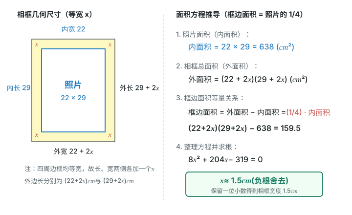

# 第二十五章 一元二次方程 · 题目

## 讲义用题

### Q-MATH-GD2022-14

```yaml
id: Q-MATH-GD2022-14
category: 真题
source: 2022年广东省初中学业水平考试数学第14题；解析PDF第5–6页
source_quality: 平台导出件，待原卷核对
kp: MATH-9A-25-1b
type: 填空
grading: 自评
answer_by: 原卷解析
review:
  概念: MATH-9A-25-1b
  计算: MATH-9A-25-1b
```

**题干**

若 $x=1$ 是方程 $x^2-2x+a=0$ 的根，则 $a=$ ________。

**答案**

$\boxed{1}$。

**解析**

1. 把 $x=\textcolor{#287fc4}{1}$ 代入方程，得 $1-2+a=0$。（根的意义）
2. 解得 $\boxed{a=1}$。（解一元一次方程）

### Q-MATH-TB9A-25.2-1

```yaml
id: Q-MATH-TB9A-25.2-1
category: 课本习题
source: 人教版数学九年级上册（根据2022年版课程标准修订）p.17，习题25.2第1题
source_quality: 课本原文
kp: MATH-9A-25-2a
type: 解答
grading: 自评
answer_by: 本项目编写，待复核
parts:
- {part: '1', kp: MATH-9A-25-2a}
- {part: '2', kp: MATH-9A-25-2a}
- {part: '3', kp: MATH-9A-25-2a}
- {part: '4', kp: MATH-9A-25-2a}
review:
  公式: MATH-9A-25-2a
  计算: MATH-9A-25-2a
```

**题干**

解下列方程：

（1）$36x^2-1=0$；

（2）$4x^2=49$；

（3）$(x+5)^2=25$；

（4）$x^2+2x+1=4$。

**答案**

（1）$\boxed{x_1=\dfrac16,\ x_2=-\dfrac16}$；

（2）$\boxed{x_1=\dfrac72,\ x_2=-\dfrac72}$；

（3）$\boxed{x_1=0,\ x_2=-10}$；

（4）$\boxed{x_1=1,\ x_2=-3}$。

**解析**

（1）

1. $x^2=\dfrac{\textcolor{#287fc4}{1}}{\textcolor{#287fc4}{36}}$。（移项并除以二次项系数）
2. $x=\pm\dfrac16$，所以 $\boxed{x_1=\dfrac16,\ x_2=-\dfrac16}$。（平方根的意义）

（2）

1. $x^2=\dfrac{\textcolor{#287fc4}{49}}{\textcolor{#287fc4}{4}}$。（两边同除以二次项系数）
2. $x=\pm\dfrac72$，所以 $\boxed{x_1=\dfrac72,\ x_2=-\dfrac72}$。（平方根的意义）

（3）

1. $x+5=\pm\textcolor{#287fc4}{5}$。（平方根的意义）
2. 分别解 $x+5=5$、$x+5=-5$，得 $\boxed{x_1=0,\ x_2=-10}$。（解一元一次方程）

（4）

1. $(x+1)^2=4$。（完全平方公式）
2. $x+1=\pm\textcolor{#287fc4}{2}$。（平方根的意义）
3. 分别求得 $\boxed{x_1=1,\ x_2=-3}$。（解一元一次方程）

### Q-MATH-TB9A-25.2-3

```yaml
id: Q-MATH-TB9A-25.2-3
category: 课本习题
source: 人教版数学九年级上册（根据2022年版课程标准修订）p.17，习题25.2第3题
source_quality: 课本原文
kp: MATH-9A-25-2b
type: 解答
grading: 自评
answer_by: 本项目编写，待复核
parts:
- {part: '1', kp: MATH-9A-25-2b}
- {part: '2', kp: MATH-9A-25-2b}
- {part: '3', kp: MATH-9A-25-2b}
- {part: '4', kp: MATH-9A-25-2b}
review:
  公式: MATH-9A-25-2b
  计算: MATH-9A-25-2b
```

**题干**

用配方法解下列方程：

（1）$x^2+10x+16=0$；

（2）$x^2-x-\dfrac34=0$；

（3）$3x^2+6x-5=0$；

（4）$4x^2-x-9=0$。

**答案**

（1）$\boxed{x_1=-2,\ x_2=-8}$；

（2）$\boxed{x_1=\dfrac32,\ x_2=-\dfrac12}$；

（3）$\boxed{x_1=-1+\dfrac{2\sqrt6}{3},\ x_2=-1-\dfrac{2\sqrt6}{3}}$；

（4）$\boxed{x_1=\dfrac{1+\sqrt{145}}8,\ x_2=\dfrac{1-\sqrt{145}}8}$。

**解析**

（1）

1. $x^2+10x=-16$。（移项）
2. $x^2+10x+\textcolor{#287fc4}{25}=-16+\textcolor{#287fc4}{25}$，所以 $(x+5)^2=9$。（两边同加一次项系数的一半的平方）
3. $x+5=\pm\textcolor{#287fc4}{3}$，得 $\boxed{x_1=-2,\ x_2=-8}$。（平方根的意义）

（2）

1. $x^2-x=\dfrac34$。（移项）
2. $x^2-x+\textcolor{#287fc4}{\dfrac14}=\dfrac34+\textcolor{#287fc4}{\dfrac14}$，所以 $\left(x-\dfrac12\right)^2=1$。（两边同加一次项系数的一半的平方）
3. $x-\dfrac12=\pm\textcolor{#287fc4}{1}$，得 $\boxed{x_1=\dfrac32,\ x_2=-\dfrac12}$。（平方根的意义）

（3）

1. 两边同除以 $\textcolor{#287fc4}{3}$，再移项：$x^2+2x=\dfrac53$。（二次项系数化为1）
2. $x^2+2x+\textcolor{#287fc4}{1}=\dfrac53+\textcolor{#287fc4}{1}$，所以 $(x+1)^2=\dfrac83$。（配方）
3. $x+1=\pm\sqrt{\dfrac83}=\pm\dfrac{2\sqrt6}{3}$，得 $\boxed{x_1=-1+\dfrac{2\sqrt6}{3},\ x_2=-1-\dfrac{2\sqrt6}{3}}$。（平方根的意义与根式化简）

（4）

1. 两边同除以 $\textcolor{#287fc4}{4}$，再移项：$x^2-\dfrac14x=\dfrac94$。（二次项系数化为1）
2. $x^2-\dfrac14x+\textcolor{#287fc4}{\dfrac1{64}}=\dfrac94+\textcolor{#287fc4}{\dfrac1{64}}$，所以 $\left(x-\dfrac18\right)^2=\dfrac{145}{64}$。（配方）
3. $x-\dfrac18=\pm\dfrac{\sqrt{145}}8$，得 $\boxed{x_1=\dfrac{1+\sqrt{145}}8,\ x_2=\dfrac{1-\sqrt{145}}8}$。（平方根的意义）

### Q-MATH-GZ2025-04

```yaml
id: Q-MATH-GZ2025-04
category: 真题
source: 2025年广州市初中学业水平考试数学第4题；解析PDF第2–3页
source_quality: 平台导出件，待原卷核对
kp: MATH-9A-25-2c
type: 选择
grading: 自动
answer_by: 原卷解析
review:
  公式: MATH-9A-25-2c
  审题: MATH-9A-25-2c
```

**题干**

关于 $x$ 的方程 $x^2-x+k^2+2=0$ 根的情况为（　　）

A. 有两个相等的实数根

B. 有两个不相等的实数根

C. 无实数根

D. 只有一个实数根

**答案**

C

**解析**

1. $\Delta=(\textcolor{#287fc4}{-1})^2-4\times\textcolor{#287fc4}{1}\times(k^2+2)=-4k^2-7$。（根的判别式）
2. 因为 $k^2\ge0$，所以 $-4k^2\le0$，于是 $\Delta\le-7<0$。（实数的平方非负）
3. 方程无实数根，故选 $\boxed{\mathrm C}$。（判别式与根的情况）

### Q-MATH-TB9A-25.2-5

```yaml
id: Q-MATH-TB9A-25.2-5
category: 课本习题
source: 人教版数学九年级上册（根据2022年版课程标准修订）p.17，习题25.2第5题
source_quality: 课本原文
kp: MATH-9A-25-2d
type: 解答
grading: 自评
answer_by: 本项目编写，待复核
parts:
- {part: '1', kp: MATH-9A-25-2d}
- {part: '2', kp: MATH-9A-25-2d}
- {part: '3', kp: MATH-9A-25-2d}
- {part: '4', kp: MATH-9A-25-2d}
review:
  公式: MATH-9A-25-2d
  计算: MATH-9A-25-2d
```

**题干**

用公式法解下列方程：

（1）$x^2+x-12=0$；

（2）$x^2-\sqrt2x-\dfrac14=0$；

（3）$x(x-4)=2-8x$；

（4）$x^2+2\sqrt5x+10=0$。

**答案**

（1）$\boxed{x_1=3,\ x_2=-4}$；

（2）$\boxed{x_1=\dfrac{\sqrt2+\sqrt3}{2},\ x_2=\dfrac{\sqrt2-\sqrt3}{2}}$；

（3）$\boxed{x_1=-2+\sqrt6,\ x_2=-2-\sqrt6}$；

（4）$\boxed{\text{无实数根}}$。

**解析**

（1）

1. $a=1,b=1,c=-12$；$\Delta=\textcolor{#287fc4}{1}^2-4\times\textcolor{#287fc4}{1}\times(\textcolor{#287fc4}{-12})=49$。（识别系数并计算判别式）
2. $x=\dfrac{-\textcolor{#287fc4}{1}\pm\sqrt{\textcolor{#287fc4}{49}}}{2\times\textcolor{#287fc4}{1}}=\dfrac{-1\pm7}2$。（求根公式）
3. 得 $\boxed{x_1=3,\ x_2=-4}$。（分别取正负号）

（2）

1. $a=1,b=-\sqrt2,c=-\dfrac14$；$\Delta=(\textcolor{#287fc4}{-\sqrt2})^2-4\times\textcolor{#287fc4}{1}\times\left(\textcolor{#287fc4}{-\dfrac14}\right)=3$。（根的判别式）
2. $x=\dfrac{-\left(\textcolor{#287fc4}{-\sqrt2}\right)\pm\sqrt{\textcolor{#287fc4}{3}}}{2\times\textcolor{#287fc4}{1}}$。（求根公式）
3. 得 $\boxed{x_1=\dfrac{\sqrt2+\sqrt3}{2},\ x_2=\dfrac{\sqrt2-\sqrt3}{2}}$。（化简）

（3）

1. 展开移项，得 $x^2+4x-2=0$。（化一般形式）
2. $\Delta=\textcolor{#287fc4}{4}^2-4\times\textcolor{#287fc4}{1}\times(\textcolor{#287fc4}{-2})=24$。（根的判别式）
3. $x=\dfrac{-\textcolor{#287fc4}{4}\pm\sqrt{\textcolor{#287fc4}{24}}}{2\times\textcolor{#287fc4}{1}}$，得 $\boxed{x_1=-2+\sqrt6,\ x_2=-2-\sqrt6}$。（求根公式与根式化简）

（4）

1. $\Delta=(\textcolor{#287fc4}{2\sqrt5})^2-4\times\textcolor{#287fc4}{1}\times\textcolor{#287fc4}{10}=-20<0$。（根的判别式）
2. 因此方程 $\boxed{\text{无实数根}}$。（判别式与根的情况）

### Q-MATH-GZ2023-17

```yaml
id: Q-MATH-GZ2023-17
category: 真题
source: 2023年广州市初中学业水平考试数学第17题；解析PDF第12页
source_quality: 平台导出件，待原卷核对
kp: MATH-9A-25-2e
type: 解答
grading: 自评
answer_by: 原卷解析
review:
  审题: MATH-9A-25-2e
  计算: MATH-9A-25-2e
```

**题干**

解方程：$x^2-6x+5=0$。

**答案**

$\boxed{x_1=1,\ x_2=5}$。

**解析**

1. $(x-1)(x-5)=0$。（因式分解）
2. $x-1=0$ 或 $x-5=0$。（两个因式的积为0）
3. $\boxed{x_1=1,\ x_2=5}$。（解两个一元一次方程）

### Q-MATH-TB9A-25.2-11

```yaml
id: Q-MATH-TB9A-25.2-11
category: 课本习题
source: 人教版数学九年级上册（根据2022年版课程标准修订）p.18，习题25.2第11题
source_quality: 课本原文
kp: MATH-9A-25-2f
type: 解答
grading: 自评
answer_by: 本项目编写，待复核
parts:
- {part: '1', kp: MATH-9A-25-2f}
- {part: '2', kp: MATH-9A-25-2f}
review:
  公式: MATH-9A-25-2f
  计算: MATH-9A-25-2f
```

**题干**

已知方程 $2x^2-6x+3=0$ 的两个根为 $x_1$，$x_2$，求下列式子的值：

（1）$\dfrac1{x_1}+\dfrac1{x_2}$；

（2）$x_1^2+x_2^2$。

**答案**

（1）$\boxed{2}$；（2）$\boxed{6}$。

**解析**

1. $\Delta=(\textcolor{#287fc4}{-6})^2-4\times\textcolor{#287fc4}{2}\times\textcolor{#287fc4}{3}=12>0$，确有两个实数根。（根的判别式）
2. $x_1+x_2=-\dfrac{\textcolor{#287fc4}{-6}}{\textcolor{#287fc4}{2}}=3$，$x_1x_2=\dfrac{\textcolor{#287fc4}{3}}{\textcolor{#287fc4}{2}}=\dfrac32\ne0$。（根与系数的关系）
3. （1）$\dfrac1{x_1}+\dfrac1{x_2}=\dfrac{x_1+x_2}{x_1x_2}=\dfrac{\textcolor{#287fc4}{3}}{\textcolor{#287fc4}{\frac32}}=\boxed{2}$。（分式相加）
4. （2）$x_1^2+x_2^2=(x_1+x_2)^2-2x_1x_2=\textcolor{#287fc4}{3}^2-2\times\textcolor{#287fc4}{\dfrac32}=\boxed{6}$。（完全平方公式）

### Q-MATH-TB9A-25.3-7

```yaml
id: Q-MATH-TB9A-25.3-7
category: 课本习题
source: 人教版数学九年级上册（根据2022年版课程标准修订）p.24，习题25.3第7题
source_quality: 课本原文
kp: MATH-9A-25-3a
type: 解答
grading: 自评
answer_by: 本项目编写，待复核
review:
  审题: MATH-9A-25-3a
  计算: MATH-9A-25-2d
```

**题干**

如图，要为两边长分别为 $22\ \mathrm{cm}$，$29\ \mathrm{cm}$ 的照片配相框，要求相框的四条边宽度相等，并且相框边的面积是照片面积的四分之一，相框边的宽度应是多少厘米（结果保留小数点后一位）？


**答案**

$\boxed{1.5\ \mathrm{cm}}$。

**解析**

1. 设相框边的宽度为 $x\ \mathrm{cm}$，$x>0$；外边长为 $(22+2x)\ \mathrm{cm}$、$(29+2x)\ \mathrm{cm}$。（两侧各加一次宽度）
2. $(\textcolor{#287fc4}{22}+2x)(\textcolor{#287fc4}{29}+2x)-\textcolor{#287fc4}{22}\times\textcolor{#287fc4}{29}=\dfrac14\times\textcolor{#287fc4}{22}\times\textcolor{#287fc4}{29}$。（框边面积等于外面积减内面积）
3. 展开后 $4x^2+102x=159.5$，整理得 $8x^2+204x-319=0$。（整式运算与两边同乘2）
4. $\Delta=\textcolor{#287fc4}{204}^2-4\times\textcolor{#287fc4}{8}\times(\textcolor{#287fc4}{-319})=51824=16\times3239$。（根的判别式）
5. $x=\dfrac{-204\pm4\sqrt{3239}}{16}=\dfrac{-51\pm\sqrt{3239}}4$。（求根公式）
6. 负号对应的根小于0，舍去；正号对应的根约为 $1.478$。（检验宽度为正）
7. 保留小数点后一位，相框边的宽度应为 $\boxed{1.5\ \mathrm{cm}}$。（按要求取近似值）



### Q-MATH-TB9A-25.3-4

```yaml
id: Q-MATH-TB9A-25.3-4
category: 课本习题
source: 人教版数学九年级上册（根据2022年版课程标准修订）p.24，习题25.3第4题
source_quality: 课本原文
kp: MATH-9A-25-3b
type: 解答
grading: 自评
answer_by: 本项目编写，待复核
review:
  审题: MATH-9A-25-3b
  计算: MATH-9A-25-2a
```

**题干**

$2022$ 年我国快递业务量是 $1\,105.8$ 亿件，$2024$ 年增至 $1\,750.8$ 亿件，这两年的年平均增长率是多少（结果写成 $a\%$ 的形式，其中 $a$ 保留小数点后一位）？

**答案**

$\boxed{25.8\%}$。

**解析**

1. 设年平均增长率为 $x$，$x>0$；经过2023、2024两次增长，业务量为 $1105.8(1+x)^2$ 亿件。（连续增长两次）
2. $\textcolor{#287fc4}{1105.8}(1+x)^2=\textcolor{#287fc4}{1750.8}$。（列等量关系）
3. $(1+x)^2=\dfrac{1750.8}{1105.8}$；$x=-1\pm\sqrt{\dfrac{1750.8}{1105.8}}$。（平方根的意义）
4. 负号对应的根不符合 $x>0$；取 $x=\sqrt{\dfrac{1750.8}{1105.8}}-1\approx0.2582878$。（检验实际意义）
5. 换成百分数并保留一位小数，得 $\boxed{25.8\%}$。（百分数表示）

### Q-MATH-TB9A-25R-9

```yaml
id: Q-MATH-TB9A-25R-9
category: 课本习题
source: 人教版数学九年级上册（根据2022年版课程标准修订）p.28，复习题25第9题
source_quality: 课本原文
kp: MATH-9A-25-3c
type: 解答
grading: 自评
answer_by: 本项目编写，待复核
review:
  审题: MATH-9A-25-3c
  计算: MATH-9A-25-2e
```

**题干**

要组织一次篮球联赛，赛制为单循环形式，计划安排 $15$ 场比赛，应邀请多少支球队参加比赛？

**答案**

$\boxed{6\text{ 支}}$。

**解析**

1. 设邀请 $n$ 支球队，$n$ 是大于1的整数。（人数的实际约束）
2. $\dfrac{n(n-1)}2=\textcolor{#287fc4}{15}$。（单循环，每两队只比赛一场）
3. 整理得 $n^2-n-30=0$，即 $(n-6)(n+5)=0$。（移项并分解因式）
4. 得到 $n=6$ 或 $n=-5$；负根不符合实际。（分别解一次方程并筛选）
5. 因而应邀请 $\boxed{6\text{ 支}}$ 球队。（检验 $6\times5\div2=15$）

### Q-MATH-GD2023-06

```yaml
category: 真题
source: 2023年广东省初中学业水平考试 数学 第6题
source_quality: 精品解析原卷Word，对照转出的PDF页核对
kp: MATH-9A-25-2g
type: 选择
grading: 自动
answer_by: 原卷解析
review:
  概念: MATH-9A-25-2g
```

**题干**

我国著名数学家华罗庚为普及优选法作出重要贡献，优选法中有一种 $0.618$ 法应用了（　　）

A. 黄金分割数

B. 平均数

C. 众数

D. 中位数

**答案**

A

**解析**

$0.618$ 法用的是黄金分割数 $\dfrac{\sqrt5-1}{2}\approx0.618$。

所以选 $\boxed{A}$。

### Q-MATH-GZ2024-15

```yaml
category: 真题
source: 2024年广州市初中学业水平考试 数学 第15题
source_quality: 精品解析原卷Word，对照转出的PDF页核对
kp: MATH-9A-25-2a
type: 填空
grading: 自评
answer_by: 原卷解析
review:
  概念: MATH-9A-25-2a
```

**题干**

定义新运算：$a\otimes b=\begin{cases}a^2-b & (a\le 0)\\ -a+b & (a>0)\end{cases}$，例如：$-2\otimes 4=(-2)^2-4=0$，$2\otimes 3=-2+3=1$。若 $x\otimes 1=-\dfrac34$，则 $x$ 的值为＿＿＿＿。

**答案**

$-\dfrac12$ 或 $\dfrac74$

**解析**

①当 $x\le 0$ 时，$x^2-1=-\dfrac34$，$x^2=\dfrac14$，解得 $x=-\dfrac12$（$x=\dfrac12$ 不满足 $x\le0$，舍去）；②当 $x>0$ 时，$-x+1=-\dfrac34$，解得 $x=\dfrac74$。综上，$x$ 的值是 $-\dfrac12$ 或 $\dfrac74$。

### Q-MATH-GD2019-09

```yaml
category: 真题
source: 2019 年广东省初中学业水平考试 数学 第 9 题
source_quality: 原卷（本地存档 Word 转 PDF 页，逐页核对）
kp: MATH-9A-25-2f
type: 选择
grading: 自动
answer_by: 原卷解析
review:
  概念: MATH-9A-25-2f
```

**题干**

已知 $x_1,x_2$ 是一元二次方程 $x^2-2x=0$ 的两个实数根，下列结论错误的是

A．$x_1\neq x_2$　　B．$x_1^2-2x_1=0$　　C．$x_1+x_2=2$　　D．$x_1\cdot x_2=2$

**答案**

D

**解析**

方程可化为 $x(x-2)=0$，两根为 $0$ 和 $2$：A、B 正确；$x_1+x_2=2$，C 正确；$x_1x_2=0\neq 2$，D 错误。

### Q-MATH-YN2024-9

```yaml
category: 外省真题
source: 2024 年云南省初中学业水平考试 数学 第 9 题
source_quality: 原卷（外省卷，Word 转 PDF 页，逐页核对）
kp: MATH-9A-25-3b
type: 选择
grading: 自动
answer_by: 原卷解析
review:
  概念: MATH-9A-25-3b
```

**题干**

两年前生产 $1$ 千克甲种药品的成本为 $80$ 元，随着生产技术的进步，现在生产 $1$ 千克甲种药品的成本为 $60$ 元。设甲种药品成本的年平均下降率为 $x$，根据题意，下列方程正确的是（　　）

A．$80(1-x^2)=60$　　B．$80(1-x)^2=60$

C．$80(1-x)=60$　　D．$80(1-2x)=60$

**答案**

B

**解析**

连续两年每年按同一个下降率 $x$ 变化：第一年后是 $80(1-x)$，第二年后是 $80(1-x)^2$，等于现在的成本 $60$，所以方程是 $80(1-x)^2=60$。

