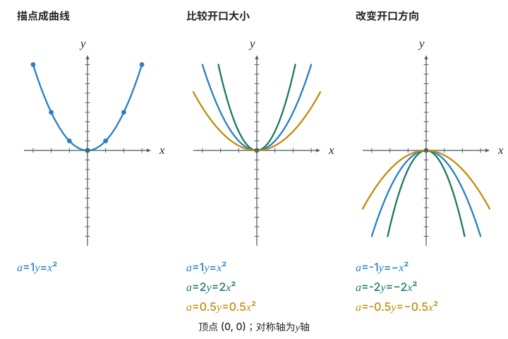
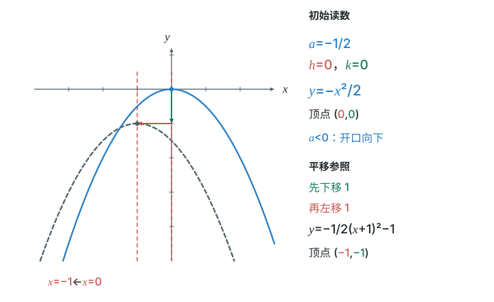
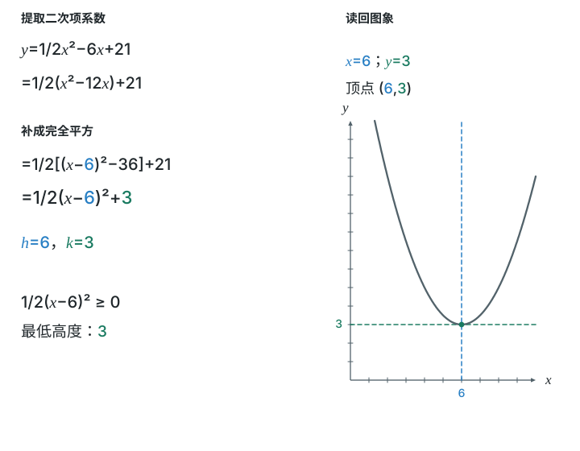
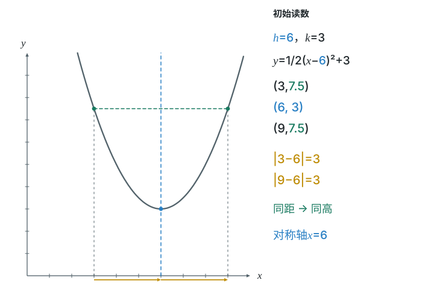
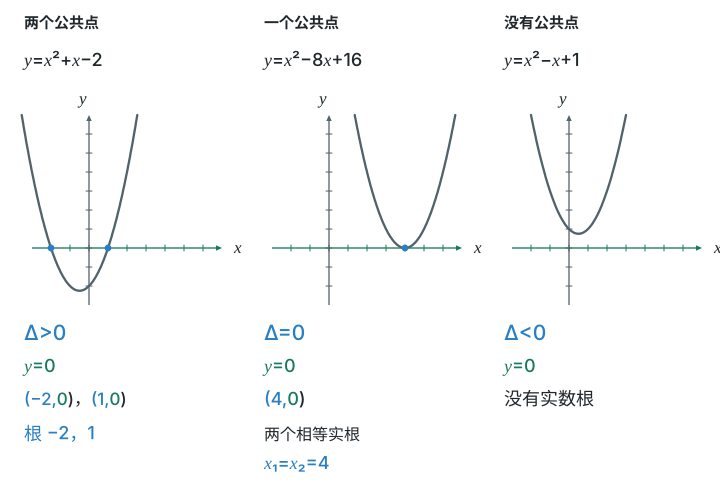
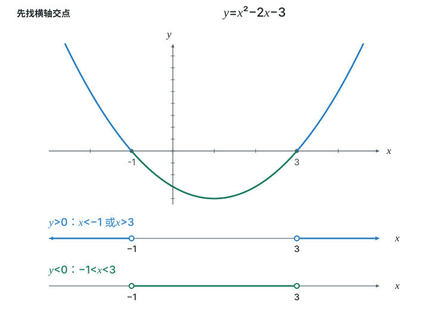
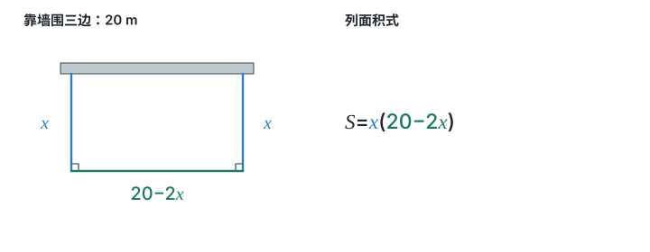
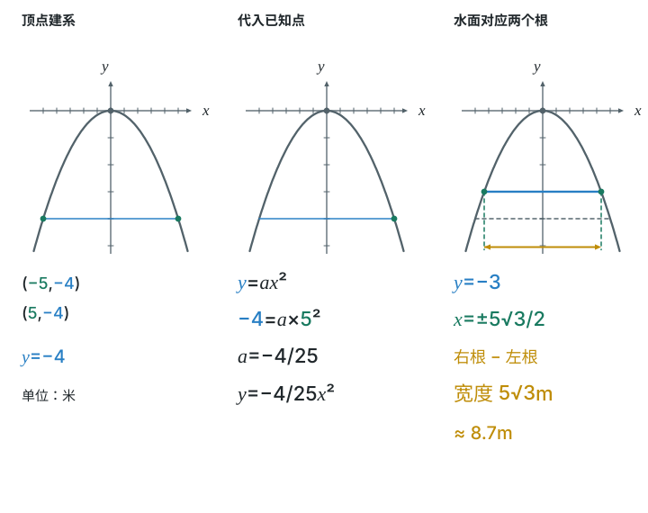
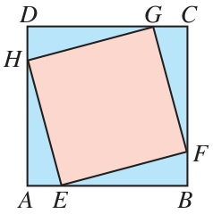
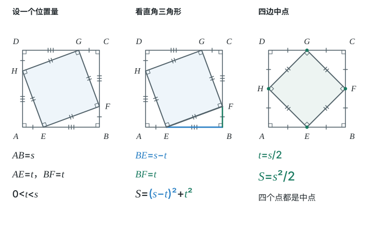

# 第二十六章 二次函数

二次函数不只是一条需要记住的公式。
式子里的平方，对应图上的弯曲；配成平方，就能找到转折点。
这一章沿着“式子—图象—实际意义”来回走。
标着**重点**的几个知识点，中考经常考，要花最多时间。

## 本章前置自查

- **函数与坐标**：知道“点在图象上”表示它的坐标满足解析式；会列表、描点。（七下 第九章 平面直角坐标系；八下 第二十二章 函数）
- **整式运算与配方**：会展开平方，也会用一次项系数的一半配成完全平方。（八上 第十六章 整式的乘法；九上 第二十五章第2节 降次——解一元二次方程中的配方法）
- **方程**：会解一元二次方程，知道判别式的三种情况；会解简单方程组。（九上 第二十五章 一元二次方程；七下 第十章 二元一次方程组）
- **几何与一次函数**：会用勾股定理、面积公式；知道直线上的点满足直线解析式。（八下 第二十章 勾股定理、第二十三章 一次函数）

## 26.1a 认识二次函数：定义和各项系数

```yaml
id: MATH-9A-26-1a
weight: 一般
textbook: 26.1，p.30–31
prerequisites:
  - {id: MATH-8B-22-1b, strength: hard, reason: 要先懂“函数”“自变量”}
  - {id: MATH-8A-16-2a, strength: soft, reason: 展开 $x(20-x)$ 要会整式乘法}
weight_note: 0 次直接考；但 $a\neq0$、二次项系数、一次项系数、常数项是后面所有二次函数题的起点
evidence:
  - 能说出二次函数的形式及二次项系数不能为零。
  - 能先展开再识别三项系数，缺项时写零。
figure: 可选；图解步骤图。①列p.33中x=1、y=1；②描点(1,1)；③呈现完整y=x²。x与横向投影蓝色，y与纵向投影绿色，点旁坐标的对应项同色，不提前堆性质。
sources: [TB9A-26.1, TB9A-26.2]
```

### 本次只学

认出二次函数，并正确读出各项系数。

### 先认住

- 一般地，形如 $y=ax^2+bx+c$（$a,b,c$ 是常数，$a\ne0$）的函数，叫作二次函数。其中 $x$ 是自变量，$a,b,c$ 分别是函数解析式的二次项系数、一次项系数和常数项。
- 必须先展开、合并，再认系数。$a$ 是二次项系数，$b$ 是一次项系数，$c$ 是常数项；缺少某一项时，该项系数是 $0$。
- 二次函数的图象是抛物线。图上的每一点，都对应一组满足解析式的 $(x,y)$。

### 容易错

- 不能认为 $\textcolor{#c9554d}{\text{有平方就一定是二次函数}}$。展开后，二次项可能抵消。
- 把 $a\ne0$ 误记成三个系数都不能为零。$b,c$ 可以为零。

### 练一练

- `Q-MATH-TB9A-26.1P-1`

## 26.1b 列二次函数解析式（面积、增长率）

```yaml
id: MATH-9A-26-1b
weight: 一般
textbook: 26.1，p.29–32
prerequisites:
  - {id: MATH-9A-26-1a, strength: hard, reason: 要认得二次函数的形式}
  - {id: MATH-9A-25-3b, strength: soft, reason: 增长率的列式方法相同}
weight_note: 0 次单独考，但实际应用和压轴题的第一步都是列式
method: [MG15 函数思想]
evidence:
  - 能把矩形另一边写成同一变量的式子，再列面积式。
  - 能用连续乘两次增长倍数列出两次增长的解析式。
figure: 可选；图解步骤图。①40 m绳围矩形；②标两邻边x与20-x；③对应y=x(20-x)。x及对应边蓝色，20-x及对应边绿色，面积淡黄；式图同色，不把边长误标成20。
sources: [TB9A-26.1, MG15]
```

### 本次只学

把两个变化的量，用同一个自变量连接起来。

### 先认住

- **先找关系，再展开。** 用长 $40\ \mathrm m$ 的绳围矩形，一边为 $x\ \mathrm m$，另一边是 $(20-x)\ \mathrm m$，所以 $y=x(20-x)=-x^2+20x$。边长都为正，故 $0<x<20$。
- 连续两次按同一增长率 $x$ 增长，要乘两次 $(1+x)$。如年产量从 $20\ \mathrm t$ 起，两年后是 $y=20(1+x)^2$；连续下降则乘 $(1-x)^2$。
- 先把边长、产量等写成关于 $x$ 的式子，再研究结果怎样随 $x$ 变化。取值范围由实际意义决定，不一定是全体实数。

### 容易错

- 两年增长写成乘 $(1+2x)$。第二年是在第一年的基础上增长。
- 面积用平方米，边长用厘米，却没有先统一单位。

### 练一练

- `Q-MATH-TB9A-26.1-1`

## 26.2a 二次函数 $y=ax^2$ 的图象和性质

```yaml
id: MATH-9A-26-2a
weight: 一般
textbook: 26.2.1，p.33–35
prerequisites:
  - {id: MATH-9A-26-1a, strength: hard, reason: 要认得二次函数}
  - {id: MATH-7B-09-1a, strength: hard, reason: 描点画图要会用坐标}
  - {id: MATH-8B-22-2a, strength: soft, reason: 描点法画函数图象}
weight_note: 0 次直接考；开口方向、开口大小和对称轴是后面各点的底子
method: [MG16 数形结合]
evidence:
  - 能由a的正负判断开口，并由绝对值比较开口大小。
  - 能指出顶点和对称轴，分左右说明增减性。
figure: 已完成 figures/coefficient-opening-26-2a.svg（三步同尺度比较系数与开口，式子与曲线同色）
sources: [TB9A-26.2]
```

### 本次只学

让系数 $a$ 与抛物线的开口对应起来。

### 先认住

- $y=ax^2$ 的顶点是 $(0,0)$，对称轴是 $y$ 轴。横坐标互为相反数的两点，纵坐标相等。
- $a>0$，开口向上，原点是最低点；$a<0$，开口向下，原点是最高点。在相同坐标刻度下，$|a|$ 越大，开口越小。
- 沿图象从左向右看：开口向上时，左降右升；开口向下时，左升右降。分界是对称轴，不能把整条曲线说成一直升或一直降。



### 数形结合

```bridge
mode: cards
式: $a>0$
图: parab-up
形: 开口朝上，原点是最低点
色: green
---
式: $a<0$
图: parab-down
形: 开口朝下，原点是最高点
色: red
---
式: $|a|$ 越大
图: parab-narrow
形: 开口越窄（灰虚线是 $y=x^2$）
色: yellow
结: 先看 $a$ 的正负定朝向，再看 $|a|$ 定宽窄。反过来，图上开口朝下又比 $y=x^2$ 窄，就是 $a<0$ 且 $|a|>1$。
```

### 容易错

- 只比较 $a$，不比较 $|a|$。例如负系数越小，绝对值反而越大。
- 把描出的点用折线连接。抛物线应是平滑曲线。

## 26.2b $y=a(x-h)^2+k$ 的图象、性质与平移

```yaml
id: MATH-9A-26-2b
weight: 重点
textbook: 26.2.2，p.36–41；习题26.2第6题，p.44–45
prerequisites:
  - {id: MATH-9A-26-2a, strength: hard, reason: 平移的是 $y=ax^2$ 的图象}
  - {id: MATH-7B-09-2b, strength: soft, reason: 用坐标表示平移}
weight_note: 3 次，深圳卷连续考平移、顶点式；中考里是读图、写解析式的基本工具
method: [MG07 平移和旋转]
evidence:
  - 能从顶点式读出开口、对称轴和顶点。
  - 能追踪顶点完成两次平移，并检查a不变。
figure: 已完成 widget parabola-explorer + figures/vertex-form-shift-26-2b.svg（初始状态，含灰色目标曲线及先下后左的平移参照）
sources: [TB9A-26.2, MG07]
```

### 本次只学

从顶点式读图，并用顶点的移动检查平移方向。

### 先认住

- $y=a(x-h)^2+k$ 的对称轴是 $x=h$，顶点是 $(h,k)$。让括号里的式子为 $0$，就找到顶点的横坐标。
- $a$ 决定开口方向和大小。平移不改变 $a$，因此不改变抛物线的形状。
- 从 $y=ax^2$ 出发，$h>0$ 向右移，$h<0$ 向左移；$k>0$ 向上移，$k<0$ 向下移。距离分别是 $|h|$、$|k|$。
- 先追踪顶点，再写新式子。向右移 $d$ 个单位，就把式子里所有的 $x$ 都换成 $x-d$，不是只改平方项。

```widget
type: parabola-explorer
a: {min: -2, max: 2, step: 0.5, value: -0.5, skip: 0}
h: {min: -3, max: 3, step: 0.5, value: 0}
k: {min: -3, max: 3, step: 0.5, value: 0}
ghost: "y=-1/2(x+1)^2-1"
```


### 走一遍

课本第40页的探究中，把 $y=-\dfrac12x^2$ 向下平移 $1$ 个单位长度，再向左平移 $1$ 个单位长度。

**先看图的位置**：顶点从 $(0,0)$ 到 $(0,-1)$，再到 $(-1,-1)$。形状不变，所以二次项系数仍是 $-\dfrac12$。

**再写对应的式子**：

$y=-\dfrac12x^2\ \longrightarrow\ y=-\dfrac12x^2\textcolor{#bf8d08}{-1}\ \longrightarrow\ y=-\dfrac12\textcolor{#bf8d08}{(x+1)^2}-1$。

因为 $x+1=x-(-1)$，最后的顶点是 $\boxed{(-1,-1)}$，对称轴是 $\boxed{x=-1}$，开口向下。

**代回检查**：当 $x=-1$ 时，平方项为 $0$，得到 $y=-1$，与顶点吻合。

### 容易错

- 把 $(x+1)^2$ 的顶点横坐标写成 $1$。先解 $x+1=0$。
- 平移后改变开口大小。只平移，不伸缩，也不翻转。

### 练一练

- `Q-MATH-TB9A-26.2-6`
- `Q-MATH-SZ2024-19-3`

## 26.2c 一般式配方：顶点、对称轴、最值

```yaml
id: MATH-9A-26-2c
weight: 重点
textbook: 26.2.3，p.42–44
prerequisites:
  - {id: MATH-9A-26-2b, strength: hard, reason: 配方后就是顶点式}
  - {id: MATH-9A-25-2b, strength: hard, reason: 配方法}
weight_note: 3 次，广州卷 2023、2024、2025 连续出现（求对称轴、顶点、最高点）
method: [MG11 配方, MG03 分类]
evidence:
  - 能配成顶点式，求顶点、对称轴和不受范围限制时的最值。
  - 能把“顶点在直线上”翻译成坐标满足直线解析式。
figure: 已完成 figures/complete-square-26-2c.svg（三步配方对应顶点、对称轴和最低高度）
sources: [TB9A-26.2, MG11, GZ2025-15]
```

### 本次只学

用配方找转折点，并分清“最值”和“取得最值时的自变量”。

### 先认住

- 一般式可转成顶点式：$y=a\left(x+\dfrac{b}{2a}\right)^2+\dfrac{4ac-b^2}{4a}$。先提取二次项系数，再补成平方。
- 对称轴是 $x=-\dfrac{b}{2a}$；顶点是 $\left(-\dfrac{b}{2a},\dfrac{4ac-b^2}{4a}\right)$。
- 在全体实数范围内，$a>0$ 时有最小值，$a<0$ 时有最大值；最值都是顶点的纵坐标。原因是平方项非负。
- 若题目限制了 $x$，先看顶点横坐标是否允许。允许才直接取顶点；不允许时，在所给范围内利用增减性比较。端点不包含时，还要检查最值能否取得。

### 走一遍

课本第42页的例子：研究 $y=\dfrac12x^2-6x+21$ 的顶点和最值。



**先配方，保住等式**：

$\begin{aligned}
y&=\dfrac12(x^2-12x)+21\\
 &=\dfrac12\bigl[\underbrace{(x-6)^2-36}_{\text{配方}}\bigr]+21\\
 &=\dfrac12(x-6)^2+3.
\end{aligned}$

**把平方读成图象**：系数 $\dfrac12>0$，抛物线开口向上；平方项在 $x=6$ 时为 $0$。

因此，顶点是 $\boxed{(6,3)}$，对称轴是 $\boxed{x=6}$；当 $x=6$ 时，函数取得最小值，最小值是 $\boxed{3}$。

**展开检查**：$\dfrac12(x-6)^2+3=\dfrac12x^2-6x+21$，与原式一致。

### 容易错

- 括号里减去 $36$，括号外却只补 $36$。必须考虑外面的系数 $\dfrac12$。
- 问最小值，却答 $x=6$。$6$ 是横坐标，最小值是 $3$。
- 有取值范围时，未经检查就套顶点最值。

### 练一练

- `Q-MATH-GZ2025-15`

## 26.2d 比较函数值大小：对称轴与增减性

```yaml
id: MATH-9A-26-2d
weight: 重点
textbook: 26.2.3，p.42–43
prerequisites:
  - {id: MATH-9A-26-2a, strength: hard, reason: 增减性随开口方向变}
  - {id: MATH-9A-26-2c, strength: hard, reason: 先求对称轴}
weight_note: 5 次，选择、填空题里的送分题，但要画图分清点在对称轴哪一侧，易错
method: [MG08 对称变换, MG16 数形结合]
evidence:
  - 能确认两点位于对称轴同侧后，用增减性比较函数值。
  - 能用到轴距离解释异侧两点的高低及等高关系。
figure: 已完成 widget parabola-explorer + figures/symmetric-values-26-2d.svg（初始状态，含三个对应点、等高辅助线及到轴距离）
sources: [TB9A-26.2, MG03, MG08, MG16, GZ2023-12]
```

### 本次只学

先判断点的位置，再比较纵坐标。

### 先认住

- 先求对称轴 $x=h$。开口向上时，左侧随 $x$ 增大而减小，右侧随 $x$ 增大而增大；开口向下则相反。
- 两点在同侧时看增减：确认两点都在对称轴同一侧，才能直接从 $x_1<x_2$ 推出函数值的大小关系。
- 两点在异侧时比距离：在 $y=a(x-h)^2+k$ 中，比较 $|x_1-h|$ 与 $|x_2-h|$。开口向上，离轴越远越高；开口向下，离轴越远越低。
- 距离相等，函数值就相等。两个不同横坐标对应相同函数值时，对称轴在它们的中点，即 $h=\dfrac{x_1+x_2}{2}$。

```widget
type: parabola-explorer
a: {min: -2, max: 2, step: 0.5, value: 0.5, skip: 0}
h: {min: 0, max: 6, step: 0.5, value: 6}
k: {min: -3, max: 3, step: 0.5, value: 3}
points: [{x: 3}, {x: 6}, {x: 9}]
```


### 走一遍

继续看课本第42页中 $y=\dfrac12(x-6)^2+3$ 的对应值表：

| $x$ | $3$ | $4$ | $5$ | $6$ | $7$ | $8$ | $9$ |
|---|---|---|---|---|---|---|---|
| $y$ | $7.5$ | $5$ | $3.5$ | $3$ | $3.5$ | $5$ | $7.5$ |

**先分左右**：$3,4,5$ 在对称轴左侧，越往右越低；$7,8,9$ 在右侧，越往右越高。

**再找成对的点**：$3$ 与 $9$ 到 $6$ 的距离都是 $3$，所以函数值同为 $7.5$。$4$ 与 $8$、$5$ 与 $7$ 也分别同高。

**从式子验证**：$\dfrac12(\textcolor{#287fc4}{3}-6)^2+3=\dfrac12(\textcolor{#287fc4}{9}-6)^2+3=\boxed{7.5}$。

这说明：横坐标更大，函数值未必更大；要先知道它在抛物线的哪一侧。

### 容易错

- 两点跨过对称轴，却直接套用一侧的增减性。
- 开口向下时，仍说“离轴越远越高”。先确认 $a$ 的正负。

### 练一练

- `Q-MATH-GZ2023-12`

## 26.2e 待定系数法求二次函数解析式

```yaml
id: MATH-9A-26-2e
weight: 重点
textbook: 习题26.2第5、8题，p.44–45；例2，p.41
prerequisites:
  - {id: MATH-9A-26-2b, strength: hard, reason: 已知顶点时用顶点式}
  - {id: MATH-9A-26-2c, strength: hard, reason: 已知三点时用一般式}
  - {id: MATH-7B-10-2a, strength: hard, reason: 三点代入后解方程组}
  - {id: MATH-8B-23-2b, strength: soft, reason: 一次函数已学过待定系数法}
weight_note: 4 次，深圳、广东卷的第一问；课本正文没有专讲（方法在八下一次函数学过），习题 26.2 第 5、8 题用到。两根式作“补充”（2026-10-07 用户同意）
method: [MG12 待定系数法]
evidence:
  - 能按已知顶点、三点或横轴交点选择解析式形式。
  - 能把点的坐标代入求系数或系数乘积，再代回检查。
figure: 可选；图解步骤图。三列分别展示一般式的三点、顶点式的顶点与另一点、两根式的横轴交点与另一点。横坐标及代入的x同蓝，纵坐标及代入的y同绿；使用正文所引习题数据或纯符号，不另造题。
sources: [TB9A-26.2, MG12, ZY-二次函数, GD2023-10]
```

### 本次只学

根据已知条件选式子，再把点的坐标代入。

### 先认住

- 已知三个点，通常设 $y=ax^2+bx+c$。每个点提供一个等式，联立求系数。
- 已知顶点 $(h,k)$，先设 $y=a(x-h)^2+k$；再代入一个不是顶点的点，就能求 $a$。
- **补充**（课本没有讲，做真题时常用）：已知与 $x$ 轴交于两个不同点 $(x_1,0)$、$(x_2,0)$，可设 $y=a(x-x_1)(x-x_2)$，再代入另一个点求 $a$。没有实数交点时，不能这样设实数两根式。
- 让已知条件直接进入所设的式子，未知量越少，计算越短；求完后把各点代回检查。

### 走一遍

课本习题26.2第8题：抛物线 $y=ax^2+bx+c$ 经过 $(-1,-22)$，$(0,-8)$，$(2,8)$ 三点，求它的开口方向、对称轴和顶点。

**先选最容易代入的点**：把 $(0,-8)$ 代入，直接得到 $c=-8$。

**再代另外两点**：

$\begin{cases}a-b-\textcolor{#287fc4}{8}=\textcolor{#287fc4}{-22},\\4a+2b-\textcolor{#287fc4}{8}=\textcolor{#287fc4}{8},\end{cases}\quad\Rightarrow\quad\begin{cases}a-b=-14,\\2a+b=8.\end{cases}$

两式相加，得 $3a=-6$，所以 $a=-2$，$b=12$。

于是 $y=-2x^2+12x-8=-2(x-3)^2+10$。

**把式子读回图象**：开口 $\boxed{\text{向下}}$，对称轴 $\boxed{x=3}$，顶点 $\boxed{(3,10)}$。

**检查**：代入 $x=-1,0,2$，分别得到 $-22,-8,8$，三个点都满足。

### 容易错

- 代入 $x=-1$ 时，$bx$ 变成 $-b$，符号别丢。
- 已知顶点，仍设三个未知系数，增加不必要的计算。
- 只用部分条件求出式子，不检查剩余条件。

### 练一练

- `Q-MATH-GD2023-10`

## 26.3a 抛物线与 $x$ 轴的交点和一元二次方程的根

```yaml
id: MATH-9A-26-3a
weight: 一般
textbook: 26.3，p.46–47；习题26.3第3题，p.49
prerequisites:
  - {id: MATH-9A-26-2c, strength: hard, reason: 要会画或想象抛物线}
  - {id: MATH-9A-25-2c, strength: hard, reason: 解方程、判别式}
weight_note: 2 次，一次考“相切、只有一个公共点”，一次考图象在 $x$ 轴上下；根的判别式是关键
method: [MG16 数形结合]
evidence:
  - 能由判别式或平方非负判断横轴公共点个数。
  - 能解方程并把实数根写成完整的公共点坐标。
figure: 已完成 figures/roots-intersections-26-3a.svg（三步同尺度对应判别式、实数根与公共点个数）
sources: [TB9A-26.3, MG16]
```

### 本次只学

把“求根”理解为寻找抛物线与 $x$ 轴的交点。

### 先认住

- $x$ 轴上的点满足 $y=0$，所以交点的横坐标，就是 $ax^2+bx+c=0$ 的实数根。
- 令 $\Delta=b^2-4ac$：$\Delta>0$ 有两个交点；$\Delta=0$ 有一个交点，方程有两个相等实根；$\Delta<0$ 没有交点，也没有实根。



### 数形结合

```bridge
mode: cards
式: $\Delta>0$
图: parab-2roots
形: 与 $x$ 轴相交，有两个实数根
色: green
---
式: $\Delta=0$
图: parab-tangent
形: 与 $x$ 轴相切，一个交点，对应两个相等实根
色: yellow
---
式: $\Delta<0$
图: parab-none
形: 与 $x$ 轴不相交，没有实数根
色: red
结: 交点的横坐标就是方程的根。
```

### 容易错

- 问交点坐标，只写两个根。坐标还要写纵坐标 $0$。
- 图象与横轴没有交点，就说函数没有值。只是它不能取到 $0$。

### 练一练

- `Q-MATH-TB9A-26.3-3`
- `Q-MATH-GZ2025-10`

## 26.3b 用图象解方程、不等式和求交点

```yaml
id: MATH-9A-26-3b
weight: 一般
textbook: 26.3，p.48–50；习题26.3第1题、第5题
prerequisites:
  - {id: MATH-9A-26-3a, strength: hard, reason: 交点横坐标就是方程的根}
  - {id: MATH-8B-23-3b, strength: soft, reason: 一次函数与方程、不等式同理}
weight_note: 1 次（求两条抛物线的交点坐标）；课本习题 26.3 第 5 题考“函数值大于 0 时 $x$ 的范围”
method: [MG16 数形结合]
evidence:
  - 能把函数值正负与横轴上下位置、横坐标区间对应。
  - 能在导引例16.7中代入三个特殊位置，不求出根也能定位根。
figure: 已完成 figures/graph-intervals-26-3b.svg（三步将图象上下位置与严格不等式的开区间同色对应）
sources: [TB9A-26.3, MG16-E7]
```

### 本次只学

把“等于、大于、小于”翻译成图象上的位置关系。

### 先认住

- 求 $y=0$ 时 $x$ 的值，看图象与 $x$ 轴的交点；求 $y>0$，看横轴上方；求 $y<0$，看横轴下方。答案写这些部分对应的 **横坐标范围**。
- 对 $y=x^2-2x-3=(x+1)(x-3)$，根为 $-1,3$，开口向上。因此 $y>0$ 时，$x<-1$ 或 $x>3$；$y<0$ 时，$-1<x<3$。这些范围与图象的上下位置一致。
- 求两个函数图象的交点，让两个解析式相等，解出 $x$，再代回求 $y$。若只是读图或用两端异号缩小根的范围，通常得到近似值，不是精确解。



### 容易错

- “大于零”时把根也算进去。根处恰好等于零。
- 求交点时把某个函数直接设为零；只有与 $x$ 轴相交时才这样做。

### 练一练

第一题是课本基础题，先画图再读根；第二题是提高题，不必求出根的具体数值，只需判断图象在哪里穿过横轴，觉得吃力可以先跳过。

- `Q-MATH-TB9A-26.3-1`
- `Q-MATH-MG16-E7`

## 26.3c 由抛物线判断 $a,b,c$ 及相关式子的符号

```yaml
id: MATH-9A-26-3c
weight: 一般
textbook: 由26.2、26.3的性质推得，p.43、46–47；按知识点地图设置本点
prerequisites:
  - {id: MATH-9A-26-2c, strength: hard, reason: '对称轴 $-\frac{b}{2a}$ 决定 $b$ 的符号'}
  - {id: MATH-9A-26-3a, strength: hard, reason: 交点个数决定 $b^2-4ac$ 的符号}
weight_note: 11 套卷未直接考；但属中考常见题型（状元笔记“图象与各项系数关系”专节），与 26.2、26.3 联系最紧
method: [MG16 数形结合]
evidence:
  - 能从开口、纵轴截距及对称轴判断a、b、c的符号。
  - 能把a+b+c与a-b+c对应到x取1和-1时的函数值。
figure: 可选；图解步骤图。复用p.46的y=x²+x-2，依次指出开口、纵轴截距、对称轴、x=1和x=-1处点高。c与纵轴截距同绿，-b/(2a)与对称轴同蓝；相关式逐项用引线连接，不凭未标刻度读数。
sources: [TB9A-26.2, TB9A-26.3, ZY-二次函数]
```

### 本次只学

每个符号判断，都找到对应的图象信息。

### 先认住

- 开口决定 $a$ 的正负；与 $y$ 轴交于 $(0,c)$，所以交点在原点上方则 $c>0$，下方则 $c<0$，过原点则 $c=0$。
- 先认 $a$，再用 $x=-\dfrac{b}{2a}$ 判断 $b$。对称轴在 $y$ 轴左侧，$a,b$ 同号；右侧则异号；重合则 $b=0$。
- $x=1$ 时，$y=a+b+c$；$x=-1$ 时，$y=a-b+c$。这些式子的正负，就是相应点在横轴上方还是下方。判别式的正负，则看横轴交点个数。

### 容易错

- 只看对称轴在左还是右，就断定 $b$ 的正负。还要结合 $a$。
- 图中没有标刻度，就凭外观猜某点横坐标是 $1$。

### 练一练

- `Q-MATH-GD2020-10`

## 26.4a 求面积、高度等最大（小）值

```yaml
id: MATH-9A-26-4a
weight: 一般
textbook: 26.4例1、例2，p.51–52；复习题26第10题，p.62
prerequisites:
  - {id: MATH-9A-26-1b, strength: hard, reason: 先列出函数式}
  - {id: MATH-9A-26-2c, strength: hard, reason: 用配方或公式求最值}
weight_note: 1 次（广州 2023，面积范围）；课本例 1、例 2，习题 26.4 多为此类
method: [MG15 函数思想]
evidence:
  - 能用篱笆总长与矩形面积列式。
  - 能按墙长限制写范围，顶点不可取时在允许范围内求最值。
figure: 已完成 figures/garden-domain-26-4a.svg（两步由20 m篱笆三边围园列面积式，边长与式子同色）
sources: [TB9A-26.4, MG15]
```

### 本次只学

求最值之前，先把实际限制写进自变量范围。

### 先认住

- 流程是“设量—列式—定范围—求最值—回到实际问题”。顶点不在允许范围内时，不能直接把顶点纵坐标当答案。
- 靠墙用 $20\ \mathrm m$ 篱笆围矩形时，篱笆只围三边；先设垂直于墙的边长为 $x\ \mathrm m$，平行于墙的边长就是 $(20-2x)\ \mathrm m$。
- 面积要区分“哪条边取多少”和“面积是多少”。高度问题要区分“何时到最高点”和“最高有多高”。若横轴是时间，图象表示高度随时间变化，不是空间中的运动轨迹。



### 容易错

- 靠墙只围三边，却把篱笆长度写成矩形周长。
- 已知墙长有限，却漏掉“平行于墙的边不能超过墙长”。

### 练一练

- `Q-MATH-TB9A-26R-10`
- `Q-MATH-GD2022-23`

## 26.4b 最大利润问题

```yaml
id: MATH-9A-26-4b
weight: 一般
textbook: 26.4探究1，p.52–53
prerequisites:
  - {id: MATH-9A-26-4a, strength: hard, reason: 求最值方法相同}
  - {id: MATH-9A-25-3b, strength: soft, reason: 销量与价格的列式}
weight_note: 1 次（广东 2024 解答题 9 分）；是 26.4 的典型应用，要会涨价、降价两种设法
method: [MG15 函数思想, MG03 分类]
evidence:
  - 能分别列利润和销售收入的式子，并求各自的最大值。
  - 能把降价金额还原成售价，并分清利润和销售收入。
figure: 可选；图解步骤图。①探究1列涨价、降价两行的售价与销量；②单件利润因式与其表格列同蓝、销量因式与其列同绿；③各标实际允许的整数点并比较最大利润。点间不连表示可选价格的实线。
sources: [TB9A-26.4, MG15, GD2024-20]
```

### 本次只学

分清售价、销量和利润，并检查价格的限制。

### 先认住

- 没有其他成本时，总利润等于“每件售价减每件进价，再乘销量”。若另有固定费用，要继续减去；销售收入则是售价乘销量，不能当成利润。
- 涨价、降价的销量变化率往往不同，要分别列式、分别求最大值，再比较。

### 容易错

- 已设 $x$ 为降价金额，最后却把 $x$ 直接报成售价。
- 题目要求整数价格，却直接把顶点的半整数当成可选价格。

### 练一练

- `Q-MATH-GD2024-20`

## 26.4c 建立坐标系解抛物线形实际问题

```yaml
id: MATH-9A-26-4c
weight: 重点
textbook: 26.2例2，p.41；26.4探究2，p.53–54
prerequisites:
  - {id: MATH-9A-26-2e, strength: hard, reason: 建系后求解析式}
  - {id: MATH-9A-26-2a, strength: soft, reason: 顶点放在原点时设 $y=ax^2$}
  - {id: MATH-7B-09-1b, strength: hard, reason: 点的坐标和线段长互相换算}
weight_note: 5 次，深圳 2023、广州 2025 都是 8–9 分的解答题；要自己建系、求解析式再代入
method: [MG12 待定系数法, MG16 数形结合]
evidence:
  - 能说明坐标系，把跨度与高度转成点的坐标后求解析式。
  - 能把同一水位的两个横坐标还原为实际宽度。
figure: 已完成 figures/bridge-waterline-26-4c.svg（三步将拱桥尺寸转成坐标，再将水面两个根还原为宽度）
sources: [TB9A-26.4, MG12, MG16, GZ2025-24]
```

### 本次只学

选一个方便的原点，把实物尺寸转成坐标，再把坐标还原为长度。

### 先认住

- 先说清原点、坐标轴方向和单位。顶点放在原点，可设 $y=ax^2$；对称轴放在 $y$ 轴上，可设 $y=ax^2+c$。
- 已知“宽”时，往往要取一半作为单侧横坐标；已知“高”时，先看它是相对地面、水面，还是相对原点。
- 用已知点求系数，再把目标高度代入。解出的 $x$ 是位置，不一定就是所求长度。
- 同高的左右两点对应两个根。宽度是右横坐标减左横坐标；只有关于 $y$ 轴对称时，才可用正横坐标的两倍。

### 走一遍

课本第53–54页的探究2：一座抛物线形拱桥，当拱顶离水面 $4\ \mathrm m$ 时，水面宽 $10\ \mathrm m$。突降暴雨后水面上升 $1\ \mathrm m$，此时水面宽为多少（结果保留小数点后一位）？



**建系**：取拱顶为原点，水平向右为 $x$ 轴正向，竖直向上为 $y$ 轴正向，单位为米。原水面在 $y=-4$，两岸点为 $(-5,-4)$、$(5,-4)$。

**求解析式**：设 $y=ax^2$，代入 $(5,-4)$，得 $\textcolor{#287fc4}{-4}=a\times\textcolor{#287fc4}{5}^2$，得 $\textcolor{#197a60}{a=-\dfrac4{25}}$，所以 $y=-\dfrac4{25}x^2$。

**读出新水位**：水面上升，不是纵坐标变得更负；新水面为 $y=-3$。

$\textcolor{#287fc4}{-3}=-\dfrac4{25}x^2\quad\Rightarrow\quad x=\pm\dfrac{5\sqrt3}{2}$。

**还原为宽度**：$\dfrac{5\sqrt3}{2}-\left(-\dfrac{5\sqrt3}{2}\right)=5\sqrt3\approx\boxed{8.7\ \mathrm m}$。

水面越接近拱顶，宽度越小；结果小于原来的 $10\ \mathrm m$，与图形一致。

### 容易错

- 原点在拱顶，仍把下方水面的纵坐标写成正高度。
- 只取一个正根，就把它当成整个宽度。
- 换了原点，却继续使用旧坐标。

### 练一练

- `Q-MATH-GZ2025-24-2`

## 26.4d 二次函数与几何综合（动点、面积、存在性）

```yaml
id: MATH-9A-26-4d
weight: 重点
textbook: 复习题26第9题，p.62；综合应用
prerequisites:
  - {id: MATH-9A-26-2e, strength: hard, reason: 先求解析式}
  - {id: MATH-9A-26-4a, strength: hard, reason: 面积用二次函数求最值}
  - {id: MATH-9A-26-3a, strength: soft, reason: 交点、判别式}
  - {id: MATH-8B-23-2b, strength: hard, reason: 直线方程和交点}
weight_note: 4 次，广州卷 2023–2024 压轴题，广东 2022 压轴；难度大，先学会 a–c 再看
method: [MG15 函数思想, MG16 数形结合]
evidence:
  - 能由全等和勾股关系把内接正方形面积写成一个变量的函数。
  - 能用抛物线对称性消去周长中的相等边，再求直线系数。
figure: 已完成 figures/inscribed-square-area-26-4d.svg（三步几何图由内接正方形转成面积式，原题图保留）
sources: [TB9A-26R, MG15, MG16, GZ2024-25]
```

### 本次只学

先把几何关系变成同一个变量的式子，再谈最值或是否存在。

### 先认住

- 动点不等于新方法。先选一个位置量作变量，用坐标、勾股定理或全等关系表示相关线段。
- 求面积时，先定底和高；必要时用“大图形减去小图形”。面积应是长度的乘积，不能直接把带正负的坐标当长度。
- 求“最大、最小”，研究面积函数；问“是否存在”，把目标条件列成方程，再检查解是否对应允许的位置。
- 遇到点在线段上、不能重合等条件，先写范围。方程算出的根只是候选位置，不能跳过几何检查。

### 走一遍

课本复习题26第9题：如图，点 $E,F,G,H$ 分别位于正方形 $ABCD$ 的四条边上，四边形 $EFGH$ 也是正方形。当点 $E$ 位于何处时，正方形 $EFGH$ 的面积最小？



**先设位置量**：设外正方形边长为 $s$，$AE=t$，则 $BE=s-t$，其中 $0<t<s$。这里 $s$ 固定，只有 $t$ 随点的位置变化。

**用几何关系减少未知量**：四个角上的直角三角形全等。以 $\triangle AHE$ 和 $\triangle BEF$ 为例，斜边 $HE=EF$，且 $\angle AHE$ 与 $\angle BEF$ 都与 $\angle HEA$ 互余，所以这两个锐角相等。于是 $BF=AE=t$。

**用勾股定理写面积**：内正方形面积等于边长 $EF$ 的平方，而 $\triangle EBF$ 是直角三角形。



$\begin{aligned}
S&=EF^2=BE^2+BF^2\\
 &=(s-t)^2+t^2\\
 &=2\left(t-\dfrac s2\right)^2+\dfrac{s^2}{2}.
\end{aligned}$

**检查取值范围**：$t=\dfrac s2$ 在允许范围内，平方项能取到 $0$。

因此，当 $\boxed{E\text{ 是 }AB\text{ 的中点}}$ 时，内正方形面积最小。此时面积为 $\dfrac{s^2}{2}$，其余三个点也分别在所在边的中点。

几何关系把四个动点收成一个变量，面积最值就变成了“平方何时为零”。

### 容易错

- 看到图近似对称，就直接认为线段相等。先写出支持它的几何关系。
- 解出一个位置，却不检查点是否仍在线段上。
- 面积函数的顶点算对了，却忘了回答点实际位于哪里。

### 练一练

先用对称性消去相等的边，再处理周长差。

- `Q-MATH-GZ2024-25-2`
