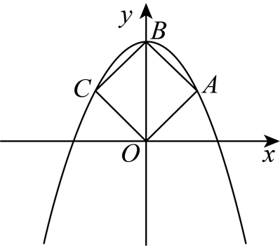
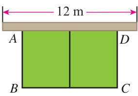
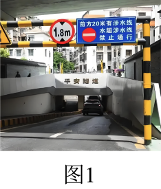
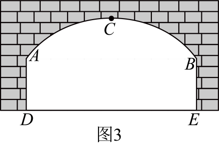
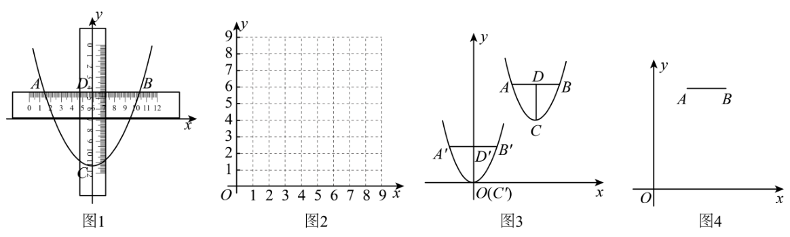
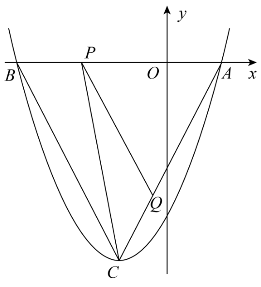
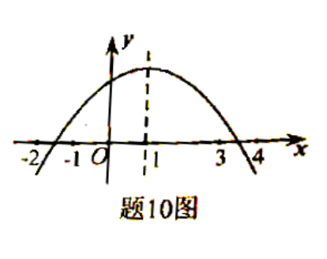

# 第二十六章 二次函数 · 题目

## 讲义用题

### Q-MATH-TB9A-26.1P-1

```yaml
category: 课本习题
source: 人教版 数学 九年级上册（根据2022年版课程标准修订）p.31，26.1练习第1题
source_quality: 题干已对照课本PDF原页；数学公式逐项核对
kp: MATH-9A-26-1a
type: 填空
grading: 自评
answer_by: 本项目编写，待复核
review:
  概念: MATH-9A-26-1a
  计算: MATH-9A-26-1a
```

**题干**

写出下列二次函数的二次项系数、一次项系数和常数项：

（1）$y=8x^2-16x+8$；

（2）$y=x^2$；

（3）$y=-\dfrac12x^2+5x$；

（4）$y=2(x-1)^2-5$。

**答案**

按“二次项系数、一次项系数、常数项”的顺序：

（1）$8,-16,8$；（2）$1,0,0$；（3）$-\dfrac12,5,0$；（4）$2,-4,-3$。

**解析**

先整理成 $y=ax^2+bx+c$，再读系数。

（4）$y=2(x^2-2x+1)-5=2x^2-4x-3$，所以三个系数为 $\boxed{2,-4,-3}$。

缺少一次项或常数项，表示对应系数为 $0$，不能空着不写。

### Q-MATH-TB9A-26.1-1

```yaml
category: 课本习题
source: 人教版 数学 九年级上册（根据2022年版课程标准修订）p.32，习题26.1第1题
source_quality: 题干及数值已对照课本PDF原页
kp: MATH-9A-26-1b
type: 解答
grading: 自评
answer_by: 本项目编写，待复核
review:
  审题: MATH-9A-26-1b
  公式: MATH-9A-26-1b
```

**题干**

某商场一月份的销售额为 $50$ 万元，二、三月份每月销售额的平均增长率为 $x$，写出三月份的销售额 $y$（单位：万元）关于 $x$ 的函数解析式。

**答案**

$\boxed{y=50(1+x)^2=50x^2+100x+50}$。

**解析**

1. 二月份销售额为 $\textcolor{#287fc4}{50}(1+x)$ 万元。（增长后的量等于原量乘增长倍数）
2. 三月份销售额为 $50(1+x)(1+x)=50(1+x)^2$ 万元。（连续增长两次）
3. 展开得 $y=50x^2+100x+50$。（完全平方公式）

增长率用小数表示；式中的 $x$ 不是增长后的倍数，增长后的倍数是 $1+x$。

### Q-MATH-TB9A-26.2-6

```yaml
category: 课本习题
source: 人教版 数学 九年级上册（根据2022年版课程标准修订）p.44–45，习题26.2第6题
source_quality: 两小问题干、平移方向及距离均已对照PDF原页
kp: MATH-9A-26-2b
type: 填空
grading: 自评
answer_by: 本项目编写，待复核
review:
  概念: MATH-9A-26-2b
  计算: MATH-9A-26-2c
```

**题干**

填空：

（1）在平面直角坐标系中，把抛物线 $y=-3(x-2)^2-5$ 先向上平移 $5$ 个单位长度，再向左平移 $2$ 个单位长度，所得抛物线对应的函数解析式为________；

（2）在平面直角坐标系中，把抛物线 $y=2x^2+4x+3$ 先向下平移 $1$ 个单位长度，再向右平移 $1$ 个单位长度，所得抛物线对应的函数解析式为________。

**答案**

（1）$\boxed{y=-3x^2}$；（2）$\boxed{y=2x^2}$。

**解析**

（1）原顶点为 $(2,-5)$，上移后为 $(2,0)$，再左移后为 $(0,0)$。系数 $-3$ 不变，所以 $\boxed{y=-3x^2}$。

（2）先配方：$y=2(x+1)^2+1$，原顶点为 $(-1,1)$。下移后为 $(-1,0)$，再右移后为 $(0,0)$。系数 $2$ 不变，所以 $\boxed{y=2x^2}$。

先把顶点移对，再检查开口是否保持不变。

### Q-MATH-GZ2025-15

```yaml
category: 真题
source: 2025年广州市初中学业水平考试 数学 第15题
source_quality: 精品解析原卷Word及对应PDF第11–12页；题干公式与解析已核对
kp: MATH-9A-26-2c
type: 填空
grading: 自评
answer_by: 原卷解析
review:
  公式: MATH-9A-26-2c
  前置: MATH-9A-26-2c
```

**题干**

若抛物线 $y=x^2-6mx+6m^2+5m+3$ 的顶点在直线 $y=x+2$ 上，则 $m$ 的值为________。

**答案**

$\boxed{m=1\text{ 或 }m=-\dfrac13}$。

**解析**

1. 对称轴为 $x=-\dfrac{-6m}{2\times1}=3m$。（对称轴公式）
2. 把 $x=\textcolor{#287fc4}{3m}$ 代入，得 $y=(3m)^2-6m\cdot3m+6m^2+5m+3=-3m^2+5m+3$。（求顶点纵坐标）
3. 顶点为 $(3m,-3m^2+5m+3)$。（由横、纵坐标写出顶点）
4. $-3m^2+5m+3=3m+2$。（顶点在直线 $y=x+2$ 上）
5. 整理得 $3m^2-2m-1=0$。（移项、合并同类项）
6. $\Delta=(\textcolor{#287fc4}{-2})^2-4\times\textcolor{#287fc4}{3}\times(\textcolor{#287fc4}{-1})=16$。（判别式）
7. $m=\dfrac{2\pm\sqrt{16}}{2\times3}=\dfrac{2\pm4}{6}$。（求根公式）
8. 所以 $\boxed{m=1\text{ 或 }m=-\dfrac13}$。（分别取正、负号求值）

### Q-MATH-GZ2023-12

```yaml
category: 真题
source: 2023年广州市初中学业水平考试 数学 第12题
source_quality: 精品解析原卷Word；识别稿第7–8页题干及解析，分行选项已合并核对
kp: MATH-9A-26-2d
type: 填空
grading: 自评
answer_by: 原卷解析
review:
  概念: MATH-9A-26-2d
  审题: MATH-9A-26-2d
```

**题干**

已知点 $A(x_1,y_1)$，$B(x_2,y_2)$ 在抛物线 $y=x^2-3$ 上，且 $0<x_1<x_2$，则 $y_1$ ________ $y_2$。（填“$<$”或“$>$”或“$=$”）

**答案**

$<$

**解析**

抛物线开口向上，对称轴为 $x=0$。

由 $0<x_1<x_2$，可知两点都在对称轴右侧。在这一侧，$y$ 随 $x$ 增大而增大，所以 $\boxed{y_1<y_2}$。

关键条件是 $0<x_1$：它保证两点处于同一侧。

### Q-MATH-GD2023-10

```yaml
category: 真题
source: 2023年广东省初中学业水平考试 数学 第10题
source_quality: 精品解析原卷Word；题图直接提取word/media/image63.png，未重绘
kp: MATH-9A-26-2e
type: 选择
grading: 自动
answer_by: 原卷解析
review:
  前置: MATH-9A-26-2e
  审题: MATH-9A-26-2e
```

**题干**

如图，抛物线 $y=ax^2+c$ 经过正方形 $OABC$ 的三个顶点 $A$，$B$，$C$，点 $B$ 在 $y$ 轴上，则 $ac$ 的值为（　　）



A. $-1$

B. $-2$

C. $-3$

D. $-4$

**答案**

B

**解析**

**先把几何关系变成坐标**：令 $AC$ 与 $OB$ 交于点 $D$。正方形对角线相等且互相垂直平分，所以 $AD=OD=\dfrac{OB}{2}$。

点 $B$ 在 $y$ 轴上，也在抛物线上，故 $B=(0,c)$；由图知 $c>0$。于是 $A=\left(\dfrac c2,\dfrac c2\right)$。

**再代入函数**：$\dfrac c2=a\left(\dfrac c2\right)^2+c$，即 $ac^2=-2c$。

因为 $c\ne0$，两边除以 $c$，得 $\boxed{ac=-2}$。

不必分别求出 $a,c$；题目只要求它们的乘积。

### Q-MATH-TB9A-26.3-3

```yaml
category: 课本习题
source: 人教版 数学 九年级上册（根据2022年版课程标准修订）p.49，习题26.3第3题
source_quality: 题干与两条函数式已对照课本PDF原页
kp: MATH-9A-26-3a
type: 解答
grading: 自评
answer_by: 本项目编写，待复核
review:
  概念: MATH-9A-26-3a
  前置: MATH-9A-26-3a
```

**题干**

下列函数的图象与 $x$ 轴是否有公共点？如果有公共点，写出公共点的坐标。

（1）$y=3x^2-6x+9$；

（2）$y=2x^2-4x-6$。

**答案**

（1）没有公共点。

（2）有两个公共点：$\boxed{(-1,0),(3,0)}$。

**解析**

（1）

1. $y=3(x-1)^2+6$。（配方）
2. $y\ge6>0$，整条抛物线都在 $x$ 轴上方，没有公共点。（平方非负）
3. 也可验证 $\Delta=(-6)^2-4\times3\times9=-72<0$。（根的判别式）

（2）

1. 令 $y=0$，得 $2x^2-4x-6=0$。（横轴上的点纵坐标为零）
2. $2(x-3)(x+1)=0$。（因式分解）
3. $x=3$ 或 $x=-1$。（两因式乘积为零）
4. 公共点为 $(3,0)$、$(-1,0)$。（把根写回点的坐标）

根只给出了横坐标；公共点的纵坐标都是 $0$。

### Q-MATH-TB9A-26.3-1

```yaml
category: 课本习题
source: 人教版 数学 九年级上册（根据2022年版课程标准修订）p.49，习题26.3第1题
source_quality: 题干与函数式已对照课本PDF原页
kp: MATH-9A-26-3b
type: 解答
grading: 自评
answer_by: 本项目编写，待复核
review:
  概念: MATH-9A-26-3b
  计算: MATH-9A-26-3b
```

**题干**

已知函数 $y=x^2-x-2$。

（1）画出这个函数的图象；

（2）观察图象，当 $x$ 取哪些值时，函数值为 $0$？

**答案**

（1）图象是开口向上的抛物线，顶点 $\left(\dfrac12,-\dfrac94\right)$，与 $y$ 轴交于 $(0,-2)$，与 $x$ 轴交于 $(-1,0)$ 和 $(2,0)$。

（2）$\boxed{x=-1\text{ 或 }x=2}$。

**解析**

（1）

1. $y=\left(x-\dfrac12\right)^2-\dfrac94$，顶点是 $\left(\dfrac12,-\dfrac94\right)$，开口向上。（配方）
2. 取 $x=0$，$y=-2$，得 $(0,-2)$。（与 $y$ 轴的交点）
3. 取 $x=-1,2$，$y=0$，得 $(-1,0)$、$(2,0)$。（与 $x$ 轴的交点）
4. 描出这几个点和它们关于对称轴 $x=\dfrac12$ 的对称点，用平滑曲线连起来。（描点连线）

（2）

1. 函数值为 $0$，就是图象上纵坐标为 $0$ 的点，即与 $x$ 轴的交点。（函数值对应纵坐标）
2. 交点的横坐标是 $-1$ 和 $2$。（读图）
3. 验证：$x^2-x-2=(x-2)(x+1)=0$，$x=2$ 或 $x=-1$。（因式分解核对）

---

### Q-MATH-MG16-E7

```yaml
category: 导引例题
source: 初中数学思想方法导引 第16章“数形结合”例16.7，印刷页p.136（PDF第143页）
source_quality: 题干、指数、字母顺序及原解已逐项对照PDF原页；原题干不含图，原解图不是题干必需图
kp: MATH-9A-26-3b
type: 证明
grading: 自评
answer_by: 导引原解；本项目编写，待复核（补充端点与根数说明）
review:
  概念: MATH-9A-26-3b
  计算: MATH-9A-26-3b
```

**题干**

已知 $a<b<c$，求证：方程 $(x-a)(x-c)+(x-b)^2=0$ 有两个不相等的实数根，且一根在 $a$ 与 $b$ 之间，另一个根在 $b$ 与 $c$ 之间。

**答案**

设两根为 $r_1<r_2$，则 $\boxed{a<r_1<b<r_2<c}$。证明见下。

**解析**

1. 设 $y=(x-a)(x-c)+(x-b)^2$。（把方程左边看成函数）
2. 二次项系数为 $2>0$，图象是开口向上的连续抛物线。（展开后的二次项系数）
3. 当 $x=a$ 时，$y=(a-b)^2>0$，对应点在横轴上方。（$a<b$）
4. 当 $x=b$ 时，$y=(b-a)(b-c)<0$，对应点在横轴下方。（$b-a>0$，$b-c<0$）
5. 当 $x=c$ 时，$y=(c-b)^2>0$，对应点在横轴上方。（$b<c$）
6. 在 $a$ 与 $b$ 之间、$b$ 与 $c$ 之间，分别至少有一个横轴交点。（连续曲线由横轴一侧到另一侧，必经过横轴）
7. 两个交点不同，且不在端点上。（两个开区间互不重叠，端点函数值非零）
8. 因而恰有两个实根，分别满足 $a<r_1<b<r_2<c$。（二次函数与横轴至多有两个交点）

题目只要根的位置，先看几个特殊位置的高低，就不必硬套求根公式。

### Q-MATH-TB9A-26R-10

```yaml
category: 课本习题
source: 人教版 数学 九年级上册（根据2022年版课程标准修订）p.62，复习题26第10题
source_quality: 题干及12、33两个数值已对照PDF；题图取识别稿原页裁图并核对
kp: MATH-9A-26-4a
type: 解答
grading: 自评
answer_by: 本项目编写，待复核
review:
  审题: MATH-9A-26-4a
  公式: MATH-9A-26-2c
```

**题干**

如图，在一道长为 $12\ \mathrm m$ 的墙一侧，用长为 $33\ \mathrm m$ 的篱笆，围成一个一边靠墙、中间隔有一道篱笆的矩形花圃。当 $AB$，$BC$ 各为多少时，花圃的面积最大？最大面积是多少？



**答案**

$AB=7\ \mathrm m$，$BC=12\ \mathrm m$ 时，最大面积为 $\boxed{84\ \mathrm m^2}$。

**解析**

设 $AB=x\ \mathrm m$，则 $BC=(33-3x)\ \mathrm m$。（两侧及中间共有三道等长篱笆）

$0<33-3x\le12$，所以 $7\le x<11$。（平行于墙的边为正，且不能超过墙长）

$S=x(33-3x)=-3\left(x-\dfrac{11}{2}\right)^2+\dfrac{363}{4}$。（矩形面积与配方）

顶点横坐标 $\dfrac{11}{2}=5.5$ 不在允许范围内；当 $7\le x<11$ 时，面积随 $x$ 增大而减小。（在开口向下抛物线的对称轴右侧）

故取 $x=7$，得 $BC=33-3\times7=12\ \mathrm m$，$S=7\times12=\boxed{84\ \mathrm m^2}$。（允许范围的左端点可取）

若直接取顶点，对应 $BC=16.5\ \mathrm m$，超过墙长，不符合题意。

### Q-MATH-GD2024-20

```yaml
category: 真题
source: 2024年广东省初中学业水平考试 数学 第20题
source_quality: 精品解析原卷Word全文核对；“利润”或“销售收入”为原文，非项目增补；原卷解析只解利润
kp: MATH-9A-26-4b
type: 解答
grading: 自评
answer_by: 原卷解析（利润）；本项目编写，待复核（销售收入）
review:
  审题: MATH-9A-26-4b
  计算: MATH-9A-26-4b
```

**题干**

广东省全力实施“百县千镇万村高质量发展工程”，2023年农产品进出口总额居全国首位，其中荔枝鲜果远销欧美。某果商以每吨 $2$ 万元价格收购早熟荔枝，销往国外。若按每吨 $5$ 万元出售，平均每天可售出 $100$ 吨。市场调查反映：如果每吨降价 $1$ 万元，每天销售量相应增加 $50$ 吨。该果商如何定价才能使每天的“利润”或“销售收入”最大？并求出其最大值。（题中“元”为人民币）

**答案**

以利润为目标：定价 $4.5$ 万元/吨，每天最大利润为 $312.5$ 万元。

以销售收入为目标：定价 $3.5$ 万元/吨，每天最大销售收入为 $612.5$ 万元。

**解析**

设每吨降价 $x$ 万元，则售价为 $(5-x)$ 万元/吨，销量为 $(100+50x)$ 吨/天。按降价且售价非负，$0\le x\le5$；若要求售价不低于进价，则进一步取 $0\le x\le3$。下面两个最优值都在这两个范围内。

若求利润：

1. 每吨利润为 $5-x-2=3-x$ 万元。（售价减进价）
2. $W=(3-x)(100+50x)$。（每吨利润乘销量）
3. $W=-50x^2+50x+300=-50\left(x-\dfrac12\right)^2+312.5$。（展开、配方）
4. 当 $x=\dfrac12$ 时，利润最大。（平方非负，二次项系数为负，顶点在允许范围内）
5. 实际售价为 $5-0.5=\boxed{4.5}$ 万元/吨，每天最大利润为 $\boxed{312.5}$ 万元。（把降价金额还原为售价）

若求销售收入：

1. $R=(5-x)(100+50x)$。（售价乘销量，不减进价）
2. $R=-50(x-1.5)^2+612.5$。（展开、配方）
3. 当 $x=1.5$ 时，收入最大。（开口向下，顶点在允许范围内）
4. 售价为 $5-1.5=\boxed{3.5}$ 万元/吨，每天最大收入为 $\boxed{612.5}$ 万元。（还原售价并代回收入式）

利润最大与销售收入最大，不是同一件事。

### Q-MATH-GZ2025-24-2

```yaml
category: 真题
source: 2025年广州市初中学业水平考试 数学 第24题第（2）问
source_quality: 精品解析原卷Word及对应PDF第22–23页；摘录报告中限高架栏的原文，恢复识别稿漏掉的数据行；保留原题图1和图3
kp: MATH-9A-26-4c
type: 解答
grading: 自评
answer_by: 原卷解析；本项目编写，待复核（定义域和另一建系答案）
do: 本章只做第（2）问
other_parts: 第（1）问涉及锐角三角函数，留给九下相应章节；第（3）问安全限高留待本点后续选题，本轮不收
review:
  概念: MATH-9A-26-4c
  计算: MATH-9A-26-2e
```

**题干**

某玩转数学小组发现隧道前通常设有涉水线和限高架等安全警示，为探究其内在的数学原理，该小组考察了如图1所示的双向通行隧道。以下为该小组研究报告的部分记录，请认真阅读，解决问题。



| 发现问题确定目标 | 限高架设置 |
|---|---|
| 数学抽象绘制图形 | 图3为隧道横截面示意图，由抛物线的一部分 $ACB$ 和矩形 $ADEB$ 的三边构成。 |
| 信息收集资料整理 | 车辆进入隧道，应在行驶车道内通行（禁止压线），且必须保证车辆顶部与隧道顶部 $ACB$ 在竖直方向的空隙不小于 $0.3$ 米。 |
| 实地考察数据采集 | 隧道的最高点 $C$ 到地面 $DE$ 距离为 $5.4$ 米，两侧墙面高 $AD=BE=3$ 米，地面跨度 $DE=10$ 米。车辆行驶方向的右侧车道线（宽度忽略不计）与墙面的距离为 $1$ 米。 |



问题解决：

（2）在图3中建立适当的平面直角坐标系，求抛物线 $ACB$ 的解析式；

**答案**

以 $C$ 为原点，水平向右为 $x$ 轴正向，竖直向上为 $y$ 轴正向，单位为米：

$\boxed{y=-\dfrac{12}{125}x^2}$，隧道顶对应 $-5\le x\le5$。

**解析**

1. 取顶点 $C$ 为原点，水平向右、竖直向上分别为两轴正向，单位为米。（建立坐标系）
2. 设 $y=ax^2$，其中 $a<0$。（顶点在原点，开口向下）
3. 点 $B$ 的横坐标为 $10\div2=5$。（抛物线的对称性）
4. 点 $B$ 的纵坐标为 $3-5.4=-2.4$，故 $B=(5,-2.4)$。（以拱顶为原点）
5. $\textcolor{#287fc4}{-2.4}=a\times\textcolor{#287fc4}{5}^2$。（点在抛物线上）
6. $\textcolor{#197a60}{a=-\dfrac{12}{125}}$，故 $y=-\dfrac{12}{125}x^2$。（解系数方程）
7. 代入 $x=\pm5$，均得 $y=-2.4$，与两端高度吻合。（代回检查）

若改用地面中点为原点，其他轴方向不变，则写成 $y=-\dfrac{12}{125}x^2+5.4$，也正确。解析式不同，但同一位置离地面的高度相同。

### Q-MATH-GZ2024-25-2

```yaml
category: 真题
source: 2024年广州市初中学业水平考试 数学 第25题第（2）问
source_quality: 精品解析原卷Word及对应PDF第23–25页；保留公共题干与第（2）问，不使用第（3）问的识别稿残缺符号
kp: MATH-9A-26-4d
type: 解答
grading: 自评
answer_by: 原卷解析；本项目编写，待复核（补足点的左右位置说明）
do: 本章只做第（2）问
other_parts: 第（1）问的对称轴已在解析中计算，不另设题；第（3）问涉及尚未学的旋转且识别符号残缺，本轮不收
review:
  概念: MATH-9A-26-2d
  审题: MATH-9A-26-4d
  前置: MATH-9A-26-4d
```

**题干**

已知抛物线 $G:y=ax^2-6ax-a^3+2a^2+1$（$a>0$）过点 $A(x_1,2)$ 和点 $B(x_2,2)$，直线 $l:y=m^2x+n$ 过点 $C(3,1)$，交线段 $AB$ 于点 $D$，记 $\triangle CDA$ 的周长为 $C_1$，$\triangle CDB$ 的周长为 $C_2$，且 $C_1=C_2+2$。

（2）求 $m$ 的值；

**答案**

$\boxed{m=\pm1}$。

**解析**

1. 对称轴为 $x=-\dfrac{-6a}{2a}=3$。（抛物线对称轴公式）
2. $A,B$ 关于 $x=3$ 对称。（两点纵坐标相等）
3. $CA=CB$。（点 $C$ 在 $AB$ 的垂直平分线上）
4. $C_1-C_2=AD-BD=2$。（周长差中消去相等的 $CA,CB$ 及公共边 $CD$）
5. $m\ne0$。（若 $m=0$，过 $C$ 的直线为 $y=1$，不能与 $y=2$ 上的线段相交）
6. $D$ 在 $x=3$ 右侧。（直线系数 $m^2>0$，从 $C$ 到 $D$ 纵坐标由 $1$ 增至 $2$）
7. 设 $M=(3,2)$，则 $M$ 是 $AB$ 的中点。（对称性）
8. $A$ 是左端点，$B$ 是右端点。（$D$ 在中点右侧，且 $AD>BD$）
9. $AD-BD=2MD=2$，所以 $MD=1$。（线段的和与差）
10. $D=(4,2)$。（$3+MD=4$）
11. $m^2=\dfrac{2-1}{4-3}=1$。（过两点的直线系数）
12. $\boxed{m=\pm1}$，两个值均符合。（题目未限制 $m$ 为正数）

### Q-MATH-GZ2025-10

```yaml
category: 真题
source: 2025年广州市初中学业水平考试 数学 第10题
source_quality: 精品解析原卷Word，对照转出的PDF页核对
kp: MATH-9A-26-3a
type: 选择
grading: 自动
answer_by: 原卷解析
review:
  概念: MATH-9A-26-3a
```

**题干**

在平面直角坐标系中，两点 $A(x_1,y_1)$，$B(x_2,y_2)$ 在抛物线 $y=ax^2-2ax\ (a>0)$ 上，则下列结论中正确的是（　　）

A. 当 $x_1<0$ 且 $y_1\cdot y_2<0$ 时，则 $0<x_2<2$

B. 当 $x_1<x_2<1$ 时，则 $y_1<y_2$

C. 当 $x_1<0$ 且 $y_1\cdot y_2>0$ 时，则 $0<x_2<2$

D. 当 $x_1>x_2>1$ 时，则 $y_1<y_2$

**答案**

A

**解析**

抛物线 $y=ax^2-2ax=ax(x-2)$ 开口向上，与 $x$ 轴交于 $(0,0)$ 和 $(2,0)$，对称轴 $x=1$。当 $x_1<0$ 时 $y_1>0$，若 $y_1\cdot y_2<0$，则 $y_2<0$，此时 $0<x_2<2$，A 正确；C 中 $y_1y_2>0$ 时 $y_2>0$，$x_2<0$ 或 $x_2>2$，错误。$x<1$ 时 $y$ 随 $x$ 增大而减小，所以 $x_1<x_2<1$ 时 $y_1>y_2$，B 错误；$x>1$ 时 $y$ 随 $x$ 增大而增大，所以 $x_1>x_2>1$ 时 $y_1>y_2$，D 错误。

### Q-MATH-SZ2024-19-3

```yaml
category: 真题
source: 2024年深圳市中考 数学 第19题第（3）问
source_quality: 精品解析原卷Word，对照转出的PDF页核对
kp: MATH-9A-26-2b
type: 解答
grading: 自评
answer_by: 原卷解析
review:
  概念: MATH-9A-26-2b
```

**题干**

如图 4，已知平面直角坐标系 $xOy$ 中有 $A$，$B$ 两点，$AB\parallel x$ 轴，$AB=4$，二次函数 $C_1: y_1=2(x+h)^2+k$ 和 $C_2: y_2=a(x+h)^2+b$ 都经过 $A$，$B$ 两点，且 $C_1$ 和 $C_2$ 的顶点 $P$，$Q$ 距线段 $AB$ 的距离之和为 10，求 $a$ 的值。



**答案**

$a=\dfrac12$ 或 $-\dfrac12$

**解析**

设 $AB$ 在直线 $y=t$ 上。两抛物线对称轴同为 $x=-h$，且 $AB=4$，所以 $A,B$ 的横坐标为 $-h\mp2$。$C_1$ 的顶点 $P(-h,k)$，把 $x=-h+2$ 代入 $y_1$ 得 $t=8+k$，所以 $P$ 到 $AB$ 的距离为 $8$。于是 $Q$ 到 $AB$ 的距离为 $10-8=2$，即 $Q(-h,t+2)$ 或 $Q(-h,t-2)$。把点 $B(-h+2,t)$ 代入 $y_2=a(x+h)^2+b$：$t=4a+b$，即 $4a=t-b$，$b=t\pm2$，所以 $4a=\mp2$，得 $a=-\dfrac12$（$Q$ 在 $AB$ 上方，开口向下）或 $a=\dfrac12$（$Q$ 在 $AB$ 下方，开口向上）。

### Q-MATH-GD2022-23

```yaml
category: 真题
source: 2022年广东省初中学业水平考试 数学 第23题
source_quality: 精品解析原卷Word，对照转出的PDF页核对
kp: MATH-9A-26-4a
type: 解答
grading: 自评
answer_by: 原卷解析
review:
  概念: MATH-9A-26-4a
```

**题干**

如图，抛物线 $y=x^2+bx+c$（$b$，$c$ 是常数）的顶点为 $C$，与 $x$ 轴交于 $A$，$B$ 两点，$A(1,0)$，$AB=4$，点 $P$ 为线段 $AB$ 上的动点，过 $P$ 作 $PQ\parallel BC$ 交 $AC$ 于点 $Q$。

（1）求该抛物线的解析式；

（2）求 $\triangle CPQ$ 面积的最大值，并求此时 $P$ 点坐标。



**答案**

（1）$y=x^2+2x-3$；（2）面积最大值为 $2$，此时 $P(-1,0)$

**解析**

（1）$A(1,0)$，$AB=4$，所以 $B(-3,0)$，抛物线为 $y=(x+3)(x-1)=x^2+2x-3$，顶点 $C(-1,-4)$。

（2）设 $P(t,0)$，$-3\le t\le1$，令 $s=AP=1-t$。因为 $PQ\parallel BC$，所以 $\triangle APQ\sim\triangle ABC$，相似比 $\dfrac s4$。$S_{\triangle ABC}=\dfrac12\times4\times4=8$，所以 $S_{\triangle APQ}=8\left(\dfrac s4\right)^2=\dfrac{s^2}{2}$。又 $S_{\triangle APC}=\dfrac12\cdot s\cdot4=2s$，所以 $S_{\triangle CPQ}=2s-\dfrac{s^2}{2}=-\dfrac12(s-2)^2+2$。当 $s=2$ 时最大值为 $2$，此时 $t=-1$，$P(-1,0)$。

### Q-MATH-GD2020-10

```yaml
category: 真题
source: 2020 年广东省初中学业水平考试 数学 第 10 题
source_quality: 原卷（本地存档 Word 转 PDF 页，逐页核对）
kp: MATH-9A-26-3c
type: 选择
grading: 自动
answer_by: 原卷解析
review:
  概念: MATH-9A-26-3c
```

**题干**

如图，抛物线 $y=ax^2+bx+c$ 的对称轴是直线 $x=1$。下列结论：①$abc>0$；②$b^2-4ac>0$；③$8a+c<0$；④$5a+b+2c>0$。其中正确的结论有



A．4 个　　B．3 个　　C．2 个　　D．1 个

**答案**

B

**解析**

由图 $a<0,\ b>0,\ c>0$，故①错；抛物线与 $x$ 轴有两个交点，②对；由对称轴 $x=1$ 知 $x=-2$ 时 $y<0$，得 ③对；④错。共 3 个正确。

